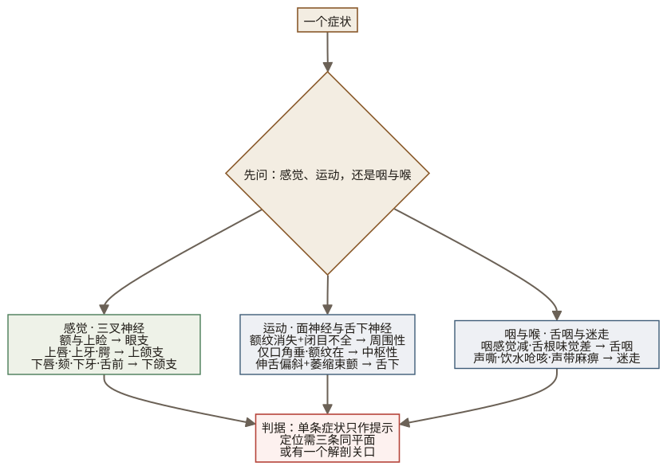
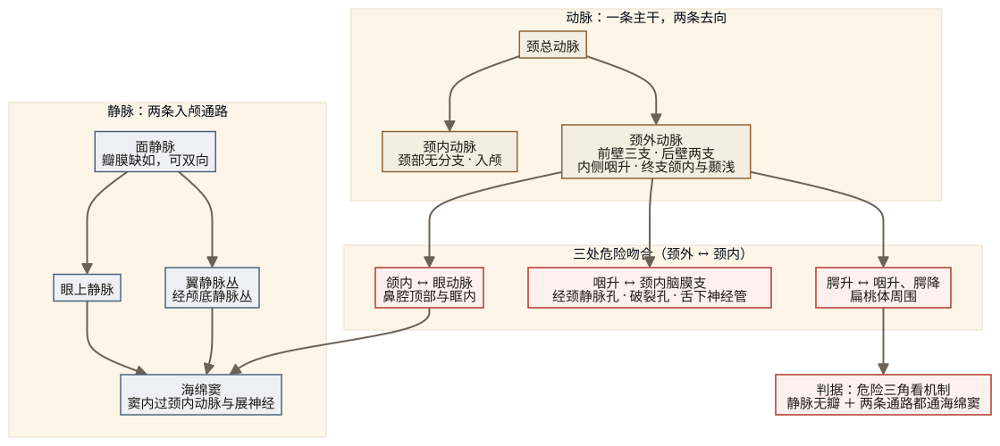

# 第 6 章 · 神经与血管支配

> **层次**：本文件是**撰写层**——以课程第 6 章教学材料（`06-e16`，12 单元）中脑神经出脑部位、内脏神经、硬脑膜窦与脑的血管四段为参照，按头颈局部重写；颅神经分区、颈外动脉分支次序、危险吻合与海绵窦通路为本章按通行解剖学补写，条条标明来处。
> **本章要回答的问题：** 「半边脸麻」「嘴歪了」「喝水呛」「伸舌偏」——四句话听起来一样模糊，指的却是四条不同的神经、四个不同的平面。解剖学在这里的任务不是背十二对神经，是给症状配一条可追的线。
> **覆盖：** 课程第 6 章；四个四级单元 01.06.01.01–01.06.02.02，分属「颅神经」「血管」两节。
> **真源状态：** 课程正文第 6 章为神经系统总论，与章题只部分对应：脑神经出脑部位、内脏神经的节前节后、硬脑膜窦与脑动脉来源可取而用之；头颈局部的分支与吻合为本章补写。
> **引用口径：** 不给神经阻滞的进针点与药量，不给血管结扎平面与造影参数；须给数处写「按所在规范，本章不给」。图全部自绘。

---

## N.1 概念与出处

头颈的神经血管看起来密，其实只有五条线。**感觉一条横线**：三叉神经三支，把面部分成三层皮；**运动一条横线**：面神经五组分支，把表情肌分成五区；**咽与喉一条纵线**：第九、第十对从颅底管到声门；**舌一条单独的线**：第十二对只管舌肌；**血管一纵两汇**：颈总分颈内、颈外，颈内入颅、颈外供面，静脉则有两个「汇」——面静脉与翼静脉丛，各自通海绵窦。

| 概念 | 出处 | 一句定义 |
|---|---|---|
| 三叉神经三支 | 课程 6.105、6.107 | 眼支、上颌支、下颌支，分管面上、面中、面下三层的一般感觉；下颌支另带咀嚼肌运动 |
| 面神经五支 | 本章补写 | 颞、颧、颊、下颌缘、颈五组，支配表情肌；另有副交感纤维管泪腺与唾液腺 |
| 舌咽神经 | 课程 6.105 | 管咽与扁桃体的一般感觉、舌后三分之一的味觉、腮腺分泌、颈动脉窦与颈动脉体 |
| 迷走神经 | 课程 6.105、6.110 | 经咽丛管咽肌，经喉上神经与喉返神经管喉的感觉与运动 |
| 舌下神经 | 课程 6.105 | 支配全部舌内肌与舌外肌（腭舌肌除外）；使舌前伸的颏舌肌归它 |
| 颈外动脉 | 本章补写 | 供面颈部与硬脑膜，分支按前壁、后壁、内侧、终支四组记 |
| 危险吻合 | 本章补写 | 颈外与颈内两系统之间的吻合通路；出血可跨系统，感染与瘤栓可循之入颅 |
| 面静脉无瓣 | 本章补写 | 面部静脉瓣膜缺如或不全，血流可双向；这是「危险三角」的机制 |
| 海绵窦 | 课程 6.111 | 颅底的硬脑膜窦，接受眼静脉与翼静脉丛的血，经岩上窦、岩下窦回流 |

**一条不能混的界线先立在这里：一般感觉与味觉是两套纤维。** 舌前三分之二的触痛温归下颌支，味觉归面神经；两者同行一段、各归各账，所以能分开损伤。同理，面神经里同时跑着躯体运动与副交感两种纤维，损伤时可以只坏一种。

## N.2 颅神经：一个症状追一条神经

颅神经在头颈的价值不在编号，在分区。分区清楚，症状一落下来就指得到神经；分区不清，只能背口诀。

### 01.06.01.01 五·七·九·十·十二对的分区

**三叉神经（第五对）是面上感觉的总干线。** 它在颅内的三叉神经节分出三支，各经一孔出颅：眼支经眶上裂，上颌支经圆孔，下颌支经卵圆孔；三支在面部的末梢又各经一孔穿出骨面——眶上孔、眶下孔、颏孔，**三个孔几乎排在同一条垂线上**，都能摸到。

分区按这条线走。**眼支**管眶内、额部、上睑、鼻背与角膜；**上颌支**管下睑、鼻侧、上唇、上牙与上牙龈、硬腭与软腭、鼻腔与上颌窦黏膜；**下颌支**管下唇、颏部、下牙与下牙龈、口底、舌前三分之二的一般感觉，以及耳前与颞区皮肤。三支里只有下颌支带运动纤维，支配四对咀嚼肌以及下颌舌骨肌、二腹肌前腹、腭帆张肌、鼓膜张肌，所以「咬东西没劲」与「下巴麻」可以同出一条神经，「闭眼无力」则绝不归它。

**面神经（第七对）是面上运动的总干线。** 它出茎乳孔后进腮腺，在腺内分上、下两干，再分五组：颞支管额肌与上部眼轮匝肌，颧支管下部眼轮匝肌与颧部肌，颊支管颊肌与口周肌上部，下颌缘支管口角与下唇，颈支管颈阔肌。**五支「上下夹口」**：颞、颧在上，下颌缘、颈在下。

面神经最要紧的一条界线在核上。**面神经核上部接受双侧皮质核束，下部只接受对侧。** 上部管额肌与眼轮匝肌，下部管口周肌。所以核上（中枢性）病变只累及对侧下部——额纹在、闭眼全、口角歪；核或核下（周围性）病变则同侧上下一起瘫——额纹消失、闭目不全、口角下垂、鼻唇沟变浅。**「额纹还在不在」是这两类的分水岭**，依据就是这一句双侧与对侧。

**舌咽神经（第九对）管咽的上半与舌的后三分之一**：咽与扁桃体的一般感觉、舌后三分之一的味觉、腮腺分泌，还带颈动脉窦与颈动脉体的感受纤维。

**迷走神经（第十对）管咽的下半与整个喉。** 它经咽支加入咽丛管咽肌；经喉上神经分内外两支，内支穿甲状舌骨膜入喉管声门上感觉，外支到环甲肌；经喉返神经管其余全部喉内肌与声门下感觉。**喉返的行程左右不对称**：右侧绕锁骨下动脉，左侧绕主动脉弓，左侧路径更长，故左侧声带麻痹更常见。落到症状：声嘶、气息声、饮水呛咳、音域变窄。

**舌下神经（第十二对）只管舌肌。** 它经舌下神经管出颅，越过颈内、颈外动脉之间到达舌，支配全部舌内肌与舌外肌（腭舌肌除外）。一侧无力则**伸舌偏向患侧**；久之可见舌肌萎缩与束颤——**萎缩与束颤是核下损伤的标志**，核上损伤不出现。

| 症状 | 追到哪条神经 | 判据 |
|---|---|---|
| 额部与上睑麻木 | 三叉神经眼支 | 眶上孔出口，角膜反射传入同支 |
| 上唇、上牙、腭部麻木 | 三叉神经上颌支 | 眶下孔出口，与上牙列同侧 |
| 下唇、颏、下牙、舌前三分之二麻木 | 三叉神经下颌支 | 颏孔出口，与下颌牙列同侧 |
| 额纹消失、闭目不全、口角下垂（同侧） | 面神经（周围性） | 上下一起瘫，同侧 |
| 仅口角下垂、额纹保留（对侧） | 皮质核束（中枢性） | 只累及下部，对侧 |
| 舌前三分之二味觉减退 | 鼓索（面神经分支） | 一般感觉可正常 |
| 咽部感觉减退、舌根味觉差、咽反射弱 | 舌咽神经 | 同侧，扁桃体窝周围 |
| 声嘶、饮水呛咳、声带麻痹 | 迷走神经（喉返） | 左侧多见，声门位置偏移 |
| 伸舌偏向一侧伴舌肌萎缩 | 舌下神经 | 偏向患侧，核下征 |

> 【边界】这张表是索引，不是诊断。单一症状只能「提示」一条神经，**定位要靠组合**：第九、第十、第十一同侧受累提示颈静脉孔区；上颌支与下颌支同时麻木提示颅内段而非末梢；周围性面瘫伴耳痛与疱疹提示膝状神经节。平面判断属神经科与耳鼻咽喉科，本章只给「哪个症状归哪条神经」这一层。

**图注**：图以「一个症状」为起点，先分成三支：感觉支落到三叉神经三支与其出口，运动支落到面神经（含核上与核下的分水岭）与舌下神经，咽与喉支落到舌咽与迷走（喉返）。各支末端汇到同一条判据：单条症状只作提示，定位要靠同平面组合或一个解剖关口。读图顺序是**先定感觉或运动，再定左右，最后定平面**。出处：本章 §N.1 表与 §N.2。

## N.3 味觉与分泌：一条界沟，两套通路

第 5 章留了一个口子：界沟把舌背分成两半，两半的神经归属不同。味觉与分泌都走「搭车」结构：纤维借别的神经走一段，在神经节换元，再到腺体。

### 01.06.01.02 味觉与分泌的神经通路

**味觉分三段进、一段上。** 舌前三分之二的味蕾，纤维随鼓索走：鼓索在面神经管内发出，经鼓索小管进鼓室，穿岩鼓裂出颅，加入舌神经，再逆行回到面神经的膝状神经节，入脑干止于孤束核上部。舌后三分之一的味蕾随舌咽神经走，会厌与软腭、咽后壁的味蕾随迷走神经走，同样止于孤束核。三路汇到孤束核，再经丘脑腹后内侧核投射到岛叶与岛盖——**味觉的皮质代表区不在舌，在岛叶**。

这套「搭车」结构解释了两件事。**其一，味觉与触觉可以分开损伤**：舌前三分之二的触痛温走舌神经本身，味觉走鼓索；鼓索在中耳内的一段最易受牵连，故「舌前味觉减退而触觉正常」是鼓索受损的组合，反过来「舌前麻木而味觉正常」则指舌神经本身。**其二，味觉丧失可以是单侧的**：鼓索与舌咽都是一侧走一侧，故单侧味觉障碍有定位意义；「全口无味」多提示黏膜或中枢问题。

**分泌通路四条，每条都是「两级神经元加一个神经节」。** **泪腺**：面神经的副交感纤维自膝状神经节发出，成岩大神经，穿翼管成翼管神经，到翼腭神经节换元，借上颌神经的颧神经与泪腺神经到腺。**鼻与腭的腺体**：同一段岩大神经，经翼腭神经节后随鼻后支与腭神经分布。**下颌下腺与舌下腺**：鼓索的副交感纤维随舌神经到下颌下神经节换元，节后纤维到两腺。**腮腺**：舌咽神经经鼓室神经到鼓室丛，成岩小神经，到耳神经节换元，节后纤维搭耳颞神经到腺。

**全章最容易记错的一处在腮腺：味觉归七，腮腺归九。** 面神经管下颌下腺与舌下腺，不管腮腺；管腮腺的是舌咽。记错的原因通常是「面神经管面部」这句顺口话——面神经管的是面部的肌与两个腺，不是三个。

交感的分工在「质」不在「量」。颈上神经节的节后纤维随血管到各腺，使分泌变黏稠、血管收缩；副交感使分泌量多而稀。**黏而少，是交感占优；稀而多，是副交感占优。** 这一条接着第 5 章的口干四步：静止时口干而黏膜发黏者，先想腺体实质与小涎腺，再想自主神经失衡；进食时口干者，先想腮腺的导管与分泌。

反射弧把线闭合：口腔内的机械与化学刺激作用于味蕾与黏膜感受器，传入孤束核，再连上涎核与下涎核，由上述四条通路传出。

## N.4 血管：一条主干，两个汇

头颈的血供比神经简单：一条主干分两支，一支入颅、一支供面；静脉没有主干，面上部的血可走两条路进颅。**动脉看分支次序，静脉看通路方向。**

### 01.06.02.01 颈外动脉分支与危险吻合

颈总动脉在甲状软骨上缘附近分为颈内与颈外。**颈内动脉在颈部不给任何分支**，直上入颅，供脑与眼；**颈外动脉自下而上发八支**，按位置分四组记。

**前壁三支，自下而上**：甲状腺上动脉（向下，供甲状腺上部与喉上）、舌动脉（在舌骨舌肌深面入舌）、面动脉（在咬肌前缘越过下颌骨下缘，迂曲上行至内眦）。**后壁两支**：枕动脉与耳后动脉。**内侧一支**：咽升动脉（沿咽侧壁上行，供鼻咽、咽鼓管、鼓室与脑膜）。**终支两支**：颌内动脉（经颞下窝）与颞浅动脉（上行于耳前，供颞部与头皮）。

面动脉迂曲，为绕过下颌骨、口角与鼻翼，留出余量。所以面部血供「多源、多吻合、可代偿」：一处出血，来源可能不止一个。

颌内动脉的分支要单独记一组，因为它们是「跨系统」的接头：脑膜中动脉经棘孔入颅，供硬脑膜；下牙槽动脉入下颌孔，供下颌牙与颏部；上牙槽后动脉与眶下动脉供上颌后部与上牙；腭降动脉下行，成腭大、腭小动脉，供硬腭与软腭；蝶腭动脉经蝶腭孔入鼻腔，供鼻甲与鼻中隔后部。

**危险吻合有三处，危险方式各不相同。**

**其一，颌内与眼动脉在鼻腔与眶内吻合。** 蝶腭动脉的分支向上与筛前、筛后动脉（眼动脉分支，属颈内系统）在鼻腔顶部与筛窦吻合；眶下动脉与泪腺动脉在眶内吻合。所以**鼻后部与鼻腔顶部的出血可以来自颈内系统**：结扎颈外或填塞前部无效，原因不是技术，是解剖——出血的那一端挂在颈内上。第 3 章讲利特尔区说的是前部，这里是后部与顶部：跨系统的那一端，从颈外换成了颈内。

**其二，咽升与颈内在颅底吻合。** 咽升动脉的脑膜支经颈静脉孔、破裂孔、舌下神经管上行，与颈内动脉的脑膜支、椎动脉的肌支吻合。**这几条孔道是「颈外通颅内」的实体通路**，也是鼻咽部病变、咽旁间隙感染可以入颅的基础。咽升细、位置深、吻合通颅内，故称最危险的一支。

**其三，腭升与咽升、腭降在扁桃体周围吻合。** 腭升动脉沿咽侧壁上行，供扁桃体与软腭，与咽升、腭降的分支交织。扁桃体周围的出血很少是「一根血管的事」。

> 【边界】「危险」在本章只有三种含义：出血来源不止一处、感染与瘤栓可循血管入颅、局部压迫难以控制。本章不写处理：不写结扎平面、填塞材料、栓塞参数。解剖学能说清「为什么危险」，处置属耳鼻咽喉科与介入科。

### 01.06.02.02 静脉回流与海绵窦通路

面部静脉与四肢静脉有一个根本差别：**瓣膜缺如或不全，血流可双向。** 它是面部感染能进颅的前提之一。

面上的血有两条入颅通路。**第一条，经眼**：面静脉起自内眦静脉，与眼上静脉交通，眼上静脉向后经眶上裂入海绵窦。面静脉向下汇入下颌后静脉或颈内静脉——**同一支静脉，向上通颅、向下通颈**，方向由压力决定。**第二条，经翼丛**：翼静脉丛位于颞下窝，收面深部的血，经卵圆孔、破裂孔的静脉丛通海绵窦，向下汇入下颌后静脉；面静脉与翼丛之间又借面深静脉相通。所以颊部、颞下窝甚至牙槽区的感染，都有第二条路可走。

**海绵窦是面上静脉的总汇。** 它接受眼上静脉、眼下静脉、蝶顶窦与大脑中浅静脉，向前经眼静脉通面，向后经岩上窦通横窦、经岩下窦通颈内静脉。窦内有颈内动脉与展神经通过——**窦内的结构决定了两个标志性表现**：静脉回流受阻（眼睑与结膜水肿、眼球突出）与展神经麻痹（眼球外展受限）。

**「危险三角」的判据不是形状，是机制。** 习惯的画法以鼻根与两口角为界，但边界历代说法不一，画法各异。真正决定危险的是两件事：静脉无瓣，以及面静脉与眼上静脉、翼静脉丛两条通路都通海绵窦。故本书的用法是：**三角只作教学提示，判据写「无瓣加两条通路」。** 见鼻根、上唇、鼻翼的感染，该想到的不是「不能碰这个三角」，而是「这里的血可以向上走」。

颅内外静脉还有第三条通路，常被漏掉：**导静脉**。顶导、乳突导、枕导静脉穿颅骨孔，把头皮静脉与硬脑膜窦直接连起来。所以头皮与乳突区的感染也能入颅，路不必经过面部——**这也是乳突炎并发乙状窦血栓形成的解剖基础**（与第 2 章中耳一节对读）。

**图注**：图上半是动脉：颈总分颈内（入颅、颈部无分支）与颈外（前壁、后壁、内侧、终支四组），中间一排是三处危险吻合——颌内与眼动脉、咽升与颈内脑膜支、腭升与咽升及腭降。图下半是静脉两条入颅通路：面静脉经眼上静脉入海绵窦，翼静脉丛经颅底静脉入海绵窦，两条都因**无瓣**而可双向。读图要点：动脉看分支从哪发出，静脉看血往哪里流。出处：本章 §N.1 表与 §N.4。

## N.5 争议与本项目立场

**争议一：「危险三角」的边界。** 一派以鼻根与两口角为界，一派以眉间与鼻翼为界，还有一派主张废除这个说法。本项目取第三条的实质、保留前两条的名字：**名可留，界不必争，判据换成机制。**

**争议二：面神经分支的命名与数目。** 五支是通行教学分法，实际变异多，颞支与颈支的数目尤不恒定。本项目取五支用于记录与沟通，**不用于断定手术平面**——平面看的是神经与腺体的层次，不是分支名称。

**争议三：「一个症状对应一条神经」的教学价值。** 这张表省力，也危险：容易让人把「麻木」直接读成「某神经病」。本项目取中间：**症状表是索引，组合与平面才是判据。** 单条症状只允许「提示」，定位要三条以上同平面，或有一个明确的解剖关口（眶上裂、圆孔、卵圆孔、茎乳孔、颈静脉孔、舌下神经管）。

**本项目立场三条。** 其一，不写神经阻滞的进针点、深度与药量，不写血管结扎平面与栓塞材料。其二，不写神经与血管的直径、长度与血流参数；须给数处一律「按所在规范，本章不给」。其三，图与表只表达「归属」与「方向」，不表达「概率」与「预后」——**解剖学给的是地图，不是路况。**

> **免责声明：** 本章为教学材料，不构成诊断或治疗建议。文中的神经分区、血管分支与危险吻合只用于建立判断框架；一切检查、用药与处置，须由具备资质的执业人员依现行规范与所在机构制度作出。突发面瘫、单侧声嘶、饮水呛咳、面部感染伴眼睑水肿或眼球突出者，须及时经耳鼻咽喉科、神经科或口腔科检查，不在此框架内自行判断。本章不给剂量、不给疗程、不含研究数据与疗效结论。

## 思考题

1. 「舌前三分之二味觉丧失而触觉正常」提示哪一条纤维受损？请从「搭车」结构说明这两类纤维为何能在同一区域分开损伤，并指出该纤维最易受损的一段在哪里。
2. 一位患者右侧额纹消失、闭目不全、口角下垂。请判断是周围性还是中枢性面瘫，并写出支持这一判断的解剖界线。
3. 鼻后部出血在填塞与结扎颈外动脉后仍未止，从危险吻合解释可能的原因；并说明为什么「危险三角」的判据应写作「静脉无瓣加两条通路」，而不是三角的形状。

## 延伸阅读

- 课程正文第 6 章（`departments/08-wuguan/01-erbihou-jiepou-shengli/chapters/06-e16/docs/zh.md`）6.105、6.107、6.110、6.111、6.113 五段——脑神经出脑部位、内脏神经的节前节后、硬脑膜窦与脑的动脉来源，本章神经与静脉部分以此为据。
- 《系统解剖学》，脑神经章与头颈部血管章——三叉神经三支的出口、面神经的分支、颈外动脉的八支次序可与之对读；只标章目，不引页码与图表。
- 《口腔颌面外科学》，颌面部神经疾患章与口腔颌面部感染章——面瘫的定位、危险三角的临床处置可与之对读；只取解剖依据，不引处置方案。
