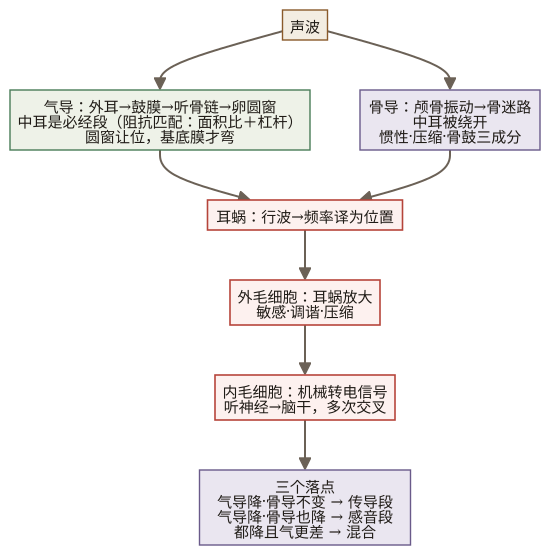
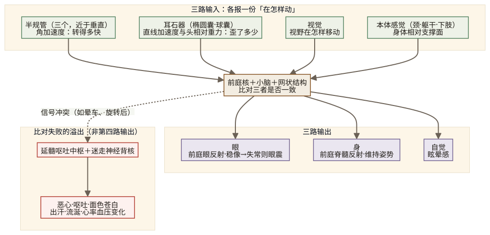

# 第 7 章 · 生理功能与免疫

> **层次**：撰写层。按课程第 7 章章题重写为教材体，不搬运占位稿脚手架，不引页码、不称引文。
> **本章要回答的问题**：一个结构「在做什么」，凭什么能被说清？——因为功能可以拆成一条通路、一串环节、一个闭环。拆得开，就能从症状反推是哪一段出了事；拆不开，就只剩「耳背」「鼻塞」「晕」这几个词。
> **覆盖**：声传导与感音、平衡三系统、鼻的调温调湿过滤、嗅觉与鼻周期、发声与吞咽、黏膜免疫与咽淋巴环；六级单元 01.07.01.01–01.07.03.02，分属「听觉与前庭」「鼻的生理」「咽喉与免疫」三节。
> **真源状态**：课程正文 `departments/08-wuguan/01-erbihou-jiepou-shengli/chapters/07-e17/docs/zh.md`（4,292 汉字）的骨架实为病因病机，与本章章题不对应；本章只取其脏腑归属与清窍关系（收进 N.4），其余按通行解剖生理学重写。外源课件未取得正文，不引。
> **引用口径**：凡属「给不出的数」一律写明不给——本书不写生理常数、听力级、声导抗判读界限与器械参数；说「增强」「减弱」时只说方向，不说倍数。
> **免责**：本章为教学材料，不构成诊断或处置建议；功能判断以专科检查与所在机构规范为准。

---

## N.1 概念与出处：七个词

生理学最容易被写成形容词表。形容词不能反推，故先用七个词换成通路。

| 概念 | 依据 | 一句定义 |
|---|---|---|
| 声阻抗匹配 | 声学 | 空气与内耳淋巴的声阻抗相差悬殊，中耳把低压大声压换成高压小位移；缺这一步，声能大半在界面被反射 |
| 气导 | 听力学 | 声波经外耳、鼓膜、听骨链、卵圆窗入耳蜗；中耳是必经段 |
| 骨导 | 听力学 | 颅骨振动直接带动骨迷路、再由淋巴推动基底膜；中耳大部分被绕开 |
| 耳蜗放大 | 耳蜗生理 | 外毛细胞随声受激主动伸缩，对基底膜振动做正反馈，使弱声被放大、调谐变锐 |
| 前庭三系统 | 平衡生理 | 前庭、视觉、本体各报一份「头与身体在怎样动」，中枢比对是否一致；平衡是比对的结果 |
| 鼻周期 | 鼻生理 | 两侧鼻甲海绵组织交替充血，一侧阻力升高时另一侧降低，总阻力大致不变 |
| 黏膜免疫 | 免疫学 | 黏膜表面的局部防御，以分泌型 IgA 为主要效应分子，独立于全身免疫 |

七条共用一个句法：**一段路、一个变量、一个可被单独替换的环节。**

### 01.07.01.01 声传导与感音

声波到耳蜗有两条路。气导经耳廓、外耳道、鼓膜、听骨链、卵圆窗入耳蜗，中耳是必经段；这一段不可省：空气声阻抗远低于淋巴，声波直射淋巴界面大半被反射。中耳做**阻抗匹配**——鼓膜有效面积大于卵圆窗，同样的力压在更小面积上、压强被提高，听骨链杠杆再补一份；面积比与杠杆比随个体与测量方法而异，本书不给数。

骨导经颅骨振动直达骨迷路，由淋巴推动基底膜，中耳大部分被绕开。它分三类：惯性骨导（听骨链惯性滞后，镫骨相对卵圆窗有位移）、压缩骨导（颅骨受压变形，挤动淋巴）、骨鼓骨导（经外耳道空气再走一次气导）。于是骨导成了一次**把中耳这个变量移出去的对照实验**，判据三句：气导降而骨导基本不变，差额在中耳或外耳，即**传导段**；气导降、骨导也降且不优于气导，说明中耳被绕开后仍不正常，病变在**耳蜗或听神经**，即感音段；两者都降而气导更差，两段都有。第一种临床叫 Rinne 阴性——不是骨导变强，是气导掉下去、骨导留在原处，一比较就反了。故本章不把「骨导短路」当结论，只当它的操作含义：**骨导把中耳从等式里划掉，剩下的差额才归内耳。**

**感音的核心是耳蜗的「主动」。** 声波在基底膜上形成行波，从底向顶走，在与频率对应的位置振幅最大——频率被翻译成位置。外毛细胞随声受激而缩舒，把能量回注基底膜，在峰值附近局部放大，即**耳蜗放大**；它使弱声被抬到可感受的水平（敏感性），使频率选择性在窄带内变锐（调谐），并把很宽的输入压在较窄的放电变化里（压缩），人才可能同时听清耳语与喧哗。外毛细胞受损，三样一起丢：阈值升高、调谐变钝、压缩失效；最后一条即**重振**——稍大就嫌吵，稍小就听不见，中间那段被压没了。真正的感受细胞是内毛细胞，绝大多数传入纤维与它相连；故外毛细胞先坏时阈值可只轻度升高，患者却先在噪声里听不清。上行通路在脑干多次交叉，**故单侧中枢病变几乎不产生单侧全聋**。

**图注**：气导与骨导两条并行路径，交汇于耳蜗；气导以中耳为必经段，骨导绕开中耳。右侧「三种差额」三个框即三个落点（传导段、感音段、混合）。出处：本章 §N.1、§01.07.01.01；读图要点是「骨导是一次对照」。

### 01.07.01.02 平衡三系统

平衡不是一种感觉，是三种感觉的比对结果。

**前庭。** 半规管三个，大致互相垂直，感受**角加速度**：头一转，管内淋巴因惯性滞后，推动壶腹嵴顶，毛细胞纤毛弯曲、放电增减。耳石器两个（椭圆囊、球囊），内有耳石膜，感受**直线加速度与头相对重力的位置**：耳石比周围结构重，头一倾它就滑一点，剪切毛细胞。**半规管答「转得多快」，耳石器答「歪了多少」**——两问不同，检查也分两类。

**视觉与本体。** 头动时前庭驱动眼球反向等速转动、稳住视网膜像，即前庭眼反射，走脑干三神经元弧。肌梭与关节感受器报「身体相对支撑面在怎样」——它慢，但站立时只有它能报「地在哪里」。三路进前庭核，与小脑、网状结构比对，另有三路出去：**眼**（稳像）、**身**（姿势）、**自觉**（眩晕）。故前庭出事，表现必是三份：眼震、站不稳、天旋地转。

**「眩晕为何伴恶心」的入口在此。** 中枢把三路不一致当成坏事。较通行的解释是：演化上能造成「所见与所感不符」的常见原因是摄入毒物，于是这套回路把冲突信号直接接到延髓呕吐中枢与迷走神经背核——恶心、呕吐、面色苍白、出汗，一整套「排毒」反应被启动。同一套反应也解释晕车与旋转后为何同样恶心。这是假说，但有用：**恶心不是胃的病，是感觉冲突的附带输出**；止吐药压得住症状，消不掉冲突。

判据两条。**其一，眩晕与头晕不是同义词**：「天旋地转」指向前庭性，「头重脚轻」多指向本体、循环或中枢整合。**其二，代偿本身就是证据**：单侧前庭损失后，中枢靠小脑与前庭核的可塑性把静息放电的不平衡重新校准；代偿靠视觉与本体两路替代，故**闭眼、暗处、软地面、快速转头时症状重现**——这不是「病又犯了」，是代偿被撤掉了支撑。

**图注**：上排三路输入，中排前庭核与小脑的比对，下排三路输出（眼动、姿势、自觉）与一条旁支（自主神经）——旁支即恶心、呕吐、出汗的来源，是「比对失败」的溢出。出处：本章 §01.07.01.02。

## N.2 鼻的生理：三个动作与一条周期

鼻的功能常被压成一句「通气」。通气只是结果，前面有三个动作，后面有一条周期；三个动作串联，断在哪一环，症状就长在哪一环。

### 01.07.02.01 调温·调湿·过滤

**先说通道形状。** 鼻腔不是直管：鼻阀先限流，气流分成层流与湍流，贴鼻甲走的那层慢、接触面积大，中央那股快、带涡流。鼻甲不是为了「堵」，是把气流按到黏膜面上：接触面积与接触时间，是调温调湿的两个乘数。鼻甲切除过多则通气好了、调温调湿变差。

**调温与调湿是一件事的两面。** 鼻黏膜血管极丰富，鼻甲内有海绵状静脉丛，可盈可缩：冷空气进来，黏膜血流增加、表面温度升高，把热量交给空气；同时静脉丛充盈使黏膜增厚、通道变窄、气流变慢，接触时间变长；两个动作同向。到鼻咽部时空气已接近体温——不给数，它随环境温湿度、气流与个体状态变。腺体与杯状细胞持续分泌，在表面形成黏液毯，气流带走水汽、黏膜以分泌补上，到声门下时接近饱和；饱和比温度更要紧，下气道的纤毛需要湿润，干燥空气直接进去，纤毛先停摆。

**过滤分三层。** 鼻毛拦大颗粒；黏液毯粘住中颗粒；纤毛协调摆动把黏液连同颗粒推向鼻咽、咽下，即**黏液纤毛清除**。方向单向，故「鼻涕倒流」一直在发生，量少而不自觉，多到被觉察才成症状。黏液里还有溶菌酶与分泌型 IgA，属「灭活」而非「过滤」（见 01.07.03.02）。

**三者合起来就是「鼻腔对下气道调节」**：鼻腔阻力占气道总阻力主要份额，故鼻塞不只是不舒服，是呼吸做功增加、睡眠时吸气负压增大；口呼吸绕过全部三个动作，故口干、咽干、晨起咽痛接踵而来。鼻腔受刺激又经三叉神经引起喷嚏、鼻肺与鼻心反射——鼻与下呼吸道是一条反射弧的两端。

### 01.07.02.02 嗅觉与鼻周期

**第一件事是位置。** 嗅黏膜只占鼻腔一小块（上鼻甲内侧面及其对应的鼻中隔上部），不在主气流道上，而在嗅裂这条窄缝里。由此得嗅觉的第一个条件：**气流必须到得了嗅区**；用力嗅，就是人为加大那一小股「嗅样气流」。

**第二件事是嗅细胞的身份。** 它是双极神经元：树突末端纤毛伸入黏液，轴突汇成嗅丝穿筛板止于嗅球。它**既是感受器又是传入第一级**，中间没有第二个细胞。更要紧的是中枢去向：嗅球→嗅束→梨状皮层、杏仁核、内嗅皮层，**不经丘脑**。三个后果：与情绪记忆的联结特别紧（杏仁核与海马就在旁边）；能绕过丘脑直接影响内脏与内分泌；嗅丝穿筛板，是颅内与鼻腔之间唯一以神经纤维相连的通道，故筛板缺损时脑脊液可经鼻流出。

**第三件事是障碍的两分法，与气导/骨导同构。** 气味到不了嗅区（鼻塞、息肉、鼻中隔偏曲、肿瘤阻塞嗅裂）是**传导性**；嗅细胞、嗅丝或中枢坏了（病毒感染后、头外伤、神经退行性变）是**感觉性**。鉴别看一条：传导性者通畅后嗅觉回来，感觉性者再通也不回来——与 01.07.01.01 同一逻辑：**先问「路是不是被挡」，再问「器件是不是坏了」。**

**鼻周期。** 两侧鼻甲海绵组织交替充血：一侧充盈、阻力升高，另一侧收缩、阻力下降，隔时互换；总阻力大致恒定，故本人多不自觉，分别测才看得见。周期以小时计，随体位、运动、激素状态变，本书不给数。**鼻中隔偏曲与慢性鼻炎者主诉「交替性鼻塞」，一半是鼻周期被放大了**——本来不觉的交替，因一侧基础阻力已高，另一侧再一充盈就越过了感受阈。故**见双侧鼻甲不大者先想鼻周期，别急着按慢性鼻炎处理。**

## N.3 咽喉：一条管道的三种用途

咽与喉共用一条通道，却要做三件互不相容的事：呼吸要开、发声要闭、吞咽要闭合并上提。生理学的任务不是把三件事都说一遍，是说清它们**怎样在时间上错开**。

### 01.07.03.01 发声与吞咽

**发声是三件事的乘积：动力、振动、共鸣。** 动力来自呼吸，声门下压即发声的电源：气压不足则声音弱而气声重，过大则声带被冲开、音质变糙。故发声训练的第一课是「练呼吸」而非「练嗓子」。

**振动在声带，而声带不是一根弦。** 它分三层：上皮与固有层浅层（Reinke 间隙）为**被覆层**，固有层中层即声韧带为**过渡层**，声带肌为**体层**。三层硬度不同，气流一吹，被覆层在体层上形成**黏膜波**——波沿声带边缘行进，不是整块组织来回摆。这个分层是嗓音医学的地基：病变累及被覆层（水肿、息肉、小结），黏膜波受阻，声音变糙变哑；累及体层（瘢痕、肿瘤浸润），振动本身被限制，后果更重。音调由声带张力与振动长度定，响度由声门下压定，音色由共鸣腔形状定。

**吞咽分四期，各期有各期的失败方式。** **口腔准备期**：咀嚼、与唾液混合成食团，失败表现为含在嘴里不咽、漏到一侧。**口腔期**：舌把食团后推、触发吞咽反射，失败表现为推不动或提前漏入咽部，后者是误吸的前奏。**咽期**是全部风险所在，以秒计的极短时间里顺序极严：软腭上抬封闭鼻咽→喉上抬前移→会厌下翻盖喉口→声带闭合→咽缩肌依次收缩→环咽肌松弛让食团入食管；任一步慢半拍，食团就可能在喉口敞开时经过。**食管期**属消化道，本章不展开。

**保护有四道**：会厌、声带闭合、喉前庭感觉、咳嗽反射；最易被低估的是第三道。喉前庭黏膜感觉末梢丰富，食团触到即触发闭合与咳嗽；感觉减退时，误吸可以**没有呛咳**，即**无声误吸**。它的危险正在于安静：家属说「他喝水不呛」不等于安全，声音变湿、餐后低热、反复肺部感染都可能是痕迹。

**一条判据收尾：呼吸、发声、吞咽在时间上互斥**——说话到一半要吞口水须先停声，吞咽到一半要咳嗽须先清食团——是结构决定的冲突，不是「不小心」。

### 01.07.03.02 黏膜免疫与咽淋巴环

**黏膜免疫是一套独立体系。** 全身免疫靠淋巴结与脾，黏膜免疫靠黏膜相关淋巴组织（MALT）：鼻、咽、支气管、肠相关——入口要的是就地拦截，不是先发炎再免疫。

**咽淋巴环是这套体系在咽喉的实体。** 一圈淋巴组织围住呼吸道与消化道的共同入口：咽扁桃体（腺样体，鼻咽顶后壁）、咽鼓管扁桃体（咽鼓管咽口周围）、腭扁桃体（口咽两侧）、舌扁桃体（舌根）与咽后壁淋巴滤泡。**它们围成一个环，环的中心是鼻咽与口咽的交界——食物与空气在这里分道。** 位置本身就是功能：把哨卡设在分流口，是解剖上的合理。扁桃体的隐窝扩大表面积、让更多抗原接触淋巴组织，但也是死腔：脱落上皮与残渣积聚、引流不畅，故它同时是反复感染与周围脓肿的起点。

**效应分子主要是分泌型 IgA。** 浆细胞产生的二聚体 IgA 经上皮转运入黏液层成为 sIgA，就地拦截病原而不引发炎症——黏膜免疫的取向是**在门口解决，不惊动全身**；故其强弱不在血里滴度，而在分泌液里。这也解释了「反复感冒」儿童为何查免疫球蛋白可以正常。

**黏膜屏障是四层**：黏液纤毛层（清除）、上皮紧密连接（封闭）、抗菌肽与溶菌酶（灭活）、sIgA 与 T 细胞（特异性免疫）。任一层弱都表现为「容易感染」，但处置方向不同：纤毛不动要促排，屏障破要修复。**把四层压成一句「免疫力低」，等于放弃定位。**

**腺样体最值得单讲。** 幼儿期相对最大、随年龄萎缩——这是生理过程，不是病；但它正对后鼻孔与咽鼓管咽口。于是肥大产生一条后果链：阻塞后鼻孔→鼻塞、张口呼吸、睡眠打鼾；压迫咽鼓管咽口→中耳通气受阻→分泌性中耳炎；长期张口呼吸→颌面发育改变（腺样体面容）；鼻塞又使鼻的调温调湿过滤被绕过（回到 01.07.02.01）。**一条链五个后果，源头是一个位置**——「结构—功能—症状」的完整示范。免疫与过敏是同一套机制的两面，故本章不把免疫写成「越强越好」：目标是**恰当**。

## N.4 与相邻学科的接口

**耳。**「肾开窍于耳」「肾气通于耳，肾和则耳能闻五音」（《灵枢·脉度》）把听觉归到肾精充养。可用之处在慢性、渐进、与年龄相关的听力下降：提示把全身状态纳入考虑。不可用处也要说清：它不描述耳蜗放大、不描述阻抗匹配，不能解释「为什么气导比骨导差」。**「肾虚耳鸣」是证候判断，「外毛细胞受损」是机制判断，两者可并列记录，不能互相翻译。**

**鼻与咽喉。**「肺开窍于鼻」把调温调湿过滤与肺的宣发肃降连成一条线：肺气足则鼻窍通利，虚则鼻塞、喷嚏、遇风冷加重。这条线临床好用，但它是功能归属而非机制；卫气「温分肉」与鼻黏膜血流有现象对应，却不是同一层语言。「咽喉为肺胃之门户」与解剖吻合最好：咽确是消化道与呼吸道的共同段，喉确是气道的门——「十字路口」与「门户」是同一件事的两种说法。

**脾胃与经络。**「脾主升清」「清阳出上窍」把上窍得养归到脾的升举，对应到生理是黏膜的营养与修复；界限同前：可说「脾虚者黏膜修复慢」，不能说「脾主黏膜上皮」。经络所过给的是定位，不是机制。

## N.5 争议与本项目立场

**一、骨导是不是「绕开中耳」。** 通行简化学说如此，但骨导的惯性成分恰依赖听骨链的惯性，中耳病变对骨导有轻度影响。本项目写成「骨导把中耳的变量大部分移出」，不写「完全绕开」。

**二、耳蜗放大与眩晕的机制解释。** 外毛细胞的电致运动与纤毛束的主动运动各占多少仍有争论，「耳蜗放大器」是功能性说法；「眩晕伴恶心」的毒素假说解释力强，却属演化假说、无法直接验证。两者在本项目都只讲到「较通行的解释」，不作定论。

**三、鼻周期与扁桃体的价值。** 鼻周期的意义两说并存，不选边；扁桃体该不该切，一方重其免疫，一方重其病灶，本项目不给指征与年龄界，只给判据方向：**问「这个扁桃体在造成什么」，而不是「它有没有免疫功能」**——有功能不等于该留，有病灶不等于该切。

> **免责声明：** 本章为教学材料，不构成医学意见、诊断或处置指导。文中的功能描述只到通路与环节，不含生理常数、听力级与判读界限；检查与处置以现行规范与所在机构制度为准。

## 思考题

1. 一位患者左耳气导下降、骨导正常，右耳气导骨导均下降。两耳病变各最可能落在哪一段？「骨导正常」为什么能起定位作用——它排除了什么变量？
2. 声带息肉与声带白斑都长在声带上，为什么前者主要影响音质、后者必须优先排除恶性？请用被覆层—过渡层—体层的分层回答，并说明黏膜波的角色。
3. 家属说「老人喝水从不呛」，你凭什么仍要怀疑吞咽不安全？请写出三个追问点，并说明「无声误吸」的解剖生理基础。

## 延伸阅读

- 通行耳鼻咽喉科学教材中「耳的生理」「鼻的生理」「咽喉的生理」三章。——本章的声传导、耳蜗放大、鼻周期与吞咽分期按此重写，涉数值处留白。
- 听力学与嗓音医学教材中「声阻抗」「耳声发射」「嗓音病理」三节。——§01.07.01.01 的阻抗匹配与 §01.07.03.01 的黏膜波依此立论。
- 黏膜免疫学教材中「黏膜免疫系统」「分泌型 IgA」两章。——§01.07.03.02 的屏障四层与 sIgA 转运按此写。
