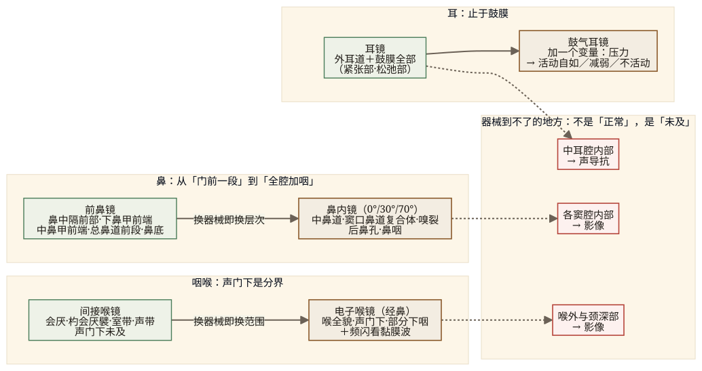
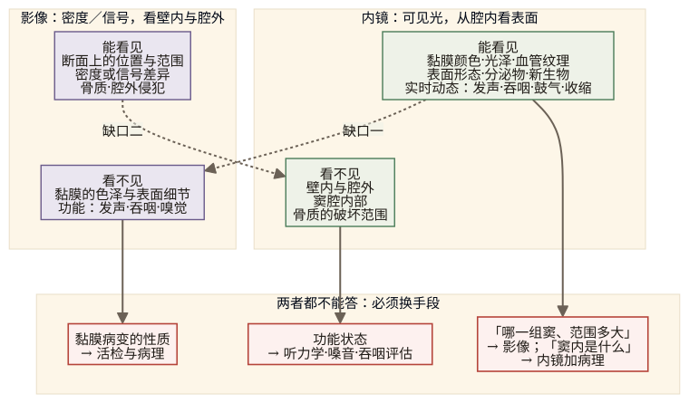

# 第 8 章 · 检查法与正常所见

> **层次**：撰写层。按课程第 8 章章题重写为教材体，不搬运占位稿脚手架，不引页码、不称引文。
> **本章要回答的问题**：每一项检查都在回答一个有限的问题——它能看到的，到底是哪一层？「未见异常」这四个字，在什么范围里才算数？
> **覆盖**：耳镜与鼓气耳镜、听力学三项、前鼻镜与鼻内镜、间接喉镜与电子喉镜、正常所见记录模板、内镜与影像的口径差异；六级单元 01.08.01.01–01.08.03.02，分属「耳」「鼻与咽喉」「记录」三节。
> **真源状态**：课程正文（13,463 汉字）的骨架是中医四诊、辨证与治法，属临床诊疗线，与本章「检查法与正常所见」不同线；本章只取其「望局部」的观察项（鼓膜、鼻黏膜、咽与声带之色，收进 N.4），检查方法与记录规范按通行做法重写。外源课件未取得正文，不引。
> **引用口径**：本书不给听力级阈值、声导抗分型判读界限、器械型号与参数；凡涉及数值处写「按所在机构规范」。正常所见只作描述模板，不构成诊断标准。
> **免责**：本章为教学材料，不构成诊断或处置建议；检查的适应证、禁忌与操作以所在机构规范与专科医师判断为准。

---

## N.1 概念与出处：五个词

检查学最容易被写成「器械清单」：耳镜、鼻镜、喉镜、听力计。清单不回答判据，故先用五个词把清单换成问题。

| 概念 | 依据 | 一句定义 |
|---|---|---|
| 可及范围 | 检查学 | 一件器械在解剖上能到达并看清的边界；范围之外不是「正常」，是「没看到」 |
| 所见层次 | 检查学 | 这项检查看到的是黏膜表面、腔道轮廓，还是壁内与腔外——层次不同，结论的类别也不同 |
| 正常所见 | 描述规范 | 在给定范围与条件下，按解剖顺序可逐项核对的一组描述，不是一个形容词 |
| 口径 | 记录学 | 一项检查的计量单位与方位约定：内镜用「部位＋形态＋相对大小」，影像用「断面位置＋密度＋测量值」 |
| 记录最小集 | 记录学 | 一份阴性记录必须写全的四项：范围、条件、所见、限度；缺一项，这条记录就不能被复核 |

五条串成一句话：**先问范围，再问层次，然后才谈所见；所见的写法由口径决定。** 全章按这个次序展开。

### 01.08.01.01 耳镜与鼓气耳镜

**可及范围。** 耳镜的光路止于鼓膜：能看到外耳道皮肤、耵聍、鼓膜的全部（紧张部与松弛部），看不到中耳腔；即便鼓膜穿孔，看到的也只是鼓室一角。

**正常所见按解剖顺序记六项。** 外耳道：皮肤完整，无红肿糜烂、耵聍堵塞与分泌物。鼓膜：半透明、珍珠灰色、有一定光泽。光锥：位于前下方，是光反射形成的三角，偏移或消失提示鼓膜内陷或增厚。锤骨短突与锤骨柄：短突在前上，柄斜向后下至脐，是判断鼓膜方位的两个地标。松弛部：鼓膜上缘一小块，薄而松弛，其内陷或穿孔比紧张部更需警惕。活动度：见下。

**鼓气耳镜加的是一个变量：压力。** 加密封帽，挤压球囊改变外耳道气压，观察鼓膜随之内外移动的幅度。它回答「鼓膜与中耳这套机械还灵不灵」：自如，说明中耳含气、鼓膜未固定；减弱，提示积液、增厚或粘连；不活动，提示中耳被液体或组织填满、或鼓膜已硬化。结论只到「自如／减弱／不活动」三档定性，不给量化分级——量化属声导抗的范畴（见 01.08.01.02）。

**三条边界必须记住。** 其一，**颜色不可靠**：婴儿哭闹、发热、擤鼻都可使鼓膜充血，单凭发红判断「中耳炎」会误诊；积液早期也可只呈淡黄或浑浊而不红。其二，**鼓膜正常不排除听力损失**：感音段的病变在耳蜗与听神经。其三，**方位比大小要紧**：松弛部与后上象限的内陷、糜烂、肉芽指向胆脂瘤一类问题，本书不给分级，只给「这个位置要转诊」。

**记录写法**：左、右耳分开写；依次记外耳道、鼓膜色泽与透明度、光锥、地标、活动度、穿孔（部位与大小用相对描述）、分泌物（性质与量）。不写「耳道通畅、鼓膜正常」了事：那六个字没有范围，也没有条件。

### 01.08.01.02 听力学三项：纯音·声导抗·耳声发射

三项常被当成「三个查听力的办法」，其实它们测的是三件不同的事。

**纯音测听**测的是**行为阈值**：给不同频率的声，记录受检者刚能听见的最小强度，分气导与骨导两条曲线。它给两类信息——**定性**（气骨导一致、气骨导差、两者皆降，对应感音、传导、混合）与**定量**（下降的程度，分级界限属听力学专科，本书不给）。它的前提是受检者能配合并如实反应，故儿童、疲劳、有意夸大者都会失真。

**声导抗**测的是**中耳的力学状态**，不需受检者回答：鼓室压图扫过外耳道压力，记录顺应性峰值出现在什么压力、峰值多高；镫骨肌反射测的是反射弧（传入→脑干→传出→镫骨肌）。它擅长回答「中耳有无积液、压力是否平衡、听骨链是否固定或中断」，对耳蜗与听神经几乎不提供信息；分型与判读界限属专科，本书不给。

**耳声发射**测的是**耳蜗外毛细胞的主动机制**：外毛细胞受声刺激后主动伸缩，产生可被耳道内微音器拾取的信号。能引出，说明耳蜗放大在工作；引不出，可能是外毛细胞受损，也可能是中耳传声受阻——解读前必须先排除中耳因素。盲区在蜗后：听神经病变时耳声发射可正常而纯音异常。

**三项必须合看：每一项都有结构性盲区。** 纯音气骨导差加声导抗异常，指向传导段；纯音气骨导同降、声导抗正常、耳声发射引不出，指向耳蜗；纯音异常而耳声发射正常、声导抗正常，就要想到蜗后。**单看一项，得到的不是「听力正常」，是「这一项正常」。**

**正常所见的写法**：纯音各频率阈值在正常范围、气导与骨导一致；鼓室压图峰值在零压附近、形态正常；耳声发射可引出且重复性良好。三句都要带条件（哪一侧、哪种探头、受检者配合程度），否则不可复核。

**图注**：图按耳、鼻、咽喉三组排开，每组箭头由浅入深，箭头终点即该器械的止点；虚线指向器械到不了、只能换手段的地方（中耳腔、窦腔内部、喉外）。凡止点之外，结论只能是「未及」。出处：本章 §N.1、§01.08.01.01、§01.08.02.01、§01.08.02.02；读图要点是每条线的**止点**，不是起点。

## N.2 鼻与咽喉：从「门前一段」到「全腔加咽」

鼻与咽喉的检查有一个共同的跃迁：器械一换，可及范围不是扩大一点，而是换了一层。

### 01.08.02.01 前鼻镜与鼻内镜

**前鼻镜**撑开鼻前庭，看到的是一段：鼻中隔前部、下鼻甲前端、中鼻甲前端、总鼻道前段、鼻底。它看不到中鼻道深部、嗅裂、后鼻孔，更看不到鼻咽。这不是操作不熟练，是几何限制：视线沿鼻前庭直线进入，被鼻甲挡住的部分永远在暗处。

**正常所见**：黏膜淡红、湿润、有光泽；下鼻甲不大、与鼻底间留有缝隙；中鼻甲前端可见、无息肉样变；鼻中隔居中、无棘突与嵴；总鼻道与鼻底无分泌物、无新生物、无出血点。

**鼻内镜换的是层次。** 硬管镜带 0°、30°、70° 视角，可越过鼻甲进入中鼻道、看清窦口鼻道复合体（中鼻道、半月裂、筛泡、各窦开口的相对位置），可上达嗅裂，可向后到后鼻孔与鼻咽（咽鼓管咽口、咽隐窝、腺样体）。**前鼻镜答「前部通不通」，鼻内镜答「引流区通不通、后鼻孔通不通」。**

**关键判据：两者都看不到窦腔内部。** 内镜能看窦口有无脓性分泌物溢出、推断该窦引流异常，但说不出是哪一组窦、范围多大、黏膜是水肿、息肉还是真菌块。**这一步必须交给影像**——即 01.08.03.02 的「口径差异」第一例。

**收缩试验：前鼻镜就能做的功能判断。** 用减充血剂喷布后复看：鼻甲明显缩小、通道打开，说明肥大以黏膜充血为主，可逆；缩小不明显，说明黏膜下已有纤维化或骨质肥厚，不可逆。同一个「鼻甲大」，两种结局，处置方向相反——这是把「形态所见」变成「功能判断」的最省事的一步。

**记录写法**：左右分记；鼻甲大小用「与鼻底」「与鼻中隔」的关系描述，不用毫米；分泌物的性质与**位置**（中鼻道、嗅裂、鼻底，位置比性质更能定位）；息肉记部位与单发／多发；黏膜记色泽与湿润度，不写「充血」了事（充血到什么程度、在哪个区）。

**边界**：鼻内镜是侵入性操作，需表面麻醉与收缩，注意出血、迷走反射与污染；本书不给器械参数与麻醉剂量。

### 01.08.02.02 间接喉镜与电子喉镜

**间接喉镜靠一面小镜子。** 镜面置于软腭后、悬雍垂前，借患者发「衣」音时会厌上抬、喉口敞开，从镜中看喉。可及：会厌、杓会厌襞、室带、声带、后连合，前连合常只能看到一部分。不可及：声门下、喉室深部，以及被会厌遮挡的喉前庭前部。

**方位要专门说一句。** 镜面所成的是反射像，方位读法与直视不同。故记录的规矩是：**只写解剖名称，不写「上下左右」**——写「左侧声带中段」不会错，写「上面那条」会错。

**电子喉镜换的是范围与时间。** 软管经鼻进入，可看清喉的全貌、声门下与部分下咽；配合频闪光源，还能看声带振动的**黏膜波**——这是功能信息，不是形态信息。形态上「光滑」的声带，黏膜波可以不对称；这正是嗓音检查要加频闪的理由。

**正常所见**：会厌形态正常、无红肿；杓会厌襞对称；室带不外翻、不肥厚；声带瓷白色、边缘光滑锐利、双侧对称；发音时闭合完全、无缝隙；吸气时外展充分；声门下黏膜光滑、无新生物；梨状窝无积液、无分泌物潴留（有潴留要想到下咽或食管的问题）。

**判据两条。** 其一，**间接喉镜「未见异常」不能排除声门下病变**——那段它看不到；声嘶持续而间接喉镜正常者，须做电子喉镜。其二，**喉镜正常不等于发声正常**：发声效率、气息控制、共鸣属功能评估，喉镜只给结构。

**为什么两把镜子都要会。** 间接喉镜不需设备、几秒钟即可完成，适合筛查与随访；限制在「患者配合」与「会厌遮挡」——舌根厚、咽反射强、会厌后倾者常看不全。电子喉镜不依赖配合、可绕开会厌，但有侵入性、需麻醉与设备。故合理次序是先间接镜，看不全或需看黏膜波再上电子镜；反过来用电子镜替代筛查，是把成本与不适提前。

## N.3 记录：把「未见异常」写成可复核的句子

检查做完了，记录才是产物。这一节讲三件事：模板长什么样、模板为什么必须带范围、不同口径之间为什么不能互相替代。

### 01.08.03.01 正常所见记录模板

**四要素。** **范围**：看到了哪里（「前鼻镜所见」与「鼻内镜所见」是两个范围）。**条件**：用什么器械、有无收缩或麻醉、体位与配合。**所见**：按解剖顺序逐项写。**限度**：写明没看到什么（「声门下未及」）。

| 部位 | 观察项 | 正常所见 | 记录用语 |
|---|---|---|---|
| 耳 | 外耳道 | 皮肤完整、无耵聍堵塞、无分泌物 | 「外耳道皮肤完整，未见耵聍及分泌物」 |
| 耳 | 鼓膜 | 半透明、珍珠灰、光锥在前下、地标清晰 | 「鼓膜完整，色泽正常，光锥存在，锤骨短突及柄可见」 |
| 耳 | 活动度 | 鼓气时活动自如 | 「鼓气试验鼓膜活动良好」 |
| 鼻 | 黏膜 | 淡红、湿润、有光泽 | 「双侧鼻腔黏膜淡红湿润」 |
| 鼻 | 鼻甲 | 不大、与鼻底留隙 | 「下鼻甲不大，总鼻道通畅」 |
| 鼻 | 鼻中隔 | 居中、无棘突 | 「鼻中隔居中，未见棘突及嵴」 |
| 鼻 | 分泌物 | 各鼻道无分泌物 | 「中鼻道、嗅裂及鼻底未见分泌物」 |
| 咽喉 | 咽黏膜 | 淡红、无红肿、无滤泡增生 | 「咽黏膜淡红，未见充血及滤泡增生」 |
| 咽喉 | 扁桃体 | 不肿大、无脓栓 | 「双侧扁桃体不肿大，隐窝无脓栓」 |
| 咽喉 | 声带 | 瓷白、边缘光滑、闭合完全 | 「双声带色泽正常、边缘光滑，发音闭合良好」 |
| 咽喉 | 声门下 | 光滑无新生物 | 「声门下未见异常」／「声门下未及」 |

**三种坏写法。** **空白**：未查与正常混为一谈。**「正常」**：谁的正常、什么条件、看到哪里，全没写，等于一个形容词。**「未见异常」而不写范围**：最危险——声门下没看却写「喉未见异常」，等于替一个没做的检查背书。

**三条写作纪律。** 左右分记，不用「双侧」笼统带过。相对描述代替绝对刻度：「与鼻底相接」比「肥大」有用，「距鼻中隔一半」比一个毫米数可复核。可复现：同体位、同器械、同收缩条件。

**一段完整的阴性记录（合成示例）**：「双耳外耳道皮肤完整，未见耵聍及分泌物；鼓膜完整、半透明，光锥存在，锤骨短突及柄可见，鼓气试验活动良好。鼻内镜下：双侧鼻腔黏膜淡红湿润，下鼻甲不大，鼻中隔居中，中鼻道、嗅裂及鼻底未见分泌物及新生物，后鼻孔通畅，鼻咽部未见异常。电子喉镜：会厌形态正常，杓会厌襞对称，双声带瓷白、边缘光滑，发音闭合完全，声门下未见异常。」——注意最后一句写的是「未见异常」而不是「未及」，因为电子喉镜确实看到了声门下；若是间接喉镜，这一句必须改成「声门下未及」。

### 01.08.03.02 内镜与影像的口径差异

同一个病灶，内镜与影像给出的两句话，往往既不能互证，也不能互替。差异有五个维度。

| 维度 | 内镜 | 影像 |
|---|---|---|
| 介质与对比 | 可见光，看表面颜色、光泽、血管纹理、分泌物 | X 线／CT 看密度，MRI 看信号；看壁内与腔外 |
| 范围 | 腔道表面可达处；腔外与壁内看不到 | 断面所及的全部结构；黏膜细节看不到 |
| 方位 | 从腔内向外看的视角，随器械转向 | 固定坐标系（轴位／冠状位／矢状位），可对照 |
| 时间 | 实时，可动态（发声、吞咽、鼓气、收缩） | 多为静态时相，功能需专门序列 |
| 判据单位 | 部位＋形态描述＋相对大小 | 断面位置＋密度／信号＋测量值 |

**三个不能互替的例子。** 鼻内镜见中鼻道脓性分泌物：说明该处引流异常，但说不出是哪一组窦、范围多大、窦内是积液还是黏膜增厚——**要影像**。CT 见一侧上颌窦腔浑浊：说明该窦内含物密度异常，但说不出黏膜是水肿、息肉、真菌块还是肿瘤——**要内镜加活检**。喉镜见声带白斑：这是黏膜表面的病变，影像上根本不存在这一层——**只能靠内镜与病理**。

**冲突时怎么处理。** **按「要回答的问题」定优先级，不按「哪个更高级」**：问黏膜病变的性质→内镜优先，必要时活检；问范围、骨质、腔外侵犯→影像优先；问功能→两者都不够。不一致时写「内镜与影像所见不一致，建议××」，不写「以××为准」——后者把口径差异伪装成结论。

**一条硬规矩收全章：每一个「未见异常」都必须带范围。** 范围是这项检查的可及边界；边界之外的正常，是没有做过的正常。

**图注**：上下两栏分别是内镜与影像的「能看见／看不见」，最下一组是两者都无法回答、必须靠病理或功能检查的问题。两条虚线标出彼此的缺口。图的作用不是比优劣，是标出盲区——盲区重叠处即必须换手段之处。出处：本章 §01.08.03.02；读图要点是中间那组「两者都不能答」。

## N.4 与相邻学科的接口

**「望」在耳鼻喉的具体化。** 中医望诊落到本科，是望鼓膜、鼻黏膜、咽黏膜与声带之色，并及「泽」（润燥、光泽）；课程正文的局部辨证以黏膜淡白属虚寒、鲜红属风热、暗红肥厚属气滞血瘀——这套读法与内镜所见可并列记录。

**界限必须写清。** 中医的「色」是**证候线索**，它服务于辨证；内镜的「色」是**光学所见**，它服务于描述与对照。两者可并列（「黏膜淡白，证属肺气虚寒」），不能换算（「淡白即等于某一种病理改变」）。同理，「声带暗红、肥厚」是望诊语言，与「黏膜波减弱」不同层——后者要频闪。

**与「四诊合参」的关系。** 课程正文强调问诊与局部检查相互印证：患者诉耳内闷胀，须结合鼓膜内陷与听力下降才能成立。这句话在检查学上的意思是：**单一所见不足以定性，须与另一路证据对齐**——与本章「三项合看」「两种口径不互替」是同一条纪律的两种说法。

## N.5 争议与本项目立场

**一、「正常」缺乏统一描述术语。** 各家对「鼻甲不大」「黏膜淡红」的界定并不一致，同一张照片可写出两种结论。本项目主张：用**相对位置**与**可核对的解剖标志**描述，少用程度副词，不虚构统一阈值。

**二、内镜的普及与过度使用。** 鼻内镜与电子喉镜显著提高了鼻咽、声门下的发现率；但设备可得之后，「常规做一次」容易替代「先想清为什么要做」。本项目回到适应证：这项检查会不会改变处置？会就做，理由写进申请。

**三、内镜与影像谁先做。** 路径依赖普遍存在：耳鼻喉科先内镜，影像科先 CT。本项目不给顺序，只给判据：**先问要答的问题属于哪一层**——黏膜与腔道归内镜，范围与腔外归影像，功能归功能检查。

**四、图像与人工智能辅助。** 内镜图像的质量高度依赖操作者（角度、距离、光照），「同一病灶两张图不一致」是常态；谈自动判读，先要解决采集标准化——**没有采集标准，就没有可比结果。**

> **免责声明：** 本章为教学材料，不构成医学意见、诊断或处置指导。文中的正常所见只作描述模板，不构成诊断标准；检查的适应证、禁忌、操作与判读以现行规范、设备说明书与所在机构制度为准，由具备资质的人员执行。本章不给听力级阈值、声导抗分型界限与器械参数。

## 思考题

1. 一位患者主诉右耳闷胀、听力下降。耳镜检查鼓膜完整、色泽正常、活动度良好。仅凭这一项，你能排除什么、不能排除什么？下一步做哪一项，为什么？
2. 鼻内镜报告写「中鼻道见脓性分泌物，鼻窦区未见异常」。这句话有什么问题？如果要回答「是哪一组窦、范围多大」，应改做哪一类检查，理由是什么？
3. 请把「喉未见异常」改成一句可复核的记录（含本章四要素），并说明间接喉镜与电子喉镜下这句话应有何不同。

## 延伸阅读

- 通行耳鼻咽喉科学教材中「检查法」各章（耳镜检查、听力学检查、鼻内镜检查、喉镜检查）。——本章的可及范围与正常所见按此传统重写，不给器械参数。
- 听力学教材中「纯音测听」「声导抗」「耳声发射」三节。——§01.08.01.02 的三项分工与盲区依此立论，分型与判读界限不在本章。
- 内镜与影像诊断学教材中「鼻腔鼻窦影像」「喉部影像」两章。——§01.08.03.02 的口径差异按此写，扫描方案与序列参数不在本章范围。
