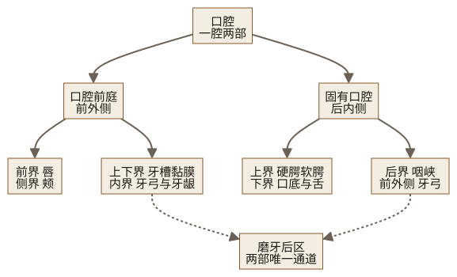
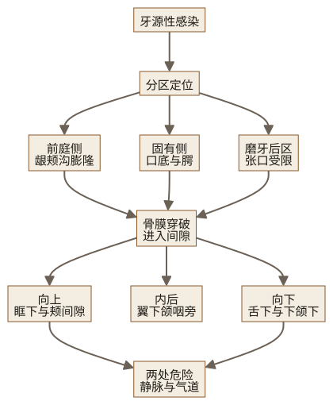

# 第 1 章 · 口腔的境界与分区

> **层次**：撰写层——由课程正文第 1 章（`01-e21`）改写并扩写，非逐字搬运。该章实为消化系统通论，与本章相关的只有 §1.2 口腔段（口腔四壁、咽峡、唇系带、腮腺管口相对、舌下阜与舌下襞）；牙弓与咬合平面、危险三角、三个骨性标志、记录坐标课程未展开，按通行骨架补写，逐处标明。
> **本章要回答的问题：** 口腔是一个腔还是两个腔？若是一个腔，临床凭什么把它分成前庭与固有口腔并据此定检查次序；若是两个腔，又凭什么只在磨牙后区留一条通道？分界讲清之后还有第二问：牙源性感染怎样走进间隙，从哪三个方向？
> **覆盖：** 单元 6 个（02.01.01.01、02.01.01.02、02.01.02.01、02.01.02.02、02.01.03.01、02.01.03.02）｜ 课程章 `departments/08-wuguan/02-kouqiang-jiepou-shengli/chapters/01-e21/docs/zh.md`（12 单元 / 20,444 汉字；只取 §1.2 口腔段）｜ 本章正文 5,497 汉字
> **参考状态：** 课程正文是主源，也是唯一底本。外源教材本机无对应 PDF；`web_search`/`web_extract` 不可用（Firecrawl 403），维基与 NCBI 不可达——**未取得外源正文**，故不引外部页码与数值，不写「据某教材」。
> **引用口径：** 结构事实标「课程正文 §1.2」；补写的判断标「本章补写」；课程正文没给到可核来源的量，一律写「随个体差异，本书不给具体数」。

---

## N.1 概念与出处

先立七个词：前五个划出「哪一块是口腔、腔里的哪一段」，后两个补上参照面与「边界坏了往哪走」。

| 概念 | 出处 | 一句定义 |
|---|---|---|
| 口腔（广义） | 课程正文 §1.2「口腔为消化管的起始部」 | 前界唇，侧界颊，上界腭，下界口底，后通咽峡 |
| 口腔前庭 | 课程正文 §1.2「前外侧部的口腔前庭」 | 牙弓与唇、颊之间的马蹄形窄隙，后经磨牙后区通固有口腔 |
| 固有口腔 | 课程正文 §1.2「后内侧部的固有口腔」 | 牙弓以内、舌与口底所在的腔，后界为咽峡 |
| 咽峡 | 课程正文 §1.2「腭垂与两侧腭舌弓与舌根共同围成」 | 口腔与咽的分界 |
| 磨牙后区 | 课程正文 §1.2「上述两部在磨牙后区相通」 | 牙弓末端之后的无牙区，两部唯一通道 |
| 咬合平面 | 本章补写（通行骨架） | 咬合接触点所成的近似平面，有纵𬌗与横𬌗曲线 |
| 间隙入口 | 本章补写（通行骨架） | 感染穿破骨膜后进入的筋膜间隙，分向上、向内后、向下三路 |

**全章骨架一句话：一腔两部、一圈通道、三个方向。** 前庭与固有口腔靠牙弓隔开；磨牙后区是牙弓后端留出的通道，左右各一；三个方向是感染向上、向内后、向下的三路。图 1-1 画前两句，图 1-2 画第三句。

**读法先立一条：腔是空的，壁才有结构。** 说「口腔里有个病灶」等于没说；说「左下后牙区颊侧前庭沟」，才落到一个可以按、可以看、可以切开的位置。另须分清两个「口腔」：狭义指牙弓以内，广义是那根管子的起始段。

### 02.01.01.01 口腔前庭与固有口腔

前庭六个壁，按前、侧、上、下、内、后数一遍。**前壁是唇的内面**：上唇与下唇在口角相接，唇内面覆黏膜，与牙龈之间形成唇沟，沟内是唇系带（课程正文 §1.2）。**侧壁是颊的内面**：颊黏膜中央有腮腺管开口，正对上颌磨牙的𬌗面，课程正文的说法是「与腮腺管的开口部位相对」。**上、下壁是牙槽黏膜**：向唇颊反折成前庭沟，义齿基托边缘就落在这条线上。**内侧壁是上下牙弓的牙冠与牙龈**——分界的实体是这一壁，不是牙槽骨，骨在牙龈之下看不见。**后界是磨牙后区**，下文单说。

固有口腔五个面：上界硬腭与软腭，下界口底与舌，前界与外侧界是上下牙弓与牙龈，后界是咽峡。课程正文 §1.2 把咽峡写得很清楚：腭垂、两侧腭舌弓、舌根围成。所以它不是盒子，是「四面壁加一道门」，门即咽峡。

**关键判断一：隔开两部的不是黏膜，是牙弓。** 两部之间没有膜、没有缝，只有一列牙。牙在，两部隔开；牙不在，两部连成一片。无牙颌患者因此在每一处缺牙间隙都相通，「两部」只剩牙槽嵴的形态意义，检查次序也不必再分先后。

**关键判断二：分界的方向感比名称重要。** 前庭是「前外侧」，固有口腔是「后内侧」：脓肿在前庭侧向龈颊沟膨隆，切开往外流；在固有侧向口底或腭部膨隆，切开往口内流，而口底那一类还要担心气道。同一颗牙，脓肿停在哪一侧，处置的紧迫性差一个量级。

回到开头那一问：**形态上是一个腔，功能与临床上必须当两部写。** 形态学说一个腔，因为它连续、同源、只隔一列牙；临床学说两部，因为两部的壁不同、引流不同、检查手法不同。教材要做的不是选一个，而是把「为什么可以同时成立」写清楚；写不清，学生遇到病例时哪一套都用不上。

### 02.01.01.02 上下牙弓与咬合平面

**第一层，形状。** 牙根植在牙槽突，牙冠向口内排成弓形。弓形不是圆弧，分三段：前牙段弧形，尖牙处转折，后牙段近直线。这个「弧—转—直」是两个临床现象的来源：前牙段弧形使前牙缺失在视觉上最明显，弧线一断，唇的支撑就塌；后牙段近直线使后牙缺失在咬合上最要紧，直线一断，咬合平面就倾斜。

**第二层，覆盖关系。** 上牙弓略大于下牙弓，正常咬合时上牙覆盖下牙的一部分，后牙颊尖覆盖下牙颊尖。本书不给覆盖与覆𬌗的数值——课程未给，且这组数字随人群与年龄差别很大。要记的是方向：**上包下，不是下包上**；反过来的叫反𬌗，属错𬌗畸形，归第 4 章。

**第三层，咬合平面。** 这是补写概念，课程未提，但不可省：没有它，牙弓只是一个形状；有了它，才是可度量、可修复的参照系。它是咬合接触点所成的**近似**平面，通行画法以下颌中切牙切缘与双侧后牙接触点为参照。三条限制要一起说：**会降低**——𬌗面终生磨耗；**会倾斜**——一侧后牙缺失未修复，对颌牙伸长、邻牙倾斜，平面在这一侧塌下去，这不是「牙长歪了」，是「面歪了」；**本身是曲面**——前后有纵𬌗曲线，下颌者凹向上（Spee 曲线）、上颌者凸向下（补偿曲线），左右有横𬌗曲线（Wilson 曲线）。

三条曲线各对应一个方向的运动，义齿排牙要「补偿」的正是它们。咬合平面还有一层用途：**三处共用的参照面**——修复排牙、正畸整平、影像重建的基准。三处共用一面，同一颗牙在三张图上才在一个高度。术语定死：本书用「咬合平面」，首现括注「𬌗平面」，其后一律用前者。

**图注**：口腔的两部与唯一通道。出处：课程正文 §1.2「口腔借上牙弓与下牙弓分为前外侧部的口腔前庭与后内侧部的固有口腔，上述两部在磨牙后区相通」，及 §02.01.01.01 的六壁与五界。读图要点：牙弓是实线分界，磨牙后区是唯一的虚线通道且左右各一；前庭属前外侧、固有口腔属后内侧，这组方位词本身就是引流方向的提示。

## N.2 四壁与一道门

### 02.01.02.01 唇颊·腭·舌腹口底·磨牙后区

**唇，看唇红缘。** 唇分三层：外面皮肤，移行部唇红，内面黏膜。唇红与皮肤的交界叫唇红缘，是唇部最可靠的定位线——病损与切口都先报它离唇红缘多远。唇的内面与牙龈之间是唇沟，沟内有唇系带（课程正文 §1.2）。唇的肌是口轮匝肌，受面神经支配；唇的感觉，上唇来自上颌神经分支，下唇来自下颌神经分支。**这一组归属是口外检查的第一道分叉**：上唇麻木与下唇麻木指向两个神经干，不能合并成「嘴唇麻」；面神经麻痹是「嘴闭不上」，三叉神经障碍是「嘴能动但木」。

**颊，看腮腺管口。** 颊的内面是颊黏膜，外面是皮肤，中间是颊肌与颊脂垫。腮腺管开口正对上颌磨牙𬌗面（课程正文 §1.2），这一个开口给颊部三个落点：查腮腺先翻颊看这个乳头；咬合线常在此附近；颊部感染沿颊间隙走，向前到眶下，向后到翼下颌。三个落点共一个前提：颊是一个「夹层」，夹层里能走东西。

**腭，看腭缝与软腭这道活门。** 硬腭由骨腭覆黏膜构成，正中有腭缝，两侧有腭横襞，前端有切牙孔与切牙管开口（课程正文 §1.2）。硬腭黏膜与骨膜结合紧密，故硬腭的肿胀「不肿则已，一肿就疼」：组织无处移位，压力直传骨膜。软腭由腭腱膜与肌构成，后缘中央为腭垂，两侧为腭舌弓与腭咽弓，两弓之间为扁桃体窝（课程正文 §1.2）。功能是**活门**：吞咽时上提封闭鼻咽，发音时调节鼻腔共鸣。软腭麻痹的见症极干净——说话带鼻音、喝水从鼻腔反流；一处肌失效、两个功能同时坏，因为共用一道门。

**舌腹与口底，看下颌舌骨肌的后缘。** 舌腹黏膜光滑，正中线有舌系带，系带两侧各有一隆起叫舌下阜，阜向后外延伸的皱襞叫舌下襞（课程正文 §1.2）。抬起舌尖，一条系带、两个阜、两条襞，就是口底检查的路线。口底的底是三块肌：下颌舌骨肌、颏舌骨肌、二腹肌前腹。要紧的是**下颌舌骨肌的后缘是游离的**：后缘只到舌骨，与咽侧壁之间留一段空隙，舌下间隙与下颌下间隙由此相通。所以口底感染不是封闭腔里的脓肿，而是能顺这条后缘向下、向后走的通道；口底水肿凶险也全在此，肿起来先推舌向后上，再压会厌。

**磨牙后区，看它是一道门。** 位置在下颌最后磨牙后方：前界牙槽嵴末端，外侧颊黏膜，内侧翼下颌皱襞，后方下颌支前缘。它不是四壁之一，是四壁留出的缺口——标题写「四壁与一道门」，门不属于墙。记三件事：它是前庭与固有口腔的唯一通道（课程正文 §1.2），两侧各一；它是第三磨牙萌出区，智齿冠周炎常先在此膨隆；翼下颌皱襞是下牙槽神经阻滞的标志。

四区各留一句：**唇看唇红缘，颊看腮腺管口，腭看腭缝与软腭这道活门，口底看下颌舌骨肌的后缘。** 磨牙后区不属于四者，它是门。

### 02.01.02.02 危险三角与间隙入口

「危险三角」在口腔语境里有两个，常被混成一个；分不清，处置的紧迫性就会判错。

**第一个是面部危险三角**，以鼻根为顶点、两口角为底边。危险的原因不是「血多」，是**静脉没有可靠的瓣膜**：面部静脉与颅内静脉窦经眼静脉等途径相通，挤压时压力反向，感染性栓子可逆行入颅。纪律只有一条——**别挤**。**第二个是口底与下颌下构成的「下危险区」**，即舌下间隙与下颌下间隙合起来的那片区域；危险的原因不是静脉，是**气道**。纪律也只有一条——**别等**。判断落点不同：前者看「有没有挤过」，后者看「口底抬没抬高、说话清不清楚」。

**间隙入口：从牙到间隙，中间隔着一层骨膜。** 链是：牙髓坏死 → 出根尖孔 → 根尖周炎 → 穿破骨皮质 → **停在骨膜下** → 穿破骨膜 → 进入间隙。每一步都有可观察的对应：根尖周炎期，牙有浮起感、叩痛明显；骨膜下期，肿胀局限、边界清楚、剧痛；骨膜一破，肿胀转弥漫、按之凹陷，张口受限。课程正文 §2.17 写根尖周炎「持续性跳痛、叩击痛、患牙浮起感，龈颊沟肿胀」，说的正是骨膜下这一段。所以**骨膜是这条链的关节**：未破，感染是「骨的」，位置可指；一破，是「间隙的」，只能按间隙名报。

间隙按方向分三路。**向上：眶下与颊间隙。** 上颌前牙根尖靠近尖牙窝，炎症向上入眶下间隙，见症是下睑、鼻侧、上唇肿胀连成一片；上颌后牙的炎症向后上入颊间隙或颞下间隙。动作是**看下睑与鼻侧**。**向内后：翼下颌与咽旁间隙。** 下颌磨牙根尖靠近下颌骨内侧面，炎症向内后入翼下颌间隙，见症是**张口受限最明显**（翼内肌受累）、咽侧壁膨隆、吞咽痛；再向内即咽旁间隙，咽部膨隆、说话含糊。动作是**量张口度**：张口受限而无面部肿胀，几乎就是指肌间隙。**向下：舌下与下颌下间隙。** 下颌前牙的炎症入舌下间隙，见症是口底抬高、舌被推向上后；下颌后牙的炎症入下颌下间隙，见症是颌下肿胀、下颌下缘轮廓消失。两处相通，故常合并出现；动作是**看口底、摸颌下**。

三路合成一句可执行的话：**张口受限看肌间隙，口底抬高看舌下与下颌下，下睑鼻侧肿胀看眶下。** 三个动作在椅旁不到一分钟可完成，完成的不是诊断，是定位。边界：本章只给「往哪走」，不给「怎么切」；切开引流、抗生素与气道的处理属口腔颌面外科与急诊范围，本书不写参数、不写入路、不写药物。

**图注**：牙源性感染的定位链。出处：§02.01.02.02 的骨膜链与三路方向，及课程正文 §2.17「持续性跳痛、叩击痛、患牙浮起感，龈颊沟肿胀」。读图要点：链的关节在骨膜——未破是骨的感染，破了才是间隙的感染；三路各有一句椅旁可执行的判断动作，最后汇到两处「危险」：静脉逆行与气道。

## N.3 表面标志与记录坐标

### 02.01.03.01 可触及标志：颏孔·下颌孔·翼突钩

三个标志共一个身份：都是**神经血管束的骨性门**。摸到门，就知道门后有束；找不到门，只能凭经验猜深度。

**颏孔。** 位于下颌骨体外面的开口，颏神经与血管由此出，供给下唇与颏部皮肤、下颌前牙的牙龈。位置在下颌前磨牙下方，但**不是固定点**：牙槽骨吸收后颏孔相对上移，甚至接近牙槽嵴顶——无牙颌患者取模、设计基托之前必须先确认，否则基托压住出孔，一戴就麻。在下颌下缘与前磨牙之间按压，若有向下唇放射的麻电感，说明按到了孔口而非孔旁骨面。

**下颌孔。** 位于下颌支内面、下颌小舌后方，是下牙槽神经血管进入下颌管的入口。它**不能从体表或口内直接触到**。所谓「摸下颌孔」，实际摸的是它的投影——下颌支前缘与咬合平面相交的那一片。孔在骨内面，皱襞在骨外面，触诊只能定「面」，不能定「孔」。

**翼突钩。** 蝶骨翼突内侧板下端的小钩，在上颌结节的后内侧。张口时可在翼下颌皱襞上端触到一条骨性硬边。意义有两条：一是**软腭这道活门的滑车**，腭帆张肌的腱绕过它转折再散入腭腱膜；二是**翼下颌皱襞的支点**，皱襞之所以可靠，正因为上端挂在固定的骨上。

可及性排序：颏孔可触（口外、口内均可），翼突钩可触（口内、需张口），下颌孔不可触（只能定投影）。这不是考题，是操作顺序。三者之间的距离与角度本书不给。

### 02.01.03.02 记录用坐标

口腔记录要三套坐标并用：牙位（第 2 章）、区域（前庭/固有/四区）、表面标志（骨性门）。三套各管一段，缺一段就说不清。

记录的最小集是四项：**部位、方位、性质、时间。**「左下后牙区颊侧前庭沟，肿胀，三日」——部位用区域坐标，方位用颊侧，性质与时间是描述。只写「左边牙肉肿」，复诊无法比对、会诊无法转述、影像对照无法定位。四项不是格式要求，是「可复现」的最低条件。

三条规矩，一条比一条容易犯。**一、以患者方位为准。** 检查者面对患者，患者的右侧落在检查者左手边；这一步颠倒，后面全错。**二、用解剖名，不用俗称。**「牙肉」写牙龈，「牙床」写牙槽嵴，「天花板」写硬腭；俗称不是错，是不能作为记录，因其边界模糊。**三、一条记录只落一个区。** 跨区病损分开写，因为跨区意味着跨间隙、跨引流方向。

坐标还有一处用途：**与影像对照**。口内照是镜像的，CBCT 是患者方位的；两者并排而不先统一方位，就会把左侧病损记到右侧。看片前先把照片在心里翻一次。

## N.4 与相邻学科的接口

本章给读者的最后一件工具是三栏：形态、功能、检查。次序不颠倒——先有形态，功能才有主语；先有功能，检查才有判据。

| 栏 | 回答什么 | 由谁提供 | 本章的例 |
|---|---|---|---|
| 形态 | 在哪里、由什么围成、与谁相通 | 本章与第 3 章 | 前庭后界为磨牙后区，两侧各一 |
| 功能 | 做什么、失效推出什么症状 | 第 6 章 | 软腭上提封闭鼻咽；麻痹则饮水反流 |
| 检查 | 怎么看见、正常所见是什么 | 第 8 章 | 翻唇见前庭沟，抬舌见舌下阜 |

**四个接口。** 与第 3 章：三个标志是骨上的门，坐标由它给，门的意义由本章给。与第 4 章：咬合平面是关节运动的参照面，本章只立这个面，运动学归它。与第 5 章：唇颊的神经归属与腮腺管口在那一章展开。与第 8 章：本章给「先看哪」的次序，它给「看见什么算正常」。

**中医口齿理论的接口。**「口为脾之窍」「龈为胃之络」（课程正文 §2.17：「齿为骨之余、龈为胃之络」）只挂功能栏的解释层，不占形态栏。形态栏能写「龈颊沟膨隆」，就不写「胃火上炎」；形态栏写不出的（为什么同一处反复发作），才交给那一层。把「胃火」写进形态栏当病因，就是越界。

## N.5 争议与本项目立场

**争议一：前庭与固有口腔算不算「两个腔」。** 一派认为既然相通就是一个腔的两部分；一派认为分界明确、引流不同，应作两区。本书取后者，但要求两句都写：**分界是牙弓，通道是磨牙后区。** 

**争议二：咬合平面是平面还是曲面。** 几何上它是曲面，临床上当平面用。本书的处理：**名字保留「平面」，内容写明「近似平面」，并把三条曲线一起给。**

**争议三：数值到底写不写。** 课程正文只给结构关系，未给任何尺寸；外源又未取得。本书立场：**未给的，一律写「随个体差异，本书不给具体数」。** 

**本项目立场三条。** 一，只写形态、位置、毗邻与通道，不写手术入路与阻滞进针点。二，不写间隙感染的处置方案——解剖学能说「为什么危险」，不能说「怎么处理」。三，修复与正畸的设计参数不在本章，本章只提供共用的参照。

> **免责声明：** 本章为教学材料，不构成诊断或治疗建议。文中的分界、分区、间隙方向与标志位置只用于建立判断框架，一切检查与处置须由具备资质的执业人员依现行规范与机构制度作出。凡遇口底抬高、张口进行性受限、吞咽困难者，按气道急症路径处理。本章不给剂量与疗程。

## 思考题

1. 本章说「隔开前庭与固有口腔的不是黏膜，是牙弓」。请说明无牙颌患者的两部关系变了什么，以及这一变化为什么会让前庭与口底的感染更容易串成一片。
2. 面部危险三角与口底「下危险区」的危险机制不同，一是静脉，一是气道。请分别说明解剖依据，并指出椅旁判断时各自的第一个动作。
3. 颏孔、下颌孔、翼突钩三者中有两个可触到。请指出哪一个不能，并说明「摸下颌孔」在什么意义上成立、什么意义上不成立。

## 延伸阅读

- 课程正文第 1 章（`departments/08-wuguan/02-kouqiang-jiepou-shengli/chapters/01-e21/docs/zh.md`）§1.2「口腔与咽与食管」——本章形态部分的主源：口腔四壁、前庭与固有口腔的划分与磨牙后区相通、唇系带、颊黏膜与腮腺管口相对、硬腭的腭缝与腭横襞、软腭的腭垂与两弓、咽峡的构成、舌下阜与舌下襞。
- 《口腔解剖生理学》，「口腔局部解剖」章——前庭沟、磨牙后区、翼下颌皱襞、三个骨性标志的通行表述可与之对读；只标章目，不引页码、图表与尺寸。
- 《口腔颌面外科学》，「口腔颌面部感染」章——牙源性感染的扩散路径与各间隙的毗邻可与之对读；本章只取「往哪走」的解剖依据，不取切开引流与药物方案。
