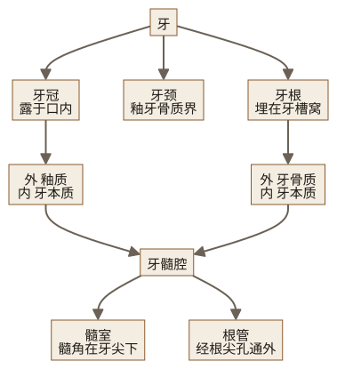
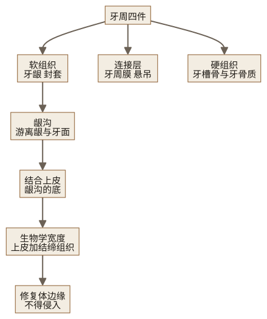

# 第 2 章 · 牙与牙周组织

> **层次**：撰写层——以课程正文第 2 章（`02-e22`）为底本，但须先说明：该章实为中医口齿病证（牙痛、牙宣、口疮、唇风），形态只到「齿为骨之余、龈为胃之络」与龋—髓—根尖—牙周的病证链，没有牙体形态、牙位记录与牙周组织的系统描述。本章的牙体三部、四类牙差异、四区记录法、牙周四件与生物学宽度按通行骨架补写，逐处标明；课程病证链作「结构失效」的落点引用。
> **本章要回答的问题：** 一颗牙凭什么能被一句话说清？四问答齐才算说清：它在哪（牙位）、由哪几部分组成（冠、根、髓腔）、靠什么固定（牙周四件）、它的边界在哪（龈沟与生物学宽度）。前三问管「是什么」，第四问管「到哪里为止」——修复体做到哪里必须停，答案就在这一问里。
> **覆盖：** 单元 6 个（02.02.01.01、02.02.01.02、02.02.02.01、02.02.02.02、02.02.03.01、02.02.03.02）｜ 课程章 `departments/08-wuguan/02-kouqiang-jiepou-shengli/chapters/02-e22/docs/zh.md`（20 单元 / 16,347 汉字；取其 §2.17 与 §2.22 的病证链）｜ 本章正文 5,498 汉字
> **参考状态：** 课程正文是唯一底本，但它是病证章，形态须补写。外源教材本机无对应 PDF；`web_search`/`web_extract` 不可用（Firecrawl 403），维基与 NCBI 不可达——**未取得外源正文**，故不引外部页码与数值。牙冠长度、根长与弯曲度、釉质厚度、龈沟深度、生物学宽度的数值一律不印。
> **引用口径：** 病证链标「课程正文 §2.17」与「§2.22」；形态补写标「本章补写」；课程未给、外源又未取得的量，写「随个体差异，本书不给具体数」。

---

## N.1 概念与出处

牙的解剖容易学成一张名词表，是因为缺一条主线。本章的主线是四个界面：**釉牙骨质界**（冠与根）、**髓腔壁**（软硬组织）、**龈牙结合部**（牙与龈）、**牙槽窝骨面**（牙与骨）。四个界面把「一颗牙」切成四段。

| 概念 | 出处 | 一句定义 |
|---|---|---|
| 牙冠·牙颈·牙根 | 本章补写（通行骨架） | 露于口内者、冠根交界处、埋于牙槽窝者 |
| 釉牙骨质界 | 本章补写 | 牙冠釉质与牙根牙骨质的相接处，解剖学的冠根分界 |
| 牙髓腔 | 本章补写 | 牙中央的腔，冠部为髓室、根部为根管，经根尖孔通根尖周 |
| 四区法 | 本章补写 | 以中线与上下牙列分四区，区内自中线向后编号；恒牙与乳牙各一套序列 |
| 牙周四件 | 本章补写 | 牙龈、牙周膜、牙槽骨、牙骨质；牙借牙周膜悬于牙槽窝，非骨性融合 |
| 龈沟 | 本章补写 | 游离龈与牙面之间的 V 形沟，底为结合上皮的冠端 |
| 生物学宽度 | 本章补写 | 结合上皮附着与结缔组织附着合成的一条恒定带，修复体的界限由它定 |

**全章骨架一句话：三部一腔、四类牙、四区编号、四件牙周、一条恒带。** 图 2-1 画第一部，图 2-2 画后两项，四类牙与四区编号由下文两节交代。

**一条读法先立：牙的形态是为受力设计的。** 前牙薄而单根，受的是切与撕的力，方向单一；后牙厚而多根，受的是研磨的力，方向多而杂。形态的每一处差别都能追到「它要受什么力」，记不住形态时，先问这一句。

### 02.02.01.01 牙冠·牙根·牙髓腔

**第一层，三部。** 牙冠露于口内，牙根埋于牙槽窝，交界处为牙颈，其标志是**釉牙骨质界**——釉质与牙骨质在此相接。这一点最容易混：口语的「牙颈部」常指龈缘附近，解剖的「牙颈」是釉牙骨质界；两者在健康人身上大致重合，牙龈退缩时就分开。

由此引出两个必须成对使用的概念：**解剖牙冠**是釉质覆盖的部分，**临床牙冠**是露在口内的部分。牙龈退缩时临床牙冠变长，解剖牙冠不变；牙龈增生时临床牙冠变短，解剖牙冠仍不变。患者说「我的牙变长了」，说的是临床牙冠；书上画的那条冠根分界，说的是解剖牙冠。**混用这两个词，会把牙周问题误记成牙体问题。**

**第二层，三层硬组织。** 牙冠最外是釉质，牙根最外是牙骨质，两者之内都是牙本质——牙本质是牙的主体，冠根通连。釉质与牙骨质在牙颈处可以端端相接，可以牙骨质覆盖釉质，也可以两者不相接而留一小段牙本质暴露。第三种情形是「牙颈部敏感」与「根面龋」的结构基础：牙本质小管直接通髓，刺激不经釉质阻挡就到了牙髓。

**第三层，髓腔。** 冠部膨大为髓室，根部收窄为根管，根尖处开口为根尖孔。髓室顶向牙尖方向突起成髓角，髓角在牙尖下方、离𬌗面最近，是备洞最易穿髓处。髓腔随年龄变小：继发性牙本质终生沉积，腔一点点缩窄，所以年轻人的髓腔大、根管粗。**同一种治疗在二十岁与六十岁难度不同，原因不在术者，在这层沉积。**

**四层界面连成一条链。** 课程正文 §2.17 写龋病「由细菌产酸破坏牙釉质、牙本质所致」，写牙髓炎「细菌侵入牙髓」，写根尖周炎「感染进一步扩散至根尖周组织」。用本章的结构重述：龋由釉质入牙本质，产物经牙本质小管抵髓腔壁；牙髓坏死，感染经根尖孔出根尖周。每一站对应一个界面——釉牙本质界、髓腔壁、根尖孔。这也解释了「补牙」与「抽神经」为何是两件事：前者止于牙本质，后者要清到根尖孔。

**图注**：牙的分部与内部腔隙。出处：§02.02.01.01 的三部、三层硬组织与髓腔描述；病证链见课程正文 §2.17。读图要点：釉牙骨质界是解剖学的冠根分界，与龈缘不是同一条线；釉质与牙骨质在颈部可以不相接，那段暴露的牙本质就是颈部敏感与根面龋的入口；髓角在牙尖下方，是备洞最易穿髓处。

### 02.02.01.02 四类牙的形态差异

四类牙按「功能—形态」配对记，一类一句话，再补三条主线。

**切牙，管切断。** 单根，冠扁平，切缘成刃，邻面呈楔形。上颌中切牙是前牙里最大的一颗，下颌中切牙最小——同名牙上下对比，差得很明显。切牙的形态要点在「薄」：冠薄才能切，根单才能转，所以前牙的扭转与移位在临床上格外显眼。

**尖牙，管撕裂，兼管引导。** 单根，且是全口牙根里最长最粗的一颗；冠呈矛头状，只有一个牙尖。尖牙位于牙弓的转角处，正在口角的位置，所以它的存在决定口角的丰满度。功能上有两重身份：一是撕裂，二是**引导**——侧方运动时，工作侧的尖牙先接触，把下颌「引」向下方离开，后牙随即分离，这叫尖牙保护𬌗。尖牙一失，这层引导就落到前磨牙或磨牙身上，后牙要承受本不该它承受的侧向力。这是「一颗牙的存亡改变整套咬合」的最清楚例子。

**前磨牙，管撕裂兼研磨。** 单根或双根：上颌第一前磨牙多为双根，其余多为单根。冠呈立方形，𬌗面有两个牙尖（颊尖与舌尖），下颌第二前磨牙可有三尖。前磨牙处在「前牙的切」与「后牙的磨」之间，形态也是过渡的：冠比切牙厚，尖比磨牙少。

**磨牙，管研磨。** 上颌三根（近中颊、远中颊、腭），下颌两根（近中、远中）；冠大，𬌗面四至五个牙尖，窝沟最深。根多而分开，是把研磨时的多向力分散到更大的骨面上——这与「根多则固」不是同一件事：根多给的是**抗旋转与分散载荷**。

三条主线把四类牙串起来：越靠后，根越多、越粗、分得越开，冠越厚、尖越多、窝沟越深，因为研磨力大于切力且方向更杂；髓腔随形态走——前牙大而单一，后牙小而多管，且根管数目在个体间有变异，所以根管治疗要先拍片。

乳牙与恒牙的差异留到 §02.02.02.02 说：乳牙冠短小、釉质薄、髓腔相对大、根分叉早，四件事合起来使乳牙的龋进展快、牙髓易受累。

## N.2 牙位记录：四区与序号

### 02.02.02.01 分区记录法：四区＋序号

牙位记录的逻辑只有三层；三层记住，任何一套系统都能读，背表却会抄错版本。

**第一层，分区。** 以面部中线（两颗中切牙之间）与上下牙列的分界，把全口牙划为四区：右上、左上、左下、右下。**这里的左右是患者的左右。** 检查者面对患者时，患者的右上落在观察者左手边；这一步颠倒，后面全错——最常见的差错不是不懂编号，而是把观察者方位当成了患者方位。

**第二层，区内序号。** 每区自中线向后递增：最靠近中线的是区内第一位，向后依次为第二、第三位。所以完整牙位由「区」与「位」两段构成，缺一段不成立；代号成对出现，前说象限，后说第几位。

**第三层，双序列。** 恒牙列与乳牙列各有一套序列：乳牙列自乳中切牙起，到第二乳磨牙止；恒牙列自中切牙起，到第三磨牙止。两套序列长度不同，又要在替牙的数年里共存于同一副牙列，所以**记录时必须写明这是乳牙还是恒牙，或者写明所用的是哪一套系统**。

> 【边界】具体的编号对照表、牙位代号与影像标记法不在本章。表属规范文件的内容，教材印出来，读者抄的是版本，不是逻辑。本章只要求一件事：看到一串代号，能反推三件事——在哪个区、区内第几位、恒牙还是乳牙。反推得出，坐标就掌握了；反推不出，背表也没用。

三套记录系统并存：部位描述（「右上第一磨牙」）、两位数字（区号加序号）、连续编号。各有适用场合，混用是差错的主要来源。**纪律：写明系统，不混用。** 同一份记录出现两种系统而不注明，等于让下一个人替你猜。

两种差错要单独说。**序号与位置不符**：多生牙、先天缺失、已拔除未修复，都会让「区内第几位」与实际位置脱节；此时要写两件事——按序号该是哪一颗、实际在位的是哪一颗。**牙周记录的单位错**：牙周以位点为单位，每颗牙的颊舌面与近远中各成一个位点；写「右上第一磨牙牙周袋」而不写位点，等于把一条线报成一个点。

### 02.02.02.02 乳恒牙替换期怎么记

替牙期是牙位记录最容易出错的一段，因为它同时存在三种状态：乳牙、已萌恒牙、未萌恒牙。

**第一条，每颗牙分别标乳或恒。** 不能写「右上第一磨牙」：乳牙列里也有第一磨牙（第一乳磨牙），同一句在两套序列里指的不是同一颗牙。

**第二条，未萌牙按牙位预留，不按「空缺」记。** 未萌的恒牙占着一个位置，记「空缺」等于宣布这里没有牙，将来的萌出会被记成「新长一颗」。写法是按牙位记「未萌」。

**第三条，乳牙滞留与乳牙早失要分开写。** 滞留是乳牙占位不走，恒牙只能错位萌出；早失是提前脱落，间隙被邻牙挤占。两者都造成错𬌗，方向相反，处置也相反；写「乳牙未换」四个字，两种情形都盖住，等于没写。

**最容易错的一颗：第一恒磨牙。** 它在乳牙列后方萌出，不待任何乳牙脱落，**不在替换序列里**，却常被当作乳牙；它又是最早萌出的恒牙、龋与早失的高发牙。记替牙期，先把它认出来。

替换的顺序有大致规律（下颌先于上颌、前牙先于后牙），但个体差异很大，本书不给时间表。替牙期的暂时性拥挤与中切牙间隙属发育过程，不是错𬌗，但要看两件事：间隙够不够、有没有挡住萌出道。

## N.3 牙周组织：四件与一条恒带

### 02.02.03.01 牙龈·牙周膜·牙槽骨·牙骨质

牙周四件，四种组织，四样坏法。

**牙龈是封套。** 分三部分：游离龈（靠近牙冠、不附着于牙面的一圈）、附着龈（附着于牙槽骨表面的一带）、龈乳头（相邻两牙之间的三角形龈）。附着龈表面常有橘皮样点彩，是纤维束牵拉黏膜所致，可作健康标志之一，但有无随个体与部位而异。牙龈的功能是封闭：上皮在龈牙结合部与牙面形成附着，把牙周膜与口腔隔开。**这层封套一旦破，菌斑就能直达牙周膜。**

**牙周膜是悬吊。** 胶原纤维束一端埋于牙骨质、一端埋于牙槽骨，把牙悬在牙槽窝里。主纤维束按方向分组：牙槽嵴、横隔、水平、斜、根尖、龈纤维。其中**斜纤维最多**，从牙骨质斜行向下入骨，把垂直压力转成对骨的拉力。这是「牙能耐垂直力、耐不住侧向力」的结构解释：垂直力沿纤维是拉力，侧向力横着扯是剪力。所以咬合创伤的表现多是骨吸收与牙松动，而不是牙折。

**牙槽骨是支持。** 容纳牙根的骨，靠牙根的一层叫固有牙槽骨，X 线上呈一条致密白线，称硬骨板。牙槽骨是全身改建最活跃的骨之一，随功能负荷改变：牙在，骨在；牙失，骨退。这叫**废用性萎缩**，是无牙颌牙槽嵴变低平的解剖依据，也是「拔牙后尽早修复」的理由。

**牙骨质是外衣。** 覆盖牙根表面，终生沉积，矿化程度低于釉质与牙本质；牙根因此随年龄略微变粗，而根面暴露时它很薄，容易被刮穿到牙本质。牙骨质与牙槽骨之间隔着牙周膜，**不是骨性融合**——这一句解释三件事：牙有生理性动度；咬合力经膜缓冲后才到骨；种植体是骨性结合，没有牙周膜，因而没有缓冲，也没有来自牙周膜的本体感觉。

四件的协同关系可以按「封套—悬吊—支持—附着」记。任何一件坏，其余三件跟着变。课程正文 §2.22 写牙宣「牙龈萎缩、牙周袋形成并溢脓、牙槽骨吸收、牙齿松动」，正是四件依次失守：封套、悬吊与附着、支持，最后表现于牙。

### 02.02.03.02 龈沟与生物学宽度

**龈沟**是游离龈与牙面之间的 V 形沟，底为结合上皮的冠端。它不是解剖常数，而是**测量值**：探针探到的深度受炎症程度、探针粗细与探诊力量影响。健康时沟浅，炎症时因上皮附着向根方移动、组织水肿而变深。所以「龈沟深度多少算正常」这个问题本身问错了——它是一个读数，不是一条界线。

**结合上皮**是龈牙结合部的关键：附着于釉牙骨质界附近，通过半桥粒与基底板连于牙面，形成「上皮附着」。它不角化，通透性较高，菌斑产物可经它渗入结缔组织——这就是龈炎的起点。

**生物学宽度**是结合上皮附着与结缔组织附着合起来的那条带。通行文献给过数值，本书不引（外源未取得，个体差异亦存在）；只写它最重要的一条性质：**它是一条恒定的带，不随牙龈的厚薄改变。** 牙龈可以增厚变薄，这条带却总要维持。

由此推出一条硬结论：**修复体的边缘不得侵入这条带。** 侵入之后，机体不是「让」它，而是以骨吸收来重建——骨向根方退，带随之重建，边缘与骨的距离才回到原状。这是「边缘越深、骨吸收越多」的结构解释。同理，**牙冠延长术的本质是切除部分牙槽骨**，让这条带在更靠根方的位置重建；只切龈不切骨，带会重新长回原处，手术等于没做。

**牙周袋是龈沟的病理性加深**，袋底在结合上皮的根方。此时探诊深度变大，但真正说明问题的是**附着丧失**——结合上皮沿根面向根方移了多少。探诊深度可以假性变深（牙龈增生覆盖），也可以假性变浅（牙龈退缩），唯有附着水平是净损失。三个易错一次说清：把探诊深度当附着水平；把牙龈增生当成「牙周变好」；把探诊出血当成诊断而非指标。

**图注**：牙周四件与龈牙结合部的界线。出处：§02.02.03.01 四件组织与 §02.02.03.02 的龈沟、结合上皮、生物学宽度。读图要点：四件是「封套—悬吊—支持—外衣」的分工，牙与骨之间隔着牙周膜，不是骨性融合；龈沟的底是结合上皮的冠端，生物学宽度在它根方——修复体边缘止于这条带之外，侵入则以骨吸收重建。

## N.4 与相邻学科的接口

三栏次序不变：形态（本章）→ 功能（第 6 章咀嚼与吞咽）→ 检查（第 8 章探诊与牙位图）。

| 栏 | 回答什么 | 由谁提供 | 本章的例 |
|---|---|---|---|
| 形态 | 在哪、由什么组成、靠什么固定 | 本章 | 上颌第一磨牙三根，下颌两根 |
| 功能 | 做什么、失效推出什么症状 | 第 6 章 | 尖牙引导侧方运动；失则后牙受侧向力 |
| 检查 | 怎么看见、正常所见是什么 | 第 8 章 | 探诊得龈沟深度与出血，按位点记 |

**四个接口。** 与第 3 章：牙槽突是颌骨的一部分，牙槽骨随牙存亡；本章讲牙这一侧，它讲骨那一侧。与第 4 章：牙尖的斜度决定下颌运动的引导型，运动学归它。与第 1 章：牙弓与咬合平面在那一章立，本章的牙位坐标挂在那个面上。与第 8 章：本章给「由什么组成」，它给「怎么逐颗登记」。

**中医口齿理论的接口。**「齿为骨之余」「龈为胃之络」（课程正文 §2.17）只挂功能栏的解释层，不占形态栏。形态栏写「牙槽骨吸收、附着丧失」，解释层才写「肾虚齿槁」。契约在第 1 章已立，此处再确认一次：**四件牙周的每一次失守，都能在形态栏里找到对应的一句话，不必借解释层的词。**

## N.5 争议与本项目立场

**争议一：牙位系统用哪一套。** 三套系统各有拥护者与历史包袱。本项目不选边，只立一条纪律：**写明系统，不混用**。教材不印对照表，理由见 §02.02.02.01 的边界——表会被抄成版本，逻辑不会。

**争议二：龈沟深度算不算「正常值」。** 许多教材给一个范围并称之为正常。本项目认为那是**测量值**：它随炎症、探诊力量与牙龈状态变，写成「正常值」会让人把读数当解剖事实。故本书只写「探诊所得的深度」，不给范围。

**争议三：生物学宽度写不写数值。** 通行文献有数值，本项目不引；外源未取得，无法核对，且写一个数会被当成硬指标。本书只写性质（恒定、不随龈厚改变）与后果（边缘不得侵入、侵入则骨吸收）。

**本项目立场三条。** 一，只写形态、位置、组成与界面，不写备洞深度、器械型号与修复设计参数。二，不写牙周治疗的方案与疗程；本章只说明「为什么边缘不能深」，不说明「深了怎么补救」。三，乳牙与恒牙的差异只写到能支持记录与判断为止。

> **免责声明：** 本章为教学材料，不构成诊断或治疗建议。文中的分部、牙位、牙周结构与界面关系只用于建立判断框架，一切检查与处置须由具备资质的执业人员依现行规范与机构制度作出。凡遇牙龈持续出血、牙松动进行性加重、面部肿胀伴张口受限者，须经口腔科检查。本章不给剂量与疗程。

## 思考题

1. 解剖牙冠与临床牙冠在健康人身上大致重合，牙龈退缩者身上分开。请说明两者的定义，并指出混用会把哪一类问题记错。
2. 尖牙只有一颗，却同时承担撕裂与引导两种功能。请说明「尖牙保护𬌗」的结构前提，以及尖牙缺失后这层引导落到后牙身上会有什么后果。
3. 生物学宽度是一条恒定带。请据此说明：为什么修复体边缘侵入龈沟深部会导致骨吸收；为什么牙冠延长术必须切骨而不能只切龈。

## 延伸阅读

- 课程正文第 2 章（`departments/08-wuguan/02-kouqiang-jiepou-shengli/chapters/02-e22/docs/zh.md`）§2.17 与 §2.22——牙痛与牙宣的按语给出龋—髓—根尖—牙周的病证链与「齿为骨之余、龈为胃之络」的归属，本章的结构失效分析以此为落点。
- 《口腔解剖生理学》，「牙体解剖」与「牙周组织」两章——牙冠形态、根管系统、牙周四件的通行表述可与之对读；只标章目，不引页码与尺寸。
- 《口腔修复学》，「修复体边缘与牙周」相关章——生物学宽度的临床推论可与之对读；本章只取「边缘不得侵入」这一条解剖结论，不取设计参数。
