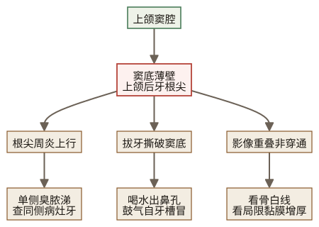
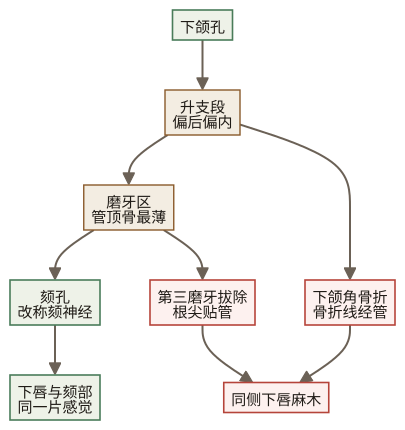

# 第 3 章 · 颌骨与咀嚼肌

> **层次：** 撰写层——本章按四级编码 `02.03` 节重写为解剖章，六个单元按「上颌骨—下颌骨—咀嚼肌」落位，串成三条链：上颌窦底与上颌后牙根、下颌管与下唇、四对咀嚼肌与开口侧方运动。课程原文是运动系统通论，本章只取能落到颌面骨上的句子。
> **本章要回答的问题：** 上颌后牙的根为什么能长到窦里去，拔一颗牙为什么会从鼻孔漏水？下颌骨里那条看不见的管子从哪儿进、从哪儿出，撞一下下巴为什么下唇会麻？同是面颅的骨，为什么上颌一动不动，下颌却能开、能合、能侧着磨？
> **覆盖：** 课程章 `departments/08-wuguan/02-kouqiang-jiepou-shengli/chapters/03-e23/docs/zh.md`｜ 骨架取同章 `3.38`（颅骨）、`3.39`（关节学：关节面、关节囊、关节腔、关节盘与韧带）、`3.42`（头肌：咀嚼肌四条）｜ 单元 6 个：02.03.01.01 / .01.02 / 02.03.02.01 / .02.02 / 02.03.03.01 / .03.02。
> **参考状态：** 课程第 3 章是运动系统通论：十二单元里只有 `3.38` 与 `3.42` 两段落到颌面部。四突、窦底与牙根、下颌管、升降颌肌的起止均未展开，本章按通行口腔解剖学补。
> **引用口径：** 引课程单元写 `派生·第3章·3.38`／`3.39`／`3.42`；引古籍只标书名与篇名，不标页码。课程未给的尺寸一律写「随个体差异，本书不给具体数」；不给器械参数，不写手术入路。

---

## N.1 上颌骨：一张薄壳，四面都是邻家

上颌骨是面颅里最大的一对骨，左右各一，在中线以腭中缝相接。它的形态一句话说得完：**一层包着空气的薄壳，四个方向都贴着别人的地盘。** 上方是眶，内侧是鼻腔，下方是口腔，后方是翼腭窝。壳里装的就是上颌窦。

先记这一句，是因为上颌骨的麻烦都从「薄」与「贴邻」来。它不像下颌骨是能动的杠杆，而是固定的、中空的、与眶、鼻、口三腔共壁的骨——一边的病变可以走另一边，一边的手术可以破另一边。

表 1 本章单元与出处

| 单元 | 主题 | 主要依据 |
|---|---|---|
| 02.03.01.01 | 四突与上颌窦底的关系 | `派生·第3章·3.38`（面颅组成）；窦底与后牙根的毗邻补 |
| 02.03.01.02 | 血供与薄弱线 | 上颌动脉分支与三支柱补；`3.38` 只给孔道名目 |
| 02.03.02.01 | 体部·升支·下颌管 | `派生·第3章·3.38`；下颌管走行补 |
| 02.03.02.02 | 薄弱区与骨折好发处 | 通行口腔解剖学；`3.38` 只到「下颌角与髁突可触及」 |
| 02.03.03.01 | 升颌肌群 | `派生·第3章·3.42`（咀嚼肌四条）；起止补 |
| 02.03.03.02 | 降颌肌与翼外肌 | `派生·第3章·3.42`（咀嚼肌、舌骨上肌群）；运动分解补 |

### 02.03.01.01 四突与上颌窦底的关系

上颌骨分一体四突。体部是四面体：前面有眶下孔与尖牙窝，后面（颧下面）有牙槽孔，上面是眶面（眶下沟闭成眶下管），内面是鼻腔外侧壁，留一大缺口即上颌窦裂孔。四突各有去处：额突接额骨与鼻骨，颧突接颧骨，腭突与对侧合成硬腭前部，牙槽突容纳牙根。四突的意义不在名字，在于每一突都通着一个腔或间隙。

**窦底就压在牙槽突上方。** 窦底由牙槽突与腭突围成，骨面不平，有牙槽窝顶的隆起。上颌后牙的根尖与窦底之间只隔一层薄骨，有的根尖几乎贴着窦黏膜；薄到什么程度随个体差异极大，本书不给具体厚度。方向确定：越靠后的牙根尖离窦底越近，第一、第二磨牙最密，前磨牙次之。

薄壁，三种结局。**其一，牙源性上颌窦炎。** 根尖周炎的肉芽把根尖外的骨破坏掉，感染就进了窦腔；牙周炎从龈沟向下破坏，也能走到窦底。特征是**单侧、有臭味、鼻内镜只见中鼻道有脓而鼻甲不肿**，同侧必有一颗带病灶的牙。判据很硬：单侧上颌窦炎久治不愈先查牙；查到牙，治牙比治窦要紧。

**其二，口腔上颌窦瘘。** 拔牙时若根尖与窦底之间只剩一层黏膜，力就可能撕破窦底，口腔与窦腔直接相通。症状不是「发炎」而是「通了」：喝水从鼻孔出，鼓气时气从牙槽窝冒，说话带鼻音。这是结构事件，加抗生素解决不了。

**其三，根尖「突入窦腔」的判定。** 影像上根尖与窦腔重叠，不等于根尖在窦内；要看窦底骨白线是否连续、根尖周围有无局限性黏膜增厚、有无瘘与鼻漏。只看一张重叠的影像就下结论，是把二维的影子当三维的结构。

图 3-1 只画一层关系：窦底与根尖之间那层薄壁，向上是窦腔，向下是口腔，破则相通。

### 02.03.01.02 血供与薄弱线

上颌骨的血供来自上颌动脉四支：**上牙槽后动脉**供后牙与窦黏膜，**眶下动脉**供上颌前部与上唇，**腭降动脉**供硬腭，**蝶腭动脉**入鼻腔。四支在黏膜与骨膜内吻合，故血供很足；静脉汇入翼丛，翼丛又与面静脉、眼下静脉相通且无瓣膜。

这个「足」有两个方向相反的后果：好的一面，骨折愈合快，只剩骨膜的骨片也能活；坏的一面，出血多且多为黏膜渗血，压迫不易止。翼丛无瓣膜，则上颌窦感染可逆流入海绵窦——与「危险三角」同一理由，路径不同。

**薄弱线讲的是力的走向。** 咀嚼时上颌骨的力不是均匀压在一片骨上，而是沿三条增厚的骨柱上传至颅底：**鼻上颌支柱**（切牙区沿鼻侧至额骨）、**颧上颌支柱**（磨牙区经颧突、颧骨至颧弓）、**翼上颌支柱**（磨牙区向后上经翼突至蝶骨）。三柱之间是两张骨板夹一层骨松质，薄。故打在柱上，力沿柱传，骨未必断；打在柱与柱之间，骨就断，且断得整齐。这一层分工即是上颌骨骨折分型的解剖基础：通行分三型，对应下部横断、锥形（经鼻根与眶下）与颅面分离（经鼻根、眶、颧额缝）。本书只写层次，不给尺寸，不写处理。

判据落到体征上：**看咬合**——压上颌牙列整块骨跟着动，是下部横断；**看麻木**——眶下区与上唇麻，是锥形，最易被漏，因为不痛；**看鼻根与眼球**——鼻根塌陷、眶周瘀斑、复视或脑脊液鼻漏，是颅面分离。

## N.2 下颌骨：一条管子决定半张脸的感觉

上颌骨不动，下颌骨动。它是颅骨中唯一能动的骨，形如马蹄铁：中间是体，两侧向上为升支，升支顶端分叉成髁突与冠突。课程 `派生·第3章·3.38` 给的就是这个骨架，并说「下颌角与髁突在体表可以触及」——摸下颌角是判断下颌骨位置与对称性最直接的一手。

### 02.03.02.01 体部·升支·下颌管

**体部**外面正中为颏隆凸，前磨牙下方有颏孔，是下牙槽神经血管的出口；内面有颏棘与斜行的下颌舌骨肌线。**升支**外面为咬肌粗隆，内面有翼肌粗隆与下颌孔，孔前缘一小骨片遮着为下颌小舌；上端前为冠突（颞肌止点）、后为髁突（关节的骨性部分），两突之间为下颌切迹。体下缘与升支后缘的交角即下颌角。

**下颌管**是本章第二条链的核心。它起于下颌孔，向下前行于升支的骨松质内，到体部转向前，沿体部走行，最后开口于颏孔；管内走的是下牙槽神经与同名血管。三点必须记住。

**第一，走行不是直线，也不恒定。** 在升支内偏后偏内；入体部后先靠近舌侧骨板与下缘，到前磨牙区才转向颊侧开口。通行描述是「先内后外、先下后上」，但变异不小。含义只有一句：不能凭「标准走行」推断眼前这个人的管在哪。

**第二，管与牙根的距离随部位变化。** 磨牙区管上方的骨最薄，下第三磨牙的根尖常紧贴管顶，有时管从根尖之间穿过。这就是拔下第三磨牙与下颌角骨折最易伤神经的原因——不是操作重，是距离近。

**第三，颏孔不是终点。** 管在颏孔之后还有一段延续，转向中线供前牙与颏部，通行称颏管与切牙支。故「颏孔以后没有神经」是错的。

**下唇麻木的意义要单独讲透。** 下牙槽神经出颏孔后改名颏神经，支配下唇皮肤与黏膜、颏部皮肤、下前牙及其唇侧牙龈。故这条神经任何一段受损，表现都是同一片——**下唇与颏部**。三种场合要读到这个信号。

**术后。** 拔牙、种植、下颌骨手术后同侧下唇麻木，是神经被牵拉、压迫或断裂的证据。要分清「麻药未退」与「神经受损」：麻药有时限，随之减退；神经受损则过时限仍麻，范围固定、边界清楚。

**骨折后。** 下颌角或体部骨折，骨折线经过下颌管，神经被错位的骨块压迫或撕断，下唇即麻。这一条比影像更早：骨折线是否经过管要等片子，麻不麻床旁一问就有，故它是判断「骨折是否累及管」的床旁指标。

**无外伤无手术而麻。** 要想到骨内病变压迫下牙槽神经：单侧、进行性、固定于该分布区；若越过中线或伴其他分支障碍，则不在下颌骨的范围。三句收尾：麻药退后仍麻是神经，同侧固定区麻伴下前牙异常是管内，越中线或伴其他支往中枢查。

图 3-2 只画管的走行与两个「挨得最近」的点：下颌孔段与磨牙区根尖段——不是管有病，而是距离太近。

### 02.03.02.02 薄弱区与骨折好发处

下颌骨是马蹄形的环状骨：受击时力沿骨环传导，在「截面突变、有孔、有牙」处应力集中，于是断在这些地方。通行讲四个薄弱区。

**颏正中联合。** 正中是左右两半的融合处，融合线虽已骨化仍是力学接缝；颏部又前突，最先受击。力向两侧传，可在两侧髁突颈或下颌角形成间接骨折——**打在中间，断在两端**。故见颏部挫伤，必查双侧髁突与下颌角。

**颏孔区。** 骨内有颏孔，等于开了个洞，上下缘骨量少，下颌管又在此转向；故易断，断后易伤颏神经。

**下颌角。** 体与升支的交界是截面突变处；有下第三磨牙时牙槽窝使局部骨量更少；咬肌与翼内肌在此夹持，骨折后两肌把后段向上内拉。

**髁突颈。** 髁突颈细，是力的「保险丝」：外力传至最细处先断，从而保护颅中窝。故颏部受击可致一侧或双侧髁突颈骨折，而关节窝未必受损。好在中颅窝安全，坏在常被漏诊——耳前区压痛、外耳道前壁触痛、开口偏斜是三个线索。

移位方向由肌决定，这是本章把骨与肌串起来的接口：**升颌肌群**把后段（含升支与髁突）向上、向内、向后拉，**降颌肌群**与**翼外肌**把前段向下、向后拉。故表现为前段下沉、后段上提，咬合出现前牙开𬌗或患侧早接触，下颌向患侧偏；从错乱方向可反推骨折在哪一侧、哪一段。

## N.3 咀嚼肌：四对肌，两种运动

课程 `派生·第3章·3.42` 只有一句：「咀嚼肌包括咬肌与颞肌与翼内肌与翼外肌，能够运动颞下颌关节，参与咀嚼活动。」名单给了，分工没给。补分工只有一条逻辑：**看起点与止点，就知它把下颌往哪个方向拉。**

表 2 四对咀嚼肌

| 肌 | 起点 | 止点 | 主要作用 |
|---|---|---|---|
| 咬肌 | 颧弓下缘与内面 | 升支外面咬肌粗隆 | 上提下颌；浅层使下颌前伸 |
| 颞肌 | 颞窝 | 冠突 | 前部上提；后部使下颌后退 |
| 翼内肌 | 翼突窝 | 下颌角内侧翼肌粗隆 | 上提下颌；单侧使下颌向对侧移 |
| 翼外肌 | 翼突外侧板外面与颞下嵴 | 髁突颈翼肌凹、关节囊与关节盘前缘 | 双侧使下颌前伸与开口；单侧使下颌向对侧移 |

### 02.03.03.01 升颌肌群

升颌肌群三对：咬肌、颞肌、翼内肌。都止于下颌骨，都由三叉神经下颌支支配，收缩时都上提下颌；不同点在方向。

**咬肌**起于颧弓，止于升支外面，厚而短，走向近乎垂直略向前，故不但上提下颌，还把下颌略向前拉；咬牙时下颌角前上方鼓起的那一块就是它。**颞肌**呈扇形，起于颞窝，穿颧弓深面止于冠突；纤维方向不同——前部近乎垂直，上提下颌，后部近乎水平向后，使下颌后退。故同一块肌，前部管闭口，后部管退位，这是「一块肌两种作用」的典型，最易被记成一句话而丢掉一半。

**翼内肌**起于翼突窝，止于下颌角内侧的翼肌粗隆。它与咬肌隔着升支相对，一内一外，形成一对吊索：两侧同时收缩，把下颌角向内上拉，下颌以髁突为轴向上闭合。故二者合称「下颌的钳」，共同完成有力的咬合。

三者的合力有一个共同点：都指向上后方，即指向关节。故闭口时髁突被压向关节窝与关节结节后斜面——**肌把髁突定位在关节里**，这是「咬合高低会改变关节负荷」的结构基础：咬合面磨耗、后牙缺失、修复体过高，都改变这条力的方向，髁突位置与盘所受的剪切随之改变（第 4 章接着讲）。压痛也有部位之别：咬肌在下颌角前上方，与夜磨牙相关；颞肌在颞部，常被说成「太阳穴痛」。

### 02.03.03.02 降颌肌与翼外肌

降颌肌群是一组：舌骨上肌群。**二腹肌前腹**起于下颌骨内面的二腹肌窝，**下颌舌骨肌**起于下颌舌骨肌线并合成口底，**颏舌骨肌**起于颏棘，三者都止于舌骨。共同条件是：**舌骨被舌骨下肌群固定住**，它们才能把下颌拉下来。故开口是「舌骨固定＋舌骨上肌群收缩」两件事同时成立；舌骨不稳，开口就无力。吞咽时反过来：下颌被固定，肌的作用变成上提舌骨与喉——**同一组肌，固定哪一端，就动哪一端。**

**翼外肌**是四条里唯一主要不升颌的，也最难讲。上头起于颞下嵴与翼突外侧板外面，止于关节盘前缘与关节囊；下头起于翼突外侧板外面，止于髁突颈前内侧的翼肌凹。**下头在开口时把髁突向前内拉；上头在闭口时与升颌肌群协同，把盘稳定在髁突前斜面上。** 故它不是「开口肌」一句可以说尽，而是「开口的动力」与「盘的稳定器」两重身份。

**开口分三步。** 一、起始段：髁突留在窝内，以下腔为轴转动，下颌前牙向下后方走——这一步是「转」。二、中段：下头收缩，把髁突连同盘沿结节后斜面向前下滑行——这是「滑」，在上腔。三、末段：髁突到达结节下方，只能再转；此时升颌肌群不是放松，而是离心收缩控制速度，故最大开口时咬肌与颞肌仍在放电。「开口是降颌肌的事」是错的：全程都有升颌肌控制，否则下颌会掉下去。

**侧方运动一句话：滑行的是对侧，旋转的是同侧。** 下颌向左移时，左髁突绕垂直轴旋转（工作侧），右髁突被右侧翼外肌向前内下拉（非工作侧）。判据：开口偏斜向患侧，多为该侧翼外肌无力或髁突受限；向健侧，多为对侧推力过强。

## N.4 三条床旁判据与两处接口

**判据一，开口型。** 让患者缓慢张口，看下切牙中线怎么走。直线下降为常；先直后偏，提示转动正常而滑动受阻，问题多在盘或髁突；全程偏斜，提示骨性或肌性；开到一半左右晃，多为肌功能不协调。

**判据二，开口度。** 通行以患者自身手指宽度作粗略比较；本书不给具体数值，因正常范围随身高、性别、年龄差异大。要看的是与本人以往比是否变小、能否完成日常动作、两侧是否对称——「够用」比「达标」更有意义。

**判据三，咬合与偏移。** 让患者从最大牙尖交错位轻张口再闭合，看是否「向后上一弹」才咬实（即正中关系至正中𬌗的滑动，见 `02.04.02.01`）；单侧滑动伴同侧压痛，提示该侧有咬合干扰。再让患者侧方磨动，看非工作侧后牙有无接触——这一侧常被忽略，因为看不见。

**接口一，与临床检查。** 四突与窦底落到检查上是三件事：单侧臭脓涕查牙、拔牙后鼓气查瘘、骨折查咬合与眶下区感觉。下颌管落到检查上是一句话：问「下唇麻不麻」。咀嚼肌落到检查上是触诊——翼外肌在升支内侧触不到，只能由运动判断。

**接口二，与中医口齿理论。** 课程未把颌骨单列成篇，只在中医学基础里给了两句可对读的话：「肾主骨，生髓」（《素问·阴阳应象大论》）与「齿为骨之余」。分寸要讲清：**「肾主骨」讲骨的整体代谢，不是「上颌窦底有多薄」；「齿为骨之余」讲齿与骨的同类，不是牙槽突的骨小梁排列。** 对得上的是方向——骨虚则齿摇，与牙周支持组织丧失方向一致；对不上的是机制——把根尖周炎译成「肾虚」，就把该做的治疗耽误了。经络也只取分界：手阳明「入下齿中」、足阳明「入上齿中」（《灵枢·经脉》），与「上牙归上颌神经、下牙归下颌神经」在上下之分上一致——**一致的只是分界，不是通路。**

## N.5 三处争议与本书立场

**一、根尖「突入窦腔」能否凭影像判定。** 不能：重叠是常态，不等于穿通。本书立场：以窦底骨白线连续性为主，局限黏膜增厚为辅，有无瘘与鼻漏为证；不一致时按「未见穿通」处理并随访。

**二、下颌管位置能否按「标准走行」推断。** 不能，变异并不罕见。本书立场：凡涉及下颌骨的操作，术前影像为必需——「按常规应该在这儿」在管的问题上不成立。

**三、下颌骨是不是「髁突承重、骨体传力」的简单杠杆。** 不是。它是三点支撑：两髁突加咬合接触点构成三角架，任一点变化都改变整体受力；只看一头必漏另一头（`02.04.03.01` 展开）。

> **免责声明：** 本章为教学材料，不构成医学意见或治疗指导。文中不给尺寸、器械参数与手术入路；检查与处置须由具备资质者依现行规范作出。凡见下颌骨外伤后下唇麻木、开口偏斜、咬合错乱，或拔牙后鼻腔漏水、鼓气漏气者，按结构损伤处理并转诊。

## 思考题

1. 一名患者左侧上颌窦炎反复半年，鼻涕有臭味，鼻内镜见中鼻道有脓、下鼻甲不大。请用「窦底—牙根」的关系说明源头最可能在哪，写出你要查的三样东西；若拔除患牙后患者说喝水从鼻孔出来，诊断从「炎」变成了什么？
2. 下颌角骨折者，床旁见同侧下唇麻木、咬合错乱、下颌向患侧偏。请分别说明这三个体征各指向哪个结构，并解释为什么「下唇麻木」比影像更早出现。
3. 开口时下颌先直后偏，最大开口时咬肌与颞肌仍有肌电活动。请用升颌肌群与翼外肌的分工解释这两个现象，并说明「开口是降颌肌的事」错在哪里。

## 延伸阅读

- 课程 `派生·第3章·3.38`「颅骨」——本章下颌体、下颌支、髁突、冠突、下颌角的名目与「下颌角与髁突在体表可以触及」一句出于此。
- 课程 `派生·第3章·3.42`「肌学总论与头颈与躯干肌」——咀嚼肌四条与舌骨上肌群的名单出于此；起止与作用为补写。
- 《灵枢·经脉》手阳明「入下齿中」、足阳明「入上齿中」——上下齿分经之据。本章只取「上下分界」一层，不取经络等于神经之说；引时标篇名，不标页码。
