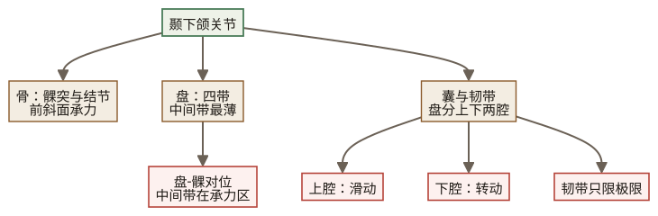
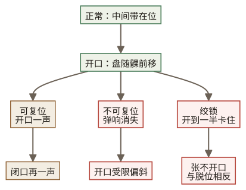

# 第 4 章 · 颞下颌关节与咬合

> **层次：** 撰写层——本章按四级编码 `02.04` 节重写，六个单元按「关节四件套—咬合两个正中—三要素与弹响」落位。课程原文是运动系统通论与关节学总论，本章取其中「关节面、关节囊、关节腔、关节盘、韧带」与「使下颌骨能够进行上提与下降与前进与后退与侧方运动」两句为骨架。
> **本章要回答的问题：** 全身的关节里，为什么只有这一对把关节腔隔成上下两间？「正中关系」与「正中𬌗」差一个字，为什么不能当同义词用？开口时「咔」一声、闭口又一声，到底是什么在跳？为什么弹响消失有时不是好转，而是变坏？
> **覆盖：** 课程章 `departments/08-wuguan/02-kouqiang-jiepou-shengli/chapters/04-e24/docs/zh.md`（12 单元 / 20,309 汉字）｜ 骨架取 `3.39`（关节学总论：关节面、囊、腔、盘、韧带）、`3.41`（颞下颌关节由髁突与下颌窝构成，腔内有盘，两侧联合运动）、`3.42`（咀嚼肌）｜ 单元 6 个：02.04.01.01 / .01.02 / 02.04.02.01 / .02.02 / 02.04.03.01 / .03.02。
> **参考状态：** 课程第 4 章与第 3 章同源，都是运动系统通论：颞下颌关节只在 `3.41` 出现一句，咬合与盘移位完全未展开。本章的关节结构按 `3.39` 的通则落到颞下颌关节上，咬合与盘-髁关系按通行口腔生理学补；补的部分不假称出自课程。
> **引用口径：** 引课程单元写 `派生·第3章·3.39`／`3.41`／`3.42`；引古籍只标书名与篇名。髁导斜度、切导斜度、开口度、盘移位分型的阈值一律不写——随个体差异，本书不给具体数；治疗参数不在本书范围。

---

## N.1 四件套：髁突、盘、囊、韧带

颞下颌关节是全身最特殊的一对关节，特殊在三处：它是**双侧联动**的，两侧由下颌骨连成一个刚性框架，动一侧必动另一侧；它的关节腔被一块**纤维软骨盘**隔成上下两间，两间各有各的运动；它用「转动＋滑动」两套动作完成同一个开口。三处特殊，都从四件套来。

四件套是：髁突与关节结节（骨）、关节盘、关节囊、韧带。骨提供面，盘提供适配，囊提供腔，韧带提供限位。

表 1 本章单元与出处

| 单元 | 主题 | 主要依据 |
|---|---|---|
| 02.04.01.01 | 髁突·关节盘·关节囊 | `派生·第3章·3.39`（关节面、囊、腔、盘）；`3.41` 一句 |
| 02.04.01.02 | 韧带与运动轴 | `派生·第3章·3.39`（韧带为辅助结构）；运动轴补 |
| 02.04.02.01 | 正中关系与正中𬌗 | 通行口腔生理学（课程未展开） |
| 02.04.02.02 | 前伸与侧方运动的引导 | 通行口腔生理学；`3.42` 咀嚼肌 |
| 02.04.03.01 | 三要素与三处常错 | 本章综合 |
| 02.04.03.02 | 弹响与绞锁的结构解释 | 通行口腔生理学（只给结构，不给分型阈值） |

### 02.04.01.01 髁突·关节盘·关节囊

**骨这一侧有两面。** 下颌骨升支上端的髁突呈椭圆形，上面有一条横嵴，把关节面分成前斜面与后斜面；**前斜面是功能面**，承力与滑动都发生在它上面，后斜面小，不主要承力。髁突颈细，前内侧有翼肌凹，是翼外肌下头的止点。颞骨一侧是下颌窝与关节结节，**关节结节的后斜面才是功能面**——髁突沿它下滑，这是开口时「滑」的那条轨道。两面的表面覆的是纤维软骨而非透明软骨，这在全身少见；理由是它要同时承受压力与剪切，纤维软骨更耐剪切。

**关节盘是这块关节的灵魂。** 它是纤维软骨，本身无血管无神经，分四带：前带、中间带、后带、双板区。**中间带最薄，也最无血管无神经，是承力区**；后带最厚，起阻挡作用；双板区在盘的后方，上下两层纤维把盘系于颞骨与髁突颈，内含血管神经与滑膜，是盘的「后附着」，可伸缩。盘的前缘与关节囊、翼外肌上头相连。

**关节囊**上附着于关节结节前斜面与下颌窝周缘，下附着于髁突颈；被盘分成上下两腔。**上腔大而松弛，管滑动；下腔小而紧，管转动。** 两腔互不相通，各有滑膜分泌滑液；上腔的滑液还部分来自双板区的渗出。

**体表怎么找它。** 让患者张口闭口，耳屏前下方能摸到一个前后滑动的小突起，就是髁突；髁突与耳屏之间、颧弓下缘之下的一小块，是关节区。触诊要两侧同时摸，比较动度与压痛：一侧滑动明显减弱，提示该侧活动受限；一侧压痛而另一侧不痛，提示病变在该侧。关节区前方是咬肌，后方是外耳道前壁——外耳道前壁触痛，是把关节病变与耳病分开的一条线。

四件套合起来的功能只有一句：**让髁突在运动全程都有一个「垫」在它与结节之间。** 这个垫就是盘的中间带。闭口时中间带夹在髁突前斜面与结节后斜面之间；开口时盘随髁突前移，中间带仍在两者之间。**盘的移位，本质是「中间带离开了承力区」**——记住这一句，本章后半都由此推出。

图 4-1 只画四件套的分工：骨给两面，盘给一个可移动的垫，囊把腔分成上下两间，韧带只在极限位拉住。

### 02.04.01.02 韧带与运动轴

三条韧带，各管一段极限。

**颞下颌韧带**在关节外侧，起于颧弓根部，止于髁突颈外侧。它最厚，作用是把下颌「吊」住，限制下颌过度向下向后；也是关节囊外侧的加强。

**蝶下颌韧带**起于蝶骨角棘，止于下颌小舌。它位置深，作用是保护进入下颌孔的下牙槽神经血管，并限制下颌过度后移。故它与第 3 章的下颌管是一条线上的两个结构：韧带在上，管在下。

**茎突下颌韧带**起于茎突，止于下颌角后缘，限制下颌过度前伸。

三条的共同点必须讲透：**它们都是「限制带」，不是「承重带」。** 关节的承重落在盘与骨面上，韧带只在极限位起作用。这与髋、膝不同——那里韧带是稳定结构的主体。颞下颌关节的稳定主要靠盘-髁对位与肌的张力，故盘一旦移位，韧带补不上；反过来，韧带松弛也不等于关节不稳，要看盘。

**运动轴有三条。** 横轴（铰链轴）在下腔，管开口初期的转动；垂直轴在工作侧髁突，管侧方运动的旋转；矢状轴理论上存在，实际少单独使用。三条轴不是三个关节，是同一个关节在不同阶段的三种运动方式。

由此得出开口的两段式：**先在下腔转，再在上腔滑。** 转动时髁突在盘下转、盘相对不动；滑动时盘与髁突一起沿结节后斜面下滑。故开口不是「一个动作」，是两个动作接起来；接不好，就出现开口型的中途改变（第 3 章 `02.03.03.02` 已述）。

双侧联动还有一句要补：两侧关节由下颌骨连成刚性框架，任一侧的运动都受另一侧约束。**故开口一旦偏斜，必有一侧不正常**——不会两侧一起「自然偏」。

## N.2 咬合：两个「正中」与三条引导

### 02.04.02.01 正中关系与正中𬌗

这两个词最容易混，混了就整章读不通。

**正中𬌗**（最大牙尖交错位）是上下牙尖窝接触面积最大的位置，**由牙决定**。它看得见、摸得着、可重复：让患者咬实，看哪颗牙先接触、哪颗牙不接触，都在牙上。

**正中关系**是髁突在关节窝内的一个特定位置，**由关节决定**，不由牙决定。它是一根参考位：在这个位置上，下颌可以自由地做铰链开闭而不偏。

问题在「特定位置」是哪一位，有两说。传统说「最后上位」——把下颌轻轻向后推，推到不能再退，髁突在窝的最后最上。现代说「前上位」——肌放松、下颌轻闭时，髁突自然落在窝的前上位，此时盘中间带正夹在髁突前斜面与结节后斜面之间。**本书取前上位为教学口径**，理由有二：它是肌放松下的自然落点，可重复；它保证中间带在承力区，与关节的生理一致。「最后上位」是被动推出来的，推的时候关节已被压向后，用它做参考等于把关节先摆到非生理位。

两说的差别不是学术趣味，落到手上就是两种操作：前者要「推下颌向后」，后者只要「让患者轻闭、别用力」。后者更容易重复，也更少干扰。

**还有第三个位要分清：下颌姿势位。** 它是肌放松、下颌自然悬垂时的位置，上下牙之间留一小段间隙，由肌的张力平衡决定。三个位的关系是：姿势位最松，正中关系是参考位，正中𬌗是咬实位。检查时若不先让患者放松，测到的「正中关系」其实是「咬合引导下的一个位置」，重复性差——这是操作上的分寸，不是理论上的花样。

**两者可以一致，也可以不一致。** 一致者从正中关系到正中𬌗没有滑动；不一致者有一个「长正中」——从参考位到牙咬实，下颌要向前上滑一段。滑动距离个体差异大，本书不给具体数。要紧的不是距离，是**有没有干扰**：滑动路径上若有某颗牙先顶住，髁突就被逼着绕开，关节受的力就不再是轴向的。

为什么必须把两者分开？因为**牙会变，关节相对不变**。牙会磨耗、会缺失、会因修复而改形；关节的位置则由骨与盘决定，稳定得多。故修复与正畸要一个「可重复的参考位」，只能用关节给的正中关系；而关节出问题时，要反问「咬合有没有逼着髁突离开这个位」。两句话，一个是「以关节定牙」，一个是「以牙查关节」。

判据：让患者轻闭、肌放松，看是否「向后上一弹」才咬实；有，即有正中关系至正中𬌗的滑动。单侧滑动伴同侧关节或肌的压痛，要查该侧的早接触。

### 02.04.02.02 前伸与侧方运动的引导

下颌不是自由走的，是被「斜面」规定的。规定的三处：前牙的舌面、关节结节的后斜面、盘的位置。这三处合称「引导」。

**前伸。** 下前牙切缘沿上前牙舌面下滑，这是前牙引导；与此同时，后牙立即分离，叫「前伸分离」；髁突沿结节后斜面下滑，这是髁导。三件事同时发生：前部由前牙定，后部由髁导定，中间不许有牙顶住。若前伸时后牙仍有接触，就是前伸干扰——力被引到本该分离的后牙上。

**侧方。** 下颌向一侧移动时，该侧为工作侧，对侧为非工作侧。工作侧的引导可以来自尖牙的舌面（尖牙引导），也可以来自多颗后牙（组牙功能）；非工作侧则必须**完全分离**——那边的髁突正向前内下滑，后牙若还接触，就成了非工作侧干扰。这一侧的干扰最容易被漏，因为它发生在看不见的一侧，患者也说不清。

引导的结构含义：**它把力分配掉了。** 前伸时由前牙承担，侧方时由工作侧承担，非工作侧与后牙被「卸掉」。故任何一处磨耗、缺失、修复体形态不当，都会改变路径：本该卸力的地方开始受力，本该受力的地方反被架空。髁导斜度与切导斜度随个体差异，本书不给具体数；能说的是方向——前牙引导越陡，后牙分离越快；髁导越陡，后部滑行越急。二者不匹配，干扰就出现。

判据两句：前伸时后牙有接触，是前伸干扰；侧方时非工作侧后牙有接触，是非工作侧干扰。两句都要在口内实际磨动才看得见，问诊问不出来。

## N.3 三要素与三处常错

### 02.04.03.01 三要素与学生最常错的三处

三要素是关节、咬合、肌。三者构成一个三角形：任一边变，另两边代偿；代偿用尽，就是症状。关节这边看盘-髁对位与骨面；咬合这边看尖窝关系与三条引导；肌这边看升颌、降颌、翼外的分工与张力（第 3 章 `02.03.03.01`、`.03.02`）。三者必须一起读——只看关节会把咬合问题漏掉，只看咬合会把肌的紧张当成牙的错。

代偿有方向。举一条最常见的：后牙缺失后余牙倾斜、对颌牙伸长，接触点减少，闭口时髁突被逼向后上寻找支撑，盘所受剪切的方向随之改变；若双板区已被拉长，盘就前移。这条链上每一环都是结构，不是「上火」。反过来也成立：盘移位后滑动路径改变，患者会不自觉地避开某一侧咀嚼，久之该侧牙磨耗加重。三要素之间的箭头是双向的——这是本章与「单一病因」说法最大的不同。

三处常错，一处一处纠。

**一、把关节盘当半月板。** 半月板在膝，是透明软骨样的纤维软骨，中央有血供；关节盘是纤维软骨，**中央无血管无神经**，且把关节腔隔成上下两间，前缘还有翼外肌附着。差别不是名词，是判据：盘中央穿孔不痛（无神经），痛的是双板区被牵拉（有神经）。故「关节痛＝盘坏了」不成立，要看痛在哪。

**二、把正中关系当「下颌最后退位」。** 最后位是被动推出来的，不是生理位；用它做修复参考，等于先把髁突压向后上，再让牙去适应这个位。代价是关节长期处在前方无垫、后方受压的状态。正确的参考位是肌放松下的前上位。

**三、把弹响当「关节错位」。** 弹响是盘-髁关系在运动中一次「复位—再移位」，关节并没有脱出关节窝；真正的脱位是髁突滑到结节前方不能退回，表现是**闭不上口**。两者一个能咬上、一个咬不上，方向相反，不能混。

## N.4 弹响与绞锁：盘移位的结构解释

### 02.04.03.02 弹响与绞锁的结构解释

先把正常状态说清：闭口时盘中间带在髁突前斜面与结节后斜面之间；开口时盘与髁突同步前移，中间带始终在承力区。**全程有垫。**

**盘前移位**是这条链的第一环：盘被拉向前（双板区松弛、翼外肌上头张力异常、髁突后移都可致），闭口时前带垫在髁突与结节之间，**中间带跑到前方**。此时承力区上没了垫，髁突压在后带或双板区上。

**可复位。** 开口时髁突前移，越过盘后带，盘「啪」地弹回原位，中间带回到承力区——这一下就是开口的那声「咔」。闭口时盘又滑向前，再响一声。故**开口一声、闭口一声，是可复位的标志**；弹响发生在开口中段，不是末段。

**不可复位。** 盘被推到前方回不来，髁突始终压在盘后带与双板区上。表现是：开口受限、开口偏斜向患侧、**没有弹响**。没有弹响不是好事——是没有「复位」这一下可响了。这是本章最容易被误读的一句：**弹响消失可以是好转，也可以是盘再也回不去。**

**绞锁。** 开口过程中突然卡住，要侧动或轻推才能继续（间歇性绞锁）；或完全张不开（闭锁）。结构上是盘在某一段路上「挡住」了髁突，或双板区炎症、粘连使滑行受阻。与脱位的鉴别只有一句：**闭不上口是脱位，张不开口是绞锁。**

图 4-2 只画一种关系：中间带在不在承力区。三种状态是同一件事的三个程度，不是三种病。

音的位置比「有没有响」有用：开口初响多为移位早期，盘弹性尚可；中段响为移位加重；摩擦音、捻发音提示骨面已暴露（盘穿孔或骨关节面改变）；无响而受限，指向不可复位。本书不给分型阈值——开口到什么程度算受限、移位到什么程度算不可复位，随个体差异，且判定要靠影像与临床合看；治疗参数更不在本书范围。

影像各看一层：曲面体层与 CT 看髁突外形与骨面，看有无增生、变平、囊性变；盘与双板区要看磁共振，因为盘是纤维软骨，在 X 线与 CT 上不显影。故「拍片说关节没问题」只说明骨没问题，不等于盘在位——这一句要写进报告的读法里。

为什么这条链值得单独讲？因为它把「结构—运动—声音—症状」四件事接成了一条可推的线：盘移位是结构，弹响是运动中的一次事件，受限是运动的后果，痛是双板区被牵拉的结果，不是盘本身。学会这条线，就不会把「有关系」说成「错位」，也不会把「不响了」当成「好了」。

## N.5 接口、争议与立场

**与中医的接口。** 面部的穴位正落在本章的结构上：颊车在咬肌隆起处，下关在颧弓下缘与下颌切迹之间，正是咬肌与关节的体表投影；听宫在耳屏前，也是关节区。「口噤」「颔肿」「颊车痛」这些症状词，落到结构上是开口受限、关节区肿胀与咬肌张力增高。能对读的是位置与症状，不能对读的是机制——「筋」可以对应肌与韧带，「骨」可以对应髁突与窝，但「骨错缝」不是盘移位，手法也不能把盘「推回去」。分寸在这里。

**三处争议。** 一、正中关系取最后上位还是前上位，本章取后者，已在上文说明理由；两说并存，读者应知道自己站在哪一说上。二、盘移位是否必然进展：不必然，许多人终生有弹响而无疼痛，故移位是结构改变，不等于疾病。三、咬合与关节症状的因果方向：横断面上二者常同时出现，但不能由此断定谁因谁果；本章只写「可以互相加重」，不写「必由咬合引起」。

> **免责声明：** 本章为教学材料，不构成医学意见或治疗指导。文中不给开口度、髁导与切导的数值，不给盘移位分型阈值，不写治疗参数与手术入路；一切检查与处置须由具备资质者依现行规范作出。凡见开口突然受限、闭口不能咬合、关节区明显肿痛者，按急症转诊。

## 思考题

1. 一名患者开口时先直后偏、中段「咔」一声、闭口又一声，最近弹响消失而开口更小。请用盘-髁关系说明前后两种状态各是什么，并解释为什么「不响了」不能当作好转。
2. 正中关系与正中𬌗为什么要分开？如果一位患者从参考位到咬实有单侧滑动，你要问哪三个问题，才能判断这段滑动是「长正中」还是「干扰」？
3. 关节盘中央穿孔为什么不痛，而双板区被牵拉会痛？由此说明「关节痛」定位的结构依据，并指出「关节痛就是盘坏了」这句话错在哪里。

## 延伸阅读

- 课程 `派生·第3章·3.39`「关节学总论」——关节面、关节囊、关节腔、关节盘与韧带的通则出于此；本章把它落到颞下颌关节上。
- 课程 `派生·第3章·3.41`「下肢与颅的关节与体表标志」——「颞下颌关节由下颌骨的髁突与颞骨的下颌窝构成，关节腔内有颞下颌关节盘，两侧关节联合运动」一句出于此，是本章唯一的直接依据。
- 《灵枢·经脉》足阳明胃经循颊车、下关一线——面部穴位与本章结构的对读之据。引时标篇名，不标页码，不取「骨错缝」之说。
