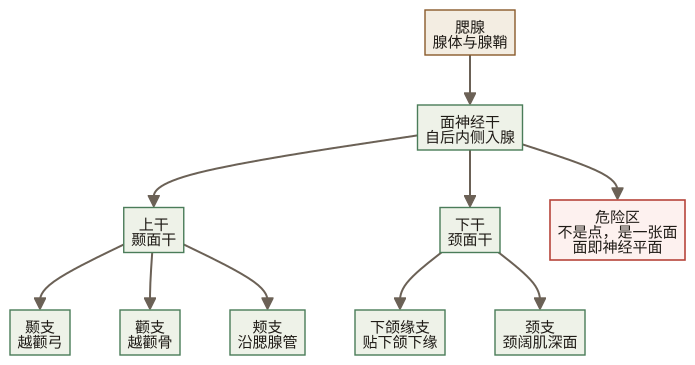
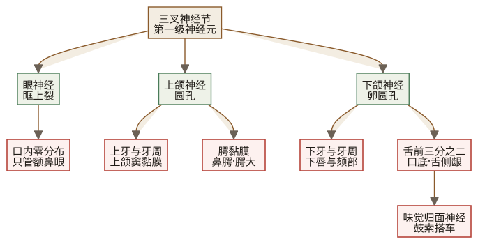

# 第 5 章 · 唾液腺与神经支配

> **层次**：本文件是**撰写层**——课程第 5 章（`05-e25`，12 单元）给的是神经系统总论：神经元、脊髓、脑干、传导通路、被膜与脑室。它给了一副「感觉通路与运动通路」的框架，没有给腺体。故腺体形态按通行口腔解剖学补写，神经只取「三叉与面神经在口内的分布」一层。
> **本章要回答的问题：** 腺出了事，先答三问——腺在哪、管往哪走、口开在哪；神经出了事，也答三问——管感觉还是运动、边界落在哪颗牙、损害平面在核上还是核下。
> **覆盖：** 课程第 5 章；五个四级单元 02.05.01.01–02.05.03.02，分属「三对大腺」「小涎腺」「神经」三节。
> **真源状态：** 课程第 5 章与章题只部分对应。可用原句两处：三对大腺「按位置与开口类别分为腮腺与下颌下腺与舌下腺」；「皮质核束止于面神经核下部与舌下神经核的纤维主要来自对侧皮质」（5.64）。前者是腺体部分的起点，后者是 §N.5 损伤定位的判据。
> **引用口径：** 腺体重量、唾液流量、神经径值一律不写，须给数处写「随个体差异，本书不给具体数」。切口与入路、麻醉的药物与剂量不写。图全部自绘。

---

## N.1 概念与出处

涎腺与神经在口腔里是一条线上的两个接头：腺泡分泌由自主神经定，腺体被碰到时那一下痛由三叉神经定。

三处坐标要具体。**腺在哪**靠间隙与毗邻说：腮腺在下颌后窝，颌下腺在下颌下三角，舌下腺在口底黏膜下。**管往哪走**靠转折与跨越说：腮腺管横过咬肌再穿颊肌，颌下腺管绕过下颌舌骨肌后缘再贴口底前行，舌下腺没有主管。**口开在哪**靠黏膜标志说：对着上颌第二磨牙的颊黏膜、舌下阜、舌下襞。三问缺一问，「腮腺的病」与「腮腺管的病」就混成一句。

| 概念 | 出处 | 一句定义 |
|---|---|---|
| 大涎腺 | 课程 5.95 | 三对，腺体在口腔壁外，借长导管开口于黏膜固定处 |
| 小涎腺 | 本章补写 | 唇、颊、腭、舌、磨牙后黏膜与黏膜下层的成片腺体，短管直接开口 |
| 腺鞘 | 本章补写 | 颈深筋膜浅层分两层包绕腮腺形成的筋膜套；浅层致密，深层薄弱 |
| 鼓索 | 本章补写 | 面神经的管内分支，含分泌纤维与舌前三分之二味觉纤维，并入舌神经 |

**全章骨架：腺看三处，神经看两条，交界看一点。** 三处是腺体、导管、管口；两条是三叉管感觉、面神经管运动与分泌；一点是鼓索并入舌神经之处——舌前三分之二的触痛温归三叉、味归面神经，两种纤维走同一根神经。还有一条要先立：**腺的「位置」与腺的「归属」不是一件事**——腮腺在耳前，分泌开关却握在舌咽神经手里。

## N.2 腮腺：一个包着神经的腺

**腮腺鞘的厚薄不均是本章第一个有临床含义的结构。** 腮腺上贴外耳道与颞下颌关节后部，前贴咬肌后部与下颌支后缘，后贴乳突与胸锁乳突肌前缘，内侧面贴茎突诸肌与咽侧壁。包裹它的颈深筋膜浅层在此分为两层：浅层致密，向上附于颧弓；深层薄，某些部位甚至缺如，直接贴咽侧壁。故腮腺的化脓性炎症向外不易穿破浅层，向内却容易穿破深层进入咽旁间隙，或沿外耳道方向破溃。**腮腺脓肿先肿在咽侧而不是脸上，原因在两层筋膜的厚薄差，不在腺体本身。**

### 02.05.01.01 腮腺与面神经的关系

腮腺的分部有一处常被误读：**腮腺没有真正的峡，浅部与深部的分界是人为划的，参照物就是面神经。** 通行说法把神经在腺内走行的平面当作两部界面，平面浅面为浅部、深面为深部。所以「浅叶」与「深叶」的分别，本质是「在神经平面哪一侧操作」的分别，不是「切上面一块」与「切下面一块」。

神经按段记。面神经出茎乳孔后经茎突根部外侧前行，从腮腺后内侧入腺；在腺内先分上干（颞面干）与下干（颈面干），再分颞、颧、颊、下颌缘、颈五组分支。五组分支并不都从前面出去：颞支、颧支多自腺体上缘穿出，颊支、下颌缘支自前缘，颈支自下缘。**「腺的前缘」只是出口之一，这是看图最容易漏的一句。**

腮腺管自腺体前缘发出，横过咬肌表面向前，到咬肌前缘几乎成直角转向内，穿颊肌，开口于与上颌第二磨牙相对的颊黏膜乳头。它穿颊肌是斜穿的：在肌内走一小段，这段斜行形成类似瓣膜的机制，口内压升高时管壁被压闭。**鼓腮、吹号时腮腺管不进气，靠的是这段斜穿，不是管口的形状。** 在咬肌表面这一段，管与颊支、颧支同层且相距很近，故**找到管就找到颊支的大致方位**；反过来，颊部手术看到管，就要想到管旁有神经。

腮腺床按「两静两肌四神经」记：颈内动脉、颈内静脉；茎突舌骨肌、茎突舌肌（连同茎突咽肌）；舌咽、迷走、副、舌下四对脑神经，均在深部内侧。

到这里可以说核心句：**腺是「包着神经的腺」，不是「挨着神经的腺」。** 神经不是从腺旁经过，是从腺中间穿过，被腺泡与疏松结缔组织包埋。由此推三件事：风险不落在「切到腺」而落在「切到穿过腺的神经」；腺内神经没有一层能凭手感分辨的鞘，器械推进的触感与腺组织无差别；浅深两部的界面就是神经平面，切浅部时分离面必然是神经面，没有「再深一点」的余量。所以**危险区不是点，是一张与腺体等大的面**，面上最脆弱的一段是下颌缘支，理由在 §N.5 说清。

**图注**：图自腮腺起，经面神经干、上下两干，到五组分支与各自的出走缘；末行标出危险区——不是一点，而是与神经平面重合的一张面，下颌缘支在此面上最浅。读图顺序是「腺—干—支—面」，四步走完，才知道风险落在哪一层。出处：本章 §N.2 与 §N.5。

> 【边界】腮腺手术的切口、翻瓣层次、神经解剖与保护技术不属本章。本章只给「为什么危险」的结构原因，不给「怎么避开」的操作。

## N.3 颌下腺与舌下腺：两条贴着口底的管

### 02.05.01.02 颌下腺与舌下腺

**颌下腺**在下颌下三角内：前界二腹肌前腹，后界二腹肌后腹，上界下颌骨下缘，底为下颌舌骨肌。它分浅、深两部，分界是**下颌舌骨肌的后缘**——浅部在肌的浅面（能从下颌下摸到的那一部），深部绕过肌后缘进入舌下区。这个「绕过」是本章第二个有临床含义的结构。

导管自深部发出，前行于口底黏膜下、舌下腺内侧，开口于舌下阜。整条管是「由深到浅、由后外到前内」的一段长路，两处要紧：绕过下颌舌骨肌后缘的转折，角度急、位置深；靠近开口的一段较窄。**涎石与炎症为什么偏爱这两处**，答案不是「管细」，是「一处折、一处窄」——折处流速改变，窄处易滞留。

**舌下腺**在口底黏膜下、下颌舌骨肌上方、下颌骨体内侧，是三对里最小、最散的一对。它**没有主导管**：多数小管开口于舌下襞，一部分汇入颌下腺导管，与之共开口于舌下阜。记住这一句，两个隆起的分别就清楚了：**舌下阜是「合用口」，舌下襞是「独用口」。**

三对腺的分工并成一句：**腮腺包着神经，颌下腺绕一个急弯，舌下腺一片多口。** 功能上，**静止时以颌下腺与小涎腺为主，刺激时腮腺出力**。

> 【边界】口干不等于唾液少。自觉口干可以是分泌量减少，也可以是成分改变（黏稠、润滑不足）、黏膜感觉异常或长期张口呼吸。流量测定与判读属唾液腺专科，不给数值、不给界限。

## N.4 小涎腺：没有管口的腺

### 02.05.02.01 分布与其临床意义

小涎腺按部位命名：唇腺、颊腺、腭腺、舌腺（舌前腺与舌根腺）、磨牙后腺。它们位于黏膜与黏膜下层，腺体小、数目多、分布广，各以短管直接开口于所在黏膜面。**没有长导管，就没有固定管口可指认**——这是小腺与大腺在记录上的根本差别：大腺说「哪条管的口」，小腺只能说什么区域。

**一是腭腺最密。** 硬腭黏膜与骨膜结合紧密，中间没有可移动的黏膜下层，而黏膜下几乎全是腺体。由此三件事：硬腭黏膜薄、不能移动、感觉敏锐；腭部成了「无痛性肿块」的常见部位；黏膜与骨膜紧贴，注入的液体不易扩散，腭侧注射因此比其他部位痛，需缓慢加压。

**二是磨牙后腺与舌腺各有落点。** 磨牙后三角的磨牙后腺前外侧紧邻腮腺前缘，故该区肿块要先分「小涎腺」与「腮腺」两问——两者组织学类型不重合，按腮腺的经验套会套错；舌前腺在舌尖腹侧、舌根腺在轮廓乳头之后，两群隔着整个舌体，记录部位必须分开。

小涎腺的意义归两点。**其一，基础分泌的份额不可忽略：** 大腺在刺激时出力，小腺在静止时持续渗润；小腺广泛萎缩或被破坏者，表现是「整天干、黏膜发黏」，不是「进食时干」。**其二，分布决定记录：** 小腺病按区域发生，只能用中线、切牙、腭缝这类可复现标志作锚点，如「硬腭中线偏左、第二磨牙平面之前的黏膜下」；没有锚点的记录，复诊无法比。

## N.5 两条神经线：感觉归三叉，运动与分泌归面

口腔的神经可粗分为两条线：**三叉管「知道」，面神经管「动」。**

### 02.05.03.01 三叉神经三分支的口内分布

三叉神经节发出三支：眼神经经眶上裂入眶，上颌神经经圆孔入翼腭窝，下颌神经经卵圆孔入颞下窝。三支都含感觉纤维，只有下颌神经另含运动纤维（咀嚼肌、下颌舌骨肌、二腹肌前腹、腭帆张肌、鼓膜张肌）。课程 5.63 那句「头面部的浅感觉通路以三叉神经节为第一级神经元」给的是起点，本章只取外周段——三支各管口内哪一格。

**眼神经在口内是零分布。** 它管额部、上睑、鼻背、角膜、鼻腔上部与鼻窦。这一句要单记，因为它是本章所有边界的第一条：**口内没有任何一块黏膜归眼神经。** 由此可推：口周麻醉若只按「面上部与面中部」分，容易把鼻侧与上唇的交界划错——那条界线在鼻前庭与鼻背之间，不在上唇。

**上颌神经按三个孔记最省力。** 眶下孔出眶下神经，管下睑、鼻侧与上唇；眶下管内上牙槽前、中、后神经管上颌牙与牙周、上颌窦黏膜、上颌颊侧牙龈；腭大孔出腭大神经，向前分布硬腭后部与腭侧牙龈直至尖牙区；腭小孔出腭小神经，管软腭与扁桃体区；切牙孔出鼻腭神经，管硬腭前部与上颌中切牙牙周。

**下颌神经按三条神经记。** 颊神经经颊肌外侧前行，管颊黏膜与下颌磨牙、第二前磨牙的颊侧牙龈；舌神经经翼内肌与下颌支之间入口底，管舌前三分之二的黏膜一般感觉、口底黏膜与下颌舌侧牙龈；下牙槽神经入下颌孔，管下颌牙与牙周，末支颏神经出颏孔，管下颌前牙与第一前磨牙的唇颊侧牙龈、下唇与颏部皮肤。

**第一条，上下线。** 上颌两个区归上颌神经，下颌两个区归下颌神经。**牙位代号的前一段直接决定神经归属**：上颌第一磨牙的落点是上牙槽后神经，下颌第一磨牙是下牙槽神经。第 2 章说「记录要能反推位置」，本章补后半句：**位置还能反推神经。**

**第二条，前后线（腭侧）。** 硬腭前部归鼻腭神经，后部归腭大神经，交界在上颌尖牙与前磨牙之间，且有重叠：两神经末支在腭中缝附近有吻合。故「拔上颌前磨牙只阻滞腭大神经」会留痛，原因不是技术，是交界处的重叠支配。

**第三条，内外线（下颌）。** 同一颗下颌牙的颊侧与舌侧归不同支：颊侧归颊神经或颏神经，舌侧与口底归舌神经；而下颌前磨牙区的颊侧，颊神经前界与颏神经后界又交叠一次，该区麻醉常需两支兼顾。两处的共同点是「重叠」而不是「缺如」——重叠区痛觉不消失，只减弱，这是「麻了但还痛」的常见解释。

还要立一条不属三叉的边界：**舌前三分之二的味觉不归三叉。** 一般感觉（触、痛、温）归舌神经，味觉归面神经的鼓索；鼓索自面神经管内段发出，经岩鼓裂出颅，从后上方并入舌神经，随它到舌。舌后三分之一则一般感觉与味觉都归舌咽神经。分工是：**舌前三分之二「触痛温归三叉、味归面神经」，舌后三分之一「两样都归舌咽」。**

**图注**：图以三叉神经节为根，三支并列：眼神经标「口内零分布」，上颌与下颌两支下列的是口内落点，舌前三分之二的下面再注一行「味觉归面神经」。读图要点：牙位代号的前一段（象限）直接决定神经归属，这是上一章四区法的后半句。出处：本章 §N.5。

### 02.05.03.02 面神经五支与危险区

| 支 | 走行要点 | 支配 | 损伤表现 |
|---|---|---|---|
| 颞支 | 越颧弓中段，于颞浅筋膜深面上行 | 额肌、眼轮匝肌上部、皱眉肌 | 额纹消失、不能皱眉 |
| 颧支 | 越颧骨，分上、下股 | 眼轮匝肌下部、颧肌、提上唇肌 | 眼睑闭合不全、下睑外翻 |
| 颊支 | 沿腮腺管上、下方前行，分支多、吻合多 | 颊肌、口轮匝肌、提口角肌 | 鼓腮漏气、食物积于颊前庭（常被代偿） |
| 下颌缘支 | 沿下颌支后缘下行，越面后静脉与面动脉，贴下颌下缘 | 降口角肌、降下唇肌、颏肌 | 口角下垂、流涎、不能噘嘴 |
| 颈支 | 自腺体下缘穿出，行于颈阔肌深面 | 颈阔肌 | 张力减弱（多可代偿） |

**「哪支最重要」与「哪支最常伤」不是同一支：** 颞支伤了最显眼，下颌缘支伤了最影响生活，而后者恰恰最常受累。原因三条，都属结构：**行程最长**——自腺体下缘穿出后要沿下颌下缘走一段相当的距离，途中每段都在腺体周围或颈部筋膜浅层附近；**位置最浅**——在下颌角附近贴下颌下缘浅面走行，上方只有皮肤、皮下与颈阔肌，按层次分离时它落在最先被碰到的那一层；**被血管固定**——跨面后静脉与面动脉处被血管周围结缔组织固定，活动度最小，牵拉时这些交叉点就是受力点。三条同时具备的，只有下颌缘支。

**其一，平面原因。** 神经在腺内走行的平面就是浅、深两部的界面。切除浅部，分离面必然是神经面，没有「再多留一点」的余量。所以危险区不是某个点，是一张与腺体等大的面。**这就是为什么腮腺手术的讨论总在「平面」上，而不在「点」上。**

**其二，包埋原因。** 腺内段的神经被腺泡与疏松结缔组织包埋，没有一层能凭手感分辨的鞘；器械推进的触感与腺组织无差别。**这就是为什么「摸到神经再避开」在腮腺区不成立**，也是这一区只能「按已知平面推进」的理由。

**其三，变异原因。** 五支的发出形式、两干的长短、支间吻合个体差异大。通行图画的是多数型：上干出颞、颧、颊，下干出下颌缘、颈；但两干间的纤维交换、颊支与颧支的交通、下颌缘支与颈支的共干，都是常见变异。**按图找神经，找到的是图，不是这一例的神经。**

损伤定位有一条判据必须会：**看额纹。** 额肌受双侧皮质核束支配，核上（中枢性）损害时对侧额肌仍有同侧皮质纤维，额纹保留；核下（周围性）损害时患侧额肌完全失去支配，额纹消失。课程 5.64 那句「皮质核束止于面神经核下部与舌下神经核的纤维主要来自对侧皮质」正是依据——面神经核上部接受双侧纤维，下部只接受对侧，故中枢性面瘫只累及下部面肌，周围性则上下一起。

最后补分泌的一面，它是把腺与神经接起来的扣。**腮腺的开关归舌咽神经**：鼓室支→鼓室丛→岩小神经→耳神经节换元→节后纤维经耳颞神经入腮腺。**颌下腺与舌下腺的开关归鼓索**：副交感纤维随舌神经至下颌下神经节换元，节后纤维至两腺。**腭腺与鼻腔腺体的开关归岩大神经**：经翼管神经至翼腭神经节换元，节后经腭神经至腭腺。三条合看得到一个反直觉的结论：**面神经管着三对腺里的两对半，唯独不管腮腺；管腮腺的是舌咽神经。**

**本章的争议与立场。** 争议一：面神经在腮腺内有无筋膜鞘——一说有鞘状间隔，一说只有疏松结缔组织；本书取后者的实用含义「没有可凭手感分辨的鞘」。争议二：腮腺浅、深两部的分界，一说以神经平面、一说以腺体峡部，本书取前者。争议三：舌前三分之二的味觉是否只经鼓索——通行以鼓索为主而另有旁路，本书取「鼓索为主」，不给比例。

立场三条：只写形态、位置、毗邻、分布边界与损伤表现，不写切口、翻瓣与神经修复；不写腺体重量、唾液流量与神经径值；不写麻醉的药物、浓度与进针深度——本章给的是「哪一支管哪一格」。

> **免责声明：** 本章为教学材料，不构成诊断或治疗建议。一切检查、用药与处置，须由具备资质的执业人员依现行规范与所在机构制度作出。面瘫、持续单侧腮腺或颌下肿胀、进食时反复肿痛或口腔内不明原因的肿块，须经口腔科、耳鼻咽喉科或神经科检查。本章不给剂量、不给疗程、不含研究数据与疗效结论。

## 思考题

1. 腮腺区的危险区为什么是一张「面」而不是一个「点」？用腺内走行平面、神经被包埋的方式、分支变异、血管旁固定四条作答。
2. 下颌第一磨牙与下颌侧切牙的颊侧牙龈归不同神经支。写出各自的分支与交界所在，并说明这个交界为什么会让「一次阻滞麻醉」漏掉一颗牙。
3. 两位患者都表现为口角下垂：一位额纹消失、不能闭眼，一位额纹保留、闭眼正常。分别判断损害平面，并写出支持判断的那一条解剖事实。

## 延伸阅读

- 课程正文第 5 章（`departments/08-wuguan/02-kouqiang-jiepou-shengli/chapters/05-e25/docs/zh.md`）5.63、5.64、5.65 三段——5.63 给「三叉神经节为第一级神经元」的起点，5.64 给「面神经核上、下部接受纤维来源不同」的判据，5.65 给「内脏运动神经须在节内换元」的框架。
- 《口腔解剖生理学》口腔局部解剖「唾液腺」「口腔颌面部神经」两章——腮腺床的组成、面神经五支的走行、三叉神经末支的口内分布可与之对读；本书只标章目，不引页码与图表。
- 《口腔颌面外科学》涎腺疾病章——腮腺鞘厚薄不一的后果、面神经分支型别与手术危险区的关系可与之对读；本章只取解剖依据，不引处置方案与手术入路。
