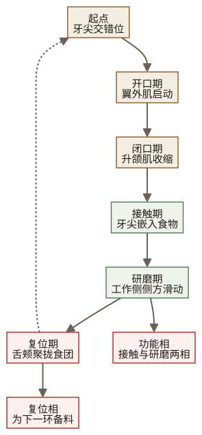
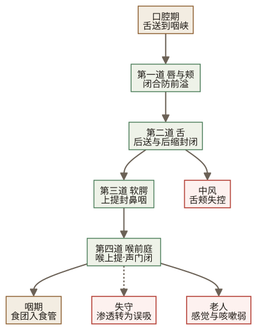

# 第 6 章 · 咀嚼与吞咽

> **层次**：本文件是**撰写层**——课程第 6 章（`06-e26`，12 单元）实为消化系统总论：口、咽、食管、胃、小肠、大肠、肝、胰、腹膜。与章题对得上的只有 6.70「口腔与咽与食管」一段，它给了腭、咽峡、舌与口底的形态；咀嚼周期、咀嚼力与效率、吞咽分期，课程未给，本章按通行口腔生理学补写。
> **本章要回答的问题：** 口腔做两件事——把食物做成团，把团交出去。两件事共用一条通道，而这条通道同时是气道。故本章所有结构的落点都一样：**谁，在什么时候，关哪一道门。**
> **覆盖：** 课程第 6 章；四个四级单元 02.06.01.01–02.06.02.02，分属「咀嚼」「吞咽」两节。
> **真源状态：** 课程 6.70 可用原句两处：「腭垂与两侧腭舌弓与舌根共同围成咽峡，为口腔与咽的分界」；「软腭与腭咽弓与咽后壁之间形成腭咽部的腔隙类别……是理解吞咽过程的形态基础」。前者是 §N.4 交接点的落点，后者是 §N.5 第三道门的形态依据。
> **引用口径：** 咀嚼次数、周期时长、咬合力与效率的数值、各期时长与误吸发生率，一律不写。喂养技巧、食物性状分级、康复训练方案不写。图全部自绘。

---

## N.1 概念与出处

咀嚼与吞咽是同一条流水线的两段：前一段把食物做成团，后一段把团交给咽。分开讲，是因为两者的控制方式不同——咀嚼是随意运动，可随时停；吞咽一旦触发就不能停。

| 概念 | 出处 | 一句定义 |
|---|---|---|
| 咀嚼 | 本章补写 | 下颌的节律性运动，把食物破碎、混唾液、压成食团 |
| 咀嚼周期 | 本章补写 | 从某一位置出发，经开口、闭口、接触、研磨回到起始位的一个运动环 |
| 咀嚼力 | 本章补写 | 咀嚼肌收缩能发出的力，是有方向与部位差异的上限 |
| 咀嚼效率 | 本章补写 | 单位时间内把食物破碎到给定程度的实际完成量 |
| 食团 | 本章补写 | 被破碎并与唾液混合、可整体后送的团块 |
| 咽峡 | 课程 6.70 | 腭垂、两侧腭舌弓与舌根围成的口咽分界 |
| 腭咽闭合 | 本章补写 | 软腭上提贴咽后壁，封闭鼻咽 |
| 喉前庭 | 本章补写 | 喉口至声门之间的空间，四道保护的最后一道守在这里 |
| 渗透与误吸 | 本章补写 | 食团入喉前庭（未过声门）为渗透；越声门入气管为误吸 |
| 沉默性误吸 | 本章补写 | 误吸发生而无咳嗽等可见反应，故不被察觉 |

**全章骨架：一口两事，四期三段，四道门。** 一口两事，是咀嚼与吞咽都从口腔起；四期三段，是口腔准备期与口腔期（口腔段，可随意停）、咽期（咽段，反射，不可停）、食管期；四道门，是唇与颊、舌、软腭、喉前庭。

还有一条读法要先立：**分期的分界不是解剖位置，是「能不能随时停下」。** 口腔期能停，咽期不能停——这一条比任何期名都重要。期名可以有几套分法，这条不能变。

## N.2 咀嚼周期：一个环上的五相

### 02.06.01.01 咀嚼周期的五个阶段

一个咀嚼周期，是下颌从某一位置出发，经开口、闭口、接触、研磨，回到起始位置的一次完整运动。一个食团要被嚼碎，需要重复若干周期；次数随食物性状、牙列状态与个体而异，本书不给数。

五相（即五期）的分法各本教材不完全一致，本书取五相，理由是把「接触」与「研磨」分开——两者的力学完全不同。

**一、开口期。** 翼外肌下头启动，二腹肌前腹、下颌舌骨肌、颏舌骨肌下降下颌。运动先快后慢，接近最大开口时减速；这个减速是保护，避免关节与肌被突然牵张。

**二、闭口期。** 咬肌、颞肌、翼内肌收缩，下颌上升。也是先快后慢，遇到食物阻力时进一步减慢。这个「遇阻减速」不是意志控制，是牙周膜的本体感觉反射——第 2 章说牙周膜是「软连接」，此处兑现：膜受压，传入冲动到三叉神经中脑核与感觉核，反射性减少升颌肌的出力。**没有这层膜，闭口就是一次硬碰。**

**三、接触期。** 牙尖嵌入食物，剪切开始。此时下颌可在牙尖交错位，也可在偏心位（工作侧），取决于食团的位置。

**四、研磨期。** 下颌向工作侧侧方滑动，牙尖沿食物已形成的沟槽推进，把食团压碎、磨细；同时舌与颊把散开的食物重新送回牙列之间。

**五、复位期。** 下颌回到起始位置，舌把食团聚拢到舌背，颊肌把它推回牙列；此时有短暂的肌电静息，即下颌姿势位。

一条读法：**五相不是五个动作，是一个环上的五个相。** 开口与闭口是运动相，接触与研磨是功能相，复位是复位相；真正做事的是第三、第四相，其余三相都在为它们服务。任何一相失手，结果都不是「嚼不动」，而是「嚼不碎」或「嚼得慢」。

**图注**：图把五相连成一个环，虚线回到起点，说明这是反复执行的循环而不是一次性的序列；右侧标出两相「做事」、一相「备料」。读图要点：环上没有起点，所谓「起点」只是观察时选的一个位置。出处：本章 §N.2。

节律由谁定？基本节律由脑干的中枢模式发生器产生，牙周、肌梭与关节的感受器反馈调制。**故无牙者仍有咀嚼节律，只是幅度与协调改变。** 这解释了全口义齿患者的一句常见主诉——「嚼得动，却嚼不烂」：节律在，接触面积不在。

运动型有四种：开闭、前后（前伸与后退）、侧方，以及三者的混合。侧方运动时，下颌偏向的一侧是工作侧，另一侧是平衡侧，由该侧翼外肌推动——与第 4 章的关节运动轴相接。

## N.3 咀嚼力与咀嚼效率：上限与产出

### 02.06.01.02 咀嚼力与咀嚼效率

这两个词常被当成一件事，其实是两件事。**力是上限，效率是产出。**

**咀嚼力**是咀嚼肌收缩能发出的力。它不是一个数，是一组条件。**方向**：垂直向最大、侧向最小——牙周膜的纤维排列对垂直向力耐受最好，对侧向力最差，这是「咬硬物不要左右晃」的结构原因。**部位**：沿牙列自前向后升高，磨牙区最大，因为升颌肌的力臂与牙周支持面积在此最大。**牙周支持**：牙周膜面积决定「能承受多少」，不是「能发出多少」；力再大，膜承受不住就是创伤。**关节负荷**：力经髁突传至关节，力越大负荷越大，故「能咬」与「该咬」不是一回事。

**咀嚼效率**是单位时间内把食物破碎到给定程度的实际完成量。它取决于：有效接触的牙单位数（接触面积）、牙尖形态与咬合关系、食物的性状与量、唾液的润滑、舌与颊的搬运、肌的协调与耐力。

两者的关系可以用一句话切开：**牙列缺失者的肌力仍在，接触面积却是零，效率近于零；肌力中等而牙列完整、咬合稳定者，效率可以很高。** 由此推三条。其一，修复的目标是效率——恢复接触面积与稳定，不是把力做大。其二，「咬得动」与「嚼得碎」是两件事：前者是力，后者是效率。其三，主诉「嚼不烂」而咬合力正常者，问题常在接触面积、食物大块未被剪切，或舌颊搬运不足（舌肌弱、义齿不稳、中风后单侧失控）。

咀嚼的功能也不止破碎，共五项：破碎并与唾液混合（润滑、初步消化）；把食团压成形（为吞咽备料）；刺激味觉与唾液分泌（口腔准备期的「预备」）；给牙周与颌骨以力学刺激（用进废退，牙槽骨尤其明显）；以节律性肌活动缓解紧张。

咀嚼与牙列是相互塑造的。牙列给咀嚼提供接触面，咀嚼给牙周与牙槽骨提供力学刺激：力经牙周膜传到骨，骨在受力方向改建，故牙槽骨的外形与牙根的走向相关。一侧后牙缺失者久之偏用对侧，患侧牙槽骨失用而萎缩，对侧负荷过重而创伤——这不是两个病，是一个力学失衡的两端。修复要恢复的是接触与负荷的分配，不是单纯「补上一颗牙」。

效率的测量属专科（筛分法、咀嚼片法、肌电），本章只给判据，不给方法与数值。

## N.4 口腔期到咽期：一个窗口，三条件

### 02.06.02.01 口腔期到咽期的交接

四期的划分与「可停性」对应：口腔准备期（咀嚼，可停）、口腔期（舌推送，可停）、咽期（反射，不可停）、食管期（蠕动，不可停）。四期的时长差异极大，本书不给数；要记的是「哪一期能停」。

**口腔期的动作分三步。** 舌尖上抬贴硬腭前部，形成前部的密封；舌背的接触点自前向后移动，像挤牙膏一样把食团沿硬腭推向咽峡；同时软腭下降、舌根前移，为食团让路，咽峡开放。此期的动力全在舌，故舌肌力弱者的第一个表现往往不是呛，而是「食物停在口中推不出去」。

**触发的三个条件：成形、居中、到位。** 食团要已成团（成形），要落在舌背中央、硬腭下方（居中），要抵到咽峡与舌根（到位）。三条件同时满足，舌根后缩把食团挤入咽，同时刺激咽峡与舌根的感受器，触发吞咽反射。**触发是咽期的起点，也是「可停」与「不可停」的分界。**

**咽期的动作序列不能乱。** 软腭上提、腭咽肌收缩，腭咽闭合封住鼻咽；咽缩肌自上而下依次收缩，把食团往下送；喉上提并前移、会厌后翻，喉口被盖住并被拉出食团路径；声带闭合、呼吸暂停，真声门关闭；环咽肌松弛，食团入食管；随后喉下降、呼吸恢复、咽腔清除残留。六步里任何一步错位，都不表现为「吞不下」，而表现为「吞错了地方」。

**交接失败有两个方向。** 早了：食团未成形、未聚拢就后送，表现为分次吞咽与渗漏，一口要分几次咽。晚了或没触发：食团滞留口咽，溢入喉前庭，表现为渗透与误吸。故「交接」不是一个瞬间，是一个窗口；窗口由三条件打开，条件缺一，窗口就不开。

**食管段不该被忽略。** 食团过环咽肌后进入食管，由食管的蠕动（原发性蠕动）继续下送，环咽肌重新关闭以防反流。此段虽不在口腔，却是「吞咽是否完成」的落点：口咽期做得再好，食管段不动，食团就停在食管里，表现为「吞下去了又返上来」而不是呛。故判断吞咽，要问三处——口咽有没有残留、喉前庭有没有渗透、食管有没有推进。

**为什么这条通道危险。** 咽是呼吸道与消化道的交叉口——一个腔，两条路。呼吸不能长时间中断，关闭动作就必须快、按序、同步。这就是四道门存在的理由；也正是「咽期极短」这件事的结构后果。时长的具体数值属专科测量，本书不给。

体位与重力也是这一环的变量：低头（颏收）使会厌谷变浅、喉口更受保护；仰头使喉口开放。这是「喂食体位」的解剖依据；具体体位与手法属吞咽康复，本章不写。

## N.5 误吸与四道保护：哪一道门关不上

### 02.06.02.02 误吸与四道保护

先分两层。食团进入**喉前庭**（喉口至声门之间）叫渗透；越过声门进入气管叫误吸。喉前庭是「最后一道门内的玄关」，不是门本身。四道门守到喉前庭为止，过了声门就没有结构保护了，只剩咳嗽。

**第一道，唇与颊。** 唇闭合防食团前溢；颊肌与颊脂垫把食物维持在牙列上，不让它落到前庭沟。失效的表现是流涎与「食物积在患侧前庭」——后者是中风患者做口腔检查时最先看到的一处。

**第二道，舌。** 三个动作：聚拢（把食团聚在舌背中央）、后送（口腔期的动力）、后缩封闭（咽期的第一道封闭，与软腭下压相接，形成口咽封闭）。失效有两个方向：后送失控则食团提前溢入咽，后送无力则食团滞留口咽。

**第三道，软腭。** 上提贴咽后壁，封闭鼻咽。课程 6.70 说的「软腭与腭咽弓与咽后壁之间形成腭咽部的腔隙」，就是这个闭合的形态基础。失效的表现是鼻反流——喝汤从鼻出、说话鼻音重。

**第四道，喉前庭。** 三重动作同时做：喉上提并前移、会厌后翻、声带闭合加呼吸暂停。失效即渗透，渗透不止即误吸。

四道的次序有意义：从前往后，越往后越危险。前三道失守多表现为「漏、积、反流」，第四道失守直接是误吸。由此得一条判读：**有呛咳，说明第四道还有反应**（咳嗽本身是保护性反射）；**没呛咳却反复低热，要想到沉默性误吸**——食团进了气道，而咳嗽反射没有启动。

**老人为什么易误吸，六条结构原因。** 一是肌量减少（舌、咀嚼肌、咽缩肌），聚拢与后送力量不足，口腔期延长，食团在口咽停留过久。二是唾液减少，食团润滑不足、成形差，咽部易残留。三是牙列缺失与义齿不稳，咀嚼效率下降，食团颗粒大，需更多次吞咽，而每一次吞咽都是一次风险。四是喉的位置下移、喉前庭与咽部感觉减退，触发延迟。五是咳嗽与喉内收反射减弱，误吸后清除能力下降——这就是沉默性误吸的由来。六是咽后壁受压、咽腔变形，食团路径改变。另有药物因素（镇静类、抗胆碱能类）抑制反射与唾液，须由医师评估，本章不展开。

**中风为什么易误吸，按损害平面分。** 皮质与皮质核束（核上）受损：舌、颊、唇的随意控制丧失，表现为颊肌滞留、唇闭合不全、舌后送无力，以口腔期障碍为主，咽反射常在但协调差——即假性球麻痹。延髓（核下）受损：软腭麻痹、咽反射消失、舌肌萎缩与纤颤、喉上提不足，以咽期障碍为主，误吸风险最高——即球麻痹。另有两条不在这两极上：**触发延迟**，即皮质吞咽区与延髓中枢的联系中断，食团已抵咽峡而咽期未启动，这段空窗正是误吸发生的窗口；**感觉通路受损**，即三叉、舌咽、迷走的感觉支受损，食团停在梨状窝而患者不知，即沉默性误吸。合并面瘫者唇闭合不全，合并偏瘫者头控与体位受限，都使重力方向不利。半球侧别与障碍类型的对应在文献中有讨论，本书不取定论。

总纲一句：**误吸不是「吞错了」，是「有一道门在错误的时间开着」。** 故判断风险，问的不是「他会不会呛」，是「四道门里哪一道关不上」。

**图注**：图把四道门串成一条次序，咽喉一侧标出失守后的结果（渗透转为误吸），另标两类人群最易失守的位置：中风多从唇颊与舌这两道起，老人多在第四道失守而不自知。读图要点：门的次序不能换，换了就是误吸。出处：本章 §N.5。

**本章的争议与立场。** 争议一：吞咽分三期还是四期。四期（准备、口腔、咽、食管）便于教学，三期（口腔、咽、食管，把准备期并入咀嚼）便于与上一节衔接。本书取四期，并说明准备期与口腔期的界是「食团是否已成形」，不是解剖位置。争议二：误吸的界线画在喉前庭还是声门。临床与文献用法不一；本书分「渗透」与「误吸」两层，因两者的后果不同。争议三：咀嚼力能否用咬合力代替。咬合力是牙合力的最大值，是可测的一端；咀嚼力是肌的能力，两者不等价。本书取「咬合力是咀嚼力的一个可测表现，不是其全部」。

立场三条：不给咀嚼次数、周期时长、压力值与误吸发生率的数值；不写喂养技巧、食物性状分级与训练方案（属吞咽康复）；不写手术与药物。

> **免责声明：** 本章为教学材料，不构成诊断或治疗建议。文中的分期、次序与保护机制只用于建立判断框架；一切评估、喂食与处置，须由具备资质的执业人员依现行规范与所在机构制度作出。进食呛咳、反复发热、体重下降、口腔内食物残留者，须经口腔科、耳鼻咽喉科或康复科评估。本章不给剂量、不给疗程、不含研究数据与疗效结论。

## 思考题

1. 五相之中，真正「做事」的是哪两相？为什么其余三相不能省——请分别说出省掉开口减速与闭口遇阻减速的后果。
2. 「咀嚼力大而咀嚼效率低」在什么情况下成立？举两个结构原因，并说明修复应恢复哪一项、不应追求哪一项。
3. 一位老人进食时无明显呛咳，却反复低热。请用四道门的次序解释「沉默性误吸」为何可能，并指出哪一道门失守最不易被察觉。

## 延伸阅读

- 课程正文第 6 章（`departments/08-wuguan/02-kouqiang-jiepou-shengli/chapters/06-e26/docs/zh.md`）6.69、6.70 两段——6.69 给「口腔为消化管的起始部」的定位与消化腺按开口分类的框架，6.70 给腭、咽峡、舌、口底的形态；本章的形态部分以此为依据，功能部分为补写。
- 《口腔解剖生理学》「咀嚼功能」「吞咽功能」两章——咀嚼周期的分相、咀嚼效率的判据、吞咽分期与误吸的分层可与之对读；本书只标章目，不引页码与数值。
- 《康复医学》吞咽障碍章——渗透与误吸的分层、假性球麻痹与球麻痹的鉴别可与之对读；本章只取解剖与生理依据，不引评估量表与训练方案。
