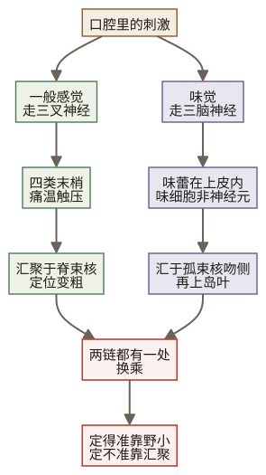
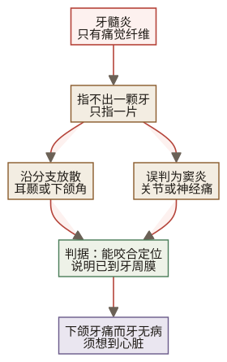

# 第 7 章 · 口腔感觉与味觉

> **层次**：撰写层。按课程第 7 章章题重写为教材体，不搬运占位稿脚手架，不引页码、不称引文。
> **本章要回答的问题**：口腔里的痛、触、温、压、味，凭什么有的能指到一颗牙、有的一指一大片？——因为三件事：末梢在不在、纤维汇不汇、通路分不分。三件事决定一句话：**定得准，还是定不准。**
> **覆盖**：一般感觉的分布差异、牵涉痛与牙痛定位、味蕾分布与味觉通路、味觉异常的分类；四级单元 02.07.01.01–02.07.02.02，分属「一般感觉」「味觉」两节。
> **真源状态**：课程正文 `departments/08-wuguan/02-kouqiang-jiepou-shengli/chapters/07-e27/docs/zh.md`（20,441 汉字）的骨架实为视器与前庭蜗器，与本章章题不同线；本章只取其两条可用之处——「感受器按结构分为游离末梢与有被囊者」，以及「味觉纤维经面神经、舌咽神经、迷走神经止于孤束核，再经丘脑中继投射」——其余按通行口腔解剖生理学重写。外源教材未取得正文，不引。
> **引用口径**：本书不给感觉阈值、两点辨别距离、味觉识别阈值，也不给味觉障碍的分级界限与药物清单；凡「随个体与测量方法而异」的量，一律写不给数。
> **免责**：本章为教学材料，不构成诊断或处置建议；感觉障碍的定位以专科检查与所在机构规范为准。

---

## N.1 概念与出处：六个词

感觉这一章最容易被写成一张「哪里更敏感」的排名。排名不回答判据，故先用六个词把排名换成一条链。

| 概念 | 依据 | 一句定义 |
|---|---|---|
| 感受器 | 神经学 | 把一类刺激换成神经冲动的末梢结构。口腔里有游离末梢（痛、温），也有有被囊的末梢（触压、本体） |
| 感受野 | 神经学 | 一根传入纤维所覆盖的一小块黏膜。野越小，两点越分得开；野越粗，只能答「这一带有事」 |
| 汇聚 | 神经学 | 多根一级纤维终止在同一群二级神经元上。汇聚是「定位变粗」的解剖原因，不是功能退步 |
| 牵涉痛 | 临床 | 病灶在此、痛感在彼。痛的位置由二级神经元的「地图」决定，不由病灶决定 |
| 味蕾 | 组织学 | 上皮内的细胞团，含味细胞、支持细胞与基细胞。味细胞是二级感受细胞，**不是神经元** |
| 孤束核 | 神经解剖 | 面、舌咽、迷走三对脑神经味觉纤维的共同终点；吻侧司味觉，尾侧司内脏传入 |

六条串成一句话：**口腔感觉的精度不是一个数，是这条链的乘积——末梢在不在、野有多大、汇不汇聚、走到哪个核。** 任何一环变粗，「说不清是哪颗牙」就有了出处。

**图注**：左列一般感觉、右列味觉，各自从「末梢」走到「核」；两链各有一处换乘，最后汇到同一句判据：定得准靠野小，定不准靠汇聚。出处：本章 §N.1；读图要点是两条链的**终点**都在脑干。

## N.2 一般感觉：一张不均匀的地图

口腔黏膜的感觉不是一种，是四类：痛、温、触压、本体。四类分布极不均匀，若只记一句「口腔很敏感」，就会漏掉三件更要紧的事。

### 02.07.01.01 痛温触压的分布差异

**先分清「敏感」的两个意思。** 一是**阈值低**：轻轻一碰就有反应，如咽后壁与软腭，异物一触即引发恶心；二是**分辨细**：两点分得开、位置指得准，如舌尖与唇红。两者常不在一处：**咽反射区阈值最低而分辨最粗，舌尖两者都最高。** 故记录时先分清是哪一种。

**触压觉的次序。** 由细到粗大体是：唇红与舌尖最细，硬腭前部与牙龈次之，颊黏膜与唇黏膜再次，口底、磨牙后区与软腭最粗。次序随个体差异变化，本书不给数值。

**痛觉与温度觉是另一条线。** 黏膜痛觉由游离末梢承担；温度觉的耐受范围比皮肤宽，故进滚烫食物时，黏膜的「报警」比皮肤晚。牙体组织是全身最特殊的一处：**釉质无感觉，牙本质有感觉，牙髓只有痛觉。** 牙本质的感觉以「小管内液体流动带动末梢」较通行；牙髓内只有痛觉纤维，没有触压与本体感受器——这一点下一单元要反复用到。

**本体觉只在牙周膜。** 牙周膜内有感受压力与方向的末梢，能报出咬合力的轻重与来向，故人闭眼也能感到「哪颗牙先接触」。牙周膜一旦被麻醉，这种精细咬合感即刻消失，患者会觉得「这颗牙不是我的」——**判断咬合是否异常，靠患者的咬合感与术者的扪诊，不靠看得见的接触点。**

**分区与神经的对应必须记清，因为差异有一半是神经造成的。**

| 区域 | 一般感觉的神经 | 备注 |
|---|---|---|
| 上颌牙与牙龈、硬腭后部 | 上颌神经（上牙槽后、中、前神经；腭大神经） | 硬腭前部另有鼻腭神经 |
| 下颌牙与牙龈、下唇、颏部 | 下颌神经（下牙槽神经、颏神经） | 颏神经出颏孔后分布下唇与颏 |
| 舌前三分之二 | 舌神经（下颌神经分支） | 只司一般感觉，不司味觉 |
| 舌后三分之一 | 舌咽神经 | 一般感觉与味觉同走一条 |
| 颊黏膜、磨牙后区 | 颊神经（下颌神经分支） | 与下牙槽神经在磨牙后区相邻 |
| 软腭、咽侧 | 腭小神经与咽支 | 触觉阈值低，咽反射由此起 |

**舌上的分界线最值得单说。** 界沟（人字沟）之前的一般感觉走舌神经（三叉），之后走舌咽神经；味觉的分界也是这条沟，前段却走面神经的鼓索。**同一块黏膜，两种感觉，走两套神经**——这是全章最容易记错的一处。检查含义很直接：舌前部一般感觉正常而味觉减退，病灶不在三叉神经，而在鼓索、面神经或味蕾；两者同时减退，才想到舌神经与鼓索一起受损。

**三条判据收束本单元。** 其一，「敏感」必须分阈值与分辨。其二，牙体与牙周是两套感受器：牙体只有痛，牙周才有触压与本体。其三，一个区域可以有两种感觉走两条神经，舌前三分之二即是。

### 02.07.01.02 牵涉痛与牙痛为何定不准

**先说一条反直觉的事实。** 急性牙髓炎的患者常指着一大片，甚至指到对侧；而根尖周炎的患者能用一根手指点准那一颗牙。两者疼得可以一样重，差别不在强度，**在感受器与通路**。

**第一层原因：牙髓没有定位所需的感受器。** 定位靠两样东西——感受野的精细度，与中枢对「哪一根纤维」的标注。牙髓的传入纤维在同一条神经束里密集并行，一根纤维对应的是「这颗牙的牙髓」这一整块组织，而不是某个点；牙髓内又没有触压与本体感受器可供交叉参照。大脑拿到的只是「有个地方在疼」，没有坐标。**牙髓能报强度与性质，不能报位置。**

**第二层原因：外周分支在解剖上互相挨着。** 上牙槽后、中、前神经在牙槽骨内与上颌窦底相邻；下牙槽神经与颏神经、舌神经在磨牙后区交汇；颊神经的末梢就贴在磨牙后区黏膜下，与下牙槽神经只隔一层骨。相邻的末梢处在同一片炎症化学环境里，可以同时被敏化——这是「上颌后牙痛而觉着颧部也痛」的外周基础。

**第三层原因：中枢汇聚与「洋葱皮」排列。** 三叉神经的痛温觉纤维下行入三叉神经脊束核，尾侧亚核是中继站；这根核柱向下延伸到上颈髓，与颈神经、舌咽与迷走的传入交汇。多根一级纤维终止在同一群二级神经元上，发往丘脑的信号就不再带「来自哪一根纤维」的标签，只带「来自哪一环带」。核内排列又按口周→面部→头顶的同心圆分层，故口内病灶的痛能「投影」到同一环带的面部皮肤。**患者指着面颊说牙痛、指着牙说脸痛，在解剖上都讲得通。**

**牵涉的走向跟着分支走。** 上颌牙的痛多牵涉眶下、颞部、颊前；下颌牙的痛多牵涉耳前、颞部、下颌角与颈上。

**反方向的牵涉更危险：心脏到下颌。** 心肌缺血的传入经交感与迷走进入脊髓与脑干，与三叉神经的传入在上颈段与丘脑交汇，故心绞痛可表现为左下颌、左下牙或咽部的痛。**下颌牙痛而口腔检查全无阳性所见时，必须想到心源性并据全身情况转诊。**

**还有一类「定不准」，病灶根本不在牙。** 上颌窦炎可致上颌后牙叩痛与窦底压痛；颞下颌关节病可致耳前痛与咀嚼痛；咀嚼肌扳机点可致放散性钝痛；三叉神经痛是闪电样、有扳机点、间歇期完全正常。

**判据收束，三句话可写进记录。** 能咬合定位、能指出单颗、叩痛明显——病灶已到牙周膜或根尖周。指一片、夜间自发、冷热激发、放散到颞或耳——病灶在牙髓。沿分支闪电样、有扳机点、间歇期正常——病灶在神经本身。**「定得准不准」由此从主观描述变成可复核的观察项。**

**图注**：由「牙髓只有痛觉纤维」起，推到「指不出一颗牙」；再分两支——沿分支放散，或误判为窦炎、关节、神经痛。两支都收在「能咬合定位说明已到牙周膜」上，末一路是反方向牵涉：下颌牙痛而牙无病须想到心脏。出处：本章 §02.07.01.02；读图要点是那个判据方框。

## N.3 味觉：从味孔到孤束核

味觉常被当成「舌头的事」。它其实是三根脑神经、一个核、一条到岛叶的路，外加一条借嗅觉走的旁路；四条通路各有一段经过外科与影像的「危险区」，故味觉障碍的定位价值远高于它的发病率给人的印象。

### 02.07.02.01 味蕾分布与四条传导通路

**味蕾在哪里。** 舌的菌状乳头（舌前部散在）、轮廓乳头（界沟前排成一列）、叶状乳头（舌侧后缘）、舌根；舌外还有软腭、咽后壁、会厌与咽鼓管咽口附近。分布有一个共同点：**都在「入口」上，且多藏在沟壑里。** 「入口」说明味觉的第一职能是**在吞咽之前做一次化学筛查**。

**味蕾的结构与一个关键身份。** 味蕾是上皮内的细胞团，顶端以味孔开口于黏膜表面，内有味细胞、支持细胞与基细胞。味细胞顶端有微绒毛伸入味孔，基底与传入纤维形成突触。**味细胞是上皮来源的二级感受细胞，不是神经元**——与嗅细胞（本身即神经元）相反。这条身份有后果：味蕾持续更新，故味觉障碍有较大的自愈余地。

**五类味质。** 甜（糖类）、鲜（氨基酸）、苦（生物碱）、咸（钠离子）、酸（氢离子）。**辣不在五味之内**：辣由温度与痛觉通道介导，走三叉神经，故「辣」在生理上是痛与热，不是味。

**「舌味地图」是误记，本书不用。** 早期文献把不同味质「定位」到舌的不同区，后被证实是误读与翻译放大的结果。现代认识是：舌各区味蕾都能感受全部味质，只是敏感度有差异，差异不足以画成地图。**故本节只画通路，不画分区。**

**四条通路，按「黏膜→神经→神经节→核」写。**

1. **舌前三分之二 → 鼓索 → 膝状神经节 → 孤束核吻侧。** 鼓索是面神经分支，在颞骨内横过鼓膜内侧，经岩鼓裂出颅，在颞下区加入舌神经。两个后果：中耳病变与乳突手术可伤鼓索；下颌阻滞麻醉后同侧舌前味觉可一并迟钝。
2. **软腭 → 腭小神经 → 翼管神经 → 岩大神经 → 膝状神经节 → 孤束核。** 末梢神经是三叉神经上颌支的分支，胞体却在面神经的膝状神经节。**这是全章最容易记错的一处：神经的名称按末梢走，纤维的归属按胞体算。**
3. **舌后三分之一 → 舌咽神经 → 岩下神经节 → 孤束核。** 一般感觉与味觉在这一段同走一条神经，故舌后部病变可同时引起感觉与味觉减退。
4. **会厌、咽后壁、舌根 → 迷走神经（咽支与内喉支）→ 结状神经节 → 孤束核。** 这段最易被忽略，却解释了「喉切除或咽部手术后味觉变淡」。

**必须更正的一条流传说法。** 常有把「舌下神经」列为第四条味觉通路者。舌下神经是纯运动神经，支配舌肌，不含味觉纤维；本节按上面四条写：面神经两束（鼓索、岩大神经）、舌咽神经、迷走神经。**四条通路，三根神经，一个核。**

**中枢与两条反射支。** 孤束核吻侧的纤维上行，经丘脑腹后内侧核中继，投射到岛叶前部与额盖，即初级味觉皮质。上行纤维交叉不完全，故单侧皮质病变很少造成完全味觉丧失——这条判据把重心推回外周：**单侧、完全的味觉丧失，几乎总是外周的事。** 下行有两支反射：到上、下泌涎核，故**味觉是唾液分泌的头相刺激**；到迷走背核与呕吐中枢，故**变质的味道直接引发恶心**，不必经过意识。

**三条判据收束。** 其一，味觉有三个入口（舌前、舌后、会厌），分属三根神经，故「哪一味、哪一区」减退能定位神经。其二，味蕾是上皮不是神经，两类损伤的恢复前景不同。其三，辣不是味觉，主诉「没味道」要先问清是「尝不出」还是「闻不到」。

### 02.07.02.02 味觉异常的分类

**先分两层，再分三类。** 两层是「量」与「质」：量指减退、丧失、过敏；质指倒错（原本的味道变了）与幻觉（无刺激而有味）。量的问题多在传导与感受，质的问题多在神经与中枢。

**一、传导性：味物质到不了味孔。** 口干是最常见的一类——唾液减少（药物性、放疗后、干燥综合征、老年性），味物质溶不开、进不了味孔；舌苔厚、义齿基托覆盖、口腔卫生差同属此理。另有一个特殊亚型在嗅觉一侧：鼻腔阻塞使气味到不了嗅区，患者主诉「吃东西没味道」，其实是**风味**丢了而味觉完好——经咽部上行的后鼻嗅觉是「风味」的主要来源。**判据：去除原因后可恢复，味觉本身的辨别大致完好。**

**二、感受性：味蕾与味细胞受损。** 病毒感染后、头颈部放疗、多种药物（机制不一：与金属离子结合、干扰上皮更新、改变唾液成分）、微量元素缺乏、内分泌变化与年龄。**判据：多为部分味质受累而非全失；可随时间恢复，因为味蕾持续更新；常伴嗅觉同时受累，因为两者都是上皮内的化学感受装置。** 本书不给药物名单与恢复时间窗——各家差异大，写出来就是假精确。

**三、神经性：通路受损。** 鼓索（中耳炎、中耳与乳突手术、颞骨骨折）、岩大神经（颅底病变）、舌咽神经（扁桃体手术、咽侧间隙病变）、迷走神经（喉与咽手术）、中枢（脑干、丘脑、岛叶）。**判据：单侧、恒定、不随进食条件变化；常伴同区域的一般感觉或运动障碍。** 一条定位线索：面神经麻痹时若同侧舌前味觉减退，病变在鼓索分出点之上；味觉完好，则在分出点之下。本书只给方向，不给分级。

**四、不是味觉的病，也要写进来。** 灼口综合征者主诉烧灼与味觉异常，检查无阳性所见；抑郁与多种药物可致味觉倒错；颞叶癫痫可有短暂刻板的幻味；胃食管反流可致口酸口苦。**这一类的共同点是：味觉辨别大致正常，而主诉很重。**

**问诊五问，先于任何检查。** 起病突然还是渐进（突然多为神经或血管，渐进多为感受性）；单侧还是双侧（单侧先想神经）；全味质还是部分（部分多为感受性）；与嗅觉的关系（同时减退多为上皮，单独减退多为神经）；用药、放疗、手术、外伤史。五问写完，多数病例已能归到三类之一。

**三类并列写进记录，不给分级。** 格式：「味觉减退，左侧，甜与咸明显，苦与酸尚可，嗅觉正常，三月前有中耳手术史」——一句里有侧别、味质、嗅觉、时间与诱因，可复核。

## N.4 与相邻学科的接口

**「脾开窍于口，其华在唇」。** 中医把口与唇的荣枯归到脾，把「五味入口，藏于脾胃」连成一条纳与化的链。可用之处在味觉与食欲的关系：口淡、口腻、口苦既是味觉主诉，也是脾胃证候的入口，两者可以并列记录。不可用处也要说清：它不描述鼓索与孤束核，不能解释「为什么中耳手术后同侧舌前味觉减退」。

**「五味」不是一张表。** 中医的酸苦甘辛咸是药物与食物的性味归类，服务于治法——辛能散、甘能缓、酸能收；生理的五味是受体类别——甜与鲜是 G 蛋白偶联受体，咸与酸是离子通道。两张表可以并列（「口苦」既是证候也是味觉异常），**不能换算**：把「肝味酸」读成「酸味由肝感受」，是把归类的语言当成解剖的语言。

**舌象与舌检查不同层。** 舌质、舌苔是望诊所得，服务辨证；舌的形态、运动、味觉是检查所得，服务描述。同一根舌，两种写法：可并列（「舌质红、苔黄腻；舌前味觉减退」），不可互译。

## N.5 争议与本项目立场

**一、味质是怎么编码的。** 「一条纤维一味」的标线学说与「一群纤维的放电图样」长期并存。实测是：单一味细胞可对多类味质反应，专一性有限。故本书只写受体类别与通路，不写编码定论，也不用「甜味神经」这类说法。

**二、牵涉痛的机制。** 汇聚、易化、中枢可塑性三说并存；「洋葱皮」排列是描述而非机制。本书写「较通行的解释」，不作定论。对临床有用的只有落点：**口腔查不出病灶的痛，要往外找。**

**三、味觉障碍的流行病学数字。** 各家患病率差异极大，与问诊方式、人群、用药相关。本书不给比例、不给药物清单、不给分级界限——**这三样一旦写进教材，就会被当成标准引用。**

> **免责声明：** 本章为教学材料，不构成医学意见、诊断或处置指导。文中的分布次序与通路只到类别与方向，不含阈值、分级界限与药物信息；感觉障碍的评估与处理以现行规范与所在机构制度为准，由具备资质的人员执行。

## 思考题

1. 一位患者右上后牙自发痛、夜间加重、冷热激发，但指不出一颗牙；另一位能准确指出左下第一磨牙，叩痛明显。两人的病灶各在哪一层？请用「感受器」与「汇聚」两条，解释「定得准」与「定不准」的差别。
2. 中耳手术后同侧舌前三分之二味觉减退，而同侧舌前的一般感觉正常。受损的是哪根神经、哪一段？为什么「一般感觉正常」是定位的关键，而不是反证？
3. 患者主诉「吃东西没味道」，检查见舌苔厚、口干、鼻腔通畅。你先归到哪一类味觉障碍？若要区分「味觉」与「风味」，还须问哪两个问题？

## 延伸阅读

- 通行口腔解剖生理学教材中「口腔的感觉」「味觉」两节。——本章的分布次序与四条通路按此重写，涉阈值与分级处一律留白。
- 神经解剖学教材中「三叉神经脊束核」「孤束核与味觉通路」两章。——§02.07.01.02 的汇聚与「洋葱皮」排列、§02.07.02.01 的中枢投射依此立论。
- 嗅觉与味觉专科教材中「味觉障碍的分类与评估」一章。——§02.07.02.02 的两层三类按此写，药物清单、患病率与分级界限不在本书范围。
