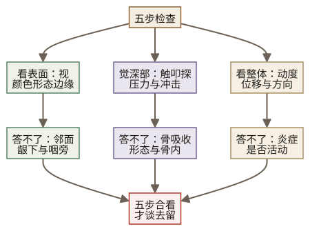
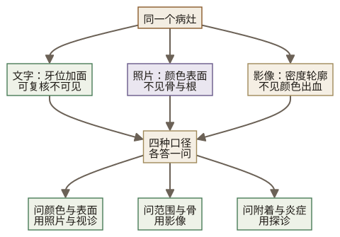

# 第 8 章 · 口腔检查与记录

> **层次**：撰写层。按课程第 8 章章题重写为教材体，不搬运占位稿脚手架，不引页码、不称引文。
> **本章要回答的问题**：同一张嘴，五步检查、一张牙位图、一张片子、一张照片，四样东西各能答什么、各答不了什么？——检查学的全部难点在这一句：**记录下来的，究竟是哪一个口径下的所见。**
> **覆盖**：视、触、叩、探、动度五步，张口度与关节检查，牙位图与探诊记录，影像与照片的口径差异；四级单元 02.08.01.01–02.08.02.02，分属「检查顺序」「记录」两节。
> **真源状态**：课程正文 `departments/08-wuguan/02-kouqiang-jiepou-shengli/chapters/08-e28/docs/zh.md`（13,463 汉字）的骨架是中医四诊、辨证与内外治法，属临床诊疗线，与本章「检查与记录」不同线；本章只取其「望齿龈、望口腔黏膜及舌象」与「问诊所得还须与局部检查相互印证」两条（收进 N.4），检查方法与记录规范按通行做法重写。外源教材未取得正文，不引。
> **引用口径**：本书不给器械型号与参数、不给探诊力量、不给张口度与牙周动度的分级界限、不给影像的曝光与放大倍数；凡涉数值处写「按所在机构规范」。
> **免责**：本章为教学材料，不构成诊断或处置建议；检查的适应证、禁忌与操作以所在机构规范与执业医师判断为准。

---

## N.1 概念与出处：五个词

检查学最容易被写成器械清单：口镜、探针、镊子、片子。清单不回答判据，故先用五个词把清单换成问题。

| 概念 | 依据 | 一句定义 |
|---|---|---|
| 可及范围 | 检查学 | 一件器械在解剖上能到达并看清的边界；范围之外不是「正常」，是「没看到」 |
| 所见层次 | 检查学 | 这一步看到的是黏膜表面、牙体外形，还是牙周膜、骨内与根尖周——层次不同，结论的类别也不同 |
| 正常所见 | 描述规范 | 在给定范围与条件下、按解剖顺序可逐项核对的一组描述，不是一个形容词 |
| 口径 | 记录学 | 一项检查的计量约定：文字用「牙位＋面＋所见」，影像用「密度＋轮廓＋测量值」，照片用「颜色＋形态＋相对位置」 |
| 记录最小集 | 记录学 | 一份阴性记录必须写全的四项：范围、条件、所见、限度；缺一项，这条记录就不能被复核 |

五条串成一句话：**先问这一步能到哪、看到哪一层，再问所见怎么写；写法由口径定。** 全章按这个次序展开。

## N.2 五步：从「看得见」到「动得了」

五步不是五个动作，是五种**力学接口**：视靠光，触靠压力，叩靠冲击，探靠尖端集中的压力，动度靠水平推力。每一种力把信息从不同深度带回来——光到表面，触及软组织与骨面，叩到牙周膜，探到龈沟与洞底，动度到牙周膜的整体弹性。**问答的深度不同，故任何一步都不能代替另一步。**

**图注**：三组分别是「看表面」「觉深部」「看整体」，每组下方一句写它答不了什么；最后汇到「五步合看才谈去留」。出处：本章 §N.1、§02.08.01.01；读图要点是每组的**否定句**。

### 02.08.01.01 视·触·叩·探·动度

**视诊看的是表面与外形。** 光源加口镜取得间接视野，注意镜中左右与实际相反——这是记录的第一道坎。看六类：牙的数目、形态、颜色、排列与接触关系；软垢、色素、牙石的分布；龋的白垩斑与墨浸状改变、磨耗、裂纹；牙龈的色、形、质（色泽、边缘厚薄、点彩是否还在）；黏膜与舌；唾液的性质与量。**视诊的盲区很硬**：邻面、龈下、上颌后牙的颊侧、下颌后牙的舌侧、口底深部、咽旁。这些位置看不见不是不熟练，是几何限制。

**触诊看的是软组织与骨面。** 口外查颌下、颏下、耳前、咀嚼肌与涎腺；口内用唇颊双合诊、口底与舌的扪诊。它带回四样：硬度（软、韧、硬、骨样）、边界是否清楚、与周围是否粘连（活动度）、压痛与波动感。**波动感是「里面有液体」的判据，硬结是「里面有实质」的判据**——两者处置方向不同。触诊的盲区在深部间隙与骨内：翼下颌间隙、咽旁间隙，手指到不了。

**叩诊看的是根尖周膜。** 垂直叩沿牙长轴施力，力传到根尖区的牙周膜；水平叩侧向施力，查牙周。**叩痛的含义只有一个：根尖周膜有炎症。** 它不说牙髓是死是活——牙髓坏死的牙照样可以叩痛；反过来，牙髓炎而未波及根尖周时可以完全不叩痛。故叩诊必须带对照牙（同名牙或邻牙），没有对照，「痛」只是一个主观形容词。反应记为无不适、不适、痛三档，**这三档是描述，不是分级**。

**探诊是五步里唯一主动施加集中力的一步。** 尖探针查龋的深度、洞底软化、有无穿髓点与探痛；牙周探针查龈沟与牙周袋的深度、出血、溢脓与根分叉。力过大会探出假性深度与假性出血，力过小会漏诊，故有两条纪律：**同一牙同一牙面用同一力；深度与出血分开记**——深度是结构（附着丧失），出血是炎症活动，两者不是一件事。探诊的盲区：根尖周、牙髓腔、骨内，以及接触点以上的邻面隐匿龋（探得到，但极易漏）。

**动度看的是整体位移。** 以器械柄或手指交替推牙冠，观察位移的方向与幅度。生理动度以水平向为主，来自牙周膜的弹性；**垂直向的动度一旦出现，说明牙周支持已明显减少**——这是定性判据。动度分级界限属牙周专科，本书不给。动度还有两处不能答：它不说骨吸收的形态（水平型、垂直型、根分叉），也不说炎症是否活动（那要靠探诊出血）。

**五步合看的一条硬话：没有任何一步能单独回答「这颗牙还能不能留」。** 视诊看破坏，探诊看附着，动度看支持，叩诊看根尖，触诊看范围与邻近。五项缺一项，判断里就有一处是猜的。

**次序可调，纪律不变。** 教学次序是视、触、叩、探、动度；临床上常把探诊提前，因为探诊出血会污染后续的视诊判断，故**视诊记录必须在探诊之前完成**。两条纪律：先无创后有创；有创检查之前先记下无创所见。

**记录写法**：左右分记，不用「双侧」笼统带过；相对描述代替绝对刻度（「与龈缘平」比一个毫米数可复核）；同一牙同一面用同一名称（近中、远中、颊、舌、𬌗、颈），不写「上面」「里面」。

### 02.08.01.02 张口度与关节检查

**张口度怎么记。** 记上下中切牙切缘之间的垂直距离，写明测量方式；床边粗测可用横指法，但正式记录不用「几指」——手指宽度因人而异，写进记录就不可复核。受限的程度分几档、界限在哪，属专科口径，本书不给数值。

**开口型比开口度更能定位。** 分三类：直线；偏斜（开口过程中向一侧偏）；摆动（先偏一侧再回，呈 S 形）。判据是：**开口末偏斜，多为单侧结构问题**（一侧关节盘移位、一侧肌痉挛）；**全程摆动，多为肌源性或双侧不对称**；**开口受限而型直，先想肌痉挛或关节盘不可复位**。

**关节检查四件事。** 触诊：耳前区与外侧、外耳道前壁，闭口与开口各一次，比两侧；听诊：弹响的时相（开口初、中、末，闭口时是否复现），时相比响度有用；运动：前伸与侧方，左右对比，记录是否受限与是否偏斜；负荷：咬合负荷下是否诱发痛。四件事合起来，才是一份关节记录。

**三联：疼痛、弹响、绞锁。** 组合比单项有意义：单纯弹响而无痛，多为可复位性盘移位；弹响伴开口受限与偏斜，多为不可复位；**无弹响而突然开口受限，先排除关节外原因**——肌源性、牙源性、感染。故「有弹响」不是诊断，「弹响在什么时相、伴不伴受限」才是。

**关节外的东西必须先排。** 牙源性：冠周炎、根尖周炎、深龋致不敢开口；肌源性：咀嚼肌压痛、张口受限而关节本身无压痛；间隙感染：咽侧壁膨隆、吞咽痛、张口受限，这一条最急；颞部：年长者的颞部压痛与头痛，要想到颞动脉炎。**「张口受限」是症状，不是诊断**——四条不排完，不要写「关节紊乱」。

**与咬合的接口。** 查张口度时顺带看正中关系与正中𬌗是否一致（第 4 章）：单侧咬合干扰会造成偏侧咀嚼，长期偏侧负荷落在单侧关节上，弹响与疼痛也随之单侧化。故关节记录里应有一句咬合所见，否则定位缺一半。

**记录**：张口度（数值＋测量方式）、开口型、弹响（侧别＋时相）、关节区压痛（侧别＋位置）、肌压痛（哪一块肌）、前伸与侧方的范围（左右对比）。全部只写所见，不写分级。

## N.3 记录：把「未见异常」写成可复核的句子

检查做完了，记录才是产物。这一节讲三件事：牙位图与探诊怎么写、不同口径为什么不能互替、一句阴性记录该有什么。

### 02.08.02.01 牙位图与探诊记录

**第一坑：图上的左是患者的右。** 牙位图按临床视角绘制，故左右与人体的左右相反。记录纪律由此而来：**只写牙位编码，不写「左边那颗」**。编码用第 2 章的分区记录法（四区＋序号），乳牙与恒牙分区不同，替换期要标明是哪一套——写错一套，整张图都错位。

**一格一牙，一牙多面。** 记录必须落到「牙＋面」：同一颗牙的𬌗面龋与邻面龋是两件事，处置也不同。面用解剖名称，不用方位词；一个牙面可以有多条记录（龋、充填、裂纹），并列写，不合并。

**符号可以自定，图例必须在前。** 缺失、龋、充填、冠、根管治疗、种植、阻生、移位，各有符号；符号表不通用，故一次记录内必须自洽，跨机构交换时用文字补写。**只写符号不附图例的记录，等于一份没有密钥的密文。**

**探诊记录的字段。** 牙位；位点（每牙六点：颊侧近中、中央、远中，舌侧三点）；深度；出血（有／无）；溢脓；附着丧失；根分叉；膜龈关系。**六点全记，不记「最深点」**——只记最深点，下一次无法重现，也无法判断是哪个位点在变。

**探诊数值是测量，不是分级。** 分级界限属牙周专科，本书不给；但同一患者前后两次的差值可比，前提是同一牙、同一位点、同一力。这一点写进记录，纵向比较才成立。

**「未查」与「正常」必须分开。** 「未探及」与「未查」是两句话；「未及」是范围所限，「正常」是核对过。三者混写，是最常见的记录缺陷。

**一份可复核的记录，四要素齐**：范围（查到哪一区、哪几颗）、条件（器械、有无麻醉、体位与配合）、所见（牙位＋面＋所见）、限度（哪一段未及）。

### 02.08.02.02 影像与照片的口径差异

**同一个病灶，四种介质给出四句话，既不能互证，也不能互替。**

| 介质 | 能给 | 不能给 |
|---|---|---|
| 文字记录 | 牙位、面、所见、限度，可复核、可检索 | 一切形态与颜色的细节 |
| 照片 | 颜色、光泽、表面纹理、牙龈轮廓、修复体边缘、排列 | 骨、根、牙髓、邻面接触点以下的龋、深部间隙 |
| X 线平片 | 密度差（釉质、牙本质、牙髓腔、骨小梁、修复体）、轮廓、位置关系 | 颜色、质地、软组织炎症、探诊出血、动度 |
| 锥形束断层 | 断面与三维位置、骨厚度、根管形态、与神经管和窦底的关系 | 黏膜细节、颜色；金属伪影会遮蔽邻近结构 |

**影像的长处是「穿过」。** 它看见的是密度与轮廓：邻面龋的边缘、根尖周的透影、牙周膜间隙是否增宽、骨吸收是水平还是垂直、牙根与上颌窦底及下颌管的距离。**影像的短处是「只看密度差」**：白垩斑、裂纹、牙龈的充血、探诊出血，在片子上根本不存在——不是看不清，是这类信息不在它的物理量里。

**照片的长处是「表面」。** 颜色、光泽、表面纹理、牙龈的轮廓与色、修复体边缘是否密合、排列与咬合接触的正面观。**短处是「只到表面」**：骨、根、牙髓、邻面接触点以下的龋，照片给不出。

**二维与三维不是「新旧」而是「投影与断面」。** 平片是投影，故有重叠与失真：邻面重叠、牙根与颊侧骨重叠、上颌后牙与颧突重叠。锥形束断层给断面，但金属修复体与种植体会产生伪影，骨细节的分辨未必优于平片。**「更高级」不等于「更适合」。**

**三个不能互替的例子。** 白垩色斑：照片与视诊见，片子不见，探诊可及（表面粗糙）。根尖周透影：片子见，照片不见，叩诊阳性而眼看不见。探诊出血：只有探诊见，照片与影像都不见。三者各占一格，缺一格就缺一条证据。

**冲突时按「要回答的问题」定优先级，不按「哪个更清楚」。** 问颜色与表面，用视诊与照片；问范围、骨、与邻近结构的关系，用影像；问附着与炎症活动，用探诊；问牙髓状态，用活力测试（本书不给参数）。不一致时写「影像与临床所见不一致，建议××」，不写「以××为准」——后者把口径差异伪装成结论。

**一条硬规矩收全章：每一个「未见异常」都必须带范围。** 范围是这一步的可及边界；边界之外的正常，是没有做过的正常。

**图注**：三支分别为文字、照片、影像，各自一句「能」与一句「不能」；下方先汇到「四种口径各答一问」，再分成三组配对。出处：本章 §02.08.02.02；读图要点是最下一行的三个「问……用……」配对。

## N.4 与相邻学科的接口

**「齿为骨之余，龈为胃之络」。** 中医望齿看色泽、形态、润燥与松动，望龈看色、形与是否出血萎缩，归属肾与胃。这一套与本章的视诊、探诊**可以并列记录**（「龈色淡白，探诊出血（＋），附着丧失」），但层次不同：中医的「色」是证候线索，服务辨证；检查的「色」是光学所见，服务描述。**并列可以，换算不行**——「淡白即等于某一种病理改变」这句话，两套语言都不成立。

**舌象与舌检查。** 舌质、舌苔是望诊所得，服务辨证；舌的形态、运动、乳头与味觉是检查所得，服务描述。同一根舌，两种写法；写在同一份记录里时，标明哪一句属哪一套。

**「四诊合参」在检查学上的意思。** 课程正文说「问诊所得还须与局部检查相互印证」，举例是患者诉耳内闷胀，须结合鼓膜内陷与听力下降才能成立。落到口腔：患者诉「这颗牙咬东西疼」，须有叩诊或咬诊的阳性所见才能成立；反之，检查有阳性而患者无主诉，也要写下来——**单一所见不足以定性，须与另一路证据对齐。** 这与本章「五步合看」「四种口径不互替」是同一条纪律的两种说法。

**嗅诊是第五种口径。** 口气的来源不止一处：牙周袋、龋洞、舌苔、扁桃体隐窝、鼻咽与消化道。中医辨口气属胃热或食积，检查学靠逐个位置排查。两套写法并列，不能互相代替。

## N.5 争议与本项目立场

**一、「正常」缺乏统一的描述术语。** 各家对「龈色粉红」「探诊少量出血」「牙石少量」的界定并不一致，同一张照片可以写出两种结论。本项目主张：用相对位置与可核对的解剖标志描述，少用程度副词，不虚构统一阈值。

**二、六点全记的成本。** 全口六点记录耗时，简记又失真。本项目不给折中方案，只给判据：**若这份记录要用于纵向比较，六点必须全记**；若只用于一次会诊，可记最深点，但须写明「仅记最深点」。

**三、影像的普及与「多拍一张」。** 锥形束断层可得之后，适应证放宽是普遍现象。本项目回到适应证：**这张片子会不会改变处置？** 会，就把理由写进申请；不会，就不拍。

**四、照片与自动判读。** 口内照片的质量高度依赖光源、角度、牵拉与白平衡，「同一病灶两张照片颜色不同」是常态。谈自动判读之前，先要解决采集标准化——**没有采集标准，就没有可比结果。**

> **免责声明：** 本章为教学材料，不构成医学意见、诊断或处置指导。文中的正常所见只作描述模板，不构成诊断标准；检查的适应证、禁忌、操作与判读以现行规范、器械说明书与所在机构制度为准，由具备资质的人员执行。本章不给器械参数、探诊力量、张口度与动度的分级界限。

## 思考题

1. 患者主诉左下后牙咬合痛。视诊见牙冠完整、无龋；叩诊（＋）；探诊龈沟深度在正常范围、无出血；动度正常。五步里哪一步给了你最多的信息？「探诊正常」能否排除牙周来源，理由是什么？
2. 牙位图上一颗牙标了「龋」，却没写面。这句记录缺什么？若两次记录之间病灶扩大，仅凭这个字能不能看出来？
3. 患者张口受限、开口末向一侧偏斜、耳前区压痛，弹响不明显。在写「颞下颌关节紊乱」之前，必须先排除哪几条关节外原因？各用哪一步检查去排？

## 延伸阅读

- 通行口腔医学教材中「口腔检查法」「牙周检查」两章。——§02.08.01.01 的五步分工与记录纪律按此重写，器械参数与分级界限不在本书。
- 口腔颌面影像学教材中「根尖片与全景片」「锥形束断层」两章。——§02.08.02.02 的口径差异按此写，曝光与放大倍数不给。
- 口腔修复与美学教材中「口内摄影」一节。——照片口径的能与不能依此立论，采集参数不在本书范围。
