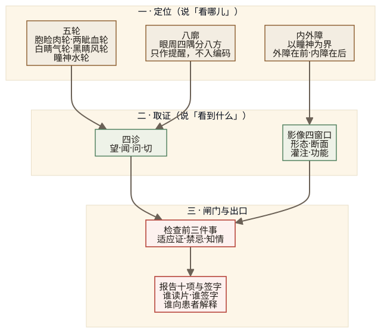
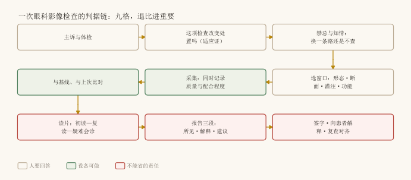

# 第 1 章 · 影像在眼科的位置（从四诊到仪器）

> **层次**：本文件是**撰写层**——正文由课程第 1 章教学材料（4 单元：五轮、八廓、眼与脏腑、眼与经络）改写为教材体，并补入影像检查的判断框架；不是底本搬运，每条判断都能在 1.1 的出处表里找到落点。
> **本章要回答的问题：** 仪器能看见的东西四诊看不见，四诊能问出的东西仪器测不到——那么把患者送进检查室之前，医生必须先把哪几个问题答清楚？
> **覆盖**：课程第 1 章 4 单元；八个四级单元 10.01.01.01–10.01.03.02，分属「影像的边界与分工」「从四诊到仪器」「报告与责任」三节。
> **参系状态**：本课**没有可引用的底本**（Firecrawl 403、维基超时、NCBI 不可达、EyeWiki 明示禁用于 AI）。中医部分只引到《中医眼科学》章目级（五轮、八廓、内外障），不引条文与页码；影像部分只写判断与记录。凡须给数处，一律写「按所在机构规范，本章不给」（N.6 明标「共识·第X节」者除外）——这是**故意留白**，不是遗漏。
> **引用口径**：课程单元记作 `第1章·1.x`；教材框架记作书名加章名，不到页码；不重合处以课程为准，差异见 1.3。
> **免责**：本章为教学整理，不构成诊断或治疗建议；检查的适应证、禁忌与参数以所在机构规范与设备说明书为准。

---

## N.1 概念与出处

本章只用七个概念，每个给两处出处：左侧是本课程的真源，右侧是参考教材的章目（只到章名）。不重合处以课程为准。

| 概念 | 课程 | 教材 | 定义 |
|---|---|---|---|
| 四诊 | 1.1–1.4 | 眼科诊断概要（章） | 望闻问切四类取证方式；眼科四诊各有专属任务，不是内科四诊的照搬。 |
| 五轮 | 1.1 | 五轮学说（节） | 胞睑肉轮属脾、两眦血轮属心、白睛气轮属肺、黑睛风轮属肝、瞳神水轮属肾的部位—脏腑对应表，回答「看哪儿」。 |
| 八廓 | 1.2 | 八廓学说（节） | 眼周四隅分八方配八卦应脏腑的另一套分区说；历代配属不一，无固定解剖标志。 |
| 目系 | 1.3–1.4 | 眼与脏腑·眼与经络（章） | 对视神经与视路的总称，谓其内通于脑；中医侧承接「影像—视野」对照。 |
| 内外障 | — | 内外障（章） | 以瞳神为界：外障在胞睑两眦白睛黑睛，内障在瞳神以内。给的是「在哪一半」，不是「有多重」。 |
| 影像窗口 | 本章自定 | 无 | 仪器能取到的信息通道：形态、断面、灌注、功能。四类取的信息不同，不可互相代偿。 |
| 检查前三件事 | 本章自定 | 无 | 适应证、禁忌、知情。是检查的闸门，不是检查之后的补充说明。 |

七个概念排成一条链：**定位**用五轮、八廓、内外障（说「看哪儿」），**取证**用四诊加影像窗口（说「看到什么」），**闸门**是检查前三件事（说「该不该做」），**出口**是报告字段与签字责任（说「谁负责」）。任何一环缺了，后面的环就只剩流程而没有理由——所以本章不从设备讲起。

### 10.01.01.01 结构与功能：两类信息不可互换

眼科全部检查最终落在两类信息上。

**结构信息**回答「在不在、连不连、厚不厚、亮不亮」：某层是否连续、某界面是否光滑、某区域比周围更厚还是更薄、反射或回声是强是弱。形态与断面两类窗口给的是这一类，特点是可以指认——两个人看同一张图，能指到同一处。

**功能信息**回答「看得见多少、看得清哪里」：视力、视野、色觉、对比敏感度、双眼单视。可重复测量，但受配合、注意力与学习效应影响，同一个人两次可以不同。

两类不可互换，有三个方向。**结构正常推不出功能正常**：层次连续不等于通路在工作，功能下降可以发生在结构改变之前，也可以落在设备分辨不了的尺度或扫描范围之外。反过来，**功能正常也推不出结构正常**：单眼视力好可能因对侧代偿，病灶在黄斑以外时中心视力可以正常到很晚。**时间尺度也不同**：结构改变多是渐进的，功能改变可以突发；用一次结构检查解释一次突发的功能下降，是把两个尺度当成一个。**责任主体更不同**：结构所见由读片人签字，功能所见由做检查者与判读医师负责，合成一句「大致正常」就是把两份责任糊成一份。

中医侧最容易误接的正是此处。五轮讲「部位—脏腑」，给的是结构侧的分区语言，不是功能侧的度量；中医描述「能视」另有一套讲整体状态的说法（目光、神情、视物昏渺与否）。把五轮当功能分级表，是把分区当刻度。本项目的写法是：**轮位管定位，神光管状态，两者不折算。**

落到记录上只有一条硬规矩：报告分栏写「结构所见」与「功能所见」，并说明两者是否一致；不一致时先怀疑质量、范围与配合，再怀疑病灶在可及范围之外，不许用「大致正常」抹平。

### 10.01.01.02 影像能回答与不能回答的问题

**能回答五类。** **有无**：这个位置上有没有可称为病灶的东西。**定位**：在哪一层、哪个象限、与什么标志结构相邻。**范围**：边界到哪里，与中心凹或视盘什么关系。**性质的类别**：高反射还是低反射、强回声还是无回声、遮蔽荧光还是透见荧光——是类别，不是病理诊断。**变化**：与上次比是大了还是小了。

**不能回答的至少六类。** 疼不疼、什么时候重——只能问。看不清的原因——可来自屈光、介质、视网膜、视神经、视皮质，任何一项影像只覆盖其中一段。是什么证——证候是四诊合参的结论，影像只是其中一条证据。预后——同一形态在不同人身上走向不同。疗效归因——影像好转与症状好转可以不同步。患者的感受与负担——影像里没有这一栏。

一句话：**影像回答「是什么样」，不回答「为什么这样」，也不回答「该怎么办」。**

【边界】第五类「变化」是有条件的能：判据是同一设备、同一范围、同一时间口径，三者任一变了，变化就不成立（详见第 7 章）。条件没写进报告，这一条等于没答。

六类的处理方式不是回避，而是**写进报告**：用「建议结合病史与体检」「建议补充××检查」把边界显性化。只写所见不写限度的报告，读的人会默认它什么都答了。

### 10.01.01.03 检查前三件事：适应证·禁忌·知情

这三件事是闸门。闸门不是「注意一下」，而是**任一答不上，检查不做；做了也不出报告**。

**适应证**只有一个问法：这项检查会不会改变处置？会就做，不会就不做。为存档、为完整、为安心而做的三种情形不是错，但要在申请单上写清理由。

**禁忌按窗口分，不按设备分。** 散瞳的窗口问前房深度与闭角风险，造影的窗口问过敏史、肾功能、妊娠与哺乳，接触式检查问角膜上皮与感染控制，需固视的检查问配合能力——判据与剂量按所在机构规范，本章不给。禁忌是「换一条路」的分支点：不能散瞳改超声，不能固视改客观检查。

**知情**答四问：做什么、为什么（要回答哪个临床问题）、有没有替代（不做会怎样）、数据去哪（存哪里、谁能看、会不会用于教学科研）。第四问与第 8 章同线：眼科影像属敏感个人信息，采集端就要想清用途。三件事的记录很轻，但省掉的那句，是后面所有争议里唯一拿得出来的东西。

**图注**：图把本章七个概念排成自上而下三层。上排是定位语言（五轮、八廓、内外障），只回答「看哪儿」；中排是两类取证方式（四诊、影像四窗口），只回答「看到什么」；下排是闸门与出口（检查前三件事、报告十项与签字）。三层之间是**单向依赖**：定位错了，取证再多也是在错的地方取证；闸门没过的检查，结果不能进处置。出处：本章 §1.1；读图要点是箭头方向，不是方框数量。

## N.2 为什么可以这样翻译

把「望目」翻译成「看四个区、再选一个窗口」，不是把中医换成西医，而是把一套口传的定位语言换成别人也能复核的记录语言。理由三条。

**一、望诊本来就是分区望。** 胞睑、白睛、黑睛、瞳神是肉眼就能分开的四个界面：一个在外、一个在表、一个透明、一个在深处。分区不是影像的新发明，影像只是把这四区看得更细更深、更能留下证据。所以「望诊四区」与「影像窗口」不是两套体系，是同一套分区在两种分辨率下的说法。

**二、五轮八廓本来就是映射表。** 它给「看哪儿、这一区归哪一脏」，不给「什么程度算几级」。映射表可以直接当定位框架；一旦当分级表用，就必须凭空造刻度，那是编。

**三、证候记录要的四样，恰好是影像给的四样。** 能复核的证候记录要写清何时、何处、何种改变、几次；影像给的正是时点、位置、形态、可比性。四诊补上的是何时重、什么情况下重、伴随什么。

合起来得到翻译规则：**定位用轮位，取证用窗口，判断留在证候里。** 顺序颠倒——先看影像再找证——就是本章最要防的错误。

**图注**：九格链从主诉开始，到复查对齐结束。三类格子分开读：浅米格是必须由人回答的判断（为什么做、禁忌与知情、选窗口），绿框格是可以交给设备的动作（采集、比对），红框格是不能省的责任（读片、报告、签字解释）。链的读法是**任何一格答不上就往回退一格**，不是往下硬走——退回去改的是适应证或窗口，硬走下去只会在错的地方取证。出处：本章 §1.2 与 §1.1 十项报告字段；读图要点是格子颜色，不是编号。

### 10.01.02.01 望诊四区（胞睑·白睛·黑睛·瞳神）与影像窗口

四区可及性差别极大，各需不同窗口。

**胞睑（肉轮，属脾）**最外层，肉眼完全可及：望形态（红肿、下垂、内外翻）、望皮肤（脱屑、溃破）、触硬度与压痛。窗口在这里不负责「看见更多」，负责**留下可比对的记录**：外眼照相用于随访对比，眶部断面判断病变有没有越过眶隔——越过与否，处置方向不同。

**白睛（气轮，属肺）**在表面，细节靠放大：血管走行、充血分布、有无结节与滤泡，窗口是裂隙灯加照相。记录要点是**范围与分布**：「颞侧球结膜局限充血，边界清楚」可复核，「白睛红赤」不可复核。

**黑睛（风轮，属肝）**透明，肉眼看得见「有没有白点」，看不见「白点在哪一层」，所以这一区**必须有窗口**：光带切面判断病变在表面、基质还是内层，角膜照相记录形态与范围，前节断面记录层次关系。星翳、云翳、斑翳是形态加深浅的描述，可与分层描述并置，不能互相替代。

**瞳神（水轮，属肾）**最深，也是唯一**没有窗口就基本看不到**的一区。瞳孔本身可见，但五轮的瞳神包括虹膜以后的全部眼内组织，这一部分必须靠散瞳后眼底照相、断面、灌注造影，以及不依赖介质透明的功能检查。介质透明度在这里第一次起作用：晶状体或玻璃体浑浊时，这一区的窗口要整体换一套。

四区摆在一起，结论只有一句：**前三区肉眼可及，第四区必须靠窗口——这就是眼科影像存在的理由。** 不是因为仪器更准，而是因为最深那一区，人眼根本进不去。

### 10.01.02.02 五轮八廓作为定位框架，不做诊断分级

**可以做定位，不可以做分级。**

定位是充分的：说「病变在风轮」等价于说「在角膜」，说「在水轮」等价于说「在瞳神以内」，两句都可指认、可复核，可以进记录、报告与交班。轮位与解剖部位的对应稳定（黑睛—角膜，白睛—结膜与前部巩膜，两眦—内外眦，胞睑—眼睑，瞳神—虹膜以后），这就是它作为定位框架的价值。

分级不成立：五轮没有刻度，既没说「风轮红到什么程度算几度」，也没说「水轮浑浊分几期」。把「风轮赤」写成「风轮热证三度」，是把没有刻度的东西硬配一个数字。**能给的只有类别判断**——有/无、局限/弥漫、单区/多区，加上范围与位置。

八廓要更谨慎：方位配属历代不一，无固定解剖标志可依，同一位患者，两位医家可以画出两张不同的图。本项目对八廓定三条：**只作提醒，不入编码，不入报告字段。** 作提醒，是它提示「眼周四隅也要看」，望诊容易只盯中央；不入编码与报告，是因为编码要唯一对应、报告要被第二个人复现，八廓两样都做不到。

【边界】轮位不是证型。轮位回答「在哪儿」，证型回答「凭什么这样判断」。记录可以只写轮位不写证型（合格），不能只写证型不写轮位（不可复核）。

### 10.01.02.03 仪器所见如何回到证候记录

仪器说仪器的话，证候说证候的话。中间走三步，每步不能跳。

**第一步，仪器语言换形态语言。** 「层间点状高反射」是仪器语言，「层间有散在点状物」是形态语言。规矩是只描述能指认的属性——位置、范围、边界、反射强弱、连续与否，不描述「提示什么病」；换不过来的词（设备专有的分级名、厂商标出的指数）一律不进证候记录。

**第二步，形态语言挂轮位。** 黄斑区改变挂水轮，角膜基质改变挂风轮，球结膜改变挂气轮。挂轮位不是「翻译成中医」，而是给所见一个**稳定坐标**，让下次复查挂在同一位置比较。

**第三步，轮位挂证候线索，不挂证型。** 「水轮、黄斑区、层间积液、累及两个象限」是合格记录；接「水湿停聚，脾失运化，待四诊合参」是合格线索；接「脾虚湿困证」就越界——证型是四诊合参的结论，不由一条影像单独成立。

三不写：**不写「符合××证」，不写「提示××分期」，不写「建议××方」。**

## N.3 这个翻译丢掉了什么

**一、丢掉了「神光」这一层。** 中医讲「能视」，不只是一组测量值，还包括目光有神与否、反应是否灵敏；仪器里没有对应栏位。检查全正常的报告可能对应主诉很重的患者，而报告无从表达这个落差。对策是结论里保留一句「与主诉是否相符」。

**二、丢掉了现场感。** 望神的整体印象（面色、姿态、眼神）与手法的动态观察（压迫、转动眼球、光带切过）都无法被静态图复现：同一处病变，压之是否褪色、是否随眼球移动，照片都不显示。对策是整体印象写进病历首段，动态所见补一句文字。

**三、丢掉了个体基线。** 仪器比参考范围，中医比「这个人原来什么样」。参考范围覆盖不了解剖变异、屈光状态与既往手术，所以「在参考范围内」不等于「对这个人正常」。对策是首次检查留基线。

**四、丢掉了不确定性。** 图像质量、配合程度、读片人经验，决定同一张图能被读出一致结论的概率，报告里却常一字不提。对策是列为必填字段（见 1.4）。

前三条是信息层的损耗，只能靠文字补；末一条是流程层的损耗，只能靠制度补。

## N.4 与相邻学科的接口

- **《中医眼科学》**：五轮、八廓、内外障的章目在彼；本章只取定位语言，辨证写法在第 4、5 章。
- **影像诊断学与放射科**：眶部与颅内的读片权在放射科，眼科提供的是**临床问题**——「看眶尖还是看眶隔前」。问题写不清，回来的报告就只能是一段描述。
- **视光学与视野学**：功能侧数据归视光与特检；本章只规定它们与结构侧如何并置，不规定测量方法。
- **病案与质控**：报告字段进病案，字段不全等于没做；质控看完整率与复读率，不看好看程度。
- **第 8 章（数据合规）**：本章只把「数据去哪」作为知情的一问提出。

### 10.01.03.01 报告必填字段（十项）

十项是下限，不是上限。缺哪一项就退回重写——不是「补一下」，因为缺项意味着判断链断了。

| 序 | 字段 | 为什么必填 |
|---|---|---|
| 一 | 项目与方法 | 同一部位有照相、断面、灌注、功能多个窗口，不写方法复查无法对齐；型号可省，方法不可省。 |
| 二 | 日期与时间 | 变化判读以时间为轴；缺时间，趋势无从谈起。 |
| 三 | 眼别 | 左与右写错一次，就是一次不良事件。 |
| 四 | 质量与配合程度 | 决定报告能被信到几分；质量不足时所见要降级表述。 |
| 五 | 范围与区域 | 范围外的病灶不是「没有」，是「没看到」。 |
| 六 | 主要所见 | 按层次或轮位分条写，一条一个位置，不合并。 |
| 七 | 与既往对比 | 有无基线、间隔多久、可比性如何；无基线写「本次为基线」。 |
| 八 | 解释与限度 | 所见能推到哪一步，不能推到哪一步。 |
| 九 | 建议 | 三档强度：复查、补充检查、转诊；不能都写「进一步检查」。 |
| 十 | 检查者与审核者签名 | 两个人，两个责任：采集与判读。 |

【边界】字段齐全不等于结论正确。字段管「可复核」，不管「对」；正确靠复读、会诊与随访，那是 1.5 的事。三项最常被省——第四（质量）、第五（范围）、第七（对比），恰好也是**让报告可被复核**的三项。

## N.5 争议与本项目立场

**争议一：影像能不能「确诊」。** 本项目立场：**影像给类别，诊断给病因与病程。** 典型形态能把概率推到很高，但「确诊」包含病因、病程与排除同类，单靠影像做不到；报告用「符合」「考虑」「不排除」三档表述，不用「确诊」。

**争议二：AI 初筛能不能替代初读。** 本项目立场：**AI 可做分诊、质控、前后对比提示；签字必须是具备资质的人。** 理由不是 AI 不准，而是责任不能转移——签字是法律行为。

**争议三：五轮能不能进报告。** 本项目立场：**并置，但分层写**——「所见」栏用解剖加轮位双坐标（如「水轮·黄斑区」），「解释」栏不写证型。并置让同一份报告既能进影像系统也能进中医病历，分层让谁都不越界。

### 10.01.03.02 谁读片、谁签字、谁向患者解释

三个动作，三个不同的人，不能合并。

**读片分三级。** 初读（采集者或住院医师）把所见写全；复读（主治及以上）判断所见与结论是否匹配；疑难会诊（跨专业）在两种解释之间取舍。三级不是资历排序，是**错误类型的分工**：初读容易漏，复读容易过度解释，会诊容易折中。

**签字要分清两种责任。** 报告签字人对「所见」负责：图上写了什么、范围到哪里、质量够不够。经治医师对「诊断与处置」负责：这些所见放在这个患者身上意味着什么。两种签字不能由同一句话承担，否则出事时无法定位是读错了还是判错了。

**向患者解释的是经治医师，不是读片人。** 内容只有三句：做了什么、看到什么（日常语言说范围与程度，不用分级名）、下一步（复查、转诊还是观察）。图像细节不给——读图需要训练，给了反而增加误读。

**留痕是底座。** 谁改过报告、什么时候改、改了什么都要留；没有留痕，前面三条只是口头约定。

【一票否决】没有签字的报告，不得进入任何处置决策。没有例外，包括「先按报告处理，签字后补」。

## N.6 与《2026 共识》的对照与增补

本章此前把适应证、禁忌、知情写成三道判断题，参数一律写「按所在机构规范」。共识第一节补的正是**这三道题由谁答、靠什么托底**：适用各级医疗机构；技师需影像技术背景加专项培训；造影须急救资质在场；检查室配除颤仪、氧气与抗过敏药（共识·第一节）。第九节补质控与培训考核（共识·第九节）。这些条目不改判断，只改可信度。

**一、闸门要有资质与器物托底。** 10.01.01.03 的规矩是「任一答不上，检查不做」。共识把答话的人写清了：没受过训练的人说「无禁忌」，只是没问出来；抢救设备不在场，禁忌清单再全也只是纸面。所以闸门是四问：适应证、禁忌、知情，加「谁在场、东西在哪」。

**二、急救配备落在「禁忌」这一格。** 过敏史与肾功能问得出来；过敏性休克问不出来，只能靠在场的人与在场的药（共识·第一节）。这与「禁忌按窗口分」同构：造影不只问「能不能做」，还问「出事有没有退路」。申请单上要能指认谁在场、药在哪、呼救怎么走；写不成三句，不算答过。

**三、特殊人群是适应证与知情的前置条件。** 共识第十一节三条：儿童安抚或镇静、家属协助固定、优先免固视的广角设备；老年放慢语速、体位舒适防跌倒；卧床重症用便携照相与床旁超声，并保护静脉通路与气管插管（共识·第十一节）。这三条把顺序倒过来：**配合能力本身就在适应证里**（10.01.01.03：需固视的检查要问配合能力），不是先决定做、再想怎么哄。孩子不镇静拍不出，这项检查对他就暂时不成立，要换窗口；卧床病人搬不动，设备就得移到床边。知情也跟着改口径：对老人说「散瞳后四到六小时看不清、要人扶着回去」（共识·第二节），比「可能视物模糊」有用。

**四、共识是行业规范，不是本院规程；冲突时以本院为准。** 共识适用于各级医疗机构，给的是下限与共识值，不是某台设备的刻度、某个科室的人手。凡共识写「建议」「多数机构」处，照原限定语引，不升级为「必须」。本院规程更严的（造影双人核对、急救车每日点检），**以本院为准**——更严不算冲突，更松才算。反过来，本院没写的，共识也不会自动变成院规：日校准、抽检、台账与考核要落成表格与责任人，只写在本章，不算执行。

三句话收口：资质与器物托住闸门，配合能力进适应证，共识让位于院规。

> **免责**：本章为教学整理，不构成诊断或治疗建议；检查的适应证、禁忌、参数与报告制度以所在机构规范为准。

## 思考题

1. 一位患者断面扫描层次连续、边界清晰，但主诉视物变形。请用 10.01.01.01 的两类信息说明：结构「正常」能不能排除病变？报告的解释栏应当怎么写？
2. 把「黑睛生翳」写成报告所见时，哪些词必须换成形态语言、哪些必须保留？请结合 10.01.02.01 与 10.01.02.03 各举一例。
3. 一份报告缺「质量与配合程度」与「检查范围」，为什么说它等于没做？请从「可复核」的角度说明，并举出复查时的具体困难。

## 延伸阅读

- 《中医眼科学》五轮学说、八廓学说、眼与脏腑、眼与经络四节（章目级引用，不引条文与页码）——本章定位语言的来源。
- 本课程第 1 章教学材料 `departments/08-wuguan/10-yanke-yingxiang-jiancha/chapters/01-e101/docs/zh.md`——四单元原文。
- 本教材第 8 章《影像数据的隐私与合规》——「数据去哪」这一问的完整答案。

> 复算：本章单元数与汉字数见 `standards/yanke-yingxiang-jiancha/units.json`；四级编码见 `00-目录-四级编码.md`。
