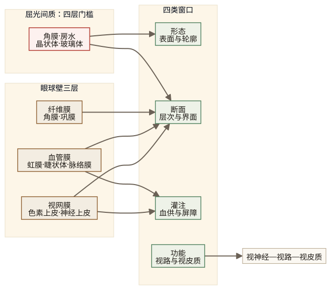

# 第 2 章 · 眼与脏腑的参照系（解剖生理基线）

> **层次**：本文件是**撰写层**——正文由课程第 2 章教学材料（眼球解剖、附属器解剖、视觉功能、眼与全身关系四单元）改写为教材体，补入「影像—解剖」的对应规则；不是底本搬运。
> **本章要回答的问题：** 仪器报回来的「厚度、反射、充盈、缺损」要跟什么比？——跟一条解剖生理基线比。这条基线若是一张数值表，本课给不出；若是一套「层次—结构—功能」的对应关系，本课给得出。
> **覆盖**：课程第 2 章的解剖与生理四单元；六个四级单元 10.02.01.01–10.02.03.02，分属「眼球壁与内容物」「附属器与视路」「血管解剖与灌注」三节。
> **参系状态**：本课**没有可引用的底本**（Firecrawl 403、维基超时、NCBI 不可达、EyeWiki 明示禁用于 AI）。中医部分只引到《中医眼科学》章目级（五轮、内外障、目系、绿风内障、圆翳内障），不引条文与页码；解剖部分只写层次与毗邻，不给厚度、折射率、眼压、视野角度等正常值——凡须给数处一律写「按所在机构规范，本章不给」（N.6 引共识扫描范围者除外，逐条标「共识·第X节」）。
> **引用口径**：课程单元记作 `第2章·2.1.x`；教材框架记作书名加章名，不到页码；差异在 2.3 交代。
> **免责**：本章为教学整理，不构成诊断或治疗建议；解剖变异与影像判读须由具备资质的人员依现行规范作出。

---

## N.1 概念与出处

本章只用六个概念。基线的作用不是给「正常值」，而是给「这一层该是什么、与谁相邻、由谁供血」——有了这三句，异常才有参照。

| 概念 | 课程出处 | 教材出处 | 定义 |
|---|---|---|---|
| 三层壁 | 2.1.4 眼球解剖 | 《中医眼科学》眼的解剖与生理（章） | 由外向内为纤维膜（角膜与巩膜）、血管膜（虹膜、睫状体、脉络膜）、视网膜（色素上皮与神经上皮）。 |
| 屈光间质与内容物 | 2.1.4 | 同上 | 角膜、房水、晶状体、玻璃体；共同属性是透明，透明度决定后面的结构能否被看到。 |
| 葡萄膜 | 2.1.4 | 同上 | 血管膜三段：虹膜（瞳孔开大与括约）、睫状体（生房水、管调节）、脉络膜（营养视网膜外层）。 |
| 目系 | 2.1.4、2.1.7 | 眼与脏腑、眼与经络（章） | 对视神经与视路的总称，谓其内通于脑；影像与视野在这一条线上对照。 |
| 血—视网膜屏障 | 2.1.7 眼与全身 | 同上 | 内屏障在视网膜毛细血管内皮，外屏障在色素上皮；是造影「渗漏」的解剖根据。 |
| 五轮（作基线对照） | 2.1.4 | 五轮学说（节） | 黑睛风轮属肝、白睛气轮属肺、瞳神水轮属肾等；本章只取它与解剖层次的对应。 |

六个概念里，只有「三层壁」是纯结构的，其余五个都带功能或生理含义。这不是巧合：**解剖基线本来就不是一张图，而是一组对应关系**——层对层、层对血供、层对功能。把它压成厚度表，反而丢掉对应关系（2.3 详述）。

### 10.02.01.01 三层壁（纤维·血管·神经）在影像上的对应

三层壁是影像读片的第一个坐标系。任何一张断面图，读的第一句话都应该是「这是哪一层」。

**纤维膜。** 前部是角膜，透明、无血管，自外向内分五层，其中上皮损伤可再生、基质损伤以瘢痕修复——「瘢痕修复」这四个字是角膜影像最重要的一句：它解释了为什么角膜的旧病变在照片上永远是一块边界清楚的混浊，而新病变边界模糊。后部是巩膜，不透明、质地坚韧，在断面上呈高密度或低信号。二者移行处是角巩膜缘，其深部即房水引流通路所在，前节影像看房角，看的就是这一带。巩膜后极有视神经穿出，该处称筛板，结构薄弱——高眼压时它向后凹陷，形成所谓视杯。这一条把「结构薄弱」与「影像上的凹陷」连了起来：视杯不是长出来的，是被压出来的。

**血管膜。** 三段各有各的影像语言：虹膜在前节影像上表现为瞳孔缘与虹膜面的形态，根部最薄、钝挫伤时易离断；睫状体在断面上是虹膜后方的三角形结构，其前内侧的突起是房水生成处；脉络膜夹在视网膜与巩膜之间，在断面上是视网膜下方的一条带——**它是唯一能被「量厚度」的层**，也是最容易被误读的层（厚度受年龄、屈光、血压影响，见 2.5）。血管膜血供丰富，因此也是眼内炎症的好发部位；在灌注类窗口上，它显影早、显影浓。

**视网膜。** 本教材只说两层：色素上皮与神经上皮。二者之间有潜在间隙，视网膜脱离即发生于此。断面图上，视网膜表现为一条有反射的带；读它的四件事是**连续、厚度、反射、界面**（第 4 章展开）。这里要记住一条纪律：**层名与厚度本教材不给**——层名对照与正常厚度随设备与机构规范变，写了就是编；能写的是「这一层在某处中断了／增厚了／与下层分开了」。

三层摆在一起，得到一条读片顺序：先认层，再认界面，最后认毗邻。认层的价值在于——同一个「白点」，在角膜基质里是瘢翳，在视网膜层间是渗出，在玻璃体里是混浊；不认层，三者都叫「白点」。

### 10.02.01.02 屈光间质与内容物：透明度决定可及性

四个间质——角膜、房水、晶状体、玻璃体——的共同属性是透明。透明不是审美问题，是**可及性问题**：光要穿四层才能到视网膜，任何一层浑浊，后面的结构在光学窗口里就整体降级。

由此得到本章最实用的一条规则：**先看介质，再选检查。** 介质清，光学窗口优先；介质浑浊，改用声学窗口或改用不依赖介质的功能窗口。这不是「设备不够好」，是物理限制——加大功率不能穿过浑浊，只会增加能量沉积。

**角膜**：写「透明／混浊／有无新生血管／有无瘢痕」。角膜无血管，营养靠角膜缘血管网与房水；一旦出现新生血管，说明有长期慢性刺激，这一句在随访里比混浊程度更有信息量。

**房水**：影像上几乎不可见，但它的循环路径是青光眼影像的解剖根据——睫状突生成、经后房过瞳孔到前房、经小梁网入房水静脉。前节影像看房角，看的就是这条路的下游；眼压数值按所在机构规范，本章不给。

**晶状体**：在最前，浑浊即「挡在门口」，是介质性视力下降最常见的原因。记录写三件事：是否浑浊、浑浊在哪一部分、是否人工晶状体眼。第三件最易漏——人工晶状体在位会改变屈光状态与测量结果，不写，复查的数就不可比。

**玻璃体**：胶状、无血管、代谢缓慢，出血与混浊吸收慢，这直接决定随访节奏（间隔按所在机构规范，本章不给）。液化与后脱离牵拉视网膜可致裂孔；患者主诉「飞蚊突然增多、伴闪光」时，检查重点是周边视网膜，不是玻璃体本身。

一句话：**介质是门槛，不是背景。** 报告不写介质条件，等于不写这次检查是在什么门槛下做的。

**图注**：图左侧是眼球壁三层（纤维膜、血管膜、视网膜）与四个屈光间质，右侧是四类窗口各自能取到的层次：形态取表面、断面取层次与界面、灌注取血供与屏障、功能取视路与视皮质。**读图要点是右侧的错位**：功能窗口取的信息不在眼球壁上，所以「结构正常、功能异常」在图上并不矛盾，它是两个窗口的正常结果。出处：本章 §2.1 与 10.02.01.01、10.02.01.02；层名与厚度按本章纪律不给。

## N.2 为什么可以这样翻译

把「五轮」接到「三层壁」上，把「目系」接到「视路」上，理由有三条。

**一、解剖基线是公共分母。** 照相、断面、灌注、功能四类窗口，取的都是同一只眼；只要都按「层—部位」定位，四份报告就能互相对齐。没有这条公共分母，四份报告各说各的位置，随访就无从比较。

**二、轮位本来就是分层定位。** 黑睛在外、白睛在表、瞳神在内，与「前节—后节」的分层同构。所以「风轮—角膜」「气轮—结膜与前部巩膜」可以直接对接；「水轮」对接不上单一层，这一点在 2.3 单列。

**三、基线的用途是定性可比，不是定量可比。** 基线告诉你「这层不该断、这个界面不该开、这条血管不该空」，不告诉你「厚多少算病」。定量的部分留给机构规范与设备参考值，本教材不越位。

### 10.02.02.01 眼睑·泪器·眶：体表与腔隙两种观察

附属器的影像有两套语言，混用就会出错。

**体表观察**（眼睑、结膜、泪点）记录的单位是「部位 + 范围 + 形态」：睑缘哪一段、多长、是脱屑还是溃破；结膜充血是局限还是弥漫；泪点是否外翻。这类观察靠照相与裂隙灯，靠的是「同一位置、同一角度、同一光线」的可比性。

**腔隙观察**（眶内、泪道、睑板深部）记录的单位是「方位 + 毗邻」：病变在肌锥内还是肌锥外、在眶上裂前还是后、与视神经管什么关系。这类观察靠断面，读片权在放射科，眼科的责任是把临床问题写清楚。

**眼睑**分五层：皮肤、皮下组织、眼轮匝肌、睑板、睑结膜。五层里只有两层有影像意义——睑板（致密纤维，内含垂直排列的腺体，腺管阻塞即成囊肿）与睑结膜。皮下组织疏松，炎症与过敏时水肿明显，所以「肿」几乎不提供鉴别信息，「肿在哪一层」才提供。这也解释了为什么眼睑的影像检查常常是「为了看它有没有越过眶隔」——越过与不越过，处置方向完全不同。

**泪器**分分泌部（泪腺，位于眶外上方的泪腺窝）与排出部（泪点、泪小管、泪囊、鼻泪管）。纪律是**功能与形态分开记**：冲洗通畅与否是功能，泪囊是否扩张是形态；两者可以不一致——通畅而溢泪，说明问题在泵或眼表；不通畅而无溢泪，说明还有代偿路径。合成一句「泪道阻塞」，就丢掉了这个不一致。

**眶**是四棱锥形的骨腔，四壁厚薄不同：上壁薄、下壁即上颌窦顶、内侧壁最薄（与筛窦相邻）、外侧壁最厚。眶尖有视神经管与眶上裂、眶下裂。四壁厚薄不是背记题，它解释了三条临床常识：眶内炎症易向筛窦蔓延、眶底骨折时眼球可下陷、眶内压增高会压迫视神经。影像上，看骨用骨窗、看软组织用磁共振，两者不互相替代。

### 10.02.02.02 视神经到视皮质：影像与视野的对照

视路是本章唯一「影像与功能必须成对读」的一段。

通路：视网膜神经节细胞的轴突在视盘汇集成视神经，向后经视神经管入颅，在蝶鞍上方形成视交叉；视交叉处**鼻侧纤维交叉、颞侧纤维不交叉**；交叉后为视束，绕大脑脚至外侧膝状体换元，形成视放射，经内囊后肢投射至枕叶视皮质。

这条通路最关键的一句是交叉规则。它把「视野缺损的形状」与「病灶的位置」锁在一起：双颞侧偏盲指向视交叉（典型的压迫来自下方垂体方向），同侧偏盲指向视束以后，中心暗点指向前段视神经。**形状即定位**——这是眼科少数几个「凭一张图就能说出位置」的地方。

于是读法固定为两步：先看影像「在哪儿」，再看视野「丢了多少」。两者一致，结论稳；不一致，按顺序怀疑三件事——检查质量（固视、配合、瞳孔大小）、检查范围（病灶在扫描野之外）、时间差（影像与视野不是同一天做的）。三者都排除后，才考虑「病灶小于分辨率」。

中医侧，视神经与视路统称**目系**，谓其内通于脑，与肝肾关系密切（章目级引用）。它与解剖学的「视神经管—颅内段」不冲突：目系的病要从全身找原因。落到记录上就是——**视野报告与断面报告必须并置在同一份病历里**，不能一份在特检、一份在影像，各自解释。

【边界】视野的正常范围有角度值，本教材不给；能给的是「缺损的形状与位置」，以及「与上次相比扩大了还是缩小了」。角度值按所在机构规范与设备参考值。

## N.3 这个翻译丢掉了什么

**一、丢掉了厚度。** 解剖基线本来带数值，本教材一律不给，于是基线只剩「层次关系」。后果是：读者知道「这层不该断」，不知道「多厚算薄」。对策是把定量交给机构规范，把定性留给自己——这一章的可用部分因此是「读法」，不是「判据」。

**二、丢掉了活体与标本的差别。** 解剖图是标本，影像是活体：有血流、有运动、有泪膜、有眼动伪影。标本上清楚的层，活体上可以糊成一片。对策是报告里写「图像质量与配合程度」，让活体的不确定性有位置可放。

**三、丢掉了「气」与「神」。** 五轮讲脏腑精气上注，解剖学讲结构与血供，两者不是同一层语言。硬译会把「精气不充」译成「供血不足」，这是错的——后者有影像证据，前者没有。对策是两套话并存、不互译。

**四、丢掉了经络。** 目系与经络的联系（如足厥阴之脉连目系）在影像上没有对应物。本教材的处理是：承认它不在影像的可及范围内，不强行找对应。

**五、丢掉了个体差异与双眼。** 视盘倾斜、脉络膜厚薄、巩膜厚度都有正常的个体差异，容易被读成异常；而解剖基线是一只眼，临床是两只眼加双眼单视——单眼的断面再漂亮，也回答不了复视与立体视的问题。对策是「与自己对侧比、与自己的基线比」，并在双眼视功能异常时另做功能检查。

五条里，第一条是本章的自觉限制，其余是方法的限制。两类限制都要在报告里留痕，而不是留给读者猜。

## N.4 与相邻学科的接口

- **《中医眼科学》**：五轮、目系、内外障的章目在彼；本章只取「轮位↔层次」的对应，不取辨证结论。
- **解剖学与组织学**：层名与厚度在彼。本章只取「能被影像分辨的层次」，不复制切片图谱。
- **影像诊断学**：眶与颅内的读片权在彼。眼科提供方位与临床问题，不越位下结论。
- **视光学与视野学**：功能侧的数据在彼。本章只规定「结构—功能」如何并置。
- **第 4 至 6 章**：本章基线是读断面、读造影、给出血定位的共同坐标。

### 10.02.03.01 视网膜血管分区与黄斑无血管区

眼内两套血管分工不同，这是读灌注图的起点。

**视网膜中央血管系统**供应视网膜内层。它在视盘处穿入视神经进入眼内，属终末动脉、无侧支吻合——分支一旦阻塞，所支配区域立刻缺血，功能损失突发且不可逆。**睫状血管系统**供应外层与前节：睫状后短动脉供应脉络膜与视网膜外层，睫状后长动脉供应虹膜与睫状体，睫状前动脉供应角膜缘与球结膜。两套系统在视网膜外层交界，这个交界就是分水岭。

由此得到一条读片规则：**缺血的位置决定它属于哪套系统。** 内层缺血（视网膜内出血、棉絮斑）指向中央血管；外层与脉络膜的问题（渗出、脉络膜无灌注）指向睫状血管。

**分区与记录。** 视网膜血管以视盘为中心分为四个象限（上颞、下颞、上鼻、下鼻），每个象限再按「与视盘、与中心凹的距离」定位。记录用**象限 + 时钟位 + 与标志结构的关系**，不用毫米——毫米需要标尺，象限与时钟位看图就能复核。

**黄斑无血管区。** 中心凹是视网膜最薄处，其中心没有视网膜毛细血管，靠脉络膜供血。这一条解剖事实解释了三件事：为什么中心凹视力最敏（光路最短、无血管遮挡）、为什么它最易因脉络膜问题受损（供血来源在外层）、为什么造影上中心凹本来就该是暗的（无血管，不充盈是正常）。**把正常的暗读成无灌注，是初学者最常见的错误之一。**

记录黄斑区所见时，句式是「以中心凹为中心，累及几个象限、是否累及中心」——临床看「有没有累及中心」，随访看「范围变没变」。

【边界】无灌注区的面积、中心凹的厚度，都不给数值；给的是范围描述与前后对比。

**图注**：三列对照。左列是视网膜中央血管系统（供内层、终末动脉、无侧支），中列是睫状血管系统（供外层与前节、吻合丰富），右列是两类读法——断面看「层与厚度关系」，灌注看「充盈与屏障」。**读图要点是左右不对应**：同一个病灶在两列里可能都「有表现」，但说的不是同一件事；断面厚不等于灌注足，灌注足也不等于断面正常。出处：本章 §2.4 与 10.02.03.01、10.02.03.02；不给面积与厚度阈值。

## N.5 争议与本项目立场

**争议一：解剖基线要不要给数值。** 一派主张给，认为没有数值就无法判断异常；一派主张不给，认为本课无可引用底本，给了就是编。本项目立场：**不给数值，给对应关系**。理由是数值随设备、机构与人群变，而「层—结构—功能」的对应稳定；要用数值，请查设备说明书与所在机构规范。

**争议二：脉络膜该不该单独成层读。** 一派主张并入「视网膜外层」一起读；一派主张单列，因为它是唯一能量厚度的层，且与多种全身病相关。本项目立场：**单列，但只读趋势**——单个厚度值意义有限，前后对比与左右对比才有意义。

**争议三：五轮与解剖层次怎么并置。** 一派主张一一对应（风轮—角膜、气轮—巩膜、水轮—视网膜）；一派主张并存两套，不强行映射。本项目立场：**前四轮可对应，水轮不对应**。水轮在五轮里是「瞳神以内全部」，在解剖上是虹膜以后三层加内容物——一一对应必然丢东西，所以水轮只作「眼内」这个层级用。

### 10.02.03.02 脉络膜与睫状体：从断面到灌注

**脉络膜**夹在视网膜与巩膜之间，血管分三层（大血管层、中血管层、毛细血管层），血流量大，营养视网膜外层并兼遮光。影像上有两条读法：断面读厚度，灌注读充盈。两条读法回答的问题不同——断面回答「厚不厚」，灌注回答「通不通」。

**睫状体**前接虹膜、后连脉络膜，前内侧的突起生成房水，睫状肌收缩使悬韧带松弛、晶状体变凸，完成调节。它是房水循环的**上游**，因此也是青光眼影像的起点：断面上看形态，功能上看房水通路。上游堵了，下游压力才升高；只盯下游不看上游，是把因果读反。

**断面不等于灌注**，这是本节的核心。断面厚，可能是水肿、淤血、纤维化，也可能是正常变异；灌注足，不代表结构没坏（渗出与新生血管都「灌注足」）。所以记录要分开写：**区域 + 断面改变 +（若有）灌注改变**，三样齐全才是一句完整的话。

中医侧，葡萄膜病多责之肝胆火炽、湿热内蕴（章目级引用）。这是**病机假说**，不是影像判据：它提示「这一类改变要从全身找原因」，但不给出「影像上看到什么就叫湿热」。把假说当判据，与把形态当证型是同一个错误（第 3 章展开）。

## N.6 与《2026 共识》的对照与增补

先说清一件事：**这份共识不涉及解剖基线。** 十四节里没有一节给正常厚度、正常眼轴或正常视野角度；第三节给的是扫描范围与信号强度（共识·第三节），不是「这一层该多厚」。所以第 2 章仍是本课自立的参照系：层、界面、毗邻与血供的对应由本章给，共识不替代它。

**一、共识的「范围」是操作参数，落地要过解剖这一关。** 共识第三节把黄斑扫描定为放射状 6mm×6mm、格栅与中心凹单线，把 OCTA 定为 3mm×3mm 或 6mm×6mm（共识·第三节）。这两条在图纸上成立，在这只眼上未必：黄斑不居中（视盘倾斜、后巩膜葡萄肿）时，以中心凹为圆心的 6mm 框会把中心凹推到边缘甚至框外；高度近视眼轴长、后极部后膨，同样的 6mm 落在视网膜上覆盖的经纬度比正视眼小，该看的周边没进来。**范围是共识给的，够不够要解剖判**——判据是 10.02.03.01 那两句：以中心凹为中心、看是否累及中心。框没框住中心凹，报告的范围栏就是假的。

**二、「视盘—黄斑—血管弓」同框是解剖关系题。** 共识第二节把眼底照相的范围定为至少含视盘、黄斑与颞侧上下血管弓（共识·第二节）。三者要同框，因为它们是**可比对的坐标系**：没有视盘就没有象限原点，没有中心凹就没有「是否累及中心」，没有血管弓就没有颞侧边界。10.02.03.01 规定记录用象限加时钟位、不用毫米，前提正是三者都在画面里；少一样，时钟位就落不到实处。

**三、解剖基线决定换不换窗口，也决定哪些「失真」不算伪影。** 介质浑浊时共识给的替代路径是超声（共识·第五节），而「为什么要换」在本章：10.02.01.02 说介质是门槛，光穿不过去只能改声学窗口。反过来，共识第十节的伪影条目列的是反光、遮挡、照明不均这类拍摄侧原因（共识·第十节），没有列「眼球形状造成的范围失真」——高度近视后极改变属于解剖，要写进范围与限度两栏，不写进伪影栏。混写，复查时会去找一个不存在的技术问题。

**四、引用的分寸。** 共识值一律带节号、保留原限定语（「设备刻度」「建议」「多数机构」），不改写成「必须」；本章原有的「不给厚度、不给角度」不变，因为共识也没给。共识没说的地方，仍按 N.5 争议一的立场处理：查设备说明书与所在机构规范。

三句话收口：共识给参数，解剖给边界；框不住中心凹的范围不算范围；共识不管基线，本章自己立。

> **免责**：本章为教学整理，不构成诊断或治疗建议；解剖变异、影像判读与检查参数以所在机构规范为准。

## 思考题

1. 为什么「水轮」不能与「视网膜」一一对应？请用 10.02.01.01 的三层壁与 2.5 的争议三说明，并指出强行对应会丢掉什么。
2. 一位患者晶状体明显浑浊，主诉视力下降。按 10.02.01.02 的规则，检查顺序应当怎么改？为什么此时加大光学设备功率没有用？
3. 断面报告说「黄斑区增厚」，灌注报告说「黄斑区充盈正常」。这两句矛盾吗？请用 10.02.03.02 的「断面不等于灌注」作答，并说明记录应当怎么写。

## 延伸阅读

- 《中医眼科学》眼的解剖与生理、五轮学说、眼与脏腑、眼与经络四节（章目级引用，不引条文与页码）——本章轮位对照的来源。
- 本课程第 2 章教学材料 `departments/08-wuguan/10-yanke-yingxiang-jiancha/chapters/02-e102/docs/zh.md`——四单元原文。
- 本教材第 4 章《内障与眼底影像》——本章基线在断面与造影上的具体用法。

> 复算：本章单元数与汉字数见 `standards/yanke-yingxiang-jiancha/units.json`；四级编码见 `00-目录-四级编码.md`。
