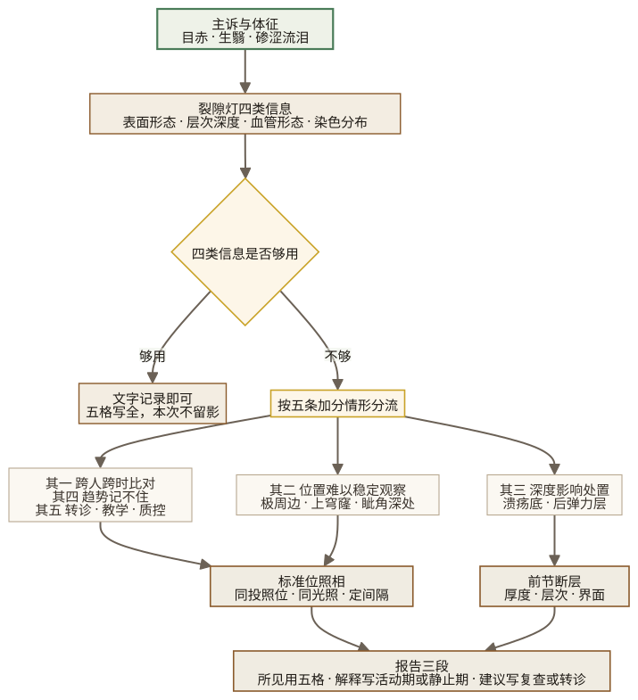
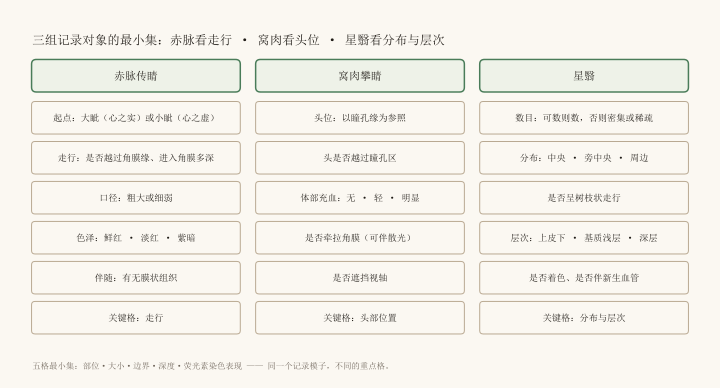

# 第 3 章 · 外障的影像辅助

> **层次**：**撰写层**（非底本搬运）。本课无可引用底本 —— Firecrawl 403、维基超时、NCBI 不可达、EyeWiki 禁止 AI 使用，四条外源途径均不可用。故不引页码与版次，不写设备参数、剂量、分期阈值、发生率。除 N.6 引自《2026 共识》并明标「共识·第X节」的条目外，数值一律写「按所在机构规范」。病名与辨证用语对齐本库《中医眼科学》（06 课）第 7–10 章，只借术语，不搬结论。
> **本章要回答的问题**：一个白睛红赤、黑睛生翳的病人，裂隙灯看完就可以记录收工，还是必须再加一项影像？如果加，加哪一项，加完之后报告上多出哪几句话？
> **覆盖**：外障的临床可及性；影像加分的五条与不加分的三种；照相与前节断层的用途边界；形态学记录最小集；赤脉传睛、窝肉攀睛、星翳作为记录对象的写法；误把形态当证型的三种句式。
> **参系状态**：无外部底本，影像分工按通行做法自行编排；参数出处自 N.6 起改用《眼科影像检查规范专家共识（2026版）》，逐条标「共识·第X节」。第 1 章的边界与第 7 章的报告纪律在本章继续有效。
> **引用口径**：只引本库课程章名与本课目录编码；共识值另标「共识·第X节」（见 N.6）；写「记什么」，不写「正常值是多少」。

---

## N.1 概念与出处

外障是病位在胞睑、两眦、白睛、黑睛一类表浅部位的病，内障是病位在瞳神、晶珠与眼底的病。这条分界本库《中医眼科学》第 5 章讲得清楚，并点明了要害：外障「外观改变显著，医者一望即知」。这句话是本章的起点 —— 既然一望即知，影像在这里能做的事就有限；本章要把这个「有限」划清楚，而不是把影像说得更重要。

「一望即知」不等于「一看就够」。外障的观察分三层：**有没有**（白睛红不红、黑睛有没有翳），肉眼可及；**什么样**（翳的形态、边界、层次，赤脉的走向），须裂隙灯；**变了没有**（与上周比、与另一只眼比），这一层靠的不是眼睛，是记录。影像在外障的位置，几乎全部落在第三层。

因此要把三类信息分开：**诊断性**（这是什么病、什么状态，绝大部分来自裂隙灯下的直接观察加问诊）、**记录性**（三个月后还能不能重现今天所见，影像强于文字也强于记忆）、**随访性**（比上次好了还是坏了，要求前两类在同一个模子里重复）。影像在外障被大量使用，多半因为后两类做得比文字好，而不是诊断类做得比裂隙灯好；两件事混为一谈，就会出现本章要反复纠正的写法：报告上一堆测量值，证候一栏仍是空的。

### 10.03.01.01 外障的临床可及性：裂隙灯能替代什么

裂隙灯给四类东西，恰好是外障辨病所需的四类。

其一，**放大的表面形态**。翳是浮嫩还是沉滞、边界清不清，肉眼下只能猜，放大与立体视下可见。本库课程把「翳色浮嫩、边缘不清」记为新翳，把「翳色沉滞灰白、边界清楚」记为宿翳 —— 这对新宿的判断全落在表面形态上，而它决定治法是祛邪还是扶正。

其二，**层次与深度**。光切下去，等于在角膜上做了一道光学剖面：病变在上皮、上皮下还是基质深层，一眼可分。深度直接对应预后，与「翳浅者易退，翳深者难消」是一件事的两种说法。

其三，**血管的形态**。抱轮红赤（环黑睛一圈的深层充血）与白睛混赤（弥漫的浅层充血）肉眼差别常不明显，镜下是两件事：前者提示风轮受邪、病位深，后者提示气轮热盛。

其四，**荧光素染色的分布**。上皮缺损处着色，着色形态（点状、树枝状、地图状、片状）与边界，是判断上皮完整性最直接的手段。

四类之外还有一样：**即时的可干预性** —— 换角度、加压、让病人转眼、滴药后再看，这是静态影像没有的。故本章立场从开头就明确：外障的诊断环节，裂隙灯不可替代；影像能替代的是记录与随访。真正需要影像的场合有一个共同特征：**当下的观察无法被固定下来**。展开就是下一条的五种情形。

### 10.03.01.02 影像只在这些情形加分（五条）

「加分」的判据不是设备能力，是待回答的问题。先有问题，再选项目；反过来先选项目再找问题，就是套餐化，也是过度检查最常见的入口。

**其一，记录需要跨人、跨时比对。** 病人要在本院与外院之间来回、门诊与急诊之间交接、病程以月计，或已出现「上次说没事、这次说有事」的分歧。此时照片的价值不在诊断，在把话说清楚，多出的一句是「与××年××月××日同一位点比较，范围……」。

**其二，位置难以稳定观察。** 角膜极周边、上穹窿、眦角深处、被睑裂遮挡的区域 —— 不是看不清，是看不稳：病人一转眼，像就跑了。此时标准位照相（含翻转上睑的结膜照相）或接触式高倍观察才是新增信息。

**其三，深度影响处置。** 角膜混浊浅层的可观察，深到后弹力层的要警惕穿孔；溃疡底部干净与底部积脓是两种处置。前节断层的价值是把深度变成可读可比的东西，而不是把「看起来深」说得更确定。

**其四，变化速度快、趋势记不住。** 进行性角膜变薄、活动期窝肉的推进、新生血管向中央生长，单次观察都不惊人，趋势才惊人。此时需要的是定基线与定间隔的序列，第一张比第十张更重要。

**其五，与手术、转诊、教学、质控对接。** 术前要有基线，转诊要有可传材料，质控要有可回溯的记录。这是制度性需求而非医学性需求，但它确实成立。

三种**不加分**的情形同样要写下：为「看得更清楚」而重复成像（清晰度若不能改变判断，只是舒适）；为报告好看而凑图；同一次检查同一部位连拍多张而无对比目的（这不是记录，是习惯）。

判断办法很朴素：**做完这项检查，报告上会多出哪一句必须写的话？** 答不出，就不必做。

## N.2 为什么可以这样翻译

把外障翻译成影像语言，做的是四步：**定轮（部位）→ 定层（深浅）→ 定活动 → 定记录方式**。顺序不能换，理由与第 1 章的四步同源：前一步的输出是后一步的输入。

定轮，即落在五轮哪一轮：胞睑为肉轮、两眦为血轮、白睛为气轮、黑睛为风轮。这一步不是给脏腑下结论，而是**选窗口**：血轮靠眦角看，肉轮要翻睑，风轮要用光切。定层，是把「生翳」落到具体层次 —— 同一句「黑睛生翳」，浅层与深层的处置、预后、复查间隔都不同，而「角膜混浊」四个字把层次全丢了。

定活动，是判断现在还在不在长：充血、浸润边界、新生血管尖端、染色范围的变化共同回答它，而它决定复查间隔。定记录方式则是收口：文字、照相、断层选几项，取决于前三步的结论，不取决于设备空闲不空闲。四步走完，记录应当有轮、有层、有活动性、有对比对象；缺一项，三个月后就是一张好看的废片。

### 10.03.02.01 裂隙灯照相：记录而不是诊断

照相的用途只有三个。**基线**：第一次就诊的样子是以后所有比较的零点，零点没留，「好转」「加重」都没有依据。基线要求可复现 —— 同一组投照位、同一放大档、同一光照方式（弥散光、光切、钴蓝加荧光素），并写清哪一眼、哪个位点。**交班**：急诊转门诊、外院转本院，照片是最省事的说明，要求不是美，是信息全 —— 要能看到病变与角膜缘、与瞳孔的关系。**争议**：病程长、结论反复的病例，照片是唯一能回到现场的东西。

照相不能做的事也要说清楚：照片没有触觉、没有问诊、没有动态、没有另一只眼（对侧对比常比患眼更有信息）。更关键的是，**它把三维压成二维，把连续压成一张** —— 正面像看不出深度，光切像只取一条线；用照片替代直接观察做诊断，等于自愿降维。所以报告里必须「看」与「照」分开写，只写其一的，不是把判断交给不在场的人，就是把可复核性交给记忆。

### 10.03.02.02 角膜与结膜的形态学记录项

最小集五格：**部位、大小、边界、深度、荧光素染色表现**。五格写全，一段描述就能被别人重画出来。

**部位。** 角膜以**角膜缘**为参照，不用瞳孔 —— 瞳孔随光与药变化，角膜缘不变。写法是「象限 + 距缘的相对位置」，如「颞上象限，角膜缘内侧约一象限宽处」。结膜则分区写：睑结膜、球结膜、穹窿部。

**大小。** 能测的按所在机构规范测并写单位，不能测的写相对比例，但不写「较大」「少许」—— 这类词不可复核：三个月后没人知道「较大」是多大。

**边界。** 清或不清、规则或不规则、隆起或平坦。边界是活动性最直接的线索：新翳「边缘不清、向四周漫延」，宿翳「边界清楚、表面光滑」。边界由不清转清，往往是转向静止的第一信号，比颜色变化更早。

**深度。** 分五档：上皮、上皮下、基质浅层、基质中层、基质深层（含后弹力层受累与否）。不必精确到微米，但必须落到「哪一层」，因为它同时决定处置的紧急度与预后。

**荧光素染色表现。** 四问：着不着色；形态（点状、树枝状、地图状、片状、环形）；边界（锐利或毛糙）；着色范围与浸润范围是否一致。最后一问最易漏，却最有信息：**着色小于浸润**，说明上皮完整而基质有病（混睛障一类）；**着色大于浸润**，说明上皮缺损超过实质病变（愈合期或机械伤）；两者一致，才是典型的浅层活动性病变。

五格之外另有三项必附，因为外障可以内传，这三项是「有没有内传」的哨兵：**充血类型**（抱轮红赤、白睛混赤、混合）、**前房反应**（闪辉、细胞）、**瞳神大小与形态**。三项不写，等于只看了墙没看门。

### 10.03.02.03 前节断层的用途边界

用途可压成三句：**看厚度、看层次、看界面。** 具体能回答四类问题：某处角膜到底多厚（尤其变薄处）；病变占了哪几层；后弹力层是否完整（穿孔风险的直接证据）；前房深度、房角开闭、虹膜形态。不能回答的也清楚：血管的活动性（充血是动态的，断层是静态的）、分泌物的性质（需刮片与培养）。把这几件事指望在断层上，是把检查当成了巫术。

边界三条。**其一**，只在「深度影响处置」时加分 —— 浅层点状着色、明确的树枝状改变，裂隙灯加荧光素已足够。**其二**，只在能稳定成像时才有意义 —— 混浊、水肿、上皮粗糙会让信号变差，信号差的图不是「看不清」，是「看起来像缺了一层」。**其三**，结果必须回到一句话上 —— 报告里要出现「某层连续性中断」「后弹力层完整」，而不是「已行前节断层，图像见附图」。图像不是结论；把图像当结论，是这一节最想拦住的写法。

## N.3 这个翻译丢掉了什么

把赤脉传睛、窝肉攀睛、星翳译成影像语言，得到的是形态属性，丢掉的是**势**。三个病名在古籍与本库课程里都带着方向与时间：赤脉「起于大眦」「渐至黑睛、蔓延瞳仁」；窝肉「发端之时多痒，渐渐生侵黑睛」；星翳「一同生起，或先后逐渐相生」。方向与时间，正是影像最不擅长给的两样东西 —— 它只能给「此刻」。所以：**这三个词是记录对象，不是影像诊断。** 影像把「此刻」写准，词把「势」留住，两者各写一行，不要互相翻译。

### 10.03.03.01 赤脉·窝肉·星翳：记录最小集

先说明用字。本课目录作「窝肉攀眍」，本库《中医眼科学》第 8 章作「窝肉攀睛（翼状胬肉）」，通行写法为「胬肉攀睛」；本章从课程正文用「窝肉攀睛」，免得读者以为是两个病。

**赤脉传睛。** 本库课程记其「以赤脉从眦部起始、横贯白睛、甚则侵及黑睛为特征」，分大眦（心之实）与小眦（心之虚）。影像记五项：起点（大眦或小眦）；走行（是否越过角膜缘、进入角膜的相对深度）；口径（粗大或细弱）；色泽（鲜红、淡红、紫暗）；伴随（有无膜状组织）。**走行**最关键：它把「白睛的病」与「已侵及风轮的病」分开，二者处置不同。

**窝肉攀睛。** 本库课程记其形「三角形肉膜，状如昆虫之翼」，分头、颈、体，并以「体厚色红、头尖隆起」与「体薄色淡、头平不尖」两组形态分进行期与静止期。本章只取这两组可观察的形态，不引时间界值。影像记五项：头部位置（以瞳孔缘为参照）；头是否越过瞳孔区；体部充血程度（按所在机构规范的档位记）；是否牵拉角膜（可伴散光）；是否遮挡视轴。**头部位置**决定要不要处理，比体部面积重要。

**星翳。** 指黑睛上的星点状混浊，本库课程在聚星障一条下记其「骤生多个细小星点状翳障，或联缀成树枝状、地图状」。影像记六项：数目（可数则数，否则写密集或稀疏）；分布（中央、旁中央、周边；是否呈树枝状走行）；层次（上皮下、基质浅层、深层）；是否着色；是否伴新生血管；是否联缀成片。**分布与层次**最关键：分布决定是否累及视轴，层次决定预后与处置强度。

三个病名的最小集是同一套五格，差别只在「哪一格最要紧」：赤脉看走行，窝肉看头部位置，星翳看分布与层次。**同一个记录模子，不同的重点格。**

### 10.03.03.02 误把形态当证型的三种写法

三种写法在报告与病历里极常见，句式都很像样，问题都在「跨了一步」。

**其一，以形定证。** 句式：「树枝状着色，属肝经风热。」错在形态提示的是活动性与层次，不指定脏腑：同一树枝状着色可见于本库课程所列四证，形态只用来分「翳之形态、色泽与红赤之轻重」，定证仍要「参以全身症状与舌脉」。改法是把两句分开写：形态一行（树枝状着色，位于上皮层，边界毛糙），证候一行（抱轮红赤、畏光流泪、口苦、舌红苔黄、脉弦数），中间不许用箭头。

**其二，以影代诊。** 句式：报告通篇是测量值与图像描述，症状、舌脉、二便一字没有。这种报告记录完整、证候空洞：复诊时无法判断证变了没有，只能再拍一次。改法是加三行「证候摘要」：主症（目痛、畏光、流泪、眵泪性质）；兼症（口苦、便结、寐差）；舌脉。三行不多，却是这份记录能不能被中医使用的分水岭。

**其三，以形变代疗效。** 句式：「翳未退，故无效。」这句话把三个东西压成一个：症状、形态、功能。三者时间常数不同：症状以日计，形态以周计，功能居中；形态滞后是常态，也有症状已解而形态未改的情形。正确写法是三条各记一行：症状「畏光流泪较上次减轻」；形态「颞上象限混浊范围缩小，边界转清，染色由片状转为点状」；功能「矫正视力较上次提高一行，同表、同距离、同照明」。三行并列，读者自己判断好转在哪里、没在哪里；合成一句「好转」，等于替读者做了一个他看不到依据的判断。

三种写法的共同病根是**省了一步**：省了「形态只是形态」，省了「证候要另外采」，省了「疗效要分维度」。

## N.4 与相邻学科的接口

- **中医眼科学（本库 06 课）**：第 7 章胞睑、第 8 章两眦、第 9 章白睛、第 10 章黑睛。本章记录项与这四章病名一一对应，对应关系是「同一个病的两种写法」，不是「影像给病名下定义」。
- **感染控制**：荧光素染色、接触式检查、翻转睑结膜都涉及交叉感染 —— 它比任何影像参数都更容易出事。染色液的分装与更换、接触镜消毒、手卫生，按所在机构规范执行。
- **影像归档与报告（第 7、8 章）**：外障照片常含睑缘、睫毛、痣与面部轮廓，属可识别信息；窝肉牵拉角膜可致散光、翳可致不规则散光，是否累及视轴交由验光量化；所见一栏用五格，解释一栏写「符合活动期或静止期」而不写证型，建议一栏写「按期复查或转诊」并给出依据。

## N.5 争议与本项目立场

**争议一：外障要不要常规留影。** 一派主张凡外障必拍（留证与随访），一派主张按需（边际收益低、增加负担）。本项目立场：按 N.1.2 的五条，不按习惯；五条都不成立时不拍，并在病历里写「本次未留影，理由：病变表浅、单次可判、无对比需求」。

**争议二：前节断层能否替代裂隙灯。** 一派认为断层更客观、可存档，应成常规；一派认为它只补了「深度」一项。本项目立场：不能替代，替代的是记录与随访 —— 裂隙灯给的是四类信息的合观，断层只取其中一类的一条线。

**争议三：中医病名与现代病名要不要画等号。** 一派主张一一对应便于教学，一派主张只作对照。本项目立场：作对照表，不作等号 —— 写「窝肉攀睛，相当于翼状胬肉」可以，因为形态描述几乎重合；写「星翳等于某型角膜炎」不行，因为星翳是形态命名、覆盖多种病因，一旦等号成立，辨证就被病名绑死。这与第 1 章「五轮八廓作为定位框架，不做诊断分级」是同一条纪律的两次应用。

## N.6 与《2026 共识》的对照与增补

本章此前凡遇数值，一律写「按所在机构规范」。现以《眼科影像检查规范专家共识（2026版）》为参数出处，只填该共识给出条目者，逐条标节号；未标节号的仍属本项目判断，不是共识。

**一、散瞳是判据，不是常规。** 共识第二节给的是一条判断条件而非一条流程：瞳孔 <3mm，或需要拍周边时，才用复方托吡卡胺散瞳（共识·第二节）。两个条件都不成立时不散瞳 —— 这与 N.1.2「先有问题再选项目」同源。散瞳前必须先排除闭角型青光眼风险（共识·第二节），这一条在外障比在眼底照相更要紧：外障病人常见前房浅、瞳神小，散瞳既可能诱发眼压升高，也可能把正在观察的瞳神形态改掉。散瞳后须告知视物模糊、畏光约 4–6 小时（共识·第二节）。本章此前的留白由共识补充，但告知要落进病历，不能只说在嘴上。

**二、范围与角度。** 共识对眼底照相的要求是画面至少含视盘、黄斑、颞侧上下血管弓，推荐 45° 或 35°（共识·第二节）。外障取其原则而不取其解剖：**覆盖**这一格指的是「判断所需的关系全在画面内」，即病变、病变与角膜缘的相对位置、同侧瞳孔缘三者同框，不是「拍得广」。45° 与 35° 的取舍在视野与放大之间，按「要看清关系还是要看清质地」定；**一旦定下就不许换** —— 换了，N.2.1 的基线就断了，序列也断了。

**三、质控五项。** 清晰度、亮度对比、对焦、覆盖、伪影（共识·第二节）。这五项正好是检验 N.2.1 那三个用途（基线、交班、争议）能否成立的尺子：清晰度与对焦决定能不能读，亮度对比决定边界与层次分不分得开，覆盖决定关系全不全，伪影决定图上多出来的东西会不会被当成病变。任一项不合格，这张图只能算「拍过」，不能算「留了基线」。

**四、伪影。** 共识第十节列了外障照片最常撞上的三种：反光（角膜与闪光灯的反光，调拍摄角度或用偏振）、眼睑遮挡（嘱睁眼或轻牵睑）、照明不均（调灯位与背景光）（共识·第十节）。外障的麻烦在于反光常正压在病变上 —— 角膜本身就是一面镜；不解决，报告里就会冒出「中央高反射，性质待定」，那是伪影冒充所见。

三句话收口：散瞳看判据，角度定了不换，五项过才算留了基线。

> **免责声明**：本章为教学材料，不构成医学意见、诊断或治疗指导。处置须由具备资质的人员依现行规范完成；设备设置、用药与随访间隔以所在机构制度与说明书为准。本章除 N.6 明标「共识·第X节」者外，不给设备参数、剂量与分期阈值，不替代面诊与必要的实验室检查。

## 思考题

1. 一位病人左眼颞上角膜缘内见片状灰白混浊，边界不清，荧光素染色阳性，伴抱轮红赤、畏光流泪、口苦、舌红苔黄、脉弦数。请按 N.2 的四步写出这份记录，说明哪一步必须靠影像、哪一步必须靠问诊与舌脉，以及为什么不能把「边界不清」直接写成「肝经风热」。
2. N.1.2 给了五条加分情形与三种不加分情形。请为「门诊初诊、病变表浅、单次可判」的病人设计一个判断流程，说明在什么条件下会决定「本次不留影」，以及这个决定应当怎样写进病历才算可追溯。
3. 「翳未退，故无效」错在哪三处？请按 N.3.3 的改法，为一位连续三次复诊的病人写出症状、形态、功能三行记录，并说明当三者方向不一致时，报告应当怎样表述才不越界。

## 延伸阅读

- 本库《中医眼科学》第 8 章·两眦疾病：赤脉传睛与窝肉攀睛的原文与辨证。本章的「记录最小集」是从这一章的形态描述反推出来的，对读可见哪些描述可量化、哪些只能留在文字里。
- 本库《中医眼科学》第 10 章·黑睛疾病：新翳与宿翳之辨、翳之深浅与预后。N.2.2 的「边界」与「深度」两格，临床意义全部来自这一章。
- 本课第 1 章·影像在眼科的位置、第 7 章·影像报告、复查与疗效评价：边界、适应证与报告三段式。本章只做外障的具体化。
