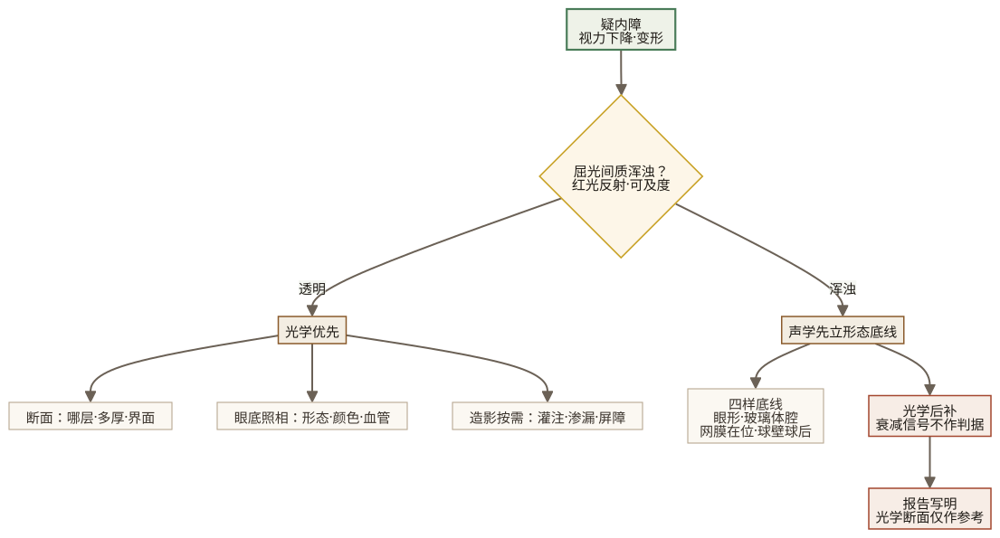
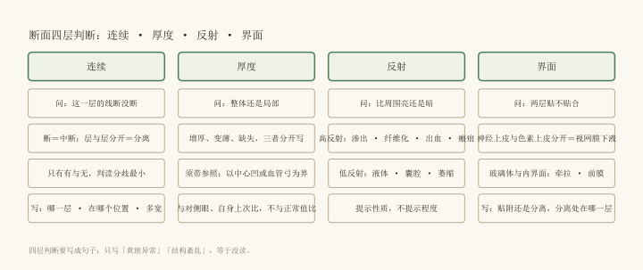

# 第 4 章 · 内障与眼底影像

> **层次**：**撰写层**（非底本搬运）。本课无可引用底本 —— Firecrawl 403、维基超时、NCBI 不可达、EyeWiki 禁止 AI 使用，四条外源途径均不可用。故不引页码与版次，不写分期阈值与发生率；设备参数、剂量与时相窗口只以 N.6 引《2026 共识》的「共识值」出现，无出处者仍写「按所在机构规范」。病名对齐本库《中医眼科学》（06 课）第 11 章，只借术语，不搬结论。
> **本章要回答的问题**：一个视力下降、眼底看不清的病人，先做哪一项？断面图上那一层层亮线与暗带，哪一处值得写成一句话？造影出来以后，报告里该写什么、不该写什么？
> **覆盖**：屈光间质浑浊时的替代路径；声学与光学的分工；断面的四层判断；常见形态改变的描述语言；造影回答的三件事；时序记录与复查对齐。
> **参系状态**：无外部底本，影像分工按通行做法自行编排；参数出处自 N.6 起改用《眼科影像检查规范专家共识（2026版）》，逐条标「共识·第X节」。第 2 章的解剖基线与第 7 章的复查纪律在本章继续有效。
> **引用口径**：只引本库课程章名与本课目录编码；共识值另标「共识·第X节」（见 N.6）；不给正常值、不给分期名。

---

## N.1 概念与出处

内障是病位在瞳神、晶珠与眼底的病。本库《中医眼科学》第 5 章把它与外障对举，并指出要害：内障「外观多无明显异常，或仅瞳神大小、色泽、形态之改变，而视力渐降」。这一句里藏着本章全部技术问题的来源 —— 外障看得见，内障看不见；看不见，才需要仪器。

但真正的难处不在「看不见」，在**看见的路径**。外障是看表面，光打在病变上就算到了；内障要隔着角膜、前房、晶状体、玻璃体去看眼底，这四层合称屈光间质，是眼睛自己的窗玻璃。窗玻璃不清，光学手段的第一损失不是分辨率，是可信度。所以内障影像的第一个判断永远是：**这条路通不通**。

由此可把内障的可及性分成三段：**通路**（屈光间质是否透明）、**断面**（视网膜与黄斑能否分层读出）、**灌注**（血流到不到、漏不漏、屏障破没破）。三段依次对应三类检查，也依次对应本章三节。顺序不能倒：通路不通时读断面，读到的是伪信号；断面不清时读灌注，读到的是猜测。

### 10.04.01.01 浑不浑浊决定先做哪一项

判断通路，不需要设备，三件事在床旁就能做完。

**其一，红光反射。** 检眼镜打到眼底，瞳孔区应有一片均匀的橘红反光。反光暗淡、发白、发黄，或出现条索状、絮状阴影，都提示通路有问题：晶状体混浊、玻璃体出血或混浊、角膜混浊。

**其二，眼底能否看清，以及看不清到哪一层。** 「看不清」不是一个判断，要分出是看不清视盘边界、看不清血管走行、还是看不清黄斑。能看清视盘而看不清黄斑，与两者都看不清，提示的通路状态不同。

**其三，病史。** 已知的白内障程度、近期的眼内炎症、外伤、出血、手术史，都能提前提示通路的状态，让检查有的放矢。

三件事做完，分两条路走。**通路透明**：光学优先 —— 断面看层次，照相看广域形态，造影按需看灌注。**通路浑浊**：先做声学。声学（超声）靠声波而不是光，能穿过混浊的晶状体与积血的玻璃体，给出四样底线信息：眼球形态是否完整、玻璃体腔有无回声、视网膜是否在位、球壁或球后有无占位。这四样不精细，但它们是**底线**：网脱没脱、球有没有萎缩，先答清楚，再谈细节。

这里有一条必须写死的纪律：**浑浊时做光学断面，得到的不是「看不清」，而是「看起来像变薄」或「看起来像缺了一层」。** 信号被遮挡后衰减，机器仍旧按同一套算法出图，图上那一层就消失了。把这张图当依据，比没有检查更危险 —— 没有检查时医生知道自己不知道，有了伪图时医生以为自己知道。

所以顺序不是「谁更高级」，是**谁在当下可信**。通路浑浊时，声学可信、光学不可信；通路透明时，光学给的信息量远大于声学。「先声学后光学」这句话的完整版是：浑浊时先声学立底线，光学按可及性后补，且补来的图只作参考，不作判读依据。

### 10.04.01.02 声学与光学的分工（参数出处见 N.6）

四类手段，一句话各自的分工。

- **声学**：回答「有没有、在哪、动不动」。穿透力强，不受屈光间质限制，能看整体形态与位置关系，能看动态（让病人转眼，观察玻璃体内回声是否飘动、视网膜是否随之移动）。
- **光学断面**：回答「哪一层、多厚、界面断没断」。分层是它独有的能力，代价是必须透过屈光间质。
- **眼底照相**：回答「广域形态、颜色、血管走行」。它给的是地图，不是剖面；适合定位与对比，不适合判断层次。
- **造影**：回答「通不通、漏不漏、屏障破没破」。它给的是功能（血流与屏障），不是形态。

四类不可互相替代，理由有二，都是物理层面的。其一，**信息类别不同**：声学给回声界面，光学给光反射界面，造影给荧光素的分布与时相 —— 三种物理量，换算不出彼此。其二，**可及性不同**：声学不怕浑浊，光学怕；照相要瞳孔够大，断面要病人能固视。

组合的规则也只有三条。**浑浊加怀疑网脱**：声学为主，光学为辅。**透明加黄斑病**：断面为主，照相定位，造影按需。**透明加血管病**：造影为主，断面看后果（水肿、积液、萎缩），照相留地图。三条之外的做法，先问一句：这项检查要回答哪个问题？答不出，就是套餐。

本章不给波长与扫描速度 —— 这两项随设备变，共识亦未列；探测频率、造影剂剂量与注射方式则按共识值写，出处统一标在 N.6。共用的理由不是保密，是数值随设备与版本变，写进教材就成了固定的错；有出处者给出处，无出处者留白。

## N.2 为什么可以这样翻译

把内障翻译成影像语言，做的是四步：**定通路 → 定层次 → 定灌注 → 定时间**。这四步与第 1 章的四步（定轮、定层、定活动、定记录）结构相同，但内容不同：外障的「层」是角膜的层，内障的「层」是视网膜的层；外障的「活动」是充血与浸润，内障的「活动」是灌注与渗漏。

定通路，是 N.1.1 那三件事。它决定后面三步用哪套手段做，是整条链的分岔点。

定层次，是把「视力下降」落到具体的一层或几层上。视网膜十层，临床上常并成四组来读：内界膜与神经纤维层、内层（含内丛状层与内核层）、外层（外丛状层与外核层）、光感受器层与色素上皮。读断面时，先认这四组，比逐层背名字有用。

定灌注，是在形态之外问血流。有形态改变不一定有灌注异常（如黄斑前膜），有灌注异常也未必立刻有形态改变（早期缺血）。两者要分别记。

定时间，是给前三点加上「与上次比」。内障的多数病是慢病，单次图像的价值有限，序列才有价值。这一步最容易被省，也最容易在省掉之后出问题。

### 10.04.02.01 断面上的四层判断：连续·厚度·反射·界面

读一张断面图，顺序固定为四步：**先定中心**（黄斑中心凹或视盘，看哪一个在先），**再逐层**（按四组走一遍），**再比对侧眼**（对侧是最好的生理基线），**最后比上次**（同一设备、同一范围）。四步做完再开口，可以避免「一眼看到最亮的地方就写」这个最常见的毛病。

逐层时问四个问题，本章称为四层判断。

**连续。** 这一层的线断没断。断，是中断（裂孔、断裂）；层与层之间分开，是分离（层间劈裂）。连续性是最硬的指标，因为它是「有与无」，不是「多与少」，判读分歧最小。写的时候要落到「哪一层、在哪个位置、多宽」。

**厚度。** 整体增厚还是局部增厚，变薄还是缺失。厚度必须带参照：以中心凹为界、以某血管弓为界，或与对侧眼、与自身上次比。**不与书本上的正常值比** —— 正常值随设备与人群变，而本章不给正常值。

**反射。** 这一段比周围亮还是暗。高反射常见于渗出、纤维化、出血、瘢痕；低反射常见于液体、囊腔、萎缩。反射提示的是**性质**，不是程度：看到高反射，先问它是渗出还是纤维化，而不是先问「有多重」。

**界面。** 两层贴不贴合。最要紧的一对界面是神经上皮与色素上皮：两者分开，其间的低反射区就是视网膜下液。第二对是玻璃体与内界面的贴合关系：牵拉、脱离、前膜，都在这一对上读。

四层判断要写成句子。只写「黄斑异常」「视网膜结构紊乱」，等于没读 —— 三个月后连写的人自己都还原不出当时看到了什么。合格的写法是：「黄斑中心凹鼻侧视网膜内层连续性中断，范围约……；其上方内界面可见高反射膜状结构，与视网膜贴附；色素上皮连续，其下未见低反射区。」

### 10.04.02.02 常见形态改变的描述语言（不写分期）

以下七类改变，各给一句可复用的写法，以及一条禁写。

**增厚与水肿。** 写「以中心凹为界，鼻侧视网膜增厚，累及内层与外层，范围约占……」。禁写「中度水肿」—— 程度没有公认的分界，写出来是自造标准。

**囊样改变。** 写「层内可见无反射囊腔，数目……，最大者位于……，囊腔之间以薄隔相隔」。禁写「囊样水肿三期」这类分期名。

**层间分离。** 写「××层与××层分离，范围为……，其间为低反射区」。禁写「劈裂」之后不再说哪两层 —— 劈裂可以发生在多处，不指明层次等于没指。

**断裂。** 写「××层连续性中断，位于……，宽度约……」。禁写「裂孔形成」而不写层：全层裂孔与内层裂孔的处置完全不同。

**膜形成。** 写「内界面或视网膜下可见高反射膜状结构，与视网膜贴附或分离，牵拉处视网膜表面……」。禁写「前膜」二字了事 —— 前膜有厚薄、有是否牵拉之分。

**隆起。** 写「色素上皮呈圆顶状隆起，其下为无反射区，覆盖其上的光感受器层……」。禁写「脱离」而不说哪两层分开：色素上皮脱离与神经上皮脱离是两件事。

**沉积与遮蔽。** 写「点状高反射，位于……，伴或不伴其下结构遮蔽」；出血则写「遮蔽其下结构，边界……」。禁写「出血较多」而不写遮蔽范围 —— 出血量在图上不可测，遮蔽范围可测。

七条之外还有一条总禁写：**不写分期名，不给厚度数值对照表。** 分期是专科文档的职责，本章只保证描述可复核；报告里一旦写下分期名，读者就会以为这里有标准。

## N.3 这个翻译丢掉了什么

结构影像把「瞳神」从一个功能单位拆成一层层组织，换来了精确，丢掉的东西有四项。

**一、丢掉了「看见」。** 断面再清楚，也不等于病人看得见。结构与功能是两条线（第 5 章），本章只走结构这一条。把「断面好转」当成「视力好转」，是把两条线并成一条。

**二、丢掉了时辰。** 中医眼科对内障的记述常带时间：「入暮目盲」是高风雀目，「倏然盲而不见」是暴盲。影像只有「检查当时」，病史里的「什么时候看不清」必须由人写进报告。

**三、丢掉了全身。** 内障多虚，虚在肝肾、在脾、在气与血，这些在图上没有位置。消渴病人的眼底改变与血糖控制的关系、眩晕与眼底的关系，都要靠问诊与舌脉，不能指望图像。

**四、丢掉了对侧眼。** 单眼图像最容易被当成全部信息。对侧眼有同一套遗传背景与血管条件，是天然对照；报告里缺一句「对侧眼所见」，这份报告就少了一半参照。

### 10.04.03.01 造影回答什么：灌注、渗漏、屏障

造影（荧光素眼底血管造影）回答三件事，只回答这三件。

**灌注。** 某区域有没有按时充盈。没有充盈的区域表现为低荧光，边界可清可不清。写的时候要写「哪一区域、以什么为界、范围约占……」，而不是「缺血」。缺血是推断，低荧光是所见。

**渗漏。** 荧光是否随时间扩大、边界是否变模糊。渗漏与「着染」不同：着染是组织被染上，晚期的范围不扩大、边界清楚；渗漏是荧光素离开血管进入组织间隙，晚期范围扩大、边界模糊。两者在报告里必须分开写，因为处置方向不同。

**屏障。** 两道屏障：视网膜血管内皮（内屏障）与色素上皮（外屏障）。内屏障破，荧光漏进视网膜内；外屏障破，荧光积存于视网膜下。窗样缺损是色素上皮萎缩留下的透见荧光，既不是渗漏也不是急性屏障破裂；写清楚可避免误判为活动性病变。

三问与断面对得上：无灌注区对应断面上相应区域的变薄；渗漏对应增厚与囊腔；外屏障破坏对应视网膜下液。**两者互证，但不能互推** —— 断面上有囊腔，未必造影有渗漏（可能是陈旧囊腔）；造影有渗漏，断面上未必已增厚（可能刚开始）。这句话是本章最实用的判读纪律之一。

造影不回答「是什么病」。同一套造影表现可见于多种病因，诊断靠病史、形态、造影三合一。所以报告的「解释」一栏应当写「符合灌注不足／活动性渗漏／屏障破坏」，而不是写病名 —— 病名留给临床诊断，影像只提供证据类型。

本章不给分期命名与渗漏分级 —— 这些随版本变，共识亦未定；循环的时相窗口则按共识值写（共识·第四节），见 N.6。留白的理由与 N.1.2 相同：没有出处的命名，写出来就是编。

### 10.04.03.02 造影的时序记录与复查对齐

造影是有时序的检查：同一次检查里，动脉期、静脉期、晚期的图讲的是不同的事。所以记录必须带时间结构。

**一次检查内的写法。** 共识给了三段时相窗口：动脉期 0–10s、静脉期 10–20s、晚期 5–15min（共识·第四节）。报告据此直接写「动脉期某区低荧光，晚期荧光渐增强并扩大，边界模糊」—— 用共识的时相名，而不是「早期」「中期」这类各家口径不一的说法。时相名统一了，两家机构的图才比得上，这比多写十个形容词有用。

**复查对齐的四条。** 同一设备、同一拍摄范围与角度、同一时相点、同一读片人。四条缺一条，比较就打折；缺两条，比较就失效。这与第 7 章「不换设备、不换范围、不换读片人」是同一条纪律在造影上的具体化。

**时序错位的三种后果**，都见过，都能避免。其一，**拿动脉期比晚期**：动脉期的低荧光若与上次晚期的强荧光相比，会得出「明显好转」的假结论。其二，**时相点不同**：渗漏在晚期才明显，这次拍到晚、上次拍到早，就会把「漏得更厉害」误读为进展。其三，**范围不同**：这次拍周边、上次只拍后极部，新出现的周边病灶会被当成「新发」，其实上次没拍到。

**写法上的纪律：不写「好转」「加重」，写差异。** 「与上次相比，颞上无灌注区边界向外移动约……，范围较前扩大」「黄斑区渗漏范围较前缩小，晚期荧光强度减弱」。差异是可复核的，判断留给读者；「好转」两个字没有信息，还替读者做了一个他看不到依据的判断。

## N.4 与相邻学科的接口

- **中医眼科学（本库 06 课）第 11 章·瞳神疾病**：圆翳内障、暴盲、视瞻昏渺、绿风内障。本章的三段可及性（通路、断面、灌注）与这一章的病名对应：圆翳内障在通路，暴盲与视瞻昏渺在断面与灌注。对应是「同一个病的两种写法」，不是等号。
- **内分泌与代谢**：消渴病人的眼底改变是全身病在眼的表现，影像只记「此刻」，血糖与病程要另外采。两者的时间常数不同，报告里不可混为一句。
- **神经眼科**：视路病变的影像（含颅内）与视野要对照读。眼内影像正常而视野缺损，提示病变在球后；报告里应当写一句「建议结合视野」。这是本章边界之外的事，但漏写会让人以为「眼内没事就是没事」。
- **超声与影像科**：浑浊时声学先做，报告要写清「因屈光间质浑浊，光学断面仅作参考」。这句话是给下一个读片人看的，也是给自己留的退路。
- **第 5、6、7 章**：结构与功能的双轨（第 5 章）、出血的层次定位（第 6 章）、复查三条纪律（第 7 章）。本章不重复，只在其上做内障的具体化。

## N.5 争议与本项目立场

**争议一：浑浊时是否必须先做声学。** 一派主张先做光学、看不清再说；一派主张先立形态底线。本项目立场：先声学。理由不是声学更好，是光学在浑浊时会给伪信号，而伪信号比没有信号更危险。

**争议二：断面正常能否排除功能病。** 一派以结构正常为「无病」；一派认为结构正常而功能异常的情况并不少见。本项目立场：不能排除。结构与功能是两条线，断面正常只说明「这一层此刻没看出异常」，不说明「看得见」。

**争议三：造影是否该常规做。** 一派主张凡眼底病必造影；一派主张按需。本项目立场：按需，且每次都要能说出「这项检查回答哪一个问题」。答不出的造影，是套餐，不是检查。

**争议四：「障」能否等同于「浑浊」。** 一派把内障理解为屈光间质混浊；一派认为「障」指遮蔽视力，与混浊不是一回事。本项目立场：不等同。圆翳内障在晶珠，确有混浊；暴盲在眼底，间质可以是清的。把「障」读成「浑浊」，会漏掉一整类间质透明的内障 —— 这正是本章要先把「通路」单独拿出来讲的原因。

## N.6 与《2026 共识》的对照与增补

N.1.2 与 N.3.1 都写过「不给参数」，理由是数值随设备与版本变、无底本可引。现在底本有了：《眼科影像检查规范专家共识（2026版）》给的是区间与判据，不是单一标准值，正好能把留白填上而不把教材变成硬性指标。以下逐条标节号；未标节号者仍是本项目判断。

**一、断面（共识·第三节）。** 黄斑扫描取放射状 6mm×6mm、格栅、中心凹单线（共识·第三节）。三者不是三选一，是三种问法：放射状看环切，格栅看旁中心凹的网格覆盖，单线看一条过中心凹的剖面。N.2.1 的四层判断在哪种模式上都成立，但**连续**这一条最好在单线上读 —— 只有单线能保证这条扫描线确实过中心凹。信号强度 ≥40dB（设备刻度值）（共识·第三节）：这不是「好图」的分数线，是可判读的下限；低于它，N.1.1 那条纪律就该启动 —— 图上少的那一层可能是信号不够，不是组织不在。扫描时开启眼球追踪（共识·第三节）：追踪丢失时机器照旧出图，只是把两个不同位置叠成一张；镜像伪影调扫描深度，条状伪影重扫并嘱固视，斑片状信号丢失多因浑浊，须在报告注明（共识·第十节）。OCTA 用 3mm×3mm 或 6mm×6mm（共识·第三节）：3mm 看中心凹无血管区与毛细血管，6mm 看弓形血管与无灌注区边界；范围一换，血流密度就不可比，这与 N.3.2 的复查四条是同一条纪律。

**二、造影（共识·第四节）。** 荧光素钠 3–5ml（10%–20%），3–5 秒推注，注射与计时同步（共识·第四节）；时相窗口为动脉期 0–10s、静脉期 10–20s、晚期 5–15min（共识·第四节）。这几个数解决的正是 N.3.2 里那个括号：此前只能写「早期（按所在机构规范设定的时点）」，现在可以写「动脉期」「静脉期」「晚期」。ICGA 早期 10–30s 看脉络膜循环，晚期看强/弱荧光（共识·第四节）；它的「早期」比 FFA 动脉期更靠后，两套时相名不可混用 —— 脉络膜循环在荧光素到达视网膜动脉之前就已开始，这正是 N.3.1「互证不能互推」在时间上的根据。

**三、超声（共识·第五节）。** B 超探头 7.5–10MHz，TGC 调至玻璃体无回声、球壁强回声（共识·第五节）；UBM 35–50MHz，水浴法避免压迫角膜，重点看 AOD500 与 TIA（共识·第五节）；A 超生物测量多次误差 ≤0.03mm，接触式须垂直角膜避免压陷（共识·第五节）。频率与深度一一对应：越高频分辨越高、穿透越浅，B 超够到球后，UBM 只到前节 —— 不是档位高低，是两段深度。N.1.1 说浑浊时先声学立底线，底线要立得住，前提就是探头频率与 TGC 按这个区间设。

**四、一句限定。** 以上都是共识值，不是强制标准；机构规程更严时从其严，更松时以共识为底线。本章此前的留白由共识补充，但**判断层**没有变：什么时候做、趋势怎么读，共识不替我们决定。

> **免责声明**：本章为教学材料，不构成医学意见、诊断或治疗指导。处置须由具备资质的人员依现行规范完成；设备设置、造影剂与散瞳用药、复查间隔以所在机构制度与产品说明书为准。本章除 N.6 明标「共识·第X节」者外，不给设备参数、剂量、分期阈值与循环时间，不替代面诊、视野与必要的实验室检查。

## 思考题

1. 一位病人视力下降两周，红光反射暗淡，眼底只能看到视盘轮廓。请按 N.1.1 的三件事说明你如何判断通路状态，给出先做哪一项、为什么，以及在报告里应当怎样写「光学断面仅作参考」这句限定。
2. 黄斑断面图上见中心凹旁视网膜增厚、层内多个无反射囊腔、内界面有高反射膜状结构并贴附。请按 N.2.2 的四层判断逐条写出可复核的描述，并指出哪一条最容易被误写成分期名。
3. 两次造影相隔三个月，第一次只拍后极部且时相偏早，第二次拍了周边且时相偏晚。请说明这样的两次结果为什么不能直接比较，并写出三条对齐要求与一句合规的差异表述。

## 延伸阅读

- 本库《中医眼科学》第 11 章·瞳神疾病：圆翳内障、暴盲、视瞻昏渺、绿风内障的辨证与转诊红线。本章的三段可及性是从这一章的病位描述反推出来的。
- 本库《中医眼科学》第 5 章·眼科诊断概要：辨内障与外障。本章「通路」之所以独立成段，依据就是这一章「外观无明显异常而视力渐降」的表述。
- 本课第 1 章·影像在眼科的位置、第 7 章·影像报告、复查与疗效评价：边界、适应证与三段式。本章只做内障的具体化。
