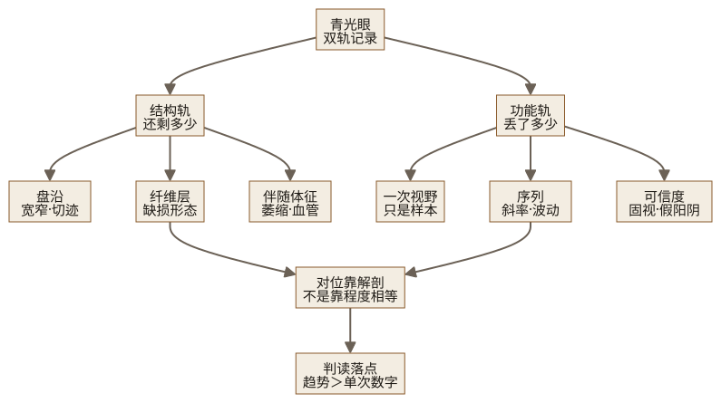
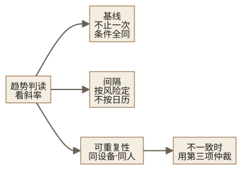

# 第 5 章 · 青光眼与视神经线索

> **本章要回答的问题:** 青光眼的影像，难处不在「看不看得见」，而在「看不看得懂一个变化」。一张视盘照相只说明「今天长这样」，一次视野只说明「今天测出来是这样」；临床真正要问的是「比上次差了多少、差得多快」。本章给的是结构侧与功能侧的双轨记录法，以及趋势判读的三要素——基线、间隔、可重复性。
> **覆盖**：参考《中医眼科学》瞳神疾病·五风内障（绿风内障）｜ 课程章 `departments/08-wuguan/10-yanke-yingxiang-jiancha/chapters/05-e105/docs/zh.md`（课程正文已于 2026-11-22 按章题补实，3993 汉字；此前为占位/错位稿，本章按章题独立撰写）｜ 本章正文 4,533 汉字（N.1–N.5 论述，不含表格行）
> **层次**：撰写层（无可引用底本；不写杯盘比阈值、神经纤维层厚度值、视野指数公式与随访天数；数值口径一律写「按所在机构规范」）

---

## N.1 概念与出处

眼科影像里，只有青光眼这一组病**必须两条轨并行记录**。理由很简单：结构损害与功能损害不是同一个测量对象。轴突在减少，这是结构；视野在缩小，这是功能。两者由同一条病理过程推动，却各有各的时钟、各有各的噪声，谁也不能替代谁。把两条轨合成一个「结论」，看着简洁，实际是把两个独立序列压成了一个形容词，复查时无从比较。

先立词。青光眼影像与随访用的词，一半是解剖名，一半是判读名，混起来就出错。

| 概念 | 一句定义 | 记录时容易出错之处 |
|---|---|---|
| 视盘（视乳头） | 视神经穿出眼球的区域，视网膜血管由此进出 | 边界常被盘周萎缩、近视弧「借走」，边界画在哪，盘沿就多宽 |
| 盘沿 | 视盘内缘与视杯外缘之间的神经组织，是轴突所在 | 记「一圈的平均宽度」没有意义，须按象限分记 |
| 视杯 | 视盘中央色浅、无神经组织的凹陷区 | 杯缘是主观划线，同一张片两人可划出两个杯 |
| 杯盘比 | 视杯直径与视盘直径之比 | 它是比值，不是病名；本章不给判读阈值 |
| 神经纤维层 | 视网膜最内的轴突层，向视盘汇聚成束 | 照相看反射亮度，OCT 量厚度，不是同一把尺 |
| 视盘出血 | 盘沿或盘面上条状、刷状的小出血，常跨过盘沿 | 除「有／无」还要记位置与是否跨缘 |
| 盘周萎缩 | 视盘周围色素上皮的萎缩带 | 变化缓慢，短期复查不必盯着它下结论 |
| 视野 | 固定条件下测得的等视力岛 | 它是「一次测验的样本」，不是「功能的真值」 |
| 总体指数 | 视野报告上概括全貌的几个数字 | 本章不写其计算式；指数下降不等于某处缺损加深 |
| 可信度指标 | 固视丢失、假阳性、假阴性等 | 记录而不擅自设阈值判废，口径按机构规范 |
| 青光眼性缺损形态 | 旁中心暗点、鼻侧阶梯、弓形暗点、环形暗点 | 形态名可背，「形态与盘沿的对位」才是判读关键 |

杯盘比这一行值得多说一句。它只是「杯的直径 ÷ 盘的直径」，分子分母都是人在片子上划的线；同一个视盘，两个人画出的杯差得比一年的真实变化还多。所以本章的立场是：**杯盘比可以记，不能单独承担判读；判读要回到盘沿的宽度与形态上。**

### 10.05.01.01 盘沿与神经纤维层：结构侧的三项记录

结构侧不是「拍一张视盘照」这一件事，而是三组互不替代的记录。少记一组，复查时就少一个可以对照的锚点。

**第一项：盘沿的宽度与形态。** 通行按上、下、鼻、颞四个象限分别记宽窄，并描述整体排列——「上下宽于鼻颞」是常见的常态排列，但它在近视、视盘斜入、盘周萎缩明显的人身上常不成立，拿它当铁律会误判。比宽窄更有价值的是**切迹**：盘沿在某一象限出现局限性缺口，朝向盘缘，常伴相应区域的纤维层缺损。弥漫变薄可以是屈光不正、光照、放大率带来的错觉，切迹很难是错觉。

**第二项：神经纤维层的缺损形态。** 最小集是：形态（楔形、裂隙样、弥漫变薄）、象限、是否触及盘缘。楔形缺损是「一束轴突整体丢失」的样子，尖端常指向视盘；裂隙样缺损窄而长，容易被当成血管影；弥漫变薄没有边界，照相上只表现为某一象限「暗了一点」。这里有一条工具边界：**照相记录的是反射亮度，OCT 量的是厚度**，两者不是同一把尺，同一患者前后对比必须用同一种工具；跨工具只能比「趋势方向」，不能比「程度」。

**第三项：伴随体征。** 盘周萎缩记「范围是否扩大、是否累及颞侧」；血管记「是否向鼻侧移位、是否在盘缘屈膝」；动脉记「是否变细、反光是否增强」；视盘记「是否倾斜、有无近视弧」。视盘倾斜与近视弧会同时改变盘缘位置与盘沿的视觉宽度，是「看起来像青光眼」的常见原因。

三项合起来，落成一张固定格式的表：**四象限 × 三项**，让第二人、第二台设备、第二家医院能在同一个格子里对话。拍摄条件也要固定——瞳孔大小、是否散瞳、照明方式、相机型号、放大倍率，都写进记录。否则第二次看到的「变薄」，可能只是「这次拍得更清楚」。

### 10.05.01.02 视野：功能侧的时间序列

视野之所以必须是序列，有三个绕不开的理由。

**一是短期波动。** 同一个人、同一台机器、隔一天再测，结果也会有出入。这不是技术不好，是阈值测量本身的随机性：注意力、眨眼、疲劳都会让读数浮动。所以「这次比上次差」只有在差的幅度超过波动幅度时才成立——而波动幅度只能由多次测量估出来。

**二是学习效应。** 第一次做视野的人往往做得更差：不熟按键、不理解「看到光就按」、眼睛乱转。第二、三次通常会「变好」一点，这个「变好」不是病情好转，是熟练了。若把第一次当基线，后面每次都显得稳定甚至进步，真正的恶化被掩盖。

**三是可信度。** 固视丢失说明眼睛在乱动，假阳性说明在乱按，假阴性说明该看到的地方没按。三项都要记录，但**要不要因此判这份报告无效，按所在机构规范**。教学上只需记住：**不可信的视野，不能推翻可信的结构记录，也不能支持「稳定」**——它最好的去处是「重做」。

缺损形态有自己的一套词汇：旁中心暗点、鼻侧阶梯、弓形暗点、环形暗点、晚期向心性收缩。这些名字不是为了好听，而是因为**它们各自对应神经纤维束的走行**——弓形暗点沿上下弓状纤维束展开，鼻侧阶梯对应视盘鼻侧纤维束在水平缝处的分界。正因如此，视野的「位置」才有对位价值：颞侧上方的弓形暗点，应对应下方盘沿与下方纤维层。**结构与功能的对位靠的是解剖，不是靠两边严重程度相等。**

## N.2 趋势判读：基线·间隔·可重复性

### 10.05.02.01 趋势判读：基线·间隔·可重复性

随访判读的落点不是「这次多少」，而是「斜率」。斜率要成立，需要三根柱子。

| 要素 | 它回答什么 | 缺了它会怎样 | 怎么做 |
|---|---|---|---|
| 基线 | 「从哪儿开始算」 | 没有基线，任何一次异常都只能叫「发现异常」，不能叫「进展」 | 以不止一次检查确立基线；两次之间条件全同，取可重复的那一档 |
| 间隔 | 「两次之间够不够看出变化」 | 太短，变化淹没在波动里；太长，错过可干预的窗口 | 按风险与变化速度定，不按日历定；本章不给天数 |
| 可重复性 | 「这两次能不能比」 | 换了设备、程序、口气，比出来的差是「方法差」不是「病情差」 | 同设备、同程序、同读片人、同拍摄与检查条件 |

**基线**常被误解成「第一次检查」。第一次检查只是第一个数据点，它本身也可能是异常的那一次（发作期，或者患者第一次不会做）。基线的真正含义是「一组条件相同、彼此可重复的检查」，通常不止一次。有了它，波动才有尺度：知道这个人在这个程序上平时上下浮多少，才敢说这次的下降「超出波动」。

**间隔**最容易被日历绑架。门诊的习惯是「三个月复查」「半年复查」，听起来整齐，实际是把连续的风险过程切成了等长格子。更合理的问法是：**这个人现在变化得多快、我下一次能看出什么？** 变化快的，间隔该短到「下一次能看出方向」；稳定的可以放宽，把资源留给更需要的环节。间隔是判断，不是日程。

**可重复性**最琐碎，也最常破。换一台 OCT、换一版算法、换一个读片人、换一次是否散瞳，都会在数字上留下痕迹，方向还往往一致——新设备分辨率更高、新算法分段更激进，于是「全线变薄」；读片人更谨慎，于是「盘沿全线变窄」。**一次全线一致的「恶化」，第一怀疑对象是方法，不是病情。**

三根柱子立起来，判读的句式也要跟着改：不写「杯盘比增大，较上次进展」，而写「同一设备、同一程序下，下方盘沿切迹加深，相应象限纤维层楔形缺损扩大，同期视野下方弓形暗点加深且位置对位」。前者是一个数字的独白，后者是一条可被人复核的推理。

反过来也要认得「不是进展」的样子。三次测量若第二次最差、第三次回落，那不是「进展后又好转」，多半是分辨率不够、把噪声当成了信号。**在波动幅度之内的差别，不构成趋势，只构成「待观察」。** 这句话要写进报告的「解释」一栏——写下来，下一位读片人才不会把同一个噪声再判一次进展。

## N.3 结构—功能不一致的四种解释

### 10.05.02.02 结构—功能不一致时的四种解释

临床最常见的困惑，是结构与功能「不匹配」：结构看着还好，视野已经缺了一块；或者视野尚可，盘沿已经薄得明显。最坏的反应是挑一个「更符合预期」的结论把它抹平。正确的反应是先问：这是四种解释里的哪一种？

| 解释 | 典型表现 | 怎么验证 | 处置倾向 |
|---|---|---|---|
| 病程错位 | 结构先损、功能后显（有储备）；或功能先损于结构可测之时 | 加密另一轨；看对位区域是否也在缓慢变化 | 不急于定性，按趋势随访，把「时间窗不同」写进解释 |
| 测量误差 | 视野波动大、可信度差；OCT 分段在高度近视或界面不清处出错 | 重做；换时段；看原始图像而非只看结论页 | 先修测量，再谈病情 |
| 解剖变异 | 视盘斜入、大视杯、近视弧、盘周萎缩宽大；生理性盲点扩大 | 对照既往多年照片；看对侧眼是否同样形态 | 不改诊断，改参照系——用盘沿而非杯盘比 |
| 读片差异 | 换设备或算法、换读片人、换机构；变化呈「全线一致」 | 同一批影像由第二人复读；回看原始数据 | 不判进展；先做方法校准，再比 |

**病程错位**最需要耐心。神经组织有储备，丢掉一部分未必立刻在视野上显出来；反之，某些功能改变在结构还能测出之前就已出现。两条轨的时钟不同，某一时点上一强一弱本身不构成矛盾，构成的是「还需要时间」——它把「不一致」从诊断危机降级为观察任务。

**测量误差**与**解剖变异**这两条，共同点是「你以为在看病情，其实在看条件」。误差藏在「结论页」背后：视野的可信度指标、OCT 的分段线有没有跑偏、照相有没有反光遮挡，都要回到原始图像去看，只看打印出来的几行数字，等于把测量当成了事实。变异则要求换参照系：天生大视杯的人杯盘比天然偏大，高度近视的人盘缘与盘周萎缩的界限天然模糊，给这类人判读，参照物要从「杯盘比」换成「盘沿的宽度与切迹」，从「单眼」换成「双眼对照」。诊断标准不变，参照物要变。

**读片差异**在随访里杀伤力最大，因为它伪装成「病情变化」。**看变化是不是「全线一致」**：真的进展通常是局部的、与解剖对得上的；方法变了，才会整片一起动。

四种解释之外还有一条总纪律：**不一致时，不要用「更权威的那一项」压服另一项，而要用「第三项」仲裁。** 第三项可以是复查（时间）、另一台设备或另一位读片人（方法）、也可以是另一种模态（造影看灌注、看瞳孔对光反应的通路）。仲裁的意思不是「谁赢」，是把不确定性降下来再判。

## N.4 与中医证候的接口

### 10.05.03.01 「绿风内障」的证候线与影像线的分工

中医眼科把瞳神一类病证统在「五风内障」之下，绿风内障是其中以急、以痛、以瞳神散大为特征的一支。证候画面很有辨识度：头目剧痛、眼珠胀硬如石、抱轮红赤、黑睛雾状不清、瞳神散大、视力骤降，常伴恶心呕吐。这套描述把「眼」与「头」「胃」连在了一起——痛在目而呕在胃，正是「肝火犯胃、痰火动风」的落点。

证候线上通行的分型不出三路：肝胆火炽者，清肝泻火；痰火动风者，化痰息风；阴虚阳亢或肝肾亏虚者，滋阴潜阳、补益肝肾。鉴别的抓手是「痛的性质与伴随」：胀痛如裂、便秘口苦者偏火；头重如裹、呕恶痰多者偏痰；隐痛、烦热盗汗、舌红少苔者偏虚。这属于证候线自己的语言，本章不展开方药。

真正需要说清的是**两条线的分工**，因为这是最容易出错的地方。

| | 证候线 | 影像线 |
|---|---|---|
| 回答什么 | 当下是什么状态：火、痰、风、虚；急不急 | 结构还剩多少、功能丢得多快 |
| 决定什么 | 治法的方向与先后：清、降、化、补 | 要不要手术或激光、复查密度、判读节奏 |
| 时间尺度 | 当下状态，可按日、按周变化 | 结构以年计，功能以月计，都要序列 |
| 谁不能用谁 | 不能用视野形态定证型 | 不能用证型推断结构损害的程度 |

三条「不互换」，要写死：

**一、不以视野缺损的形态定证型。** 弓形暗点对应的是弓状纤维束的走行，不是「肝火」。把「弓形暗点」读成「肝火旺」，是把解剖当成了病机，看似高深，实则两套语言都没说清。

**二、不以证型推断结构损害的程度。** 「舌红少苔、脉细数」提示阴虚，不提示盘沿薄到几分之几。证型是状态分类，不是损害计量。用证型估结构，会让「看起来虚」的人被低估、「看起来实」的人被高估。

**三、不以影像「稳定」宣布「证已解」。** 影像稳定只说明结构与功能这一年没明显变化，不说明「火已清、痰已化」。反过来也一样：证候缓解、症状消失，不能替代复查——**痛止了，视神经不会告诉你它还在不在丢。**

两者在哪里交汇？在**急性发作**这一点上。此时两条线不是先后，是并联：影像与临床要立刻确认眼前段状态（前房深浅、房角是否关闭、眼压水平，判据按所在机构规范），证候要立刻辨清是火、是痰、是风。处置窗口很短，降眼压与辨证论治必须同时启动，谁等谁都是错的。

另一处交汇在**慢性期的调护**。结构线给的是「还剩多少」，证候线给的是「为什么在耗」。肝火、阴虚、痰湿对应的，是睡眠、情绪、饮食这些每天发生的事——它们不改变盘沿的宽度，却决定一个人能不能把随访坚持下去。把「坚持复查」写进调护，比多开一味药更接近结果。

## N.5 争议与本项目立场

**争议一：单次杯盘比能不能「排除」青光眼。** 本项目立场：**不能**。分子分母都是人划的线，正常人群分布又宽；排除靠盘沿形态、纤维层、视野与风险因素的综合。

**争议二：OCT 能不能替代视野。** 本项目立场：**不能替代，只能互补**。两条轨的时钟不同，一强一弱本身就是信息；省掉功能，等于放弃了「这个人现在看得见多少」这一问。

**争议三：「眼压正常就不是青光眼」。** 本项目立场：**错**。眼压是风险因素之一，不是诊断的全部；眼压处于统计正常范围而视神经仍在损害的情形是存在的（本章不给比例数字）。反过来，「眼压高」也不等于「已经是青光眼」。

**争议四：中药能否替代降眼压治疗。** 本项目立场：**不能替代**。眼压可以用器械测量、可以用药物与手术干预；中医内治在改善症状、调节全身状态上有位置，但不能顶替降眼压这条主线。以「中药已起效」为由推迟手术，代价是不可逆的轴突丢失。

**争议五：要不要做人群筛查。** 本项目立场：**按风险分层，不做无条件普筛**。有家族史、高度近视、糖尿病、长期用激素、有偏头痛样发作史者，是该被主动找出来的人。频率本章不写，按所在机构规范。

**争议六：AI 读片能不能直接用。** 本项目立场：**辅助，不替代**。算法在屈光间质浑浊、视盘畸形、术后改变上不稳定；算法输出要有读片人签字，版本变更要写入记录——否则「版本升级」会被误读成「病情进展」。

## N.6 与《2026 共识》的对照与增补

本章 N.1–N.5 讲的是怎么记录、怎么判趋势、怎么解释不一致、怎么与证候分工，都在「判断」这一层；共识补的是两件更基础的事：**报告里该写什么**，以及**哪些检查要并起来看**。两件都不改判读立场，只让记录变得可复核。

**其一，报告怎么写（共识·第七节）。** 共识对阳性所见给了几项要件：定位（象限、钟点、距中心凹距离）、大小、形态、颜色、反射，以及与周围结构的关系；对阴性所见也给了示例（视盘边界清、C/D 约 0.3、中心凹反光存在）。这一条补上本章 10.05.01.01 那张「四象限 × 三项」表缺的一列：表格解决「记哪些维度」，共识解决「每个维度用什么坐标写下来」——盘沿切迹不能只写「下方变窄」，要写到钟点；纤维层缺损要写到象限与是否触及盘缘。诊断意见按共识分三档，其一名为「对比分析」，与本章 N.2 的句式要求同向：结论可以是一句比较，不必是一个形容词。

**其二，哪些检查要并起来看（共识·第十二节）。** 共识在青光眼一条上写得很省：视盘照相＋视野。要求两件事都做，并做对比分析；但没有规定两者的先后与频次，也没有给「结构与功能相差多少算不一致」的界值。这句话要读准：**共识只要求做两类检查并做对比分析，不给杯盘比或厚度阈值。** 于是本章 10.05.02.02 的四种解释仍是本项目的判断层工具，共识不替我们排优先级，也不把「不一致」算成一个差值。共识所称的「解剖配准融合」是图像层面的对齐，不是把结构指标与功能指标折成一个总分——与本章 N.1 的立场一致：两条轨合成一个结论，复查时就无从比较。

**其三，共识没有给的部分，仍然留白。** 第七节那句 C/D 约 0.3 是**阴性描述的写法示例**，不是正常值上限；共识未给杯盘比阈值、盘沿宽度界值、神经纤维层厚度值，也未给视野判废口径与随访天数。本章 N.5 争议一的立场因此不变：杯盘比可以记，不能单独承担判读。凡涉阈值，仍写「按所在机构规范」。

**最后一条纪律。** 融合的前提是接口与 PACS 支持（共识·第十二节），这是机构条件，不是读片判断；条件不具备时，宁可两份报告分别写清定位与日期，也不要用「综合评估」四个字把两次检查糊在一起。

> **免责声明：** 本章为教学材料，不构成诊疗建议。文中不写杯盘比阈值、神经纤维层厚度值、视野指数计算式与随访间隔天数，凡涉数值与判废口径，须依所在机构规范、设备说明书与现行诊疗指南。青光眼的诊断与治疗决定，须由眼科执业医师结合眼压、前房角、视盘、纤维层、视野与全身情况综合判定。凡见头目剧痛、眼珠胀硬、视力骤降伴恶心呕吐者，属眼科急症，须立即就诊，不以服药观察代替。

## 思考题

1. 一位患者三次视野检查的总体指数依次为甲、乙、丙，其中乙最差、丙回落。请说明你凭什么判断这是「进展后好转」还是「波动」，并写出你会补做哪些检查来支持这个判断。
2. 本章把「结构—功能不一致」列为四种解释。若一位高度近视患者的 OCT 显示下方纤维层变薄、视野却完全正常，你会按哪几种解释去排查？排查顺序的理由是什么？
3. 「痛止了，视神经不会告诉你它还在不在丢。」请结合证候线与影像线的分工，说明为什么症状缓解不能替代复查，以及你会如何向一位症状已消失、拒绝复查的患者交代。

## 延伸阅读

- 《中医眼科学》瞳神疾病·五风内障（绿风内障）。——绿风内障的病名、证候画面与三型治法框架，是本章 N.4 证候线的来源；本章不引页码，方药只取公认方，不给剂量与疗程。
- 《证治准绳·七窍门》，明·王肯堂。——「五风内障」（青风、绿风、乌风、黑风、黄风）分类的通行出处。本章只取其「以急缓分风」的思路，不引原文，也不把五风当作五个现代病名。
- 本课程教学章 `departments/08-wuguan/10-yanke-yingxiang-jiancha/chapters/05-e105/docs/zh.md`。——现行正文 3 单元 / 7,549 汉字，讲流泪症、漏睛、赤脉传睛与窝肉攀睛，与本章章题不合；本章按章题重写。
