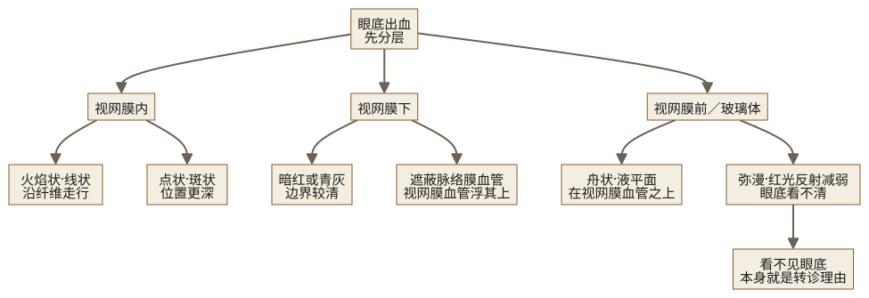
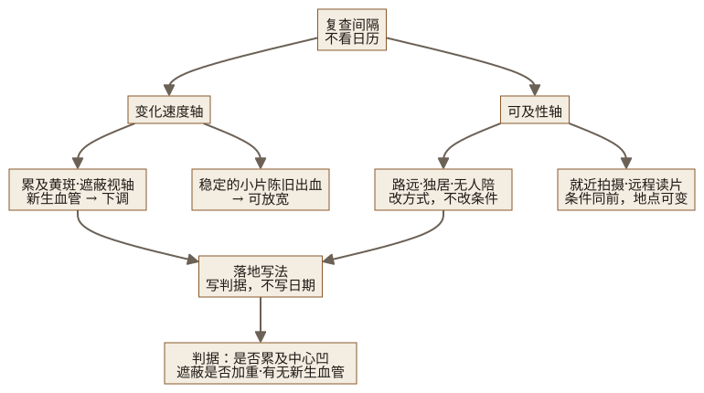

# 第 6 章 · 眼底出血与糖网随访

> **本章要回答的问题:** 眼底出血在照片上是一团红，在记录里必须变成三件事：出在哪一层、出了多少、还在不在出。这三件事记不清，随访就只剩下「比上次好一点」这种谁也无法复核的话。本章给的是分层定位法、量与程的记录法、复查间隔的决定因素，以及疗效评价的三条纪律。
> **覆盖**：参考《中医眼科学》瞳神疾病·云雾移睛、消渴目病 ｜ 课程章 `departments/08-wuguan/10-yanke-yingxiang-jiancha/chapters/06-e106/docs/zh.md`（课程正文已于 2026-11-22 按章题补实，3972 汉字；此前为占位/错位稿，本章按章题独立撰写），与眼底出血不是同一件事；本章按章题重写，仅取其「血溢络外」的分层思路）｜ 本章正文 4,713 汉字（N.1–N.5 论述，不含表格行）
> **层次**：撰写层（无可引用底本；不写糖网分期标准、随访天数、出血面积百分比与设备参数；凡涉数值与分级，一律写「按所在机构规范」）

---

## N.1 出血的描述与定位

眼底出血是眼科影像里最容易被「看了却没说清」的一项。原因不难理解：出血在照片上极其醒目，医生一眼就看见，于是记录就停在「可见出血」四个字上；而这四个字既不能支持随访，也不能支持转诊，更不能支持疗效评价。

要让它变成可用的记录，第一步是**分层**。同一团红色，落在不同的解剖层，成因、吸收速度、对视力的威胁、处置方向都不同。分层不需要额外设备，靠的是三件事：出血的边界形态、出血与血管的关系、出血是否遮蔽了它后面的结构。

| 层次 | 形态特征 | 与血管的关系 | 常提示 |
|---|---|---|---|
| 视网膜内 | 火焰状、线状，沿神经纤维走行铺开；点状、斑状则见于深层 | 出血包着血管，血管轮廓仍可见 | 静脉阻塞、糖网、高血压性改变 |
| 视网膜下 | 暗红或青灰，边界较清，面积常较大 | 出血把脉络膜血管遮住，视网膜血管浮在其上 | 脉络膜新生血管、息肉样病变、外伤 |
| 视网膜前／玻璃体下 | 舟状、片状，可有水平液平面 | 出血盖在视网膜血管之上，血管被遮挡 | 增殖性病变的新生血管破裂 |
| 玻璃体 | 弥漫、絮状，可遍布整个视野 | 什么都看不见，红光反射减弱或消失 | 大量出血，须先排除需急诊的情形 |
| 脉络膜 | 深在、大片、暗红，边界不清 | 表面视网膜血管清晰可见 | 脉络膜破裂、肿瘤、炎症 |

这张表要配合一句话使用：**形态决定层次，层次决定威胁。** 火焰状出血沿纤维走行，说明血在神经纤维层内，顺着纤维束铺开；舟状出血有液平面，说明血在玻璃体后界膜与视网膜之间的腔隙里，比重大于水；弥漫到看不清眼底的，说明血已经进入玻璃体腔，此时最要紧的不是「出了多少」，而是「还能不能看见眼底」——看不见，就无法排除视网膜脱离这类必须尽快处理的情形。

### 10.06.01.01 按层次定位：视网膜内·下·玻璃体

三个层次是本章的最小集，也是最常用的分界。

**视网膜内出血**是最常见的一类。它沿神经纤维层的走行分布，因此形态有方向性：从视盘向周边放射的火焰状、线状出血，多见于静脉回流受阻的情形；散在的点状、斑状出血，位置更深，多见于毛细血管层面的病变。记录时除了层次，还要记**与黄斑的关系**：出血是否累及中心凹、是否位于黄斑颞侧、是否沿黄斑区的弓状纤维束排列。同一片出血，累及中心凹与不累及，随访的紧迫性完全不同。

**视网膜下出血**的判断靠「遮蔽」。血在视网膜之下，把脉络膜血管遮住，而视网膜血管仍在其上方清晰可见；这是与视网膜内出血最快的区分方法。它的边界常较清楚，颜色偏暗红或青灰，面积可以很大。记录时要写清「是否累及中心凹」「边界是否清楚」「有无伴发的灰白膜状物」——后者提示可能伴有新生血管或纤维化。

**玻璃体与视网膜前出血**的判断靠「遮挡」。视网膜前出血多在玻璃体后界膜下，受重力影响形成水平液平面，形如舟船；玻璃体出血则弥漫分布，严重时红光反射消失，眼底一片模糊。这一层的记录必须加一项：**可见度**。能看清视盘与黄斑、只能看清视盘、或完全看不见——这三档决定了下一步该做什么，也决定了这次影像能不能用于疗效评价。

定位的落点是一句话：**「哪一层 + 哪个区域 + 遮挡到什么程度」。** 三层各有一句固定句式，写不出来的，等于没记。

糖网的出血，恰好把三层都用上了，这也是它适合做教学标本的原因。早期的出血多是视网膜内的点状、斑状，散在后极部，与微血管瘤、硬性渗出这类「点与斑」混在一起；硬性渗出是脂质沉积，色黄白、边界清楚，出现在出血的周边往往提示慢性渗漏。棉絮斑则是神经纤维层的缺血性改变，色灰白、边界模糊，与出血不是一回事，却常同时出现。到了增殖期，新生血管破裂，出血就进入视网膜前与玻璃体这两层，形态从「点」变成「片」，从「可见」变成「遮挡」。

这一串变化的教学意义在于：**出血的层次本身携带着病程信息。** 只记「有出血」，就把这条信息丢了；记了层次，即使不给分期，随访者也能看出「从点状到片状、从后极部到玻璃体」这个方向。方向比分级更能指导行动——分级告诉你「他现在属于哪一期」，方向告诉你「他正在往哪里走」。

### 10.06.01.02 出血量与时程的记录法

「量」在眼底出血里没有绝对单位，只有相对单位。这是它跟白细胞计数、血糖不同的地方：没有人能给出「出血多少毫升」。可行的方法是三个相对标尺。

**第一，以视盘直径为标尺。** 记「约几个视盘直径大小」，把面积变成可比的相对量。这一标尺的前提是同一只眼、同一放大条件——眼底照相的放大率随屈光状态变化，高度近视眼与正视眼的「一个视盘直径」在照片上像素不同，因此跨眼、跨设备比较时必须换算，不能直接比。

**第二，以遮蔽程度为标尺。** 出血是否遮蔽其下的血管、是否遮蔽黄斑、是否遮蔽视盘边缘。遮蔽是最贴近「威胁」的量度：它同时反映了出血的厚度与位置，比面积更接近临床关切。

**第三，以分区计数为标尺。** 把眼底按象限或按以黄斑、视盘为锚点的区域划分，逐区记「有／无」与「密度」。这一标尺的优点是离散、可复核、不依赖测量工具，第二个人看同一张片能得出同样的结论。

「程」的部分比「量」更容易被忽略。出血的时程有三条线索：**颜色的演变**（鲜红—暗红—黄白，反映血红蛋白的分解过程）、**边界的演变**（新出血边界清楚，陈旧出血边界模糊、颜色变淡）、**液平面的演变**（视网膜前出血的液平面随体位与时间移动）。这三条合起来，可以粗略判断「这是新出的还是旧有的」。而这个判断直接决定复查间隔：新出血要看得勤，陈旧出血要看得准。

记录时还要写清一件常被漏掉的事：**这次是「首次发现」还是「复发」。** 复发出血与首发出血，在处置与随访上的分量不同；同一个患者两眼都有出血时，还要注明是单眼还是双眼。这些字段不加，复查时就会出现「上次是哪只眼」的尴尬。

## N.2 随访的时间结构

### 10.06.02.01 复查间隔由什么决定（不给天数）

复查间隔不是一个数字，是一个判断。把它写成「三个月复查」，等于把判断外包给了日历。间隔应当由四件事决定。

| 决定因素 | 具体问法 | 对间隔的作用 |
|---|---|---|
| 层次与位置 | 出血在哪一层？是否累及黄斑或遮蔽视轴？ | 累及黄斑、遮蔽视轴者，间隔要短到能抓住变化 |
| 活动性 | 是新出血还是陈旧出血？有无新生血管、有无活动性渗漏？ | 活动性强者间隔短；稳定者放宽 |
| 全身状态 | 血糖、血压、凝血状态是否受控？用药有无变动？ | 全身失控时，眼部变化会加速，间隔随之下调 |
| 可及性与责任 | 患者住多远、谁陪、能不能按时来、谁负责召回？ | 达不到的间隔没有意义；宁可改方式，不可假设置 |

四件事里最容易被说漏的是第四件。一个写在纸上的间隔，如果患者根本来不了，它就是一个假的承诺。临床上常见的情形是：医生按病情定了较密的复查，患者因路远、独居、无人陪而一次次失约，最后在「失访」的名义下丢掉随访。正确的做法不是把间隔放宽到「他能来」，而是**改随访方式**——就近复查后带回影像、远程读片、由基层机构按同一条件拍摄。间隔可以变，条件不能变，这是下一节的前提。

间隔的写法也要改。不写「三个月后复查」，而写「下次复查的判据是：出血是否累及中心凹、遮蔽是否加重、有无新生血管出现；在上述任一情形出现前按计划复查，出现则提前」。前者是一个日期，后者是一条可执行的规则。

### 10.06.02.02 失访与转诊的判据

失访不是「患者不听话」，是一个可被定义、可被管理的状态。本章的用法是：**约好的复查未到、且按登记的联系方式无法在合理期限内建立联系，即为失访。** 这一定义的重点在「可被记录」：谁联系、什么时候联系、联系了几次、结果如何，都要留痕。没有留痕的失访，无法改进，也无法追责。

转诊的判据比失访更硬，因为它关乎不可逆的损害。以下情形不属于「下次再说」：

| 判据 | 为什么不能等 | 交给谁 |
|---|---|---|
| 出血累及中心凹，或视力在短期内明显下降 | 黄斑区的损害窗口很短，等一次复查可能就错过了 | 眼底病专科，尽快 |
| 玻璃体出血导致眼底无法看清 | 看不见就无法排除视网膜脱离、无法判断新生血管 | 眼底病专科，需进一步检查 |
| 飞蚊突然增多伴闪光感，或视野出现固定遮挡 | 提示可能存在裂孔或脱离，与出血量无关 | 眼底病专科，当日处理 |
| 出现新生血管（盘上、盘周、虹膜） | 新生血管意味着增殖期，出血与牵拉的风险上升 | 眼底病专科，评估激光或抗新生血管治疗 |
| 眼压升高伴眼痛、头痛 | 可能与新生血管性青光眼相关，属急症 | 眼科急症通道 |
| 全身病失控（血糖、血压、凝血）或正在用抗凝药且出血反复 | 眼部只是全身的窗口，局部处置无法解决源头 | 内分泌／心内／相应内科，眼科配合 |

这张表里有一条纪律要写死：**「看不见眼底」本身就是转诊理由。** 很多失访与延误，起于「等血吸收一点再看」——这句话在玻璃体出血的早期是合理的，但它必须带一个上限：到了约定的时点仍未吸收、仍看不见眼底，就必须升级检查与转诊，而不是继续等。

## N.3 疗效评价的可比性

### 10.06.03.01 同一设备·同一范围·同一时间点

疗效评价最容易出的错，不是判断错，是**比较错**。两个时点的影像，如果拍摄条件不同，比出来的差可能是方法差。三条纪律挡住这条路。

**一、不换设备。** 不同设备的色彩还原、分辨率、放大率不同，同一片出血在两台机器上可以是两种红、两个面积。更换设备时，必须在记录中标注，并在新旧之间做一次「重叠期」拍摄，否则跨设备的前后对比只能作趋势参考，不能作结论。

**二、不换范围。** 眼底照相的拍摄范围（黄斑区、后极部、还是拼接到周边）与拍摄角度，直接决定「能看到多少」。范围一变，出血的「面积」就变了；这不是病情变化，是视野变化。范围应当按病情固定：糖网随访通常需要覆盖后极部并包含视盘与黄斑；周边病变需要拼接时，拼接方式也要固定。

**三、不换读片人。** 出血的面积估计、密度分级都带有主观成分。同一位读片人在同一套标准下重复读片，一致性最好；换人时应当双读并留存分歧记录。读片人变更、算法版本变更，都要写进报告，理由与第 5 章相同：**方法变了，才会整片一起动。**

三条之外还有一条时间纪律：**同一时间点，指的是同一病程相位。** 治疗前后、出血前后、散瞳前后，都是不同的相位。把「治疗前的照片」与「治疗后的照片」放在一起比，本身是合理的；但把「散瞳后的照片」与「未散瞳的照片」放在一起比，比出来的视野范围差会被误读成病情变化。

可比性还有一半在档案里。命名规则、存放目录、检查日期与设备标识、是否散瞳、拍摄范围，这些字段如果不在文件名与报告里，三个月后连「哪张是哪次」都要靠回忆。可行的做法是固定一条命名式：日期＋眼别＋范围＋设备，治疗节点另加标记。这套东西看着像行政工作，实际上是疗效评价的地基——**找不到可比的旧片，等于没有随访。**

疗效评价的结论也要分层写：**结构**（出血面积、遮蔽程度、有无新生血管）、**功能**（视力、视野）、**全身**（血糖、血压）。三者不一致时，不要用其中一个去否定另一个——出血吸收了而视力没升，可能是因为黄斑已有不可逆改变；视力升了而出血没吸收，可能是因为出血不在中心凹。**疗效是三个层面各自的结果，不是一个总分。**

## N.4 与相邻学科的接口

- **内分泌科**：糖网的源头在血糖。眼科影像能提供的是「损害到什么程度」，不能提供「血糖控制得好不好」；两者必须并看。患者把「眼睛还好」当成「血糖还行」的证据，是最常见的一种误读，须在交代中明确否定。
- **心内科／肾内科**：高血压、肾病与眼底改变互为窗口。眼底是全身唯一能直接看到血管的地方，这一点的价值不在诊断眼科病，而在为全身病提供旁证——旁证不等于诊断，表述须谨慎。
- **血液科**：出血反复、双眼多发、伴全身瘀斑者，须先查凝血与血小板。此时眼底记录的作用是「定位与定量」，不是「定因」。
- **神经内科／神经外科**：玻璃体出血合并头痛、恶心者，须排除颅内情形；视野缺损与眼底所见不匹配时，也要想到视路。
- **产科**：妊娠期高血压相关的眼底改变，须与产科同步评估；影像随访的节奏由产科与眼科共同决定。
- **中医眼科**：消渴目病、云雾移睛、视瞻昏渺在彼。本章的中医接口只保留一条：**证候线讲「为什么出血」，影像线讲「出在哪、出了多少、还在不在出」。** 消渴目病的阴虚燥热、气阴两虚、瘀血阻络三路，对应的是「耗」与「滞」的状态判断；影像侧的层次与量，对应的是损害的计量。两者不互换，与第 5 章同一纪律。

## N.5 争议与本项目立场

**争议一：出血面积能不能作为疗效的主要指标。** 本项目立场：**只能作辅助**。面积受范围、放大率、遮蔽程度影响，且与视力不成比例；主指标应当是「是否累及中心凹」与「有无新生血管」这类结构性判据。

**争议二：玻璃体出血要不要「等它吸收」。** 本项目立场：**可以等，但必须有上限与再评估点**。等的理由是少量出血可自行吸收、手术有风险；上限的理由是「看不见眼底」期间无法排除脱离与新生血管。等的过程中要按期复查，不能一等了之。

**争议三：复查间隔能不能统一规定。** 本项目立场：**不能**。间隔由层次、活动性、全身状态与可及性共同决定；写成统一天数，等于放弃了判断。本章因此只给决定因素，不给天数。

**争议四：中药能否促进出血吸收、替代抗新生血管治疗。** 本项目立场：**不能替代**。活血化瘀、凉血止血一类的治法在改善症状、调节全身状态上有位置；但新生血管是结构性问题，须由专科评估是否行激光或抗新生血管治疗。以「先吃几付看看」推迟处置，代价可能是玻璃体出血与牵拉性脱离。

**争议五：AI 自动测量出血面积能否直接用于随访。** 本项目立场：**辅助，不替代**。算法在标准化的后极部照片上稳定，在周边拼接、屈光间质浑浊、出血遮蔽血管时不稳定；算法版本变更必须记录，且须与人工读片对照。

## N.6 与《2026 共识》的对照与增补

本章 N.1–N.5 的重心是「出血怎么记、间隔怎么定、疗效怎么比」。共识在这三处各补了一块可引用的内容，也各留了一处空白；分清哪块是补的、哪处是空的，比背下条目更要紧。

**其一，拍摄范围有了出处（共识·第二节）。** 本章 10.06.03.01 只说「范围按病情固定」，并没有说固定成什么。共识给了：至少含视盘、黄斑与颞侧上下血管弓，推荐 45° 或 35°；**DR 需 ETDRS 7 个标准视野**，含周边。瞳孔小于 3mm 或需拍周边时散瞳，散瞳前先排除闭角型青光眼风险，并告知视物模糊、畏光约 4–6 小时。这一条把「不换范围」从一句纪律变成了可执行的取景约定：换设备可以，换视野布局不行。

**其二，对比分析要分档（共识·第七节）。** 共识的诊断意见分「明确诊断／提示性诊断／对比分析」三档，对比分析要求把前后两次放在一起给出方向。落到本章的疗效评价，方向只有三档：**进展、稳定、好转**。三档都必须带可比性前提——同设备、同范围、同一病程相位（10.06.03.01）；前提不成立时，正确的写法不是「好转」，而是「不可比，须重拍」。共识给的是「要做对比分析」这一要求，没有给「面积缩小多少算好转」的界值，也没有给「出到什么程度算进展」的界值：三档是定性方向，不是评分。

**其三，跨模态各归其位（共识·第十二节）。** 共识给两条现成的组合。RVO：FFA 看渗漏，OCTA 看血流密度与无灌注区——彩照回答「出在哪一层」（10.06.01.01），FFA 与 OCTA 回答「还在不在漏、灌得到不到」。中浆：彩照看渗出点，FAF 看 RPE 损害，ICGA 看高通透点——黄斑区的浆液性脱离在彩照上可能只有一个点，RPE 受累范围要 FAF 才看清，高通透点要 ICGA 才定得住。这里有一条本章自己的边界：**灌注侧的量与出血的量不是同一个测量对象**，无灌注区不能折进 10.06.01.02 那三个相对标尺里去加总。

**共识没有给的部分，仍然留白。** 第二节给的是拍摄范围与散瞳口径，不是复查间隔；第十二节给的是模态组合，不是组合的先后与频次，也没有给「无灌注区多大算缺血」的界值。本章 N.5 争议三的立场因此不变：间隔由层次、活动性、全身状态与可及性决定，不给天数。凡涉分级与阈值，仍写「按所在机构规范」。

> **免责声明：** 本章为教学材料，不构成诊疗建议。文中不写糖网分期标准、随访天数、出血面积百分比与设备参数，凡涉及分级与数值口径，须依所在机构规范与现行诊疗指南。眼底出血的定位、转诊与治疗决定，须由眼科执业医师结合眼底检查、影像与全身情况判定。凡见视力骤降、飞蚊突增伴闪光、视野固定遮挡、玻璃体出血致眼底无法看清者，须尽快转眼底病专科，不以服药观察代替。

## 思考题

1. 同一片出血，在视网膜内、视网膜下、玻璃体三个层次，形态上各有什么可用来区分的特点？请说明你会用哪一句话把「层次」写进记录。
2. 一位患者两次随访的出血面积「明显变小」，但你发现两次拍摄的范围与设备都不同。请说明这个「变小」为什么不能作为疗效结论，以及你会怎样补做才能得到可比的判断。
3. 本章把复查间隔交给「变化速度」与「可及性」两轴，而不给天数。请以一位住得远、独居、血糖控制不佳的糖网患者为例，说明你会如何设计随访，使这个间隔既符合病情又真的能被执行。

## 延伸阅读

- 《中医眼科学》瞳神疾病·云雾移睛、消渴目病。——云雾移睛（眼前黑影、玻璃体混浊）与消渴目病（消渴所致目病）的病名与证治框架，是本章 N.4 中医接口的来源；本章不引页码，方药只取公认方。
- 《证治准绳·七窍门》，明·王肯堂。——眼科血证的通行分类源头之一。本章只取其「血溢络外、当辨虚实与新旧」的思路，不引原文，也不把古病名直接对应当代分级。
- 本课程教学章 `departments/08-wuguan/10-yanke-yingxiang-jiancha/chapters/06-e106/docs/zh.md`。——现行正文 4 单元 / 15,455 汉字，讲白睛病证（暴风客热、天行赤眼、金疳、火疳），其中「出血」指白睛溢血，与眼底出血不同；本章按章题重写。
