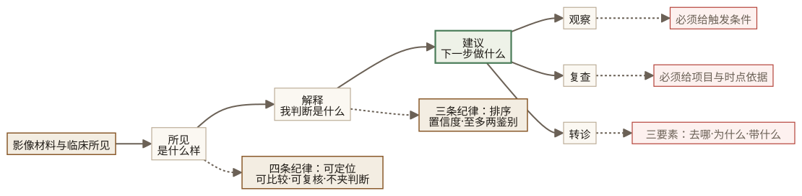
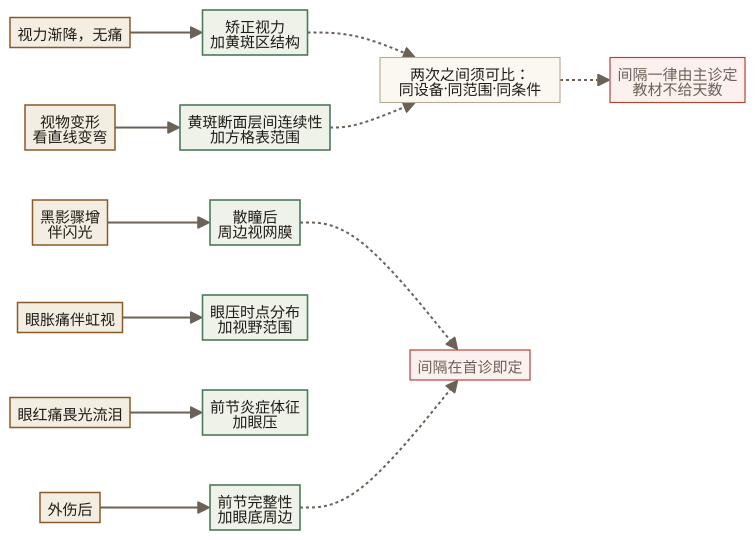

# 第 7 章 · 影像报告、复查与疗效评价

> **本章要回答的问题：** 同一张片子，两个人各写一份报告，一份能让下一个人接着往下做，一份只能进档案柜锁起来——差别到底在哪几行字上？
>
> **覆盖**：三段式报告的字段分工与四条纪律；「建议」一栏的三档强度及其与所见确定性的失配；复查项与主诉的对应；四类必须提前复查的情形；疗效评价的三条纪律与「必须换」时的桥接办法｜对应课程章 `07-e107`（课程正文已于 2026-11-22 按章题补实，4000 汉字；此前为占位/错位稿，本章按章题独立撰写）
>
> **层次**：本文件是**本项目撰写层**。参考《中医眼科学》瞳神疾病与眼外伤章目、《卫生信息管理》病历与信息安全相关章节（只作结构对读，不引原文与页码）。本课无可引用底本，故**不给分级阈值、不给设备参数、不给复查天数**；一切具体间隔与判据以现行规范与所在机构制度为准。**不写页码。**
>
> **免责**：本章为教学材料，不构成诊断、治疗或随访建议。报告格式、复查间隔与转诊时限，须由具备资质的执业人员与所在机构制度决定。

---

## N.1 报告的结构化写法

### 10.07.01.01 三段式：所见—解释—建议

一份报告读的人不止一个：开单的医生要据此决定今天做什么，下一次接诊的人要知道这一回和上一回比什么，患者要听懂下一步该干什么。三个人关心的不是同一件事，所以一段到底的写法必然偏向其中一个。

三段式的意义就在这儿：**所见给「是什么样」，解释给「我判断是什么」，建议给「所以下一步做什么」。** 三段各自对不同的读者负责，也各有各的出错方式——所见最容易掺进判断，解释最容易含糊其辞，建议最容易写成一句谁都不必执行的客气话。

**所见段的四条纪律。**

一、**可定位。** 写清眼别、象限或钟点、与哪个解剖标志的距离关系。「黄斑区上方可见」不合格，「左眼、黄斑中心凹上方约一个视盘直径处」才合格——粒度不必到微米，但必须到「下一个人能找到」。

二、**可比较。** 每个形态描述都要有参照物：以视盘直径为单位、以血管弓为界、以中心凹为圆心。没有参照的描述，第二次读片时无法判断是变大了还是没变。

三、**可复核。** 把成像条件写在所见之前，而不是塞进附录：设备与检查方式、是否散瞳、固视是否配合、屈光间质是否影响成像。同一只眼，散瞳前后、配合与不配合，拍出来的东西不一样；不写条件，等于把两次不同的测量当成同一个量在比。

四、**不夹判断。** 这是最常被违反的一条。「黄斑水肿」是解释，「视网膜内层出现低反射腔隙、层间结构紊乱」是所见。前者已经替读报告的人做完了推理，后者把材料交出去。中文报告里「可见渗出」「提示水肿」这类写法难改，是因为读起来顺；但顺不等于对——判据一混进描述，复核的人就没有独立材料可用。

**解释段的三条纪律。**

一、**一句话给结论，并且排序。** 有多个可能时按可能性排序，不要并列。「考虑 A，不排除 B」是允许的；「考虑 A 或 B 或 C」等于没考虑。

二、**给置信度，用可操作的说法。** 「符合」「不除外」「依据不足，建议结合临床」是三个不同强度，读的人据此决定要不要追加检查；混用等于把不确定性藏起来。

三、**给鉴别，最多两条。** 列五条鉴别看似严谨，实为把判断责任推回去；真需列五条者应当走会诊。

**建议段不重复解释。** 它只回答三件事：下一步做什么、什么时候做、由谁做。病情安慰、用药指导、预后估计都不属于这个位置：报告由读片人签发，用药与预后由主诊决定，越界写一句，责任就模糊一分。

**一个反例。** 原始写法：「右眼眼底可见出血，考虑糖尿病视网膜病变，建议复查。」三层问题：出血在哪一层、哪个范围，没写；「考虑糖尿病视网膜病变」没有置信度、没有鉴别；「建议复查」没有时间、没有项目、没有触发条件。

改后：「右眼，后极部沿血管弓分布的点状与斑状出血，主要位于视网膜内层，范围约四个视盘直径，未累及黄斑中心凹；屈光间质清晰，配合良好，未散瞳。符合糖尿病视网膜病变的出血表现，依据为出血分布与层次；不除外合并静脉阻塞，若出血沿某一支静脉分布则支持后者。建议：由主诊按现行随访规范安排眼底复查，固定同一范围与同一固视点并记录视力；如出现视物变形或视力较本次下降，不必等到约定日期。」

改后未增加新信息，只是把三段各自的活儿干完了。**同一份材料，报告的好坏只取决于分工是否清楚。** 至于不写的东西——无关的既往史猜测、对同行的评价、预后承诺——都不是遗漏，是位置问题。

**课程稿与本章的关系。** 课程章 `07-e107` 已于 2026-11-22 按章题补实为「报告—复查—疗效」方法稿，与本章同题；本章的独立价值在于把方法落到影像字段与共识节号上。补实之前，该课程章的九单元切自《中医眼科学》的病种论述（病名与病因病机，不是报告与随访方法），与本章题不对齐，本章因此按章题独立撰写。

## N.2 「建议」一栏的三种强度

### 10.07.01.02 「建议」一栏的三种强度

建议只有三档，多一档就乱，少一档就漏，按「是否要求患者在某个时点采取行动」划分，不按病情轻重划分。

| 档位 | 句式 | 必须附的条件 | 不许出现 |
|---|---|---|---|
| 观察 | 「本次所见不足以支持进一步处置，按原计划随访；如出现以下任一情况提前就诊」 | 触发条件（新增症状的具体描述） | 「必要时复查」「不适随诊」这类无触发条件的收尾 |
| 复查 | 「于 X 类时点复查 Y 项，复查时固定同一范围与同一固视点」 | 复查项目、时点的确定依据、由谁安排 | 只写「复查」不写项目；只写项目不写时点依据 |
| 转诊 | 「建议至 X 科评估 Y 问题，在 Z 类时限内完成」 | 科室、要解决的问题、要带的材料、时限的量级 | 「建议上级医院进一步诊治」——没有科室、没有问题、没有时限 |

**三档的分界线是「谁在什么时点必须做事」**：观察档里做事的是患者（自查）与主诊，复查档里是检查流程，转诊档里是另一个科室。三档混写，最常见的结果是该转诊的写成复查、该复查的写成观察，而那句「不适随诊」把责任完整地推回给患者。

**「必要时复查」是这一节要挡住的第一个写法。** 它不是建议，是语法上像建议的空白：患者不知道什么算「必要」，下一位医生不知道上一次的判断有多确定。要留它，就必须改成条件句——出现视物变形、黑影突然增多、视力较本次下降，三者任一即就诊。条件越具体，患者越能用；越抽象，越像是为了免责。

**强度与所见不匹配，是第二类错误，也更危险。** 一种方向是轻所见配重建议：一点点周边视网膜变薄就写「建议尽快手术评估」，患者被吓到，做了不必做的处置——本质是把风险管理外包给患者。另一种是重所见配轻建议：所见里已经写了视网膜下液、新出现的周边裂孔、视盘边界不清伴出血，建议却落在观察档。后者危害更大，因为它不是判断保守，而是两段之间根本没有对齐。**建议的强度必须由所见的确定性推出来，不由读片人的心情或科室的习惯推出来。**

**转诊三要素：去哪、为什么、带什么。** 「去哪」要写到能挂号的程度，「为什么」要写成一个能被对方接手的问题（不是「进一步诊治」，而是「评估是否需要手术」），「带什么」要带影像原件而不只是报告——原件可复读。三样缺一样，转诊就等于把患者放进了一个更长的队列。

**与中医记录的接口要摆正位置。** 中医病历里的「治法」有自己的层级（内治、外治、针灸、调护），与影像建议的强度不是一套刻度。把「建议中药调理」写进影像报告，是把两套判断混在一栏里：读片人无处方权，主诊也无义务照办。**本项目立场：** 报告不写「建议手术」，写「建议至某科评估手术适应证」——前者是处置决定，后者是请另一个专业做决定。越界的报告在事后追责时既保护不了患者，也保护不了写的人。

## N.3 复查项与主诉的对应

### 10.07.02.01 复查项与主诉的对应表

复查项由**主诉加首诊所见**共同决定，不由套餐决定。套餐式复查的问题不在浪费，而在**错配**：真正会变的那一项没查，不会变的那几项查了一堆，然后用「都查了」安慰自己。

| 主诉 | 首诊必做 | 复查必看 | 间隔由谁定 |
|---|---|---|---|
| 视力渐降，无痛 | 视力（裸眼与矫正、远与近、单眼）、屈光间质评估、眼底与黄斑区结构 | 矫正视力、黄斑区结构、屈光间质变化 | 主诊按病因与进展速度定 |
| 视物变形、看直线变弯 | 矫正视力、黄斑区断层、方格表自查 | 黄斑区断面的层间连续性与厚度变化、变形范围 | 主诊按病种定；自查频率另定 |
| 眼前黑影突然增多、伴闪光 | 散瞳后周边视网膜检查、必要时的声学检查 | 周边视网膜是否出现裂孔或局限性脱离 | 首诊即定，不按常规间隔 |
| 眼胀痛伴虹视、视物发雾 | 眼压、前节评估、视盘与神经纤维层、视野 | 眼压的时点分布、视野缺损范围、盘沿变化 | 主诊按眼压控制情况定 |
| 眼红、痛、畏光、流泪 | 裂隙灯下前节评估（含房水与前房细胞） | 前节炎症体征、有无粘连、眼压 | 主诊按炎症活动度定 |
| 眼部外伤后 | 全面前节与眼底评估，必要时影像 | 前节看结构完整性，眼底看周边 | 首诊即定，不套用常规间隔 |
| 糖尿病史、无症状 | 散瞳眼底检查（按现行筛查规范） | 出血范围与层次、黄斑是否受累 | 按现行筛查与随访规范 |

第四栏故意只写「由谁定」而不写「多少天」：复查间隔随病种、病情、治疗反应与机构能力变化，教材写一个数字，落到另一个机构就是错的。**教材能负责的是「这一项必须看」，不能负责的是「隔多少天看」。**

**两处对应关系要单独讲。** 视力渐降而眼不痛，最容易被当成屈光问题，于是只复查视力；但视力对黄斑不敏感，中心凹旁的病变可以在视力仍「正常」时就存在，故复查必须带上结构。视物变形几乎只在黄斑区有形态改变时出现，只查视力很可能得到「稳定」而患者的变形在加重——**症状与结构脱节，是黄斑病随访最常见的假稳定。** 黑影骤增伴闪光指向周边视网膜，应在首诊把间隔定死；眼胀痛伴虹视则看眼压的时点分布，而不是某一次读数。

**「两次之间要有可比性」是这张表的隐含前提。** 视力要比，就得同表、同距离、同矫正状态；断层要比，就得同设备、同扫描范围、同固视；眼底照相要比，就得同角度、同范围。任何一项变了，两次的差值里就混进了方法差异，而方法差异常常大于病情差异。

**给患者的自查项，三条就够。** 一是方格表：变形的格数是否变多；二是黑影：是否固定、是否变大、是否伴闪光；三是视野边角：有没有新的固定遮挡。三条都要教患者说清**哪只眼、什么时候开始、在哪个方向**。患者说「最近看不清」，医生要从零问起；说「左眼、三天前、上方靠鼻侧有一块挡着」，医生可直接进入检查。这一分钟省的是门诊十分钟。

## N.4 什么情况必须提前复查

### 10.07.02.02 什么情况必须提前复查

约定好的复查日期是一个**默认值**，不是承诺。有四类情形必须打破它，而且这四类不需要读片人重新判断，患者自己就能识别——这一点决定了它们能被写进患者教育。

**一、新增症状。** 新出现的闪光感、黑影突然增多、固定的黑影、视野里新出现的遮挡、看东西变大变小。关键词是「新」：与本次检查时的状态比，不是与「正常人」比。机制上很直接——玻璃体牵拉视网膜产生闪光，裂孔形成后液化的玻璃体进入视网膜下，产生固定黑影与遮挡，这一串变化以天计。

**二、视力突降。** 判据是**与上次记录比**，不是与「一点零」比。基线矫正视力本就不高的患者，从原有水平再降一行，意义可能大于另一个人从一点零降到零点八。所以患者教育要说的是「记住你上次查的数」。

**三、视野变化。** 自己画出的缺损范围扩大、出现新的象限。它常先于患者自觉的视力下降，尤其在视神经相关的情形里；患者不会主动报告，因为「还能看见」——这一条必须由医生主动问。

**四、外伤后。** 任何眼球挫伤之后的一段时间都属观察期，不套用常规间隔。钝挫伤造成的周边视网膜裂孔可以延迟出现，前房出血可以再发，外伤后的眼压可以双向异常——三件事在受伤当天都不能完全排除，「当天查了没事」不等于「不必复查」。

**第五类单独列出：治疗后的非常规反应。** 眼内注射后眼痛、视力下降、黑影增多；激光后视野缺损扩大；手术后眼胀、恶心、呕吐。这些不属于「提前复查」，属于**立即联系**——差别在路径：前者走门诊，后者走急诊或值班电话。两者并成「不适随诊」，患者就会在应该打电话的晚上等到第二天上午。

| 情形 | 该做什么 | 不该做什么 |
|---|---|---|
| 新出现的闪光或黑影骤增 | 当日或次日散瞳查周边视网膜 | 等到约定日期；自行滴上次剩下的眼药 |
| 视力较上次记录下降 | 尽快复测视力并复查对应结构 | 只在家「休息观察」；换一副眼镜了事 |
| 视野出现新的固定遮挡 | 尽快复查视野与眼底 | 归因于「上火」「疲劳」而后延 |
| 外伤后任何新症状 | 按急诊路径就诊 | 热敷、揉眼、自行冲洗（化学伤除外） |
| 治疗后眼痛、恶心、视力骤降 | 立即联系手术或治疗医生 | 等到次日门诊 |

第三列比第二列更重要：患者面对突发症状时最常见的两个动作是「等一等」和「自己处理」。**告诉患者「不要做什么」，比告诉他「要做什么」更能改变行为**，因为前者不需要他判断病情。

**这几条是下限。** 每一家都该有自己的红旗清单，写清急诊路径、值班联系方式与转诊去向。**患者教育还要留痕：** 讲了哪几条、由谁讲的、患者能否复述，三样进病历——「讲过」与「听懂」是两件事，能复述的患者才会在症状出现时真的来。

## N.5 疗效评价的三条纪律

### 10.07.03.01 不换设备·不换范围·不换读片人

「疗效」在影像上是**差值**：这一次减上一次。差值的可靠性有一个前提常被忽略——**两次测量用的是同一把尺子。** 换一把尺子，尺子之间的偏移就会混进差值里，而偏移常常大于疗效本身。

**纪律一：不换设备。** 同一台设备坏了、换院区了、升级了，同一只眼在两个月内拍出的两张图，层厚、放大率、色彩映射都可能不同；此时把差值当疗效，等于把设备差异记在治疗账上。补救不是「尽量别换」，而是**桥接**：切换的那一天用新旧两台各拍一次，先测出两台之间的系统差异，此后跨设备的比较以这个值为基准。做不到桥接，就在报告里写「本次与上次不可比」，不要写「较前相仿」。**「不可比」是诚实的结论，「相仿」不是。**

**纪律二：不换范围。** 拍了不同的象限、不同的扫描角度、不同的固视点，等于看了不同的地方；范围变了，病灶「消失」可能只是没拍到。执行不靠读片人的自觉，靠**固定的拍摄协议**：同一病种、同一随访序列用同一套范围与固视要求，写在申请单上由技师执行。

**纪律三：不换读片人。** 不同的人对同一张图的判断阈值不同：边界算不算清楚、范围算不算扩大、反射算不算增强——这不是水平问题，是标定问题。可行做法分三层：同一序列尽量由同一人复读；做不到时双人独立读片，不一致处记录；再做不到，至少保留原图，让后来的人能重新判读。**最不可取的是只留结论不留原图**——那样的报告在一年后既不能复核，也不能被推翻。

**疗效分三层，不要互相替代：** 结构层（影像）、功能层（视力与视野）、患者报告层（症状）。三层不同步是常态——影像上渗出吸收而视力未改善，可能已发生不可逆的结构损害；影像「稳定」而主诉加重，可能功能损害先于结构改变被察觉。**报告的价值不在于三层一致，而在于把不一致如实写出来。**

**与中医证候疗效的接口，本项目立场是「并列不折算」。** 证候积分下降与影像改善各有各的判据：证候的改善可以在结构未变时发生（症状、全身状态、耐受度），结构的改善也可以在证候未变时发生（局部的、迟发的）。用一个换算系数折成同一分数，等于假设两者测的是同一个东西，而这个假设没有依据。可行写法是并列记录两套结论，注明各自的判据与时点。

## N.6 与《2026 共识》的对照与增补

> 本节是对照层：条目按共识节号定位，不占四级单元号。N.1–N.5 是无底本时的判断层，这里把第七节的字段对进去，并补第八节的反向约束。

**一、基本信息 9 项。** 共识·第七节要求抬头写明姓名、性别、年龄、病历号、检查日期、设备型号、检查项目、检查号，加散瞳状态与造影剂名称、剂量。对照 N.1 第三条纪律，差别两处：病历号与检查号须并存，前者对人唯一，后者对一组文件唯一；造影剂名称与剂量进抬头而非散在所见，因为剂量会改变时相读法，两次剂量不同，动脉期到静脉期就不能直接比。

**二、阴性、阳性、动态。** 共识·第七节分三类写法，本章此前只讲「不夹判断」，未讲阴性也须成句：「视盘边界清、C/D 约 0.3、中心凹反光存在」是示例（数字只示范句式），而「未见明显异常」不合格，它没留下可比较的基线。阳性按定位、大小、形态、颜色、反射、与周围关系六项展开，即 N.1「可定位·可比较」的字段化。动态用于造影与随访：充盈时间、渗漏、窗样缺损、强弱荧光各落一句，不留「较前相仿」这类收尾。

**三、诊断意见三档。** 共识·第七节分「明确诊断」「提示性诊断（性质待查，建议结合 OCT 及临床）」「对比分析」。它与 N.2 不是同一刻度：本章按所见确定性分级，共识按报告担什么责任分级。界线是能否落到一个病名上——明确诊断落病名并给依据；提示性诊断只给方向，加「待查」与建议补做的检查；对比分析不落病名，只答比上次进退。第三档 N.5 讲过可比性却没给位置，共识补上：随访报告应允许只写对比。

**四、AI 结果的标注。** 共识·第七节：含 AI 结果的报告必须标注「AI 辅助分析结果」，写明仅供医师参考、不作最终诊断依据。本章补三行——模型版本、输入范围、有无人工复核：标注解决这段不是人写的，三行解决它能否被追溯。AI 输出也不进所见段（所见须可复核），不作解释段结论，只作附块排在解释之后，由签发人对全文负责。

**五、第八节的反向约束。** 共识·第八节允许亮度、对比度、伪彩后处理，严禁修改原始像素。这条表面属存储，实际决定报告站不站得住：N.1 的「可复核」与 N.5 的「留原图让人重判」，前提都是原始像素还在。图一旦被修过——擦反光、拼两视野、调亮渗出——所见就是对加工品的描述，复核者拿原图对不上，证据链从第一段断开。故示教箭头只落副本，会诊用的裁剪图须注明「局部放大，非原始比例」。

**一句话收口。** 共识管字段齐不齐，本章管这份报告一年后还有人接得上。

> **免责声明：** 本章为教学材料，不构成医学意见、诊断或随访指导；报告格式、复查间隔、转诊时限与疗效判据，以现行规范、临床路径与所在机构制度为准。

## 思考题

1. 一份报告写「左眼黄斑区可见水肿，建议复查」。请按 N.1 的四条纪律指出它分别违反了哪一条，并改写为合格的三段式；改写时不许增加原报告没有的信息。
2. 「必要时复查」与「出现视物变形即提前就诊」字面上都是把决定权交给患者。请说明两者在患者行为上的差别，并解释为什么后者的条件必须具体到症状而不是「不适」。
3. 某患者因院区调整，两次随访用了不同设备，第二次影像显示「病灶范围缩小」。请写出你会在这份报告里如何表述，以及为什么「不可比」比「好转」更负责。

## 延伸阅读

- 参考《中医眼科学》瞳神疾病与眼外伤相关章目 —— 只取病名体系与病程阶段的结构对读，不引原文与页码；本课的证候—影像接口见第 6 章与本章 N.5。
- 参考《卫生信息管理》病历与信息安全相关章节 —— 报告字段、留痕与借阅的结构对读；第 8 章据此展开数据侧的规则。
- 课程章 `departments/08-wuguan/10-yanke-yingxiang-jiancha/chapters/07-e107/docs/zh.md` —— 本章对应的课程稿（课程正文已于 2026-11-22 按章题补实，4000 汉字；此前为占位/错位稿，本章按章题独立撰写）；单元级出处见 `standards/yanke-yingxiang-jiancha/units.json`。
