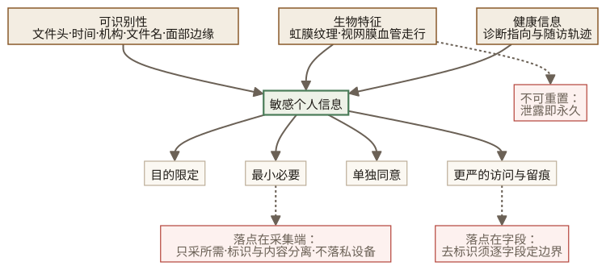
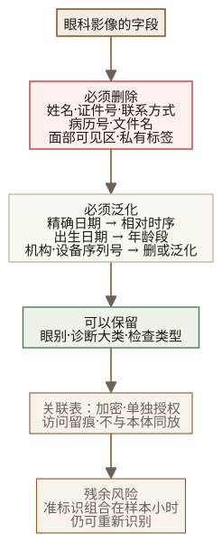

# 第 8 章 · 影像数据的隐私与合规

> **本章要回答的问题：** 一张眼底照片里，除了病灶还有几个「人」？为什么同一张图，在诊室里是证据，出了诊室就是一条可被追溯的身份记录？
>
> **覆盖**：眼科影像为何同时落在「可识别」与「生物特征」两条线上；采集端的三条最小化规则；去标识的字段边界与残余风险；借阅、教研与 AI 二次使用的三条路径；告知三问与患者的五项权利｜对应课程章 `08-e108`（课程正文已于 2026-11-22 按章题补实，4008 汉字；此前为占位/错位稿，本章按章题独立撰写）
>
> **层次**：本文件是**本项目撰写层**。本课无可引用底本，故本章**只写原则与字段级规则**：不引法条号、不给合规结论、不给处罚幅度，也不判断某一具体做法是否合法。凡涉及具体义务，一律写「依现行个人信息保护与医疗数据管理规定与所在机构制度」。**不写页码。**
>
> **免责**：本章为教学材料，不构成法律意见或合规审查结论。具体的数据处理活动，须由所在机构的数据安全责任部门与法律事务部门依现行规定判断。

---

## N.1 敏感个人信息

### 10.08.01.01 眼科影像为何属敏感个人信息

一般的医学影像之所以敏感，是因为它指向健康。眼科影像多一层：**它还指向身份。**

第一条来路是**可识别性**。一张影像文件本身带着一整套身份痕迹：文件头里的患者标识与设备序列号、精确到秒的检查时间、拍摄机构的科室编码、文件名与目录结构、影像边缘露出的眼睑与睫毛、画面角上的姓名条。这些字段单看都不致命，合起来就足以指认一个人。

第二条来路是**生物特征**。虹膜纹理与视网膜血管走行是天然的、稳定的、个体间高度不同的标识，且终生基本不变。它们区别于密码的地方在于：**密码泄露了可以改，虹膜泄露了不能换。** 这一条决定了泄露后果的不对称——它不是「一次性损失」，而是永久性的、不可撤回的暴露。

还有第三条来路，常被忽略：**「内容」与「身份」耦合。** 一张胸片拍的是胸腔，与面部无关；一张眼前段或眼底照片，画面里常常同时有眼睑、睫毛、皮肤纹理与泪阜——这些都属于面部特征的一部分。也就是说，即使把文件头清干净，**画面本身仍可能被用来做人脸或眼周的匹配。**

三条叠加，结论是：眼科影像属于敏感个人信息，需要比一般诊疗数据更严的目的限定、更窄的访问范围与更明确的告知。

| 类别 | 例子 | 为什么难处理 |
|---|---|---|
| 直接标识 | 姓名、病历号、证件号、联系方式、文件名 | 出现一处即可指认，且常出现在文件头与目录里 |
| 准标识 | 精确日期、机构与科室、设备序列号、年龄段、罕见病种 | 单条不足以指认，组合起来唯一性很高 |
| 生物特征 | 虹膜纹理、视网膜血管走行、眼周皮肤与睫毛 | 不可更改、不可重置，泄露即永久 |
| 推断性标识 | 诊断、用药、随访频次、就诊科室 | 能推出一个人的健康状况与生活轨迹 |

**本项目立场：默认「可识别」，除非逐项去标识并验证过。** 这一条与工程默认值相反——工程习惯是「先假设匿名，出问题再加控制」，而生物特征一旦流出，后面的控制都只是补丁。默认值的选取，决定了整个流程的松紧。

**一个可当课堂练习的判断题：** 同一张眼底照片，去掉文件头、裁掉边缘皮肤、只保留黄斑区与视盘，还算不算可识别？答案是「取决于上下文」——若同时发布了「某院某月收治的罕见病例」，罕见病本身就是强准标识。**去标识永远是对一组数据的判断，不是对一张图的判断。**

**课程稿与本章的关系。** 课程章 `08-e108` 已于 2026-11-22 按章题补实，与本章同题，并把眼科这一层的具体物（虹膜纹理、视网膜血管形态、文件头信息、翻拍与水印）写进了对应节。补实之前，该课程章的六单元切自《卫生信息管理》的安全管理框架——风险管理、责任体系、访问控制、脱敏、审计、等级保护；框架是通用的，眼科这一层的具体物不在其中，本章因此沿用其层次并自行补上这四样。

## N.2 采集端的三条最小化规则

### 10.08.01.02 采集端的三条最小化规则

数据的一生里，采集是唯一一个「不做什么就永远不必补救」的环节。后面的加密、权限、审计、脱敏，全都在补偿采集端的松懈。所以最小必要原则在眼科影像上，落点其实只有三条。

**规则一：只采集本次目的所需的范围与序列。** 该拍后极部就拍后极部，不「顺手多拍两个象限，以后可能有用」；该做一个序列就做一个序列，不因为「机器闲着」而加做。多拍的部分不产生诊断价值，却产生存储、访问与泄露的面积。判断的问句是：**这一张如果三个月后没人看，为什么当初要拍？**

**规则二：采集时即分离标识与内容。** 身份信息应当写在关联表里（谁在哪天做了哪一项），而不是烧进图像、写进文件名、贴在画面角上。文件名不带姓名、病历号与日期；目录按检查号而非患者名组织；能用检查号关联的，就不要在图里写名字。**越早分离，后面每一步的成本越低**——这一点在导出、教学、科研时体现得最清楚。

**规则三：默认不落本地、不进个人设备。** 不拍屏、不用手机翻拍显示器、不发即时通讯工具、不存个人网盘、不带回家做课件。这五件事天天发生，理由都很正当（急着会诊、带教、患者想看），但正当的理由不改变数据的性质：**一旦进了个人设备，机构就失去了对它的可见性，也失去了撤回的能力。**

| 规则 | 典型违规 | 改法 |
|---|---|---|
| 只采所需 | 为「留资料」加拍无关序列；重复检查 | 申请单写明目的与范围；重复检查需说明理由 |
| 标识与内容分离 | 文件名含姓名与日期；画面角上贴姓名条 | 以检查号命名；姓名条只在阅片工作站叠加显示 |
| 不落本地不入私设备 | 手机翻拍会诊；微信传图；个人网盘备份 | 用机构内的会诊通道；远程会诊走加密链路；教学用去标识副本 |

**三条规则里，第三条最难执行**：前两条改了流程就见效，第三条是习惯问题，而习惯是在「这次很急」的压力下一寸一寸让掉的。可行的做法不是禁止，而是**给出更快的内网替代路径**——会诊通道要比微信更快、更省事，人才会用它。

## N.3 去标识的边界

### 10.08.02.01 去标识的边界：哪些字段必须去掉

去标识不是「把名字涂掉」，而是**把「能指认一个人」的所有路径逐条切断**。切断得不彻底，剩下的部分就成了残余风险；切断得过头，数据就失去可比性，随访核验与质量控制都做不了。边界要按字段定，不按感觉定。

**必须去掉的字段。** 姓名与各类证件号；病历号与住院号（对外删除）；联系方式与住址；精确到日的检查日期（对外可保留相对时序，如「第几次随访」）；机构名称、科室与设备序列号；拍摄者与读片人姓名；画面中可识别的面部区域（眼睑、睫毛、皮肤、泪阜）与姓名条；文件头里的私有标签与自由文本备注——**这一项最容易被漏，因为它在阅片软件里根本不显示。**

**可以保留的字段。** 眼别；年龄段（而非出生日期）；诊断大类（而非精确病名加罕见修饰）；检查类型与是否散瞳；相对时间序列；图像本身的技术参数（在必要且不指向设备个体时）。

**必须单独管理的字段。** 关联表——把去标识后的编号与真实身份对上的那张表。它不能与被去标识的数据放在一起，否则去标识等于没做。正确做法是关联表由专人保管、单独授权、访问留痕，且只在核验时使用。

| 字段 | 处置 | 理由 |
|---|---|---|
| 姓名、证件号、联系方式 | 删除 | 直接标识，无分析价值 |
| 病历号、住院号 | 对外删除；对内以检查号替换 | 可反查，且常出现在文件名里 |
| 精确日期 | 泛化为相对时序或年月 | 精确日期加机构是强准标识 |
| 机构、科室、设备序列号 | 删除或泛化 | 组合后可定位到具体检查 |
| 出生日期 | 泛化为年龄段 | 完整生日是强标识 |
| 眼别、诊断大类、检查类型 | 保留 | 分析必需，识别力弱 |
| 面部可见区域、姓名条 | 裁切或遮盖 | 生物特征与直接标识 |
| 关联表 | 加密、单独授权、访问留痕 | 去标识能否成立，取决于它 |

**残余风险要算一次，而不是声明一次。** 去标识后的数据仍可能被「准标识组合」重新识别：罕见病种、年龄段、机构所在地、就诊月份——四项组合，样本里往往只剩一个人。**样本越小，风险越高**；这也是为什么教学片库比大数据集更需要小心：几十张图的片库里，每一张都可能是唯一的。

**去标识过头的代价也要说清楚。** 日期全抹掉，就做不了随访核验；诊断全抹掉，就无法分层分析；眼别也去掉，很多结论就不成立。**过度的去标识制造的是「看起来安全、实际没用」的数据**，它不减少泄露风险，只会让数据被反复复制以补足信息，反而扩大暴露面。

**一句原则：去标识的目标不是「看起来匿名」，而是「无法通过合理努力重新识别」。** 「合理努力」四个字是关键，它把成本与手段都算进去：用公开信息对不上、用常规技术拼不出，才算过线。

## N.4 借阅与二次使用

### 10.08.02.02 借阅与二次使用（教研/AI）的合规路径

同一张图离开诊室，可能是三种完全不同的情形，义务也不同。**把它们混成一句「数据共享」，是这一章要挡住的第二个写法。**

**情形一：临床借阅（诊疗目的，同一机构内）。** 义务的重心是「最小权限 + 留痕」，落成三处：存储加密、传输走受控链路、调阅按岗位授权并留痕；越出本科室范围要有理由。这一层通常是信息系统的事，临床只需知道两件事：**谁看过、能不能查。**

**情形二：对外借阅（会诊、转诊、司法、保险）。** 义务的重心是「目的限定 + 范围最小 + 时限 + 归还」。五个要素缺一不可：为什么给（会诊要解决什么问题）、给什么（只给相关序列，不给全部）、给谁（具体机构与接收人）、给多久（时限与到期处理）、怎么留痕（谁批的、给了什么、什么时候该收回）。**「发过去了就收不回来」是这一层的现实**，所以时限与销毁约定必须写在前头。

**情形三：二次使用（教研、质控、AI 训练）。** 这一层最容易被「科研豁免」四个字带过去，而它恰恰是泄露风险最高的一层：数据要离开诊疗闭环、要被复制、要被长期保存、可能要被第三方处理。

教研的可行路径：**去标识副本 + 机构内审批 + 不外传**。片库建设要回答三个问题——片子从哪来（是否在患者被告知的范围内）、谁在维护（责任人是否明确）、用完怎么处理（保留多久、如何销毁）。教学现场还有一条常被忽略的：**示教时的屏幕与投屏，本身就是一次对外展示**，患者姓名条、检查日期、就诊卡号都在屏幕上。

AI 训练的三条路径要分开说：

一是**自建**（机构用自己的数据训练自己的模型）。义务重心在目的限定与内部治理：训练目的是否在告知范围内、数据是否最小、模型与训练数据是否隔离、模型输出能否反查到个体。

二是**委托**（把数据交给外部技术方处理）。义务重心在书面约定与过程可控：处理目的、期限、方式、安全措施、禁止再委托、删除与返还。**没有书面约定就交数据，是把责任交出去而把风险留下来。**

三是**采购**（买现成的模型或服务）。义务重心在输入侧：**不要把患者影像上传到不受控的公共接口**。把影像贴进公开的对话式工具，在当前技术条件下等同于公开发布——可能被留存、被用于改进模型，且不可撤回。

**三条红线的表述可以很朴素：** 数据不出境；不上境外云；不以「免费筛查」换数据。第三条红线最隐蔽——它常以合作研究、公益项目、设备试用之名出现，而实质是用患者数据支付服务费用。**判断的问句只有一个：这项服务的对价是什么？如果对价是数据，那它就是一次数据交易，需要按数据交易来对待。**

| 情形 | 谁批 | 前提 | 留什么痕 |
|---|---|---|---|
| 临床借阅 | 系统按岗位授权 | 诊疗目的、本科室范围 | 调阅人、时间、对象 |
| 对外借阅 | 科室负责人加数据管理岗 | 目的、最小范围、时限、接收方明确 | 审批记录、交付清单、回收记录 |
| 教研使用 | 机构内审批 | 去标识、不外传、片库有责任人 | 审批、片库台账、示教记录 |
| AI 自建 | 机构数据治理机构 | 目的在告知范围内、数据最小 | 训练数据来源与范围、评估记录 |
| AI 委托 | 机构加法律事务 | 书面约定、禁止再委托、删除返还 | 合同、处理记录、验收记录 |
| AI 采购 | 机构加信息部门 | 不上传未去标识影像、接口受控 | 服务清单、数据流向说明 |

**本项目立场：把「数据能不能出去」换成两个更可操作的问题——出去之后谁负责，出事之后能不能撤回。** 第一问逼出责任主体，第二问逼出技术边界。两个问题都答不上来的合作，无论名目多正当，都不该开始。

## N.5 患者权利与告知

### 10.08.03.01 告知三问：做什么·为什么·数据去哪

知情同意在影像检查里最容易被做成一个动作：递一张纸，指一下签名处。而真正的告知只有三句话，患者听懂这三句，才算被告知。

**第一问：做什么。** 要拍什么部位、用哪种方式、大概多久、有没有不适或风险（散瞳后的畏光与视近模糊、造影的不适、接触镜式的操作感）。**不合格答法**：「常规检查，很快的。」合格答法要包含「会有什么感觉」与「做完要注意什么」。

**第二问：为什么。** 这次检查要回答什么临床问题，不做会漏掉什么。这一问的价值在于让患者理解「不是套餐里的一项」，而是有指向的。**不合格答法**：「医生开的，都得做。」

**第三问：数据去哪。** 影像存在哪（本院系统、区域平台、第三方云）、谁能看（本科室、会诊方、教学）、留多久、会不会用于科研或模型训练、能不能撤回。**这一问是三者中最少被讲的，也是最容易出事的。** 不合格答法：「放心，我们有规定。」

| 问 | 必须讲到的 | 常见的不合格答法 |
|---|---|---|
| 做什么 | 部位、方式、时长、感受、注意事项 | 「常规检查，很快」 |
| 为什么 | 要回答的临床问题、不做的后果 | 「医生开的都得做」 |
| 数据去哪 | 存储位置、可见范围、保留期限、是否二次使用、能否撤回 | 「放心，我们有规定」 |

**时机在检查前，不在检查后**：做完再告知「数据可能用于科研」，此时的「同意」已失去选择意义。**形式是口头加留痕**：讲了哪三问、谁讲的、患者能否复述。集体告知（张贴、入院须知）不替代个体告知——它证明「公告过」，不证明「这个人知道了」。

**依现行个人信息保护与医疗数据管理规定，医疗健康信息与生物识别信息属于敏感个人信息，处理需要具备特定目的与充分的必要性，并取得单独同意。** 这句话在实操上落成两条：**同意要单独取得，不能混在挂号或住院的总同意书里；目的变化要重新告知**，不能拿「当初签过」覆盖后来的新用途。

**患者的五项权利，要能一件件办到，而不是写在纸上：** 查阅与复制自己的影像与报告；对错误信息要求更正；在法定情形下要求删除或限制处理；撤回同意（并被告知撤回的后果）；拒绝检查（并被告知拒绝的临床后果）。**最后两项最考验告知的诚意**：如果拒绝的后果讲得含糊，所谓的「同意」就只是流程。

**代理人情形要单独处理。** 未成年人、失能老人、意识障碍者，同意由法定代理人作出，代理人身份要核验留痕。常见偏差是家属说「别告诉他」，而患者本人是有判断能力的成年人——**此时告知义务的对象仍是患者本人**。

**一张告知卡，六栏：** 做什么、为什么、数据存在哪、谁能看、留多久、有问题找谁。六栏写在一张卡片上，比三页纸的同意书有用——患者会读完它。

**与第 1 章的接口。** 第 1 章讲的「检查前三件事：适应证、禁忌、知情」，在本章落地为：适应证与禁忌属于前两问的临床内容，知情属于第三问与同意程序。**三件事在同一次谈话里完成，不能拆成「医生说检查、护士说签字、技师说躺好」。**

**争议：基层的现实条件。** 门诊量大、时间紧、方言与识字差异、老年人听力下降——这些都不是不告知的理由，而是告知必须更短的理由。**本项目立场：告知的合格标准是「患者能复述」，不是「患者签了字」。** 一句「您回去跟家里人说，这次拍的是眼底，图存在医院系统里，只有看病的医生能调，不会发到外面」——患者能复述，就达标；复述不出来，再长的同意书也只是形式。

## N.6 与《2026 共识》的对照与增补

> 本节是对照层：条目按共识节号定位，不占四级单元号。N.1–N.5 讲谁可以看、可以给谁、患者知不知道；第八、十三节讲技术上怎么存、怎么传——这里把技术条目落进本章字段与流程。

**一、存储格式与原始数据。** 共识·第八节：按 DICOM 3.0 存储，保留原始数据，不得只存压缩图。去标识副本若取自压缩图，切掉的不只是像素，还有判读的可能——压缩图在细小渗出与层间界面上不可靠，拿它做教研或训练，等于把「看不清」记成「没有」。正确顺序是原始数据按 DICOM 入库、副本从原件派生、派生件登记来源与时间；只留副本不存原件，N.5 的撤回在技术上就执行不了。

**二、传输与链路。** 共识·第八节：传输加密，禁止经非加密公共网络传原始影像，共识明确点了公共即时通讯工具与普通邮件。N.2 规则三此前写的是「不发即时通讯工具、远程会诊走加密链路」，属原则表述；有出处后可改成判断句：链路是否加密，由接收端能否验证发送方身份来判，不由「这个软件平时也用来谈病情」来判。

**三、远程医疗的交集。** 共识·第十三节给远程影像四条：优先免散瞳或超广角、关键区域无遮挡；走加密专线或医疗专网；带宽受限时可有损压缩但不得影响主要病变识别；阅片医师须具备资质、报告写明是否需转诊、危急值（视网膜脱离、视乳头水肿）立即预警。前两条落在本章，是同一套加密要求，不因「远程」降一档。第三条把责任放回选参数的人身上，本章补留痕：压缩比、用什么工具、压缩后是否复核关键区域，三样要查得到，否则事后证明不了「当时看得见」。第四条落到数据侧：资质与身份随报告留痕，预警带时间戳与接收人——它的价值全在「多快到达」，而到达只能靠记录证明。

**四、边界：技术要求不等于合规义务。** 共识是行业技术规范，回答设备与流程应当做到什么；合规义务另依现行个人信息保护与医疗数据管理规定、行业规范与所在机构制度，回答是否被允许、做错担什么责任。两条线分开走：链路加密做到了，若影像用于告知范围外的目的，仍不合规；审批与告知走完了，若只存压缩图、经公共网络传，技术上已失守。**共识不能用作合规结论的依据，合规审查通过也不证明技术达标。** 共识没给保留期限、压缩比阈值与算法清单，本章也不补。

**一句话收口。** 共识管链路通不通、格式对不对，本章管数据出去之后谁负责、能不能撤回。

> **免责声明：** 本章为教学材料，不构成法律意见或合规结论；数据处理的具体义务与程序，以现行个人信息保护与医疗数据管理规定、行业规范与所在机构制度为准。

## 思考题

1. 一张去掉了姓名、病历号与日期的眼底照片，配文「某院上月收治的一例罕见眼底病」。请说明它为什么仍可能构成可识别信息，并给出两条降低风险的具体做法。
2. 「以免费 AI 筛查换数据」的合作，在形式上常常是公益项目。请用本章 N.4 的两个问句（谁负责、能否撤回）分析它，并说明为什么「对价是数据」这一判断比「名目是否正当」更有用。
3. 一位听力下降的老年患者，在嘈杂门诊里被要求签一份三页的同意书。请按告知三问重写你会说的三句话（总长不超过一百字），并说明你如何确认他听懂了。

## 延伸阅读

- 参考《卫生信息管理》信息安全相关章节 —— 风险管理、访问控制、加密与脱敏、审计留痕、等级保护的结构对读；本章在其通用框架上补「眼科影像」这一层的具体物（虹膜、视网膜血管、文件头、翻拍）。
- 现行个人信息保护与医疗数据管理的相关规定 —— 只作原则对照（敏感个人信息的范围、单独同意、最小必要、删除与撤回），**本章不引条款号**。
- 课程章 `departments/08-wuguan/10-yanke-yingxiang-jiancha/chapters/08-e108/docs/zh.md` —— 本章对应的课程稿（课程正文已于 2026-11-22 按章题补实，4008 汉字；此前为占位/错位稿，本章按章题独立撰写）；单元级出处见 `standards/yanke-yingxiang-jiancha/units.json`。
