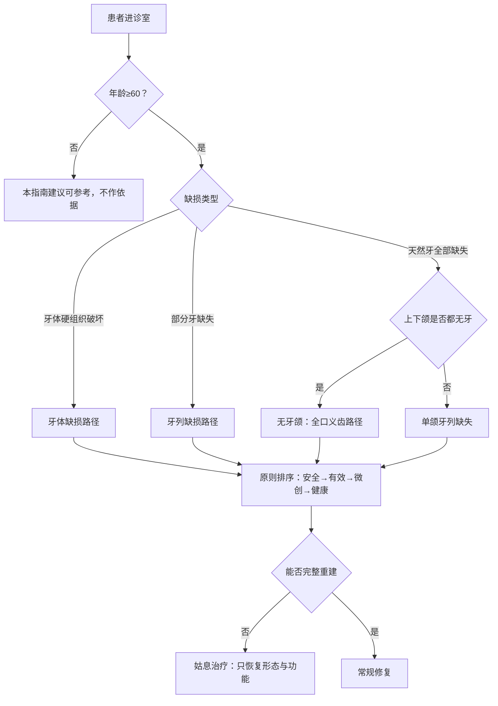

# 第 1 章 · 术语与原则：团标为什么要先定义，再谈技术

> **层次**：本文件是**本库撰写层**（无底本表，不是源正文层）。依据是 8 份中华口腔医学会团体标准（`standards/kouqiang-xiufu/sources/`，90 条登记条文，逐条可核），不是某一本教材的原文抽取稿。
> **依据**：`standards/kouqiang-xiufu/外源条文.json`（90 条）+ `补源登记.json`（`python scripts/build_kouqiang_sources.py --all --check` 现算 sha256 与逐字校勘，**90/90 通过**）；条文引用格式见 [`补源约定.md`](../../../补源约定.md)。
> **免责**：本章为术语与原则的教学整理，不构成诊断或治疗建议，也不替代团体标准原文与执业规范；具体操作以现行有效标准、机构规程与执业医师判断为准。

---

## 本章要回答的问题

学生第一次读团标，最常有的反应是「这些词我都认识，为什么还要单独列一章讲定义？」——因为团标里的定义不是解释，是**生效条件**。

举个最直接的例子：某份团标管的是「老年患者口腔修复」。那么「老年」是多少岁？不写清楚，整份文件的适用范围就是空的。团标给了一个数：**60 周岁以上**（外源·T/CHSA 001—2021 老年患者口腔修复指南 第3.1条）。这一个数字决定了：58 岁的患者，本指南的建议可以参考，但**不能当作依据**。

本章要做两件事：把 90 条条文里的术语挖出来、判明它们各自动了什么手脚；再把四条原则（安全、有效、微创、健康）之间的先后关系讲清楚 —— 因为原则冲突时，团标给的是**顺序**，不是权重。

## N.1 概念与出处

> 「本指南给出了关于临床老年患者进行常规的口腔修复的治疗原则、诊治技术要点的建议及注意事项。」（外源·T/CHSA 001—2021 老年患者口腔修复指南 第1条）

这一条是适用范围条款，里面藏着三个限定词：**常规**（不含复杂重建）、**治疗原则与诊治技术要点**（不含材料学标准）、**建议及注意事项**（是推荐强度，不是强制）。读任何团标，先读这一句，比读后面的技术细节更省时间。

| 概念 | 出处 | 这个定义在动什么手脚 |
|---|---|---|
| 老年患者 = 60 周岁以上 | 外源·T/CHSA 001—2021 老年患者口腔修复指南 第3.1条 | 把「老年」从主观印象变成年龄阈值：58 岁不算，61 岁算 |
| 牙体缺损 | 外源·T/CHSA 001—2021 老年患者口腔修复指南 第3.2条 | 限定为「牙体硬组织外形与结构被破坏」，与「牙缺失」分属两类问题 |
| 牙列缺失 | 外源·T/CHSA 001—2021 老年患者口腔修复指南 第3.4条 | 上下颌天然牙**全部**缺失；上下颌都无天然牙另称「无牙颌」 |
| 知情同意 | 外源·T/CHSA 001—2021 老年患者口腔修复指南 第3.5条 | 定义为「明了并认可」，不是「签了字」 |
| 患者评估 | 外源·T/CHSA 001—2021 老年患者口腔修复指南 第3.6条 | 把心理、生理、社会三维写进评估对象，不只是口腔检查 |
| 瓷贴面粘接的适用范围 | 外源·T/CHSA 001—2019 瓷贴面粘接技术操作规范 第1条 | 限定在「树脂水门汀选择 + 瓷面与基牙处理」这条链上 |
| 外源性着色 / 内源性着色 | 外源·T/CHSA 002—2021 牙齿漂白治疗技术操作指南 第4.1条 / 第4.2条 | 按色素**位置**分类，直接决定能不能漂、漂几次 |
| 调和技术基本原则 | 外源·T/CHSA 003—2022 牙科水门汀材料调和操作规范 第4条 | 比例、时间、器具、环境四项是硬约束，不是经验 |
| 椅旁全瓷修复的适应证 | 外源·T/CHSA 014-2022 椅旁全瓷修复技术指南 第4条 | 先判「能不能一条龙做完」，再谈材料与参数 |

**读表的方法**：右栏问的不是「定义是什么」，而是「这个定义把谁排除在外了」。每一个排除，都是一个临床决策点。

## N.2 为什么可以这样翻译：术语→字段→判定

术语只有变成可填的字段，才能进病历、进质控。团标的术语天然可以翻译成三层：

这张图里有两个点值得单独说。

第一，**年龄是前置闸门**，不是背景信息。它决定了整份指南是否适用，所以放在最前面判。

第二，**「能不能完整重建」这一问在原则之后、方案之前**。团标把它写成一条独立原则——姑息治疗：必要时只恢复牙列形态与功能，不强求完整重建（外源·T/CHSA 001—2021 老年患者口腔修复指南 第4.6条）。这句话在教科书里常被读成「退而求其次」，但在老年修复里它是**首选正解**：一位 88 岁、卧床、认知障碍的患者，做一副能吃饭、能清洁、不压迫黏膜的简易义齿，比一副精密附着体义齿更符合「安全优先」。

## N.3 这个翻译丢掉了什么

团标的定义法有明确的取舍，本章必须把这些取舍讲出来，否则学生会把「没写」当成「不需要」。

1. **不给度量**。「牙体硬组织外形与结构被破坏」是定性描述，缺损到什么程度算需要修复、什么程度可观察，团标不填这个空——那属于临床判断，写进指南就会被当成硬指标。
2. **不给阈值**。60 岁是唯一给出的数字阈值。而「安全」这一原则（先评估全身状况与风险，再定治疗时机与方案，外源·T/CHSA 001—2021 老年患者口腔修复指南 第4.1条）没有给出任何量化风险分级——高血压多少、血糖多少可以手术，团标不写。
3. **不指定工具**。患者评估要求覆盖心理、生理、社会（第3.6条），但**用哪个量表**没写。这是有意的：一旦指定量表，量表版本更新就会让指南过期。
4. **不排权重，只排顺序**。四条原则并列给出（安全、有效、微创、健康），隐含的先后是安全在前——但没有给出「冲突时按什么比例折中」。所以「安全与微创冲突怎么办」这类问题，团标回答不了，必须由术者与患者共同决定。
5. **不给「知情同意」的形式要件**。定义是「明了并认可」（第3.5条），不是「签字」。反过来，签了字但不明了，按这一定义仍未取得同意。
6. **不给术语的英文对照**。这对写论文、做国际交流是缺口，但团标是临床文件，不承担术语标准化职能。

## N.4 与相邻学科的接口

| 去向 | 用法 |
|---|---|
| 第 2 章 术前评估 | 第3.6条的三维评估在这一章展开成检查清单；第3.1条的 60 岁阈值成为纳入标准 |
| 第 5 章 全口义齿印模 | 第3.4条「无牙颌」的界定决定是否走全口义齿路径（外源·T/CHSA 006—2022 全口义齿修复的印模与模型制作规范 第5条） |
| 第 6 章 固定修复与粘接 | 第3.2条的「牙体缺损」定义决定是否进入贴面／全瓷路径（外源·T/CHSA 001—2019 瓷贴面粘接技术操作规范 第1条、外源·T/CHSA 014-2022 椅旁全瓷修复技术指南 第4条） |
| 第 7 章 漂白 | 第4.1／4.2条的外源／内源分类是漂白适应证判断的起点（外源·T/CHSA 002—2021 牙齿漂白治疗技术操作指南 第4.1条） |
| 第 9 章 并发症 | 原则冲突（安全 vs 微创）留下的判断空间，是并发症讨论的主要来源 |
| 病历与质控 | 「知情同意＝明了并认可」可用于病历字段设计：写「已告知 X、Y、Z，患者表示理解并同意」，而不是只留一个签名 |

## N.5 争议与本项目立场

**争议一：术语该由谁定。** 一种意见认为教材应给出统一的术语表，学生才好记；另一种认为术语必须跟着现行标准走，教材只做「指向」不做「定义」。本项目取后者：凡是团标有定义的，**照抄条号，不改写**；团标没定义的，明写「本项目在此处不定义」。

**争议二：「60 岁」这条线该不该在教材里重复。** 有老师认为教材不该写死年龄，因为标准会修订。本项目的处理是：写数字，同时写来源与版本（T/CHSA 001—2021），并注明「标准修订后以此为据更新」。写死数字的风险是过期，不写数字的风险是**无法执行**——后者更严重。

**争议三：姑息治疗的位置。** 多数教材把它放在「特殊情况的替代方案」，本项目把它提到 N.2 的决策树里，与常规修复并列。理由是第4.6条的措辞是「必要时只恢复…不强求完整重建」，主语是治疗目标而非患者类型——它适用于任何「完整重建风险大于收益」的情形，不只是高龄。

**本项目立场**：术语章的产出不是一份词汇表，而是一组**判定条件**。凡不能落到「满足/不满足」的表述，本章一律标注为「描述性，不作判定用」。

> **免责**：本章所列条文与判据不构成诊断或治疗建议；术语取义以现行有效的团体标准原文为准，标准修订后须重新核对条号。

## 小结

1. 团标的定义是生效条件，不是解释；读定义要问「它把谁排除在外」。
2. 老年 = 60 周岁以上，是唯一的硬阈值，也是适用范围的前置闸门。
3. 缺损分三类（牙体缺损／牙列缺损／牙列缺失），无牙颌是牙列缺失的下级情形。
4. 四条原则有顺序（安全在前），没有权重；冲突时靠术者与患者共同决定，团标不代答。
5. 姑息治疗不是「退而求其次」，是目标选择；它与常规修复并列。
6. 知情同意的定义是「明了并认可」，签字只是形式。

## 思考题

1. 一位 59 岁、全身状况良好、要求全口义齿的患者，按 T/CHSA 001—2021，本章哪些条文可以引用、哪些不可以？请逐条说明理由。
2. 四条原则中，若「微创」与「健康」冲突（例如为保牙体少磨牙，但修复体不易清洁），你会如何向患者呈现这个取舍？请写出一段不超过 150 字的告知话术。
3. 团标不给量化风险分级，这对临床是保护还是负担？请分别说出一个支持与一个反对的理由。
4. 「知情同意＝明了并认可」若用于病历字段设计，你认为至少应记录哪三项内容？

## 延伸阅读

- 外源·T/CHSA 001—2021 老年患者口腔修复指南 第3、4 条（术语与原则全文）
- 外源·T/CHSA 001—2019 瓷贴面粘接技术操作规范 第1 条（适用范围）
- 外源·T/CHSA 002—2021 牙齿漂白治疗技术操作指南 第4 条（着色分类）
- 本库专题：[`standards/kouqiang-xiufu/专题-修复操作流程.md`](../../../standards/kouqiang-xiufu/专题-修复操作流程.md)（8 份团标按临床流程重组）
- 补源与校勘约定：[`补源约定.md`](../../../补源约定.md)
