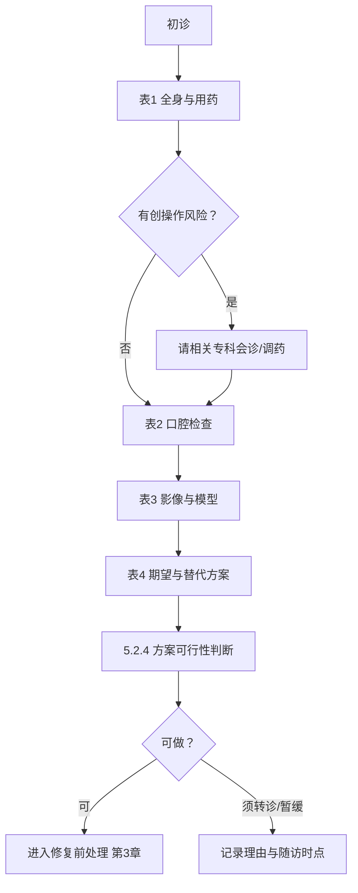

# 第 2 章 · 术前评估：全身风险先于口腔方案

> **层次**：本文件是**本库撰写层**（无底本表，不是源正文层）。依据是中华口腔医学会团体标准 T/CHSA 001—2021《老年患者口腔修复指南》，条文逐条登记在 `standards/kouqiang-xiufu/外源条文.json`（90 条，全部通过 sha256 与逐字校勘）。
> **依据**：`standards/kouqiang-xiufu/补源登记.json`（`python scripts/build_kouqiang_sources.py --all --check` 现算）；引用格式见 [`补源约定.md`](../../../补源约定.md)。
> **免责**：本章为临床评估流程的教学整理，不构成诊断或治疗建议；风险分级与停药决策须由相关专科与执业医师作出。

---

## 本章要回答的问题

同样的牙列缺损，为什么 65 岁和 85 岁的方案不同？更准确地说：**什么时候该先停下来，去看别的器官？**

团标把这件事写成了顺序问题。安全原则排在其他三条原则之前（外源·T/CHSA 001—2021 老年患者口腔修复指南 第4.1条：先评估全身状况与风险，再定治疗时机与方案）。顺序即优先级：评估不是「顺便问一下有没有高血压」，而是方案能否成立的前提。

## N.1 概念与出处

| 环节 | 依据 | 要点 |
|---|---|---|
| 患者评估的对象 | 外源·T/CHSA 001—2021 老年患者口腔修复指南 第3.6条 | 经病史、体检、辅助检查，对**心理、生理、社会**三维作出判断 |
| 系统性疾病 | 外源·T/CHSA 001—2021 老年患者口腔修复指南 第5.1.1条 | 心血管、内分泌、呼吸、消化、神经、泌尿逐系统过；并评估营养状况 |
| 用药史 | 外源·T/CHSA 001—2021 老年患者口腔修复指南 第5.1.2条 | 抗凝、激素与免疫调节、镇静安眠、双膦酸盐四类各自改变方案 |
| 口腔治疗史与期望 | 外源·T/CHSA 001—2021 老年患者口腔修复指南 第5.1.3条 | 既往修复经历与患者评价，明确期望值 |
| 临床检查 | 外源·T/CHSA 001—2021 老年患者口腔修复指南 第5.2.1条 | 牙体、牙周、牙列、咬合、腺体、黏膜、颞下颌关节 |
| 放射检查 | 外源·T/CHSA 001—2021 老年患者口腔修复指南 第5.2.2条 | 优先曲面断层片与 CBCT，避免根尖片反复 |
| 模型与照相 | 外源·T/CHSA 001—2021 老年患者口腔修复指南 第5.2.3条 | 用于方案设计与沟通留档 |
| 方案可行性 | 外源·T/CHSA 001—2021 老年患者口腔修复指南 第5.2.4条 | 检查完成后对**可选方案**做可行性判断 |
| 沟通与知情同意 | 外源·T/CHSA 001—2021 老年患者口腔修复指南 第5.3条 | 交代方案、风险、费用与替代方案 |

**一句话读法**：5.1 是「问出来的」，5.2 是「查出来的」，5.3 是「说清楚的」，5.2.4 是「合起来判的」。四段缺一段，评估就不成立。

## N.2 为什么可以这样翻译：把条文变成四张表

团标给的是条目，不是表格。要落进病历与质控，必须把条目翻成字段。翻法如下：

| 表 | 必填字段 | 落到哪一条 |
|---|---|---|
| 1 全身与用药 | 系统疾病／控制状态／用药清单（抗凝、激素免疫、镇静安眠、双膦酸盐）／营养 | 5.1.1、5.1.2 |
| 2 口腔检查 | 牙体、牙周、牙列、咬合、腺体、黏膜、颞下颌关节七项各自结论 | 5.2.1 |
| 3 影像与模型 | 影像种类与日期、模型/照相是否留档、放射理由 | 5.2.2、5.2.3 |
| 4 期望与替代 | 患者期望、可接受度、替代方案（含不治疗）、费用与疗程 | 5.1.3、5.3 |

> 「抗凝药物：应检测患者的凝血功能，避免因有创的修复操作引起术后持续性出血」（外源·T/CHSA 001—2021 老年患者口腔修复指南 第5.1.2条）

这条把「问用药」变成了**可执行动作**：不是记下「服用华法林」，而是「检测凝血功能」。字段设计上必须能区分「已记录」与「已检测」——很多病历停在第一步。

## N.3 这个翻译丢掉了什么

1. **不给风险分级阈值**。团标要求「评估风险」，但没有给出「红黄绿」的划分标准。所以「这个患者能不能做」最终仍由医师判断，教材不能替标准作答。
2. **会诊触发条件只有「必要时」**（第5.1.1条）。什么叫必要，团标不写 —— 这是把判断权留给临床的典型写法，也意味着**写病历时必须说明为什么请或不请会诊**。
3. **不给抗凝停药策略**。第5.1.2条只说检测凝血功能，未说停不停、停几天、由谁决定。这个空白只能在专科会诊里填。
4. **不给影像频次上限**。第5.2.2条说「优先曲面断层与 CBCT，避免根尖片反复」，是方向性表述，不是次数。
5. **不给认知与心理的评估工具**。第3.6条把心理、社会写进评估对象，但没有指定量表；第4.5条另要求高龄、认知功能障碍者须取得直系亲属或监护人同意 —— 判断「是否认知障碍」的工具仍需外部引入。
6. **把「期望管理」放在沟通条款里**，没有给出可量化的满意度预期。这在教学上是缺口，在临床上靠病例积累。

## N.4 与相邻学科的接口

| 去向 | 接口 |
|---|---|
| 第 1 章 术语与原则 | 60 周岁阈值决定本指南是否适用；「患者评估」的定义（第3.6条）在本章展开成四张表 |
| 第 3 章 修复前处理 | 表 1、表 2 的阳性发现，就是第 3 章要处理的对象（先控制全身疾病与不良习惯，再处理口腔） |
| 第 7 章 漂白 | 漂白前同样要「确认着色类型、牙体与牙周状况、有无修复体」（外源·T/CHSA 002—2021 牙齿漂白治疗技术操作指南 第7.2条），与本表 2 共用 |
| 第 9 章 并发症 | 评估时未识别的风险，通常在第 9 章以并发症的形式回来 |
| 病历与质控 | 四张表 + 会诊理由 = 可审计的评估记录；缺任一项都算「评估未完成」 |

## N.5 争议与本项目立场

**争议一：会诊门槛该不该由教材给。** 一种做法是给出具体数值（如血压 >180/110 暂缓），学生好执行；另一种是不给，避免教材越权替代指南与专科判断。本项目取后者，但补一句操作要求：**不给数值，就要给记录的格式**（写明未会诊的理由）。

**争议二：CBCT 的使用边界。** 第5.2.2条把 CBCT 列为老年患者优先选项之一，理由是减少根尖片反复。这在放射防护与诊断收益之间是有取舍的，教材应把取舍写明，而不是把 CBCT 当作「更高级的检查」。

**争议三：评估做多深算够。** 评估没有终点：查到什么程度停，取决于下一步要做什么。本项目立场是「按方案倒推评估深度」：预备做全口义齿的，与预备做单颗全瓷冠的，评估深度不同。

**本项目立场**：评估的产出不是一份检查单，而是**三类结论之一** —— 可做、须先处理（含会诊/调药）、不可做（转诊或姑息）。第 5.2.4 条要求「对可选方案做可行性判断」，正是要求落到这三类上。只写「已评估」不写结论，等于没评估。

> **免责**：本章所列条文与判据不构成诊断或治疗建议；条文取义以现行有效的团体标准原文为准，标准修订后须重新核对条号。

## 小结

1. 安全原则排第一，意味着评估先于方案，且评估结论必须改变方案。
2. 评估四段：问（5.1）、查（5.2.1–5.2.3）、说（5.3）、判（5.2.4）。
3. 用药史的价值在四类药：抗凝、激素与免疫调节、镇静安眠、双膦酸盐 —— 每一类都能改写手术可行性。
4. 评分、阈值、停药策略、量表，团标都不给；这些空白要写进病历，而不是凭记忆补。
5. 评估结论只有三类：可做 / 须先处理 / 不可做。
6. 认知障碍者的同意须由直系亲属或监护人取得，这是评估阶段的动作，不是术前签字的动作。

## 思考题

1. 一位 78 岁患者，长期服用抗凝药，要求拔除三颗残根后即刻做可摘局部义齿。按本章四张表，你至少要记录哪几项？哪几项需要请会诊？
2. 团标不给风险分级阈值，对教学是保护还是负担？试从「学生执行」和「教材越权」两个角度各写一句。
3. 第5.2.2条把 CBCT 列为老年患者优先，你认为在什么情形下这一优先应当让位于根尖片？请给出两条判据。
4. 「评估结论只有三类」这个设计，如何避免把「须先处理」写成拖延的借口？请设计一个随访时点字段。

## 延伸阅读

- 外源·T/CHSA 001—2021 老年患者口腔修复指南 第5.1–5.3 条（评估与沟通全文）
- 外源·T/CHSA 002—2021 牙齿漂白治疗技术操作指南 第7.2条（术前检查）
- 本库专题：[`standards/kouqiang-xiufu/专题-修复操作流程.md`](../../../standards/kouqiang-xiufu/专题-修复操作流程.md)
- 本库登记：[`standards/kouqiang-xiufu/补章登记.json`](../../../standards/kouqiang-xiufu/补章登记.json)
