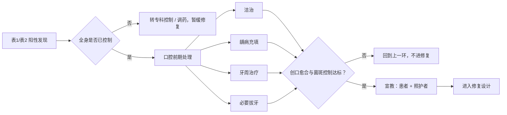

# 第 3 章 · 修复前处理与口腔健康宣教

> **层次**：本文件是**本库撰写层**（无底本表，不是源正文层）。依据是中华口腔医学会团体标准 T/CHSA 001—2021《老年患者口腔修复指南》，条文登记于 `standards/kouqiang-xiufu/外源条文.json`。
> **依据**：`standards/kouqiang-xiufu/补源登记.json`（`python scripts/build_kouqiang_sources.py --all --check` 现算 sha256 与逐字校勘，90/90 通过）。
> **免责**：本章为修复前准备与宣教流程的教学整理，不构成诊断或治疗建议；具体处置以现行标准、机构规程与执业医师判断为准。

---

## 本章要回答的问题

一副做得再好的义齿，为什么三个月就废了？答案常常不在义齿上，而在**戴牙之前没做完的事**：龋齿没补、牙周没控、黏膜没处理、清洁方法没人教。

团标把这段时间的处置写成三条（第5.4.1–5.4.3条），并在此之前给了四条原则（第4.1–4.4条）。本章要说明的是：**修复前处理不是「顺便治一治」，而是四条原则的执行方式**——安全原则要求先控全身病，健康原则要求修复体「便于清洁」，而便于清洁这件事在戴牙那天已经无法改变，只能靠此刻的选择。

## N.1 概念与出处

| 环节 | 依据 | 要点 |
|---|---|---|
| 控制全身疾病与不良习惯 | 外源·T/CHSA 001—2021 老年患者口腔修复指南 第5.4.1条 | 修前先控；不良习惯（吸烟、磨牙等）一并处理 |
| 口腔前期处理 | 外源·T/CHSA 001—2021 老年患者口腔修复指南 第5.4.2条 | 洁治、龋病与牙周处理、必要拔牙 |
| 口腔健康宣教 | 外源·T/CHSA 001—2021 老年患者口腔修复指南 第5.4.3条 | 把清洁维护方法教给患者**与照护者** |
| 安全原则 | 外源·T/CHSA 001—2021 老年患者口腔修复指南 第4.1条 | 先评估全身状况与风险，再定治疗时机与方案 |
| 有效原则 | 外源·T/CHSA 001—2021 老年患者口腔修复指南 第4.2条 | 方案适合患者自身特点，侧重恢复咀嚼功能，兼顾美观与发音 |
| 健康原则 | 外源·T/CHSA 001—2021 老年患者口腔修复指南 第4.4条 | 修复体便于清洁、利于根面龋与牙周病防治，口内无异味异物 |

**四条原则里有两条第（4.1、4.4）直接落在「修复前」这段时间**：4.1 是推迟治疗的理由，4.4 是改变设计的理由。这解释了为什么修复前处理不能与修复并行。

## N.2 为什么可以这样翻译：把「准备」拆成可勾的清单

清单化后，每一格都能对应一个**可验证状态**，而不是一句「已处理」：

| 检查项 | 判据（可记录） | 依据 |
|---|---|---|
| 全身控制 | 主要疾病有近期控制指标；需会诊者已会诊 | 第5.4.1条 |
| 菌斑与牙周 | 有洁治记录；牙周治疗阶段完成 | 第5.4.2条 |
| 龋与残根 | 已充填或已拔除，创口愈合期已过 | 第5.4.2条 |
| 黏膜 | 无未诊断的溃疡、白斑、炎性区 | 第5.4.2条、第5.2.1条 |
| 宣教 | 患者与照护者都能复述清洁方法 | 第5.4.3条 |

最后一行最容易被糊弄。「宣教过了」不是判据 —— **能让对方复述出方法**才是。团标特意写「患者与照护者」两个对象，是因为老年修复体的长期存留取决于照护者的日常操作，而不是戴牙当天的密合度。

## N.3 这个翻译丢掉了什么

1. **不给「必要拔牙」的判据**。哪颗牙该留、该拔，第5.4.2条只列了「必要拔牙」四个字。留牙标准涉及基牙条件与全身风险，团标不代答。
2. **不给愈合期长度**。拔牙后多久可以开始修复，团标未写；这直接决定疗程安排，教材只能说「按创口愈合与组织改建判断」。
3. **不给洁治与牙周的间隔与次数**。老年患者牙周维护频次因人而异，团标只写「处理」。
4. **不给宣教的形式与时长**。第5.4.3条要求把方法教给患者与照护者，但没有指定用模型演示、视频还是书面材料，也没有要求复述确认 —— 本章把「能复述」作为项目自定的判据，明确标注为**本项目要求**，不是团标原文。
5. **没有把「不良习惯」列清单**。第5.4.1条提到不良习惯，未列举；吸烟、夜磨牙、偏侧咀嚼等各自影响不同。
6. **不给「修复前处理」与「修复设计」的先后硬边界**。临床上常并行（例如一边牙周治疗一边取模），团标的顺序是理念上的，不排除实务并行 —— 但**并行时必须记录风险**。

## N.4 与相邻学科的接口

| 去向 | 接口 |
|---|---|
| 第 2 章 术前评估 | 本章的输入就是第 2 章表 1、表 2 的阳性发现 |
| 第 4 章 可摘局部义齿 | 第5.5.2条要求基托与连接体设计「尽可能简单」，前提是本章已完成菌斑控制 |
| 第 5 章 全口义齿 | 印模前必须无压痛点与急性炎症，否则边缘整塑会失真 |
| 第 6 章 粘接 | 粘接面不得被唾液污染（外源·T/CHSA 001—2019 瓷贴面粘接技术操作规范 第5.1条），隔湿条件依赖本章的牙周与黏膜状态 |
| 第 10 章 维护随访 | 宣教内容即随访时的复查项，两章共用同一张清单 |
| 病历与质控 | 五项判据可勾可查，是「修复前准备已完成」的唯一机器可核证据 |

## N.5 争议与本项目立场

**争议一：先修复还是先治疗。** 实务中常为缩短疗程而并行；团标的写法（第5.4.1条「修复前控制」）把顺序定死了。本项目立场：**顺序不可倒，但可以并行，前提是把风险写进病历并告知**。

**争议二：宣教是不是医师的活。** 有观点认为宣教应交给护理或健康管理岗。团标把宣教写在修复流程里（第5.4.3条），本项目据此认为**主诊医师对宣教结果负责**，可以由他人执行，但不能不验收。

**争议三：「便于清洁」由谁判定。** 第4.4条要求修复体便于清洁，但「便于」没有量化标准。本项目立场：把它转成两个可答问题 —— 患者（或照护者）能否用现有工具清洁到每个面？复查时该区菌斑是否可控？两者任一为否，即视为设计不达标。

**本项目立场**：修复前处理的产出不是「治完了」，而是**五项判据全绿 + 一份宣教对象名单**（患者与照护者各自的姓名与关系）。名单是本章对团标的最小增补，理由是可核性：没有名单，「教给照护者」这句话就无法验证。

> **免责**：本章所列条文与判据不构成诊断或治疗建议；条文取义以现行有效的团体标准原文为准，标准修订后须重新核对条号。

## 小结

1. 四条原则里，安全（4.1）与健康（4.4）直接约束修复前阶段：一个决定何时开始，一个决定怎么设计。
2. 修复前处理三段：控全身（5.4.1）、治口腔（5.4.2）、做宣教（5.4.3）。
3. 宣教对象是**患者与照护者**两个人，不是一个人。
4. 判据要能勾选：菌斑、龋与残根、黏膜、全身控制、宣教复述。
5. 团标不给愈合期、留牙标准、宣教形式 —— 这些是本项目要补的判据，须标注来源。
6. 并行可以，但风险必须记录并告知。

## 思考题

1. 一位 82 岁患者，家属坚持「先做义齿，牙周以后再治」。请用第4.1条与第4.4条各写一句拒绝理由，并给出一条折中方案。
2. 「便于清洁」若转成两个可答问题（能否清洁到每个面／复查菌斑是否可控），你认为还缺哪个维度？
3. 「宣教对象名单」这个增补，你认为会不会造成文书负担？请给出一个不超过三行的记录格式。
4. 如果患者无照护者（独居、无亲属），第5.4.3条的要求如何执行？请写出你的处置顺序。

## 延伸阅读

- 外源·T/CHSA 001—2021 老年患者口腔修复指南 第4.1–4.4 条、第5.4 条
- 外源·T/CHSA 001—2019 瓷贴面粘接技术操作规范 第5.1条（隔离术区）
- 本库专题：[`standards/kouqiang-xiufu/专题-修复操作流程.md`](../../../standards/kouqiang-xiufu/专题-修复操作流程.md)
