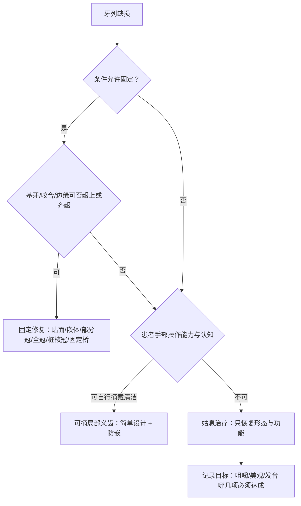

# 第 4 章 · 可摘局部义齿：形式选择与姑息治疗

> **层次**：本文件是**本库撰写层**（无底本表，不是源正文层）。依据是中华口腔医学会团体标准 T/CHSA 001—2021《老年患者口腔修复指南》，条文登记于 `standards/kouqiang-xiufu/外源条文.json`。
> **依据**：`standards/kouqiang-xiufu/补源登记.json`（`python scripts/build_kouqiang_sources.py --all --check` 现算）。
> **免责**：本章为修复形式选择与姑息治疗的教学整理，不构成诊断或治疗建议；具体设计以现行标准与执业医师判断为准。

---

## 本章要回答的问题

面对同一个牙列缺损，为什么有的患者应做固定修复，有的应做可摘，有的**只该做姑息处理**？这三条路的分岔点在哪里？

团标给出的不是「哪种更好」，而是**判据的顺序**：先看条件允不允许固定（第5.5.2条 a），再看可摘设计能不能被患者的手操作（b），最后才谈是否只作姑息（第4.6条）。顺序错了，就会出现「做了一个漂亮但患者戴不上、清洁不了的义齿」。

## N.1 概念与出处

> 「对于老年口腔修复治疗的患者，必要时可行姑息治疗，适当恢复患者牙列的形态与功能。」（外源·T/CHSA 001—2021 老年患者口腔修复指南 第4.6条）

这条只有一句话，但它把「姑息」从贬义变成了**正当选项**：目标不是完整重建，而是恢复形态与功能。判定标准因此不是「做得多好」，而是「够不够用」。

| 概念 | 依据 | 要点 |
|---|---|---|
| 牙体缺损 | 外源·T/CHSA 001—2021 老年患者口腔修复指南 第3.2条 | 牙体硬组织外形与结构被破坏，与牙缺失分属两类 |
| 牙列缺失 | 外源·T/CHSA 001—2021 老年患者口腔修复指南 第3.4条 | 上下颌天然牙全部缺失；上下颌都无牙称无牙颌 |
| 固定修复的条件 | 外源·T/CHSA 001—2021 老年患者口腔修复指南 第5.5.2条 | 条件允许时**尽量**选固定；边缘位于龈上或齐龈，利于维护 |
| 可摘局部义齿的设计约束 | 外源·T/CHSA 001—2021 老年患者口腔修复指南 第5.5.2条 | 基托与连接体尽可能简单；卡环数量与固位力要匹配患者手部操作能力 |
| 姑息治疗 | 外源·T/CHSA 001—2021 老年患者口腔修复指南 第4.6条 | 必要时只恢复形态与功能，不强求完整重建 |
| 操作注意 | 外源·T/CHSA 001—2021 老年患者口腔修复指南 第5.5.1条 | 体位、时间、张口度、误吸防范 |
| 戴牙后指导 | 外源·T/CHSA 001—2021 老年患者口腔修复指南 第5.5.3条 | 初戴不适、清洁、复诊要求 |
| 复诊与维护 | 外源·T/CHSA 001—2021 老年患者口腔修复指南 第5.6条 | 定期复查修复体、基牙与牙周 |

第5.5.2条里最容易被读漏的是两处限定语：**「条件允许情况下」**（固定修复的前提）与**「与老年患者的手部操作能力相适应」**（可摘设计的硬约束）。前者是适应证，后者是**使用者能力**——把患者的手写进了设计参数。

## N.2 为什么可以这样翻译：三岔决策树

三岔的判据可以直接写成表：

| 分支 | 判据 | 依据 |
|---|---|---|
| 固定修复 | 基牙条件允许；边缘能位于龈上或齐龈；咬合力分布可控 | 第5.5.2条 a |
| 可摘局部义齿 | 卡环数量与固位力匹配手部操作；基托连接体尽量简单；宜加防嵌设计 | 第5.5.2条 b |
| 姑息治疗 | 完整重建的风险大于收益；患者/家属目标以「够用」为准 | 第4.6条 |

**「防嵌设计」这一条值得单独讲**：团标写的是「老年人由于牙周萎缩等原因，易食物嵌塞，所以老年人中的修复可推荐防嵌设计」。它不是美观问题，而是**维护成本问题**：食物嵌塞 → 菌斑堆积 → 基牙龋与牙周恶化 → 义齿寿命缩短。防嵌设计是把 4.4 条「便于清洁」落到具体结构上的方式。

## N.3 这个翻译丢掉了什么

1. **不给「条件允许」的具体清单**。基牙松动度、冠根比、咬合空间这些硬指标，团标不列举。所以「允不允许固定」在教材层面只能给出判据方向，不能给出数值。
2. **不给卡环数量上限**。第5.5.2条要求「数量、固位力与手部操作能力相适应」，但没有给出「几颗以上戴不动」的经验值。
3. **不给姑息治疗的目标清单**。第4.6条只说「适当恢复形态与功能」，未说明咀嚼、美观、发音三项如何取舍 —— 本章建议由患者排序，属于项目增补。
4. **不给「手部操作能力」的评估工具**。这是本章最大的空白：握力、精细动作、认知配合度都能影响摘戴，团标只把它作为约束条件提出。
5. **不给误吸防范的具体措施**。第5.5.1条列出体位、时间、张口度、误吸防范四项，但只到名词层面。
6. **不区分「首次修复」与「重做」**。老年患者多为重做，既往修复经历（第5.1.3条）对设计有直接影响，团标分列在评估章，本章需自行接续。

## N.4 与相邻学科的接口

| 去向 | 接口 |
|---|---|
| 第 2 章 术前评估 | 「条件允许」的输入来自表 1（全身）与表 2（口腔七项） |
| 第 3 章 修复前处理 | 基牙与牙周状态决定卡环设计与防嵌设计是否可行 |
| 第 5 章 全口义齿 | 牙列缺失（第3.4条）走到全口义齿路径，单颌缺失则与本意齿对颌配合 |
| 第 8 章 椅旁数字化 | 固定修复分支里，椅旁全瓷与 SLM 金属是可选实现方式 |
| 第 10 章 维护随访 | 第5.6条的复查项与第5.5.3条的戴牙后指导是同一条链的两端 |
| 病历与质控 | 三岔判据 + 姑息目标排序 = 可审计的设计理由 |

## N.5 争议与本项目立场

**争议一：能固定就一定固定吗。** 第5.5.2条用「尽量」二字，倾向固定；但固定的牙体预备量更大，对高龄患者是风险。本项目立场：**「尽量」以第4.1条安全原则为上限**——固定带来的收益若小于预备与就诊次数的风险，应退回可摘或姑息。

**争议二：姑息治疗是不是「放弃治疗」。** 不是。第4.6条的措辞是目标选择（适当恢复形态与功能），不是治疗强度的降级。本项目在决策树中把它与另两条路并列，理由已见第 1 章 N.5。

**争议三：谁来判断「手部操作能力」。** 团标把患者手写进设计参数，但没有给评估工具。本项目立场：至少记录三项 —— 能否自行摘戴（演示一次）、握持工具的能力、有无照护者协助；三项全否即倾向姑息。

**本项目立场**：可摘局部义齿的设计产出必须包含一句**可核的理由**：「为什么不用固定」。没有这句，设计就只是偏好；有了这句，第5.5.2条的「条件允许」「相适应」才真正被执行。

> **免责**：本章所列条文与判据不构成诊断或治疗建议；条文取义以现行有效的团体标准原文为准，标准修订后须重新核对条号。

## 小结

1. 三条路的分岔顺序：固定（条件允许）→ 可摘（手能操作）→ 姑息（目标够用）。
2. 第5.5.2条把「患者的手」写进了设计参数，这是老年修复区别于一般修复的地方。
3. 防嵌设计不是美观问题，是维护成本与寿命问题。
4. 固定修复的前提是边缘位于龈上或齐龈 —— 便于维护优先于美观隐蔽。
5. 姑息治疗是并列目标，不是放弃。
6. 设计必须能回答「为什么不用固定」。

## 思考题

1. 一位 76 岁患者，缺失 46、47，46 对颌为天然牙，患者手指有明显震颤。请按三岔判据给出建议，并写出「为什么不用固定桥」的理由。
2. 第5.5.2条要求卡环数量与固位力「与手部操作能力相适应」，你认为应记录哪三项能力？为什么是三项而不是一项？
3. 防嵌设计在什么情况下反而会增加清洁难度？请给出一个反例。
4. 姑息治疗的目标排序若由患者给出，医师应如何避免「患者要什么就做什么」的风险？

## 延伸阅读

- 外源·T/CHSA 001—2021 老年患者口腔修复指南 第3.2、3.4、4.6、5.5 条
- 本库专题：[`standards/kouqiang-xiufu/专题-修复操作流程.md`](../../../standards/kouqiang-xiufu/专题-修复操作流程.md)
