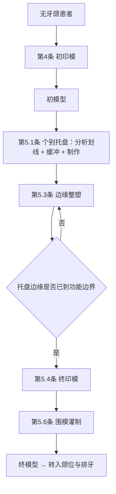

# 第 5 章 · 全口义齿：印模与模型的四道工序

> **层次**：本文件是**本库撰写层**（无底本表，不是源正文层）。依据是中华口腔医学会团体标准 T/CHSA 006—2022《全口义齿修复的印模与模型制作规范》（7 条）与 T/CHSA 001—2021《老年患者口腔修复指南》相关条，条文登记于 `standards/kouqiang-xiufu/外源条文.json`。
> **依据**：`standards/kouqiang-xiufu/补源登记.json`（`python scripts/build_kouqiang_sources.py --all --check` 现算）。
> **免责**：本章为印模与模型制作的教学整理，不构成诊断或治疗建议；实际制作以现行标准与规范化培训为准。

---

## 本章要回答的问题

全口义齿的固位，究竟在哪一步被决定？多数人会说「在边缘整塑」。团标把它拆成了四道工序：**初印模 → 个别托盘 → 边缘整塑与终印模 → 围模灌制**。四道里任何一道走样，后面都补不回来。

本章要说明的核心是：义齿的边界不是医师「设计」出来的，而是**患者的黏膜反折线与功能运动共同决定的**——医师能做的是把这条边界准确地搬到模型上。

## N.1 概念与出处

| 工序 | 依据 | 要点 |
|---|---|---|
| 初印模与初模型 | 外源·T/CHSA 006—2022 全口义齿修复的印模与模型制作规范 第4条 | 托盘与材料选择、上下颌制取方法、印模要求 |
| 初印模制取 | 外源·T/CHSA 006—2022 全口义齿修复的印模与模型制作规范 第4.3条 | 上下颌分别制取，动作与体位各有要求 |
| 终印模与终模型 | 外源·T/CHSA 006—2022 全口义齿修复的印模与模型制作规范 第5条 | 个别托盘—边缘整塑—终印模—围模灌制，四步一条链 |
| 个别托盘 | 外源·T/CHSA 006—2022 全口义齿修复的印模与模型制作规范 第5.1条 | 初模型分析与划线、缓冲处理、材料与制作方法 |
| 边缘整塑 | 外源·T/CHSA 006—2022 全口义齿修复的印模与模型制作规范 第5.3条 | 先检查个别托盘，再整塑边缘 |
| 终印模制取 | 外源·T/CHSA 006—2022 全口义齿修复的印模与模型制作规范 第5.4条 | 托盘准备、材料选择与上下颌操作 |
| 围模灌制 | 外源·T/CHSA 006—2022 全口义齿修复的印模与模型制作规范 第5.6条 | 划线、蜡条蜡片法与石膏蜡片法 |
| 无牙颌的界定 | 外源·T/CHSA 001—2021 老年患者口腔修复指南 第3.4条 | 上下颌天然牙全部缺失；上下颌都无牙称无牙颌 |

> 「个别托盘边缘线比黏膜反折线短2mm左右，上颌后缘区在腭小凹后3-4mm，下颌后缘覆盖磨牙后垫。」（外源·T/CHSA 006—2022 全口义齿修复的印模与模型制作规范 第5.1条）

这一句是本章唯一给出的**数字**，也因此最值钱：它把「个别托盘做多大」从经验变成了可核的尺寸。2 mm、3–4 mm、磨牙后垫覆盖 —— 三者共同定义了托盘的边界初值，而真正的边界要靠第5.3条的功能整塑去逼近。

## N.2 为什么可以这样翻译：四道工序的输入与产出

| 工序 | 输入 | 产出 | 可核判据 |
|---|---|---|---|
| 初印模 | 无牙颌解剖条件 | 初模型 | 覆盖全部承托区，无气泡、无变形 |
| 个别托盘 | 初模型 + 划线 | 托盘 | 边缘比黏膜反折线短 2 mm 左右；上颌后缘达腭小凹后 3–4 mm；下颌后缘覆盖磨牙后垫 |
| 边缘整塑 | 个别托盘 | 功能边缘 | 整塑后边缘与功能运动一致，无压痛区 |
| 终印模 | 整塑后的托盘 | 终印模 | 材料均匀、边缘清晰、无压穿 |
| 围模灌制 | 终印模 | 终模型 | 围模规整、无模型缺损、底座水平 |

「先检查个别托盘，再整塑边缘」（第5.3条）这一顺序常被跳过：托盘本身有倒凹或过长，整塑出来的是**错误边界的功能化结果**，比不做更危险 —— 因为它看起来是对的。

## N.3 这个翻译丢掉了什么

1. **只给了托盘边界的尺寸，没给整塑的压力与时机**。第5.3条只写「检查托盘—整塑边缘」，压力大小、整塑次数、材料选择都不写。
2. **不给印模材料的性能要求**。第4条要求「材料选择」，但未规定流动性、弹性、尺寸稳定性指标。
3. **不给「终印模合格」的判据**。第5.4条列出操作要点，却没有一条可量化的合格标准（例如边缘完整度、厚度均匀性）。
4. **不给围模的具体尺寸**。第5.6条给出两种方法（蜡条蜡片法、石膏蜡片法），但底座厚度、围模高度不写。
5. **不涉及颌位关系与排牙**。团标只到模型为止 —— 从终模型往后（颌位记录、排牙、试戴）不在本规范范围内，本章必须明说，否则学生会以为「模型做好就完成了一半」。
6. **不涉及单颌无牙的对颌处理**。第3.4条区分了牙列缺失与无牙颌，但单颌缺失时对颌为天然牙的情形，本规范未覆盖。

## N.4 与相邻学科的接口

| 去向 | 接口 |
|---|---|
| 第 1 章 术语与原则 | 第3.4条的「无牙颌」界定决定是否进入本章路径 |
| 第 3 章 修复前处理 | 印模前必须无压痛点与急性炎症，否则整塑失真 |
| 第 4 章 可摘局部义齿 | 单颌缺失时，本章的全口义齿与第 4 章的可摘局部义齿需配合设计 |
| 第 8 章 椅旁数字化 | 数字印模（外源·T/CHSA 014-2022 椅旁全瓷修复技术指南 第8条）是另一条取模路径，但边界整塑仍需临床完成 |
| 第 10 章 维护随访 | 压痛与固位下降是随访最常见主诉，回溯点往往在本章的四道工序 |
| 病历与质控 | 五项判据可勾选，是「印模合格」的唯一机器可核证据 |

## N.5 争议与本项目立场

**争议一：初印模能否省略。** 数字化流程下有人主张一步取模。本项目立场：第4条把初印模列为工序之一，是否省略取决于设备与病例，但**省略必须在病历里写明理由**，否则等于跳过规范。

**争议二：托盘的 2 mm 是硬指标还是起点。** 团标写「短 2mm 左右」，是起点而非终点；终点由整塑决定。教材若把 2 mm 当作合格线，就会做出「尺寸对、功能错」的托盘。

**争议三：围模两种方法该教哪种。** 第5.6条并列蜡条蜡片法与石膏蜡片法，未分优劣。本项目立场：两种都教，但要求学生说明所选方法的理由（材料可得性、模型尺寸、后续工序要求）。

**本项目立场**：本章的产出不是「印模取好了」，而是**四道工序各自的判据记录 + 一次自检**（在整塑前检查托盘）。自检是团标第5.3条已经写明的要求，本章只是把它提升为记录项。

> **免责**：本章所列条文与判据不构成诊断或治疗建议；条文取义以现行有效的团体标准原文为准，标准修订后须重新核对条号。

## 小结

1. 全口义齿的边界由黏膜反折线与功能运动共同决定，医师负责把它准确搬到模型上。
2. 四道工序：初印模 → 个别托盘 → 边缘整塑与终印模 → 围模灌制。
3. 本章唯一的数字：托盘边缘比黏膜反折线短 2 mm 左右，上颌后缘腭小凹后 3–4 mm，下颌后缘覆盖磨牙后垫。
4. 「先检查托盘，再整塑」不可跳过：错误边界被功能化后更难发现。
5. 团标只到模型为止；颌位与排牙在本规范之外。
6. 数字印模是另一条路径，但功能整塑仍需临床完成。

## 思考题

1. 患者下颌牙槽嵴吸收明显、磨牙后垫活动度大。第5.1条要求的「下颌后缘覆盖磨牙后垫」应如何调整？请写出你的判断与记录方式。
2. 为什么「错误边界 + 完美整塑」比「粗糙边界 + 正确整塑」更危险？
3. 终印模的合格判据在团标里是操作描述而非量化标准，你认为可以补哪两项可量化指标？
4. 若采用口内扫描直接取模，第5.1条的托盘尺寸规则还有意义吗？请说明你的理由。

## 延伸阅读

- 外源·T/CHSA 006—2022 全口义齿修复的印模与模型制作规范 第4、5 条
- 外源·T/CHSA 001—2021 老年患者口腔修复指南 第3.4条
- 外源·T/CHSA 014-2022 椅旁全瓷修复技术指南 第8条（数字印模）
- 本库专题：[`standards/kouqiang-xiufu/专题-修复操作流程.md`](../../../standards/kouqiang-xiufu/专题-修复操作流程.md)
