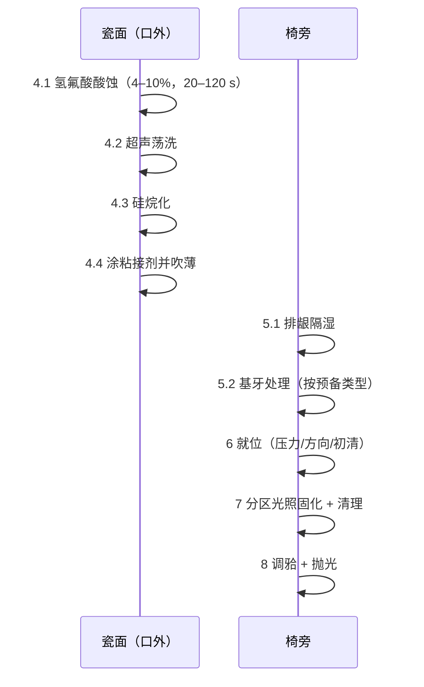

# 第 6 章 · 固定修复与粘接链：顺序不可交换

> **层次**：本文件是**本库撰写层**（无底本表，不是源正文层）。依据是中华口腔医学会团体标准 T/CHSA 001—2019《瓷贴面粘接技术操作规范》（18 条）与 T/CHSA 001—2021《老年患者口腔修复指南》相关条，条文登记于 `standards/kouqiang-xiufu/外源条文.json`。
> **依据**：`standards/kouqiang-xiufu/补源登记.json`（`python scripts/build_kouqiang_sources.py --all --check` 现算）。
> **免责**：本章为粘接流程的教学整理，不构成诊断或治疗建议；材料与操作以产品说明书与现行标准为准。

---

## 本章要回答的问题

粘接失败时，问题出在「粘接剂不好」还是「操作顺序错了」？团标给出的答案是结构性的：**瓷面处理（4.1–4.4）→ 术区隔离与基牙处理（5.1–5.2）→ 就位（6）→ 固化清理（7）→ 调𬌗抛光（8）**。这条链上任何一步提前或推后，都会让后续步骤失效。

本章要说明的是：**粘接不是「涂胶水」，而是把两个界面在一段时间内同时保持干燥、清洁与活性**。

## N.1 概念与出处

| 环节 | 依据 | 要点 |
|---|---|---|
| 适用范围 | 外源·T/CHSA 001—2019 瓷贴面粘接技术操作规范 第1条 | 树脂水门汀选择 + 瓷面与基牙处理 |
| 水门汀选择与试色 | 外源·T/CHSA 001—2019 瓷贴面粘接技术操作规范 第3条 | 按贴面材料、遮色需求与固化方式选 |
| 氢氟酸酸蚀 | 外源·T/CHSA 001—2019 瓷贴面粘接技术操作规范 第4.1条 | 瓷组织面形成微孔，是机械固位来源 |
| 超声荡洗 | 外源·T/CHSA 001—2019 瓷贴面粘接技术操作规范 第4.2条 | 清除残留酸与碎屑 |
| 硅烷化 | 外源·T/CHSA 001—2019 瓷贴面粘接技术操作规范 第4.3条 | 形成化学结合层 |
| 粘接剂处理 | 外源·T/CHSA 001—2019 瓷贴面粘接技术操作规范 第4.4条 | 涂布并吹薄 |
| 隔离术区 | 外源·T/CHSA 001—2019 瓷贴面粘接技术操作规范 第5.1条 | 排龈隔湿，粘接面不得被唾液污染 |
| 基牙处理 | 外源·T/CHSA 001—2019 瓷贴面粘接技术操作规范 第5.2条 | 按预备类型分别处理釉质／牙本质 |
| 就位 | 外源·T/CHSA 001—2019 瓷贴面粘接技术操作规范 第6条 | 就位压力、方向与多余材料初清 |
| 固化与清理 | 外源·T/CHSA 001—2019 瓷贴面粘接技术操作规范 第7条 | 分区光照，各面达到规定光照量 |
| 调𬌗与抛光 | 外源·T/CHSA 001—2019 瓷贴面粘接技术操作规范 第8条 | 调改咬合接触点并抛光边缘 |

> 「采用4%-10%的氢氟酸在口外酸蚀处理贴面组织面20s-120s」（外源·T/CHSA 001—2019 瓷贴面粘接技术操作规范 第4.1条）

这是本章唯一的区间数字，也是最能说明「为什么不能凭经验」的例子：区间跨度 6 倍，团标同时给了两条收敛规则 —— **玻璃相越多，酸蚀时间越长；贴面越薄，时间越短**，超薄贴面还要再减 5–10 s。同一条文里给出区间、方向与例外，等于要求术者按材料判断，而不是按习惯。

## N.2 为什么可以这样翻译：把链画成时序

| 阶段 | 谁做 | 可核判据 |
|---|---|---|
| 瓷面处理 | 技工/医师（口外） | 酸蚀时间符合材料与厚度；酸已中和冲净；硅烷后未被污染 |
| 术区隔离 | 医师 | 全程无唾液污染；排龈有效 |
| 基牙处理 | 医师 | 按釉质／牙本质分别处理，处理面未被再次污染 |
| 就位 | 医师 | 就位方向正确、压力适度、多余材料及时初清 |
| 固化 | 医师 | 各面达到规定光照量，分区不遗漏 |
| 调𬌗与抛光 | 医师 | 咬合接触点合理，边缘抛光无锐利台阶 |

第4.1条还有一条容易被忽略的注：**有的加工中心在出厂前已做氢氟酸处理**，临床只需磷酸酸蚀清洁，不必重复。这条注把「谁做」写进了流程 —— 重复酸蚀会削弱薄贴面。

## N.3 这个翻译丢掉了什么

1. **不给光照剂量**。第7条要求「各面达到规定光照量」，但具体 mW/cm² × s 未给，需回产品说明书。
2. **不给隔湿的具体手段**。第5.1条只说排龈与隔湿，未指定橡皮障、棉卷还是吸唾器组合。
3. **不给基牙处理的酸蚀时间**。第5.2条按预备类型分处理方式，未给时长。
4. **不给就位压力的量**。第6条要求「就位压力、方向」，未给数值与判断方法。
5. **不给失败率的基线**。第10.2条承认重新粘接「存在较高失败风险」，但没有给数字。教材若要谈预后，只能另找文献。
6. **只覆盖瓷贴面**。全套条款以贴面为对象；全冠、嵌体、桥体的粘接只部分适用，第1条的适用范围已经限定。

## N.4 与相邻学科的接口

| 去向 | 接口 |
|---|---|
| 第 1 章 术语与原则 | 「牙体缺损」的定义决定是否走贴面路径；知情同意的定义要求把「可能失败、可再粘」说清 |
| 第 3 章 修复前处理 | 菌斑与牙周状态决定隔湿能否维持 |
| 第 8 章 椅旁数字化 | 椅旁全瓷与复合材料的组织面处理（喷砂/酸蚀/硅烷）与本链同构，参数不同 |
| 第 9 章 并发症 | 碎裂、脱落、边缘染色、继发龋四类的主诉与处理，在第 9 章展开 |
| 第 10 章 维护随访 | 边缘抛光质量与复查时的边缘染色直接相关 |
| 病历与质控 | 六阶段判据可勾选；「谁做了酸蚀」必须记录（临床 or 加工中心） |

## N.5 争议与本项目立场

**争议一：酸蚀交给技工还是医师。** 团标允许两种（加工中心预处理 + 临床免重复），但责任归属不同。本项目立场：**在病历里写清「已预处理」并核验**，否则重复酸蚀与漏酸蚀各有一半概率。

**争议二：隔湿能否用简化方案。** 单颗前牙、唾液控制良好时，棉卷加吸唾可能足够；多颗连续贴面则几乎必须橡皮障。团标不代答。本项目立场：把「隔湿方案」作为设计项写进治疗计划，而不是当场的临场决定。

**争议三：调𬌗该不该在固化后立即做。** 第8条把调𬌗抛光放在固化之后，顺序明确；但临床上有人先在预固化阶段粗调。本项目立场：允许粗调，但**最终调𬌗必须在完全固化后完成并抛光**，否则边缘微裂。

**本项目立场**：粘接链的产出不是「粘上了」，而是一份**六阶段记录**：谁做的酸蚀、酸蚀参数、隔离方式、基牙处理、固化剂量、调𬌗结果。缺任一项，失败时无法回溯。

> **免责**：本章所列条文与判据不构成诊断或治疗建议；条文取义以现行有效的团体标准原文为准，标准修订后须重新核对条号。

## 小结

1. 粘接链顺序不可交换：瓷面处理 → 隔离与基牙处理 → 就位 → 固化清理 → 调𬌗抛光。
2. 唯一区间数字（4–10%，20–120 s）配两条收敛规则：玻璃相多则长，贴片薄则短。
3. 「出厂已酸蚀」这条注要求记录责任归属，避免重复酸蚀。
4. 隔湿是设计项，不是临场决定。
5. 调𬌗必须在完全固化后完成并抛光。
6. 失败可再粘，但第10.2条明说「存在较高失败风险」—— 这句话应进知情同意。

## 思考题

1. 一枚 0.3 mm 超薄贴面，瓷块玻璃相含量中等。按第4.1条，酸蚀时间应如何调整？请写出你的推理链。
2. 「出厂已酸蚀」若不记录，会出现哪两种相反的错误？各自的后果是什么？
3. 多颗连续贴面粘接时，你认为隔湿失败最可能发生在第几颗？为什么？
4. 第10.2条允许重新粘接但提示高风险，你会如何在知情同意里表述这一点（不超过 80 字）？

## 延伸阅读

- 外源·T/CHSA 001—2019 瓷贴面粘接技术操作规范 第1、3、4、5、6、7、8 条
- 本库专题：[`standards/kouqiang-xiufu/专题-修复操作流程.md`](../../../standards/kouqiang-xiufu/专题-修复操作流程.md)
- 本库登记：[`standards/kouqiang-xiufu/补源登记.json`](../../../standards/kouqiang-xiufu/补源登记.json)
