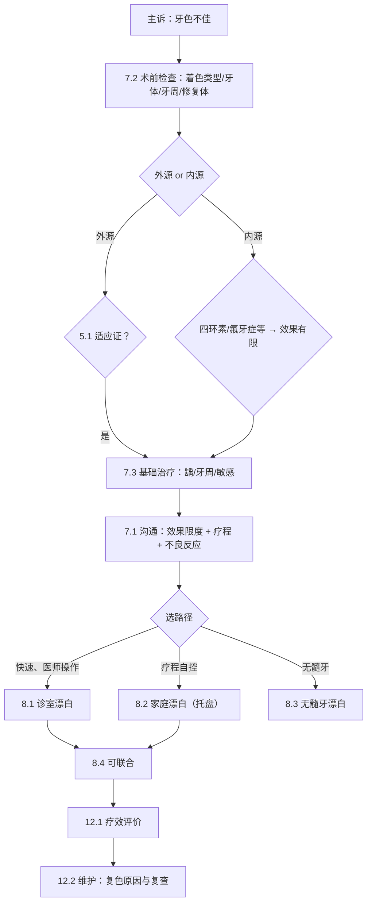

# 第 7 章 · 牙齿漂白：先分型，再定方案，最后谈维护

> **层次**：本文件是**本库撰写层**（无底本表，不是源正文层）。依据是中华口腔医学会团体标准 T/CHSA 002—2021《牙齿漂白治疗技术操作指南》（18 条），条文登记于 `standards/kouqiang-xiufu/外源条文.json`。
> **依据**：`standards/kouqiang-xiufu/补源登记.json`（`python scripts/build_kouqiang_sources.py --all --check` 现算）。
> **免责**：本章为漂白适应证与流程的教学整理，不构成诊断或治疗建议；药剂浓度、适应证与禁忌须以现行标准与产品说明书为准。

---

## 本章要回答的问题

同一个「黄牙」，为什么有人做一次诊室漂白就满意，有人做了三个疗程还在退色？团标的回答是：**先分型（外源／内源），再判适应证，最后才谈剂型与疗程**。顺序一乱，就会出现「用高浓度去治内源性着色」这种既费钱又伤牙的组合。

## N.1 概念与出处

> 「外源性着色物质主要包括进入口腔的外来色素」（外源·T/CHSA 002—2021 牙齿漂白治疗技术操作指南 第4.1条）

这句定义了第一类：色素**在外面**——茶、咖啡、烟草、洗必泰、金属盐离子，或细菌产生的色素，吸附在牙面与获得性膜上。第4.2条定义第二类：色素**在里面**——釉质与牙本质中引起光吸收与发散性能改变，与遗传、发育期药物元素沉积、牙体损伤及其他疾病并发症有关（如四环素牙、氟牙症）。

| 环节 | 依据 | 要点 |
|---|---|---|
| 外源性着色 | 外源·T/CHSA 002—2021 牙齿漂白治疗技术操作指南 第4.1条 | 外来色素或细菌色素吸附于牙面与获得性膜 |
| 内源性着色 | 外源·T/CHSA 002—2021 牙齿漂白治疗技术操作指南 第4.2条 | 牙釉质/牙本质本身光学性能改变 |
| 适应证 | 外源·T/CHSA 002—2021 牙齿漂白治疗技术操作指南 第5.1条 | 哪些着色与牙况适合漂白 |
| 非适应证 | 外源·T/CHSA 002—2021 牙齿漂白治疗技术操作指南 第5.2条 | 不宜漂白者须先处理病因 |
| 剂型与安全性 | 外源·T/CHSA 002—2021 牙齿漂白治疗技术操作指南 第6条 | 诊室制剂与家用制剂两类，浓度与作用时间不同 |
| 术前沟通 | 外源·T/CHSA 002—2021 牙齿漂白治疗技术操作指南 第7.1条 | 说明效果限度、疗程与可能的不良反应 |
| 术前检查 | 外源·T/CHSA 002—2021 牙齿漂白治疗技术操作指南 第7.2条 | 确认着色类型、牙体与牙周状况、有无修复体 |
| 口腔基础治疗 | 外源·T/CHSA 002—2021 牙齿漂白治疗技术操作指南 第7.3条 | 先处理龋病、牙周病与敏感 |
| 诊室漂白 | 外源·T/CHSA 002—2021 牙齿漂白治疗技术操作指南 第8.1条 | 高浓度制剂、医师操作、需隔离防护 |
| 家庭漂白 | 外源·T/CHSA 002—2021 牙齿漂白治疗技术操作指南 第8.2条 | 专业人员指导、低浓度、戴托盘、疗程自控 |
| 无髓牙漂白 | 外源·T/CHSA 002—2021 牙齿漂白治疗技术操作指南 第8.3条 | 根管治疗后冠变色，注意颈部封闭与复发 |
| 联合漂白 | 外源·T/CHSA 002—2021 牙齿漂白治疗技术操作指南 第8.4条 | 诊室与家庭方案配合 |
| 方法与疗程 | 外源·T/CHSA 002—2021 牙齿漂白治疗技术操作指南 第9条 | 按着色类型、牙况与意愿选择 |
| 修复前漂白 | 外源·T/CHSA 002—2021 牙齿漂白治疗技术操作指南 第10.1条 | 先漂白再比色修复，避免配色漂移 |
| 牙齿敏感 | 外源·T/CHSA 002—2021 牙齿漂白治疗技术操作指南 第11.1条 | 最常见不良反应的机制、预防与处理 |
| 软组织不适 | 外源·T/CHSA 002—2021 牙齿漂白治疗技术操作指南 第11.2条 | 药剂接触软组织引起的刺激与防护 |
| 疗效评价 | 外源·T/CHSA 002—2021 牙齿漂白治疗技术操作指南 第12.1条 | 比色结果与患者主观评价结合 |
| 效果维护 | 外源·T/CHSA 002—2021 牙齿漂白治疗技术操作指南 第12.2条 | 复色原因与维护措施 |

## N.2 为什么可以这样翻译：四问定方案

| 判据 | 可记录内容 | 依据 |
|---|---|---|
| 着色类型 | 外源／内源（写明依据：色素位置、病史、既往用药） | 4.1、4.2 |
| 适应证 | 是／否；若否，写明先行处理项 | 5.1、5.2 |
| 基础治疗 | 龋、牙周、敏感三项状态 | 7.3 |
| 沟通 | 效果限度、疗程、不良反应（敏感、软组织刺激） | 7.1、11.1、11.2 |
| 路径 | 诊室／家庭／无髓牙／联合 + 理由 | 8.1–8.4、9 |
| 评价 | 比色结果 + 患者主观评价 | 12.1 |

**第10.1条是本章最实用的一条**：需要修复的病例应「先漂白再比色修复」。理由很朴素 —— 漂白会改变牙色，若先做修复体，漂白后基牙变白、修复体偏黄，配色就漂移了。顺序错了，返工成本远高于等两周。

## N.3 这个翻译丢掉了什么

1. **不给浓度与剂量数值**。第6条区分诊室与家用制剂，但本章不转写具体浓度（团标原文有，教材引用需按现行版本核对）。
2. **不给疗程长度与次数上限**。第9条要求「按类型、牙况与意愿选择」，未给标准疗程。
3. **不给疗效的定量预期**。第12.1条要求比色 + 主观评价，但没有「能提亮几个色阶」的基线数据。
4. **不给敏感的发生率**。第11.1条称敏感为最常见不良反应，但不给比例，教材不能自造数字。
5. **不给复色时间窗**。第12.2条列复色原因与维护措施，未给「多久复色」的经验值。
6. **不给无髓牙漂白的封闭材料要求**。第8.3条强调颈部封闭与复发，但材料与操作细节未展开。

## N.4 与相邻学科的接口

| 去向 | 接口 |
|---|---|
| 第 1 章 术语与原则 | 第4.1／4.2 的外源、内源分类在第 1 章已作为「术语即判定」的例子出现 |
| 第 2 章 术前评估 | 第7.2条的术前检查与第 2 章表 2 共用；牙周状态决定能否漂白 |
| 第 3 章 修复前处理 | 第7.3条的基础治疗就是第 3 章的修复前处理清单（龋、牙周、敏感） |
| 第 6 章 粘接与修复 | 第10.1条「先漂白再比色修复」把漂白放在修复之前，是跨章的顺序约束 |
| 第 9 章 并发症 | 第11.1／11.2 的敏感与软组织刺激在第 9 章展开为处理路径 |
| 第 10 章 维护随访 | 第12.2条的复色原因清单即随访宣教内容 |
| 病历与质控 | 六项判据可勾选；「先漂白后修复」的顺序应写入治疗计划 |

## N.5 争议与本项目立场

**争议一：家庭漂白能不能首诊就给。** 第8.2条要求「口腔专业人员指导」，并列出制作托盘、教戴用与清洗的步骤。本项目立场：**家庭漂白不是「发个托盘」**，指导与复诊是条款的一部分；无指导的家用制剂不属本章覆盖范围。

**争议二：内源性着色要不要做。** 第5.2条给出了非适应证，但四环素牙、氟牙症并非绝对禁区，只是效果有限。本项目立场：把「效果预期」写进沟通记录，让患者在选择前知道可能不满意。

**争议三：漂白与修复的先后能否通融。** 第10.1条要求先漂白后比色。临床上为节省时间常反过来做。本项目立场：顺序不可倒，除非患者明确拒绝漂白（此时须记录「已知色差风险」）。

**本项目立场**：漂白的产出不是「变白了」，而是**分型结论 + 路径理由 + 评价方式**三项。缺分型，适应证判断无从谈起；缺路径理由，疗程无法复现；缺评价方式，「有效」就会变成主观印象。

> **免责**：本章所列条文与判据不构成诊断或治疗建议；条文取义以现行有效的团体标准原文为准，标准修订后须重新核对条号。

## 小结

1. 第一步永远是分型：外源（色素在外）／内源（牙体光学性能改变）。
2. 适应证与非适应证（5.1／5.2）成对使用；非适应证不是绝对禁止，而是「先处理病因」。
3. 基础治疗（7.3）在前：龋、牙周、敏感先解决。
4. 四条路径：诊室、家庭、无髓牙、联合；选择依据写进计划。
5. 需要修复的病例，先漂白再比色（10.1）。
6. 评价用比色 + 主观（12.1）；维护讲复色原因（12.2）。

## 思考题

1. 一位患者主诉「整体偏黄」，检查发现前牙有树脂充填体、牙龈轻度炎症。按本章顺序，你的第一步与第二步分别是什么？为什么不能先漂白？
2. 内源性着色效果有限，你会如何在沟通记录里写「预期」而不构成过度承诺？
3. 家庭漂白的「指导」若由助理完成，主诊医师的责任边界在哪里？
4. 第12.1条要求比色与主观评价结合，两者冲突时（比色改善但患者不满意）以哪个为准？请说明理由。

## 延伸阅读

- 外源·T/CHSA 002—2021 牙齿漂白治疗技术操作指南 第4–12 条
- 本库专题：[`standards/kouqiang-xiufu/专题-修复操作流程.md`](../../../standards/kouqiang-xiufu/专题-修复操作流程.md)
- 本库登记：[`standards/kouqiang-xiufu/补源登记.json`](../../../standards/kouqiang-xiufu/补源登记.json)
