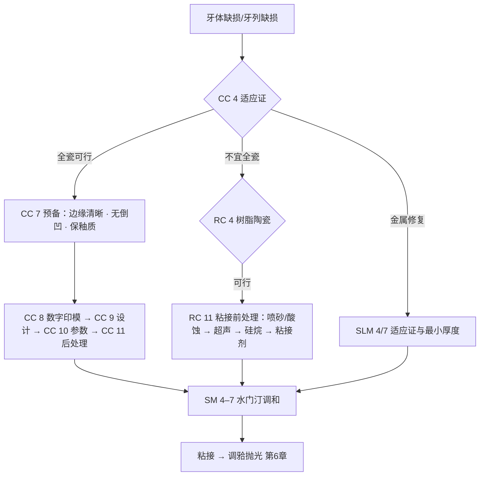

# 第 8 章 · 椅旁数字化修复：参数比品牌重要

> **层次**：本文件是**本库撰写层**（无底本表，不是源正文层）。依据是四份中华口腔医学会团体标准／共识：T/CHSA 014-2022《椅旁全瓷修复技术指南》、T/CHSA 013—2022《树脂陶瓷复合材料椅旁CAD/CAM修复技术指南》、T/CHSA 012—2022《选择性激光熔化金属修复技术的临床应用专家共识》、T/CHSA 003—2022《牙科水门汀材料调和操作规范》，条文登记于 `standards/kouqiang-xiufu/外源条文.json`。
> **依据**：`standards/kouqiang-xiufu/补源登记.json`（`python scripts/build_kouqiang_sources.py --all --check` 现算）。
> **免责**：本章为椅旁数字化流程的教学整理，不构成诊断或治疗建议；设备参数与材料性能以厂商说明书与现行标准为准。

---

## 本章要回答的问题

同一台切削机、同一台扫描仪，为什么不同医师做出来的修复体成功率差很多？团标给出的答案是：差异不来自品牌，而来自**四条参数链** —— 适应证判断（材料能不能用于这个位置）、预备原则（厚度与形态）、数字印模质量、后处理（结晶／上釉／抛光／粘接前处理）。

本章只讲这四件事，不比较设备。

## N.1 概念与出处

> 「预备体边缘要清晰明确、光滑连续，尽量位于有牙本质支持的釉质上」（外源·T/CHSA 014-2022 椅旁全瓷修复技术指南 第7条）

这条是椅旁全瓷的预备原则之一，也点出了椅旁与传统的差别：因为是**机器切削**、材料是**全瓷**，所以更强调保留釉质、减少应力集中，而不那么强调机械固位和点线角锐利（第7条原话）。

| 环节 | 依据 | 要点 |
|---|---|---|
| 椅旁全瓷适应证 | 外源·T/CHSA 014-2022 椅旁全瓷修复技术指南 第4条 | 先判是否适合一条龙完成 |
| 一般操作流程 | 外源·T/CHSA 014-2022 椅旁全瓷修复技术指南 第5条 | 从预备到粘接的椅旁链条 |
| 材料选择 | 外源·T/CHSA 014-2022 椅旁全瓷修复技术指南 第6条 | 按牙位、跨度与咬合选 |
| 牙体预备原则 | 外源·T/CHSA 014-2022 椅旁全瓷修复技术指南 第7条 | 边缘清晰光滑、无倒凹、保留釉质 |
| 数字印模 | 外源·T/CHSA 014-2022 椅旁全瓷修复技术指南 第8条 | 扫描范围与边缘清晰度 |
| 形态设计 | 外源·T/CHSA 014-2022 椅旁全瓷修复技术指南 第9条 | 软件内设计要点 |
| 参数推荐 | 外源·T/CHSA 014-2022 椅旁全瓷修复技术指南 第10条 | 连接体、咬合与厚度参数 |
| 切削后处理 | 外源·T/CHSA 014-2022 椅旁全瓷修复技术指南 第11条 | 结晶／上釉／抛光与试戴 |
| 复合材料适应证 | 外源·T/CHSA 013—2022 树脂陶瓷复合材料椅旁CAD/CAM修复技术指南 第4条 | 树脂陶瓷的适用范围 |
| 复合材料选择 | 外源·T/CHSA 013—2022 树脂陶瓷复合材料椅旁CAD/CAM修复技术指南 第6条 | 材料选择依据 |
| 复合材料粘接前处理 | 外源·T/CHSA 013—2022 树脂陶瓷复合材料椅旁CAD/CAM修复技术指南 第11条 | 喷砂/酸蚀 + 硅烷 + 粘接剂 |
| 破损后处理 | 外源·T/CHSA 013—2022 树脂陶瓷复合材料椅旁CAD/CAM修复技术指南 第12条 | 破损或脱落后的处理路径 |
| SLM 适应证 | 外源·T/CHSA 012—2022 选择性激光熔化金属修复技术的临床应用专家共识 第4条 | 金属修复的适用范围 |
| SLM 材料 | 外源·T/CHSA 012—2022 选择性激光熔化金属修复技术的临床应用专家共识 第6条 | 金属材料选择 |
| SLM 预备原则 | 外源·T/CHSA 012—2022 选择性激光熔化金属修复技术的临床应用专家共识 第7条 | 按修复类型的最小厚度预备 |
| 调和基本原则 | 外源·T/CHSA 003—2022 牙科水门汀材料调和操作规范 第4条 | 比例、时间、器具、环境四项硬约束 |
| 调和前准备 | 外源·T/CHSA 003—2022 牙科水门汀材料调和操作规范 第5条 | 环境、操作者、用量、用物 |
| 粉液调和 | 外源·T/CHSA 003—2022 牙科水门汀材料调和操作规范 第6.3条 | 加粉方式与器具差异 |
| 调和性状评价 | 外源·T/CHSA 003—2022 牙科水门汀材料调和操作规范 第6.4条 | 充填/垫底、粘接、暂粘三种目标性状 |
| 调和注意事项 | 外源·T/CHSA 003—2022 牙科水门汀材料调和操作规范 第7条 | 比例、加盖、散热、「不追加」原则 |

## N.2 为什么可以这样翻译：三条材料路径 + 一条调和链

| 参数链 | 可核判据 | 依据 |
|---|---|---|
| 适应证 | 用哪种材料、为什么不用另两种 | CC 4、RC 4、SLM 4 |
| 预备 | 边缘清晰光滑、无倒凹、最小厚度达标 | CC 7、SLM 7 |
| 印模 | 扫描范围完整、边缘可辨识 | CC 8 |
| 设计参数 | 连接体、咬合、厚度在推荐区间 | CC 9、CC 10 |
| 后处理 | 结晶／上釉／抛光完成且未遗漏 | CC 11 |
| 粘接前处理 | 喷砂粒度与压力、酸蚀时间、硅烷时长 | RC 11 |
| 调和 | 比例、时间、「不追加」 | SM 4、6.3、6.4、7 |

> 「宜使用不大于50µm的氧化铝微粒在0.2Mpa的压力下进行喷砂」（外源·T/CHSA 013—2022 树脂陶瓷复合材料椅旁CAD/CAM修复技术指南 第11条）

这类数字是椅旁修复最容易被忽略的部分：喷砂粒度与压力都在条文里，但临床上常「按手感喷」。第11条还给了后续两步的时间 —— 5% 氢氟酸约 60 s、硅烷化 60 s，构成一条可复现的处理链。

## N.3 这个翻译丢掉了什么

1. **不给切削/烧结设备的参数区间**。CC 第10条给的是修复体参数（连接体、厚度、咬合），不是设备参数。
2. **不给数字印模的精度指标**。CC 第8条要求「扫描范围与边缘清晰度」，但没有提出可量化的扫描精度门槛。
3. **不给不同材料的强度对比**。三份标准各自给适应证，但未做横向比较 —— 选材仍依赖术者经验与文献。
4. **不给「不追加」原则的原因解释**。SM 第7条把「不追加」列为注意事项，未说明加粉会改变粉液比与性能（这是材料学知识，需外部补）。
5. **不覆盖咬合调整的量化**。CC 第11条到试戴与抛光为止，调𬌗在第 6 章与第 9 章处理。
6. **不涉及成本与时间**。椅旁的价值主张常是「一次就诊」，但团标不谈时间与费用，教材需要另找证据。

## N.4 与相邻学科的接口

| 去向 | 接口 |
|---|---|
| 第 4 章 可摘局部义齿 | 固定分支（第5.5.2条 a）里，椅旁全瓷与 SLM 是可选实现方式 |
| 第 5 章 全口义齿 | 数字印模是另一条取模路径，但功能整塑仍需临床完成 |
| 第 6 章 粘接链 | RC 第11条的粘接前处理与本链同构；SM 的调和结果决定粘接层质量 |
| 第 9 章 并发症 | 崩瓷、脱粘、边缘不密合在材质与参数上都能回溯到本章的某条判据 |
| 第 10 章 维护随访 | 抛光与边缘质量影响长期菌斑控制 |
| 病历与质控 | 七项参数链可勾选，是「椅旁修复合规」的记录骨架 |

## N.5 争议与本项目立场

**争议一：参数该不该记进病历。** 有人主张只记材料名与品牌。本项目立场：**记参数，不记品牌** —— 品牌会变、型号会停产，参数（厚度、喷砂粒度与压力、酸蚀与硅烷时间）才是可复现的东西。

**争议二：一次就诊是不是椅旁的定义。** 团标把椅旁写成技术路径（CC 第5条的一般流程），没有把「一次完成」写进定义。本项目立场：一次就诊是**结果**，不是标准；为赶时间压缩后处理（结晶、上釉、抛光）是典型的偷工。

**争议三：树脂陶瓷还是全瓷。** 两份标准各自给适应证，没有排序。本项目立场：按咬合负荷与对颌材料选，不按价格选；选择理由必须写进计划。

**本项目立场**：椅旁数字化的产出不是「做出来了」，而是**七项参数记录**。理由与第 6 章一致：失败时能回溯到具体参数，才有改进的可能。

> **免责**：本章所列条文与判据不构成诊断或治疗建议；条文取义以现行有效的团体标准原文为准，标准修订后须重新核对条号。

## 小结

1. 三种材料三条路径：全瓷（CC）、树脂陶瓷（RC）、SLM 金属（SLM），各有适应证与预备原则。
2. 预备原则的差别来自「机器切削 + 全瓷材料」：保釉质、减应力集中，弱化点线角锐利。
3. 数字印模要求扫描范围与边缘清晰度；设计参数（连接体、厚度、咬合）有推荐区间。
4. 粘接前处理是可复现的链：喷砂（≤50 µm、0.2 MPa）→ 超声 → 酸蚀（约 60 s）→ 硅烷（60 s）→ 粘接剂。
5. 水门汀调和四项硬约束：比例、时间、器具、环境；「不追加」是原则。
6. 记参数，不记品牌。

## 思考题

1. 一位患者需做后牙全冠，咬合紧、对颌为天然牙。你会选全瓷还是 SLM 金属？请用 CC 第4/7条与 SLM 第4/7条各写一条判据。
2. 为什么「预备体边缘尽量位于有牙本质支持的釉质上」对椅旁全瓷比对金属冠更重要？
3. 喷砂粒度从 50 µm 改为 110 µm 会带来什么后果？请结合 RC 第11条说明。
4. 「不追加」原则若被违反（调和后继续加粉），你认为最先出现的问题是什么？

## 延伸阅读

- 外源·T/CHSA 014-2022 椅旁全瓷修复技术指南 第4–11 条
- 外源·T/CHSA 013—2022 树脂陶瓷复合材料椅旁CAD/CAM修复技术指南 第4、6、11、12 条
- 外源·T/CHSA 012—2022 选择性激光熔化金属修复技术的临床应用专家共识 第4、6、7 条
- 外源·T/CHSA 003—2022 牙科水门汀材料调和操作规范 第4–7 条
- 本库专题：[`standards/kouqiang-xiufu/专题-修复操作流程.md`](../../../standards/kouqiang-xiufu/专题-修复操作流程.md)
