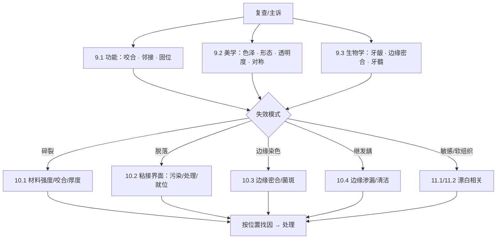

# 第 9 章 · 并发症与失败分析：按位置找因

> **层次**：本文件是**本库撰写层**（无底本表，不是源正文层）。依据是 T/CHSA 001—2019《瓷贴面粘接技术操作规范》（评价与并发症条款）、T/CHSA 002—2021《牙齿漂白治疗技术操作指南》（不良反应条款）、T/CHSA 013—2022《树脂陶瓷复合材料椅旁CAD/CAM修复技术指南》（破损处理条款），条文登记于 `standards/kouqiang-xiufu/外源条文.json`。
> **依据**：`standards/kouqiang-xiufu/补源登记.json`（`python scripts/build_kouqiang_sources.py --all --check` 现算）。
> **免责**：本章为并发症分析与处理路径的教学整理，不构成诊断或治疗建议；具体处置须结合临床检查与执业医师判断。

---

## 本章要回答的问题

修复体失败时，最先出现的问题是「为什么」，而临床上最常见的回答是「患者没维护好」。这个回答既无法证伪，也无法改进。

团标的写法提供了另一条路：**先按位置分类**（功能、美学、生物学三类评价角度），再按**失效模式**命名（碎裂、脱落、边缘染色、继发龋），最后才谈原因。分类在前，归因在后 —— 这是本章的全部方法论。

## N.1 概念与出处

| 失效模式 | 依据 | 要点 |
|---|---|---|
| 功能评价 | 外源·T/CHSA 001—2019 瓷贴面粘接技术操作规范 第9.1条 | 复查咬合、邻接与固位 |
| 美学评价 | 外源·T/CHSA 001—2019 瓷贴面粘接技术操作规范 第9.2条 | 色泽、形态、透明度与对称性 |
| 生物学评价 | 外源·T/CHSA 001—2019 瓷贴面粘接技术操作规范 第9.3条 | 牙龈反应、边缘密合与牙髓状态 |
| 碎裂 | 外源·T/CHSA 001—2019 瓷贴面粘接技术操作规范 第10.1条 | 原因与处理建议 |
| 脱落 | 外源·T/CHSA 001—2019 瓷贴面粘接技术操作规范 第10.2条 | 粘接失败原因与再粘接路径 |
| 边缘染色与龈缘红肿 | 外源·T/CHSA 001—2019 瓷贴面粘接技术操作规范 第10.3条 | 边缘不密合或菌斑堆积 |
| 继发龋 | 外源·T/CHSA 001—2019 瓷贴面粘接技术操作规范 第10.4条 | 边缘渗漏与清洁不良 |
| 牙齿敏感 | 外源·T/CHSA 002—2021 牙齿漂白治疗技术操作指南 第11.1条 | 漂白最常见不良反应 |
| 软组织不适 | 外源·T/CHSA 002—2021 牙齿漂白治疗技术操作指南 第11.2条 | 药剂接触软组织引起 |
| 复合材料破损或脱落 | 外源·T/CHSA 013—2022 树脂陶瓷复合材料椅旁CAD/CAM修复技术指南 第12条 | 破损或脱落后的处理路径 |

> 「若基牙和贴面完整无破损，贴面可顺利地完全复位，可尝试清理脱落的瓷贴面组织面和基牙粘接面后重新粘接（存在较高失败风险）」（外源·T/CHSA 001—2019 瓷贴面粘接技术操作规范 第10.2条）

这条把「能不能再粘」写成了一个**条件判断**（基牙与贴面是否完整、能否完全复位），并明确标注风险。教材若只讲「可以再粘」，就把条件与风险都抹掉了。

## N.2 为什么可以这样翻译：三轴定位表

| 失效模式 | 先查哪个位置 | 常见根因（可回溯到哪一章） | 依据 |
|---|---|---|---|
| 碎裂 | 材料与厚度、咬合接触 | 预备厚度不足（第8章 CC 7）、调𬌗过度（第6章 8） | 10.1 |
| 脱落 | 粘接界面 | 唾液污染（第6章 5.1）、酸蚀与硅烷缺失（4.1–4.4）、就位压力不当（6） | 10.2 |
| 边缘染色 | 边缘密合性 | 边缘台阶、抛光不足（第6章 8）、清洁差 | 10.3 |
| 继发龋 | 边缘渗漏 + 清洁 | 防嵌与清洁设计不足（第4章 5.5.2）、宣教未验收（第3章 5.4.3） | 10.4 |
| 敏感 | 釉质暴露/漂白 | 漂白后敏感（第7章 11.1）、预备暴露牙本质 | 11.1 |
| 软组织刺激 | 药剂接触 | 隔离不足（第7章 8.1 需隔离防护） | 11.2 |

**这张表的用法**：不是「查症状确诊」，而是「按失败位置倒推操作链的哪一环」。脱落的根因几乎总在粘接链（第 6 章），碎裂的根因几乎总在预备与咬合（第 8 章、第 6 章），两类混为一谈会导致处理方向相反。

## N.3 这个翻译丢掉了什么

1. **不给发生率**。第10.1–10.4 逐条给「原因与处理建议」，但没有一条给失败率，教材不能自造数字。
2. **不给「复位」的判据细节**。第10.2条要求「完整无破损、能完全复位」，但没有给出检查方法（试戴看边缘？看咬合？）。
3. **不给再粘的成功率**。只说「存在较高失败风险」，程度未量化。
4. **不覆盖全部修复类型**。10.1–10.4 以瓷贴面为对象；全冠、桥、可摘义齿的失效模式不在本规范内 —— 本章引用时必须说明。
5. **不给随访间隔**。什么时候复查、间隔多久，散在第10章（维护）与第5.6条，第9章本身不涉及。
6. **不区分「可修复失败」与「不可修复失败」**。团标给的是处理建议，不是预后分级。

## N.4 与相邻学科的接口

| 来源章 | 与本章的接口 |
|---|---|
| 第 3 章 修复前处理 | 继发龋与边缘染色的根因常回溯到「宣教未验收」 |
| 第 4 章 可摘局部义齿 | 防嵌设计不足 → 食物嵌塞 → 基牙龋；本章的继发龋条款可复用其逻辑 |
| 第 6 章 粘接链 | 脱落的四大根因（污染、酸蚀、硅烷、就位）全部在第 6 章的链上 |
| 第 7 章 漂白 | 敏感与软组织刺激属漂白不良反应，本章只做归口 |
| 第 8 章 椅旁数字化 | 碎裂与预备厚度、后处理参数直接相关；记参数才能回溯 |
| 第 10 章 维护随访 | 本章的失效模式是随访检查表的内容项 |

## N.5 争议与本项目立场

**争议一：失败该记在谁头上。** 临床上容易记成「患者维护差」。本项目立场：**先按位置定位，再谈责任**；若无法回溯到具体参数（厚度、粘接记录、复查记录），就应记为「记录不足」，而不是患者依从性差。

**争议二：再粘还是重做。** 第10.2条给了再粘的条件与风险。本项目立场：条件不满足（贴面破损、无法完全复位）即重做；条件满足也应把「较高失败风险」写进知情同意。

**争议三：漂白不良反应要不要单列。** 第11.1／11.2 属漂白指南，与修复并发症并列会让分类混乱。本项目立场：**归口服药，分账记录** —— 漂白的不良反应进漂白档案，修复失败进修复档案，避免把两类原因混在一份统计里。

**本项目立场**：并发症章的产出不是一份「可能出什么问题」的清单，而是**一张定位表 + 一条回溯链**：从主诉 → 三轴评价 → 失效模式 → 操作链哪一环 → 哪条判据没做到。

> **免责**：本章所列条文与判据不构成诊断或治疗建议；条文取义以现行有效的团体标准原文为准，标准修订后须重新核对条号。

## 小结

1. 先分类后归因：功能（9.1）、美学（9.2）、生物学（9.3）三轴评价。
2. 四种主导失效模式：碎裂（10.1）、脱落（10.2）、边缘染色（10.3）、继发龋（10.4）。
3. 脱落的根因在粘接链；碎裂的根因在预备与咬合 —— 两类不能混谈。
4. 再粘有条件（完整、可完全复位）且高风险（10.2）。
5. 漂白相关的不良反应（11.1、11.2）单列归档，不与修复失败混账。
6. 无法回溯的失败，应记为「记录不足」。

## 思考题

1. 一枚贴面在半年内脱落两次，基牙与贴面均完整。请按本章定位表写出三条最可能的根因，并说明各自该查什么记录。
2. 患者主诉「边缘发黑」，检查见牙龈轻度红肿。你会先按 10.3 还是 10.4 处理？两步的先后顺序如何安排？
3. 「无法回溯的失败记为记录不足」这条立场，会不会导致医师倾向于少记？请给出一个防止办法。
4. 为什么漂白的不良反应要单列归档？若混在修复失败统计里，会误导什么判断？

## 延伸阅读

- 外源·T/CHSA 001—2019 瓷贴面粘接技术操作规范 第9、10 条
- 外源·T/CHSA 002—2021 牙齿漂白治疗技术操作指南 第11 条
- 外源·T/CHSA 013—2022 树脂陶瓷复合材料椅旁CAD/CAM修复技术指南 第12条
- 本库专题：[`standards/kouqiang-xiufu/专题-修复操作流程.md`](../../../standards/kouqiang-xiufu/专题-修复操作流程.md)
