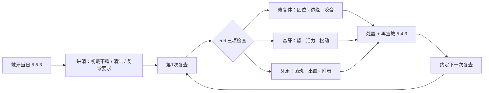

# 第 10 章 · 维护与随访：修复体的第二段寿命

> **层次**：本文件是**本库撰写层**（无底本表，不是源正文层）。依据是 T/CHSA 001—2021《老年患者口腔修复指南》（复诊、戴牙后指导、宣教条款）与 T/CHSA 002—2021《牙齿漂白治疗技术操作指南》（疗效评价与效果维护条款），条文登记于 `standards/kouqiang-xiufu/外源条文.json`。
> **依据**：`standards/kouqiang-xiufu/补源登记.json`（`python scripts/build_kouqiang_sources.py --all --check` 现算）。
> **免责**：本章为随访与维护流程的教学整理，不构成诊断或治疗建议；复查间隔与处置以临床判断与机构规程为准。

---

## 本章要回答的问题

修复体「做完」的那天，寿命才走完一半。剩下的那一半由什么决定？团标把答案写成三个动作：**戴牙后当日讲清、定期复查、把维护方法教给患者与照护者**（第5.5.3、5.6、5.4.3条）。

本章要说明的是：维护不是「有事再来」，而是**有间隔、有检查项、有责任人的流程**。

## N.1 概念与出处

| 环节 | 依据 | 要点 |
|---|---|---|
| 戴牙后指导 | 外源·T/CHSA 001—2021 老年患者口腔修复指南 第5.5.3条 | 初戴不适、清洁、复诊要求 |
| 复诊与维护 | 外源·T/CHSA 001—2021 老年患者口腔修复指南 第5.6条 | 定期复查修复体、基牙与牙周状况 |
| 健康宣教 | 外源·T/CHSA 001—2021 老年患者口腔修复指南 第5.4.3条 | 清洁维护方法教给患者与照护者 |
| 知情同意（特殊人群） | 外源·T/CHSA 001—2021 老年患者口腔修复指南 第4.5条 | 高龄、认知功能障碍者须取得直系亲属或监护人同意 |
| 功能评价 | 外源·T/CHSA 001—2019 瓷贴面粘接技术操作规范 第9.1条 | 咬合、邻接与固位 |
| 漂白疗效评价 | 外源·T/CHSA 002—2021 牙齿漂白治疗技术操作指南 第12.1条 | 比色结果与患者主观评价结合 |
| 漂白效果维护 | 外源·T/CHSA 002—2021 牙齿漂白治疗技术操作指南 第12.2条 | 复色原因与维护措施 |

**三句话概括第 5.5.3、5.6、5.4.3 条的分工**：5.5.3 是**当日**（初戴不适、清洁、复诊要求），5.6 是**长期**（定期复查修复体、基牙、牙周），5.4.3 是**能力建设**（把方法教给患者与照护者）。三者合起来才构成维护，缺任一条都会让另一个失效：教了不复查等于没教，复查不教则每次都在处理同一个问题。

## N.2 为什么可以这样翻译：随访表 + 三条时间线

| 复查项 | 可核内容 | 依据 |
|---|---|---|
| 修复体 | 固位是否下降、边缘是否密合、咬合是否有早接触 | 5.6、9.1 |
| 基牙 | 继发龋、牙髓活力、松动度 | 5.6 |
| 牙周 | 菌斑指数、出血、附着水平 | 5.6 |
| 清洁能力 | 患者／照护者能否复述并演示 | 5.4.3 |
| 漂白（若做过） | 比色对比 + 主观评价 + 复色原因 | 12.1、12.2 |

**三条时间线必须分开记**：当日指导（一次）、定期复查（周期性）、宣教复训（周期性）。把它们混成一句「嘱定期复查」，等于什么都没写。

## N.3 这个翻译丢掉了什么

1. **不给复查间隔**。第5.6条只说「定期」，未给 3 个月／6 个月／1 年的建议。
2. **不给复查项的合格阈值**。菌斑指数多少算控制良好、松动度几度需处理，团标不写。
3. **不给复色时间窗**。第12.2条列复色原因与维护措施，但没有「多久复色」的经验值。
4. **不区分可摘与固定的维护差异**。可摘义齿需摘戴与基托清洁指导，固定修复需邻面清洁工具；第5.6条只写通用三项。
5. **不给「照护者更换」的处置**。老年患者的照护者可能变更（入住机构、家属轮换），第5.4.3条的「教给照护者」未涉及交接。
6. **不涉及费用与依从性**。复查的经济负担与交通可及性，团标不谈，但现实中是随访脱落的主因。

## N.4 与相邻学科的接口

| 来源章 | 与本章的接口 |
|---|---|
| 第 1 章 术语与原则 | 「知情同意＝明了并认可」在随访中同样适用：每次处置变更都需重新告知 |
| 第 2 章 术前评估 | 评估记录里的全身与用药变化，是复查时必须更新的部分 |
| 第 3 章 修复前处理与宣教 | 5.4.3 的宣教在第 3 章执行、在本章复训，两章共用一份清单 |
| 第 4 章 可摘局部义齿 | 防嵌设计与摘戴能力决定维护强度 |
| 第 6 章 粘接链 | 边缘抛光质量与复查时的边缘染色直接相关 |
| 第 7 章 漂白 | 12.1／12.2 的评价与维护在本章纳入随访表 |
| 第 9 章 并发症 | 本章的复查项就是第 9 章失效模式的早期发现入口 |

## N.5 争议与本项目立场

**争议一：复查间隔该由谁定。** 团标不给数字，是因为它取决于修复类型、牙周状况与依从性。本项目立场：**不给统一间隔，但要求写明下一次复查的时间与理由** —— 有日期的计划才是计划。

**争议二：宣教做一次够不够。** 第5.4.3条是修前宣教，第5.5.3条是戴牙当日指导，两次内容重叠但不重复。本项目立场：两次都必须做，且复查时做**复训**（要求演示），因为遗忘曲线比任何材料老化都快。

**争议三：谁负责随访召回。** 临床上常无人负责，患者不来就断了。本项目立场：**责任人必须是主诊医师或指定随访人**，并写进病历；否则「定期复查」只是一句祝愿。

**本项目立场**：维护的产出不是「嘱定期复查」，而是一张**随访表**：复查日期、三项检查结果、宣教复训是否通过、下次复查时间与责任人。四项缺任一项，随访即不算完成。

> **免责**：本章所列条文与判据不构成诊断或治疗建议；条文取义以现行有效的团体标准原文为准，标准修订后须重新核对条号。

## 小结

1. 修复体寿命分两段：制作段（第 3–8 章）与维护段（本章）。
2. 三个动作：当日指导（5.5.3）、定期复查（5.6）、宣教与复训（5.4.3）。
3. 复查三项：修复体（固位/边缘/咬合）、基牙（龋/活力/松动）、牙周（菌斑/出血/附着）。
4. 漂白病例另加比色对比与复色原因（12.1、12.2）。
5. 团标不给间隔与阈值 —— 项目要求写「下次复查时间与理由」。
6. 随访必须有责任人，否则不成流程。

## 思考题

1. 一位 85 岁患者由不同家属轮流照护。第5.4.3条「教给照护者」应如何执行？请设计一个交接办法。
2. 复查三项里，你认为哪一项最能预测修复体寿命？请给出理由与所需记录。
3. 「不给统一间隔，但要求写下一次时间与理由」—— 这个设计如何在病历里落地？请写出字段名。
4. 若患者连续两次未按约复查，按本章立场应如何处置？请写出三步。

## 延伸阅读

- 外源·T/CHSA 001—2021 老年患者口腔修复指南 第4.5、5.4.3、5.5.3、5.6 条
- 外源·T/CHSA 001—2019 瓷贴面粘接技术操作规范 第9.1条
- 外源·T/CHSA 002—2021 牙齿漂白治疗技术操作指南 第12 条
- 本库专题：[`standards/kouqiang-xiufu/专题-修复操作流程.md`](../../../standards/kouqiang-xiufu/专题-修复操作流程.md)
