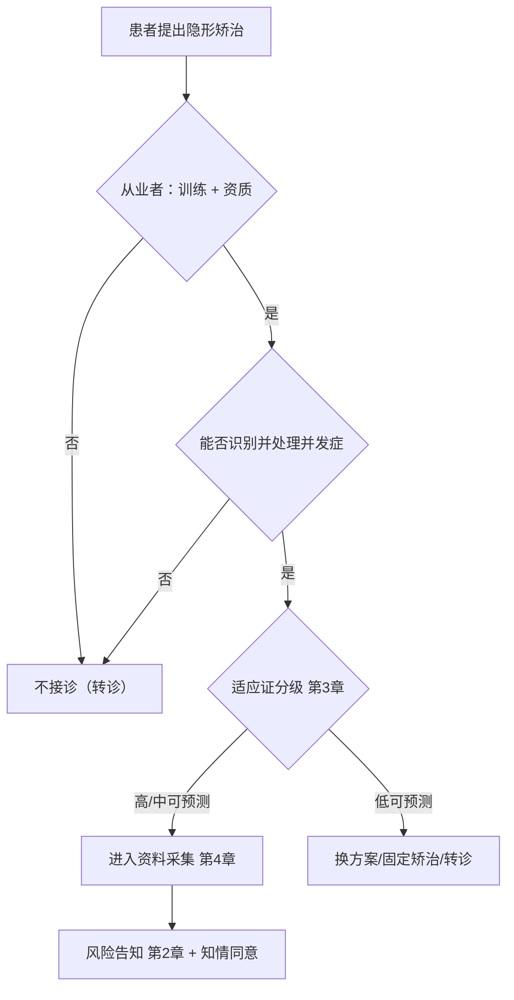

# 第 1 章 · 隐形矫治的对象与从业要求

> **层次**：本文件是**本库撰写层**（无底本表，不是源正文层）。依据是中华口腔医学会团体标准 T/CHSA 003—2021《口腔正畸无托槽隐形矫治技术指南》，条文登记于 `standards/kouqiang-zhengji/外源条文.json`（33 条，全部通过 sha256 与逐字校勘）。
> **依据**：`standards/kouqiang-zhengji/补源登记.json`（`python scripts/build_kouqiang_sources.py --all --check` 现算）；引用格式见 [`补源约定.md`](../../../补源约定.md)。
> **免责**：本章为适应证边界与从业要求的教学整理，不构成诊断或治疗建议；资质认定与执业范围以现行法规与行业规范为准。

---

## 本章要回答的问题

一副隐形矫治器，谁有资格开、开给谁？这两个问题看起来是行政问题，实际上决定了治疗失败的分布：**接诊门槛低、适应证放宽，是把风险从「技术」搬到「人」身上**。

团标开头就把这件事写成了范围条款。

## N.1 概念与出处

> 「本指南从口腔正畸无托槽隐形矫治技术中的从业者要求、治疗风险、适应证、病历资料的采集要求、矫治方案的设计流程和常用治疗策略几个方面给出了口腔正畸无托槽隐形矫治技术的应用标准和指南。」（外源·T/CHSA 003—2021 口腔正畸无托槽隐形矫治技术指南 第1条）

这一句是目录，也是**责任划分表**：六件事——从业者、风险、适应证、资料采集、方案设计、治疗策略。前两件是「人」和「风险」，后四件是「技术」。指南把它们并列，说明隐形矫治的失败既可能出在技术上，也可能出在资质与告知上。

| 概念 | 依据 | 要点 |
|---|---|---|
| 本指南的范围 | 外源·T/CHSA 003—2021 口腔正畸无托槽隐形矫治技术指南 第1条 | 六件事：从业者要求、治疗风险、适应证、资料采集、方案设计、治疗策略 |
| 制订依据与方法学 | 外源·T/CHSA 003—2021 口腔正畸无托槽隐形矫治技术指南 第4.1条 | 说明本指南的制订方法与来源（WHO 指南制订方法） |
| 从业者要求 | 外源·T/CHSA 003—2021 口腔正畸无托槽隐形矫治技术指南 第4.2条 | 须具备正畸专业训练与相应资质，能识别并处理并发症 |
| 治疗风险 | 外源·T/CHSA 003—2021 口腔正畸无托槽隐形矫治技术指南 第4.3条 | 依赖依从；牙移动与设计存在偏差；并发症与传统正畸同类 |
| 器械属性 | 外源·T/CHSA 003—2021 口腔正畸无托槽隐形矫治技术指南 第4.3条 | 矫治器是医疗器械，须按器械管理规范使用 |

**读法**：第4.2条是本章的核心 —— 它把「从业者」的定义写成**两件事同时成立**：受过正畸专业训练且有相应资质，**且**能识别并处理并发症。只有前者，是「会做」；只有后者，是「会收拾」。指南要求两者都有。

## N.2 为什么可以这样翻译：三道资格闸门

| 闸门 | 判据 | 依据 |
|---|---|---|
| 训练与资质 | 正畸专业训练证明 + 执业范围 | 第4.2条 |
| 并发症处理能力 | 能否识别脱轨、能否改方案（重启/辅以固定） | 第4.2条、第4.3条 |
| 器械合规 | 矫治器按医疗器械管理，来源与使用合规 | 第4.3条 |

第三道常被当成「采购问题」，其实是**责任问题**：第4.3条明确矫治器是医疗器械。隐形矫治的链条里有第三方（加工/软件），一旦出问题，责任在开处方的人身上。

## N.3 这个翻译丢掉了什么

1. **不给资质的具体标准**。「正畸专业训练与相应资质」由谁认定、训练多少学时、是否需要专科医师资格，团标不写 —— 这属于法规与行业规范的地盘。
2. **不给「能处理并发症」的判定方式**。是考试、病例数还是设备条件？团标不指定。
3. **不给转诊标准**。低可预测病例该转给谁（正畸专科、正颌外科），团标在第5章给分级，但转诊路径不给。
4. **不覆盖跨专业协作**。隐形矫治常涉及修复、牙周、种植的联合设计（例如修复前正畸开辟间隙），团标以正畸为主线，协作界面不给。
5. **不给病历的最低字段**。第1条提到「病历资料的采集要求」，第5.2条给了影像与模型，但完整病历格式不给。
6. **不谈费用与商业行为**。器械与软件的分成模式、宣传口径，全在指南范围之外。

## N.4 与相邻学科的接口

| 去向 | 接口 |
|---|---|
| 第 2 章 治疗风险 | 第4.3条的三类风险在本章只点名，第 2 章展开 |
| 第 3 章 适应证与分级 | 第5.1.1条的三级可预测性是接诊的实际判据 |
| 第 4 章 资料采集 | 第5.2条的影像与模型是「接诊后第一件事」 |
| 第 5 章 方案设计 | 第5.3条的设计流程决定治疗方案是否可交付 |
| 第 6–8 章 三条策略 | 推磨牙、邻面去釉、分步移动是「技术」部分 |
| 第 9–10 章 儿童与唇腭裂 | 特殊人群的适应证另行判断（不同团标） |
| 病历与质控 | 三道闸门可勾选，是「接诊合规」的记录骨架 |

## N.5 争议与本项目立场

**争议一：隐形矫治该不该限定为专科医师。** 一种意见认为应等同固定矫治的资质要求（即专科）；另一种认为基础病例可由全科医师在规范内完成。本项目立场：**按可预测性分级分配权限**（第 3 章），高度可预测病例可放宽，低度必须专科 —— 这与第5.1.1条的三级结构同构。

**争议二：第三方加工的责任归属。** 软件排牙由第三方完成时，方案的责任在谁？本项目立场：**处方与验收责任在开单医师**，这与第4.3条「矫治器是医疗器械」的定位一致。

**争议三：营销话术算不算风险告知。** 「无痛、无钢丝、可自行摘戴」是事实，但若省略「依赖依从、可能脱轨」，就构成告知不完整。本项目立场：第2章的告知清单必须在首次咨询时就给，而不是签同意书时才给。

**本项目立场**：本章的产出不是一份资质清单，而是**三道闸门 + 一份转诊判据**。没有转诊判据的「资格门槛」只是形式；有了它，接诊才是有边界的。

> **免责**：本章所列条文与判据不构成诊断或治疗建议；条文取义以现行有效的团体标准原文为准，标准修订后须重新核对条号。

## 小结

1. 指南范围六件事：从业者、风险、适应证、资料采集、方案设计、治疗策略。
2. 从业者要求是「训练 + 资质」与「能识别并处理并发症」两件同时成立。
3. 矫治器是医疗器械（第4.3条），责任在开单医师。
4. 三道闸门：资质、并发症处理能力、器械合规。
5. 适应证分级是接诊的实际判据（第 3 章展开）。
6. 转诊标准团标不给，属于本项目要补的判据。

## 思考题

1. 一位全科医师完成了 50 例高度可预测病例，接诊一例中度可预测病例。按本章立场，他需要满足什么条件才能接？
2. 第4.2条把「能处理并发症」写进从业者要求，你认为这一条最容易被哪种方式规避？
3. 第三方软件排牙出错导致脱轨，责任如何划分？请按第4.3条的器械属性写出你的分析。
4. 首次咨询时，你会用哪三句话把「依赖依从、可能脱轨、需辅以固定」讲清楚？

## 延伸阅读

- 外源·T/CHSA 003—2021 口腔正畸无托槽隐形矫治技术指南 第1、4.1–4.3 条
- 本库专题：[`standards/kouqiang-zhengji/专题-正畸操作路径.md`](../../../standards/kouqiang-zhengji/专题-正畸操作路径.md)
- 本库登记：[`standards/kouqiang-zhengji/补章登记.json`](../../../standards/kouqiang-zhengji/补章登记.json)
