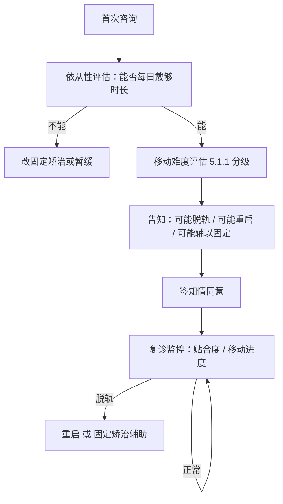

# 第 2 章 · 治疗风险：依从性、移动偏差与并发症

> **层次**：本文件是**本库撰写层**（无底本表，不是源正文层）。依据是 T/CHSA 003—2021《口腔正畸无托槽隐形矫治技术指南》，条文登记于 `standards/kouqiang-zhengji/外源条文.json`。
> **依据**：`standards/kouqiang-zhengji/补源登记.json`（`python scripts/build_kouqiang_sources.py --all --check` 现算）。
> **免责**：本章为风险告知内容的教学整理，不构成诊断或治疗建议；具体风险交代与处置以临床判断与现行规范为准。

---

## 本章要回答的问题

隐形矫治的风险，与传统固定矫治是同一套，还是另一套？团标的回答分两层：**同类风险（正畸并发症）+ 特有风险（可摘、依赖配合、移动与预设偏差）**。把这两层混成一份「知情同意清单」，患者记不住，医师也说不清。

本章要做的事：把第4.3条的四小段拆成可逐条告知的风险项，并说明每一项对应什么处置动作。

## N.1 概念与出处

> 「无托槽隐形矫治器是一种可摘式矫治器，治疗过程依赖于患者的配合，良好的依从性是保证隐形矫治良好治疗效果的前提」（外源·T/CHSA 003—2021 口腔正畸无托槽隐形矫治技术指南 第4.3条）

第一层风险就写在这句里：**可摘 → 依赖配合**。它与固定矫治的风险结构根本不同 —— 固定矫治的失效多来自力学与口腔卫生，隐形矫治的失效多来自「患者有没有戴够时间」。

| 风险项 | 依据 | 要点 |
|---|---|---|
| 依从性风险 | 外源·T/CHSA 003—2021 口腔正畸无托槽隐形矫治技术指南 第4.3条 | 可摘式，治疗依赖患者配合；依从性是疗效前提 |
| 移动偏差与脱轨 | 外源·T/CHSA 003—2021 口腔正畸无托槽隐形矫治技术指南 第4.3条 | 材料性能与个体差异导致实际移动与计算机预设偏差，可出现脱轨 |
| 复杂移动的重启 | 外源·T/CHSA 003—2021 口腔正畸无托槽隐形矫治技术指南 第4.3条 | 复杂移动可能需要重启治疗，或辅以固定矫治器及其他装置 |
| 正畸并发症 | 外源·T/CHSA 003—2021 口腔正畸无托槽隐形矫治技术指南 第4.3条 | 与传统固定正畸同类，设计期就应考虑 |
| 器械风险 | 外源·T/CHSA 003—2021 口腔正畸无托槽隐形矫治技术指南 第4.3条 | 矫治器是医疗器械，须合规使用 |
| 并发症处理能力 | 外源·T/CHSA 003—2021 口腔正畸无托槽隐形矫治技术指南 第4.2条 | 从业者须能识别并处理并发症 |
| 低可预测病例 | 外源·T/CHSA 003—2021 口腔正畸无托槽隐形矫治技术指南 第5.1.1条 | 分级决定风险上限，低可预测即高风险 |

## N.2 为什么可以这样翻译：风险→判据→处置

| 风险项 | 可核判据 | 对应处置 | 依据 |
|---|---|---|---|
| 依从性 | 复诊时的佩戴时长自述 + 贴合度 | 缩短复诊间隔、改方案 | 第4.3条 |
| 脱轨 | 矫治器与牙面贴合度、计划移动量与实际比较 | 重启、加附件、辅以固定 | 第4.3条 |
| 复杂移动 | 是否需要多颗联动、是否需要支抗 | 设计期即预留固定矫治方案 | 第4.3条 |
| 正畸并发症 | 牙根吸收、牙龈炎、龋、颞下颌关节症状 | 常规正畸监控 | 第4.3条 |
| 器械合规 | 矫治器来源与批次可追溯 | 留存记录 | 第4.3条 |

**关键点**：第4.3条把「可能需要重启或使用固定矫治器」写在**风险条款**里，而不是写在补救方案里。这意味着它不是失败，而是**治疗路径的一部分** —— 必须在治疗前说，而不是脱轨后才说。

## N.3 这个翻译丢掉了什么

1. **不给依从性的量化门槛**。每天戴多少小时、每周至少几天，团标不写（这是产品说明书与临床经验的领域）。
2. **不给脱轨的判定标准**。贴合度容差、允许偏差量，没有数值。
3. **不给重启率的基线**。哪类病例多大比例需要重启，不写；教材不能自造数字。
4. **不给并发症清单**。第4.3条说「与传统正畸一样存在各种并发症」，未列举。牙根吸收、牙龈炎、白斑、关节症状需要外部文献补。
5. **不给告知的形式要求**。口头、书面、视频？由谁告知？不指定。
6. **不涉及费用分担**。重启、加附件、改固定矫治的额外费用与责任，团标不管，但这是纠纷高发点。

## N.4 与相邻学科的接口

| 去向 | 接口 |
|---|---|
| 第 1 章 从业要求 | 第4.2条「能识别并处理并发症」是本章风险处置的能力前提 |
| 第 3 章 适应证分级 | 可预测性分级即风险分级：低可预测 = 高脱轨概率 |
| 第 5 章 方案设计 | 第5.3条的设计流程决定是否预留「复杂移动」的备用路径 |
| 第 8 章 分步移动 | 分步策略是降低脱轨概率的主要技术手段 |
| 第 9–10 章 特殊人群 | 儿童依从性依赖家长；唇腭裂病例的并发症结构不同 |
| 病历与质控 | 五项风险项可勾选 + 告知版本号，是纠纷时的核心证据 |

## N.5 争议与本项目立场

**争议一：把「可能重启」写进同意书会不会吓退患者。** 会，但这是必要成本。本项目立场：**用概率语言而非结果承诺**（「部分复杂移动病例需要重启」），比事后解释「这很正常」更省事也更诚实。

**争议二：依从性差的患者要不要接。** 团标把依从列为风险而非禁忌。本项目立场：**依从性可评估但不可保证**，因此对低可预测 + 依从不确定的组合应直接改方案，而不是「先做做看」。

**争议三：重启费用谁承担。** 团标不谈。本项目立场：在治疗计划里写明「含几次重启」与超出的计费方式 —— 把商业问题写清楚，才不会在临床上被当成技术问题处理。

**本项目立场**：风险章的产出是一份**四条告知清单**：可能戴不够（依从）、可能不按计划走（脱轨）、可能需要重启或辅具（路径）、并发症与传统正畸同类。四条之外，还要写清「谁负责发现脱轨」（复诊间隔与判据）。

> **免责**：本章所列条文与判据不构成诊断或治疗建议；条文取义以现行有效的团体标准原文为准，标准修订后须重新核对条号。

## 小结

1. 风险分两层：正畸通用并发症 + 隐形特有风险（可摘、依赖配合、移动偏差）。
2. 依从性是疗效前提，不是美德要求。
3. 脱轨与重启是治疗路径的一部分，必须在治疗前告知。
4. 复杂移动应在设计期就预留固定矫治或辅助装置。
5. 矫治器是医疗器械，合规与追溯是制度要求。
6. 重启的责任与费用，团标不管，必须在计划里写清。

## 思考题

1. 一位患者明确表示「白天不方便戴，只能晚上戴」。按第4.3条，你会如何调整方案或拒绝？
2. 「可能重启」如果写进同意书，你认为应该怎样表述才既真实又不引发误解？
3. 第4.3条把并发症一句带过，你认为教材补哪三类最常见？
4. 复诊间隔短能降低脱轨损失，但增加患者负担。你会如何设定「首次发现脱轨」的判据？

## 延伸阅读

- 外源·T/CHSA 003—2021 口腔正畸无托槽隐形矫治技术指南 第4.2、4.3、5.1.1 条
- 本库专题：[`standards/kouqiang-zhengji/专题-正畸操作路径.md`](../../../standards/kouqiang-zhengji/专题-正畸操作路径.md)
