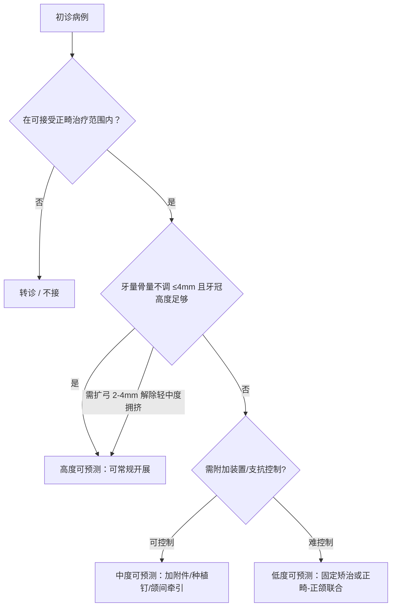

# 第 3 章 · 适应证与可预测性分级

> **层次**：本文件是**本库撰写层**（无底本表，不是源正文层）。依据是 T/CHSA 003—2021《口腔正畸无托槽隐形矫治技术指南》，条文登记于 `standards/kouqiang-zhengji/外源条文.json`。
> **依据**：`standards/kouqiang-zhengji/补源登记.json`（`python scripts/build_kouqiang_sources.py --all --check` 现算）。
> **免责**：本章为适应证判断的教学整理，不构成诊断或治疗建议；分级判据以现行标准原文为准。

---

## 本章要回答的问题

「这个病例能不能用隐形矫治」——这个问题在临床上常被回答成「试试看」。团标的做法不同：它不问「能不能」，而问「**结果有多可预测**」，并把病例分成三级，分别给建议。

> 「合理的选择适应证是决定矫治成败的关键。」（外源·T/CHSA 003—2021 口腔正畸无托槽隐形矫治技术指南 第5.1.1条）

这句话的份量在于：它把成败归因于**选病例**，而不是操作技巧。分级的意义是把「经验判断」换成「可复述的判据」。

## N.1 概念与出处

| 概念 | 依据 | 要点 |
|---|---|---|
| 适应证的总原则 | 外源·T/CHSA 003—2021 口腔正畸无托槽隐形矫治技术指南 第5.1.1条 | 首先须在可接受正畸治疗的范围内；相较固定矫治，适应证**尚有一定局限** |
| 分级的维度 | 外源·T/CHSA 003—2021 口腔正畸无托槽隐形矫治技术指南 第5.1.1条 | 按**矫治结果的可预测性**分为三类 |
| 高度可预测 | 外源·T/CHSA 003—2021 口腔正畸无托槽隐形矫治技术指南 第5.1.1条 | 能精确实现模拟目标：临床牙冠高度足够、牙量骨量不调 ≤4 mm 等 |
| 中度可预测 | 外源·T/CHSA 003—2021 口腔正畸无托槽隐形矫治技术指南 第5.1.1条 | 需附加装置或更多设计控制 |
| 低度可预测 | 外源·T/CHSA 003—2021 口腔正畸无托槽隐形矫治技术指南 第5.1.1条 | 建议固定矫治或转诊 |
| 适应证的历史性 | 外源·T/CHSA 003—2021 口腔正畸无托槽隐形矫治技术指南 第5.1.1条 | 随研究深入，适应证范围在扩展 —— 分级是当下的，不是永久的 |

第5.1.1条在「高度可预测」下给了具体条件，其中最有操作性的是 **牙量骨量不调 ≤4 mm** 与「可利用 2–4 mm 唇颊远中扩弓解除拥挤的轻度拥挤病例」。这是本章唯二的数字判据，也正是「可预测」的技术基础：移动量小、移动方向是可预期的扩弓。

## N.2 为什么可以这样翻译：分级表 + 三档建议

| 档 | 典型判据（第5.1.1条） | 建议 |
|---|---|---|
| 高 | 牙冠高度足够保证固位；牙量骨量不调 ≤4 mm；轻中度拥挤可经 2–4 mm 扩弓解除 | 常规开展 |
| 中 | 需更多支抗控制、需附加装置、需分步设计 | 加附件、种植钉、颌间牵引，加密复诊 |
| 低 | 复杂移动、需大量整体移动或显著矢状向改变 | 改固定矫治、或正畸-正颌联合、或转诊 |

**操作要点**：分级不是给病案贴标签，而是**决定设计参数**。同一个「拥挤 5 mm」的病例，判成中度就要在设计阶段把支抗方案写清；判成低度就该换路径，而不是「先上隐形，不行再说」。

## N.3 这个翻译丢掉了什么

1. **只给了两条数字**（≤4 mm、2–4 mm 扩弓）。其余判据是描述性的，例如「临床牙冠有足够高度」没给毫米阈值。
2. **不给中度与低度的完整判据**。第5.1.1条对高度可预测列得最细；中、低两档的边界需要靠后面的分则（6.1–6.3）间接推断。
3. **不给分级与预后的对应**。三级各自的成功率、脱轨率、重启率，团标不写。
4. **不说谁来定级**。是术者自评、还是需第二人复核？未指定 —— 这直接影响分级的可靠性。
5. **不给「范围内」的定义**。「可以接受正畸治疗的范围内」是循环表述：可以正畸治疗的病例才可能用隐形矫治，但什么算「可以正畸治疗」由谁定？
6. **不区分年龄与牙列阶段**。儿童混合牙列期的分级标准与成人不同，本指南未分列（儿童相关见第 9、10 章的两份共识）。

## N.4 与相邻学科的接口

| 去向 | 接口 |
|---|---|
| 第 1 章 从业要求 | 低可预测病例的转诊对象由第 1 章的资质界限决定 |
| 第 2 章 治疗风险 | 分级即风险分级；低可预测 = 高脱轨概率 |
| 第 4 章 资料采集 | 分级所需判据（牙冠高度、拥挤量）来自影像与模型测量 |
| 第 5 章 方案设计 | 分级结果直接写入设计参数（附件、支抗、分步） |
| 第 6–8 章 三条策略 | 分级决定这三条策略是否适用、以何顺序用 |
| 第 9 章 间隙管理 | 儿童病例的分级要叠加「牙列阶段」与「替牙进度」 |
| 病历与质控 | 分级结论 + 判据数值 = 可审计的接诊记录 |

## N.5 争议与本项目立场

**争议一：分级该不该有第三方复核。** 单术者定级容易自我服务（想接就定高）。本项目立场：**中度以上应留第二人复核记录**，这是本项目的增补要求，不是团标原文。

**争议二：判成低度就一定要拒吗。** 第5.1.1条的建议是「分别给予开展治疗的建议」，措辞留有余地。本项目立场：低度可预测不等于禁忌，但**必须同时具备两件事**：明确告知预估难度、书面预留改固定矫治的路径与费用。

**争议三：适应证会扩展，教材的分级会不会过期。** 会。本项目立场：写清「本分级以 T/CHSA 003—2021 为据」，并在教材层面注明「扩展的部分须回标准现行版核对」。

**本项目立场**：分级的产出不是标签，而是**三件套**：判据数值（如 ≤4 mm）、结论档位、以及该档位对应的设计参数。缺任一件，分级就只是印象。

> **免责**：本章所列条文与判据不构成诊断或治疗建议；条文取义以现行有效的团体标准原文为准，标准修订后须重新核对条号。

## 小结

1. 适应证判断的正确问法是「结果有多可预测」，不是「能不能做」。
2. 三级：高（精确实现模拟目标）、中（需附加装置与支抗控制）、低（改固定或联合治疗）。
3. 第5.1.1条给了两个可用数字：牙量骨量不调 ≤4 mm、扩弓 2–4 mm 解除轻中度拥挤。
4. 分级的用途是决定设计参数，不是给病例贴标签。
5. 「可接受正畸治疗范围内」是循环表述，实际边界由资质与转诊路径确定。
6. 儿童与混合牙列期的分级不在此条范围内。

## 思考题

1. 一位成人患者拥挤 5 mm、牙冠高度正常、无需矢状向改变。按第5.1.1条，你会归到哪一档？理由与设计参数各是什么？
2. 「临床牙冠有足够高度」没有给毫米阈值，你会用什么方法在病历里留下可核的记录？
3. 分级由单术者自评的风险是什么？第二人复核能解决多少？
4. 如果适应证范围随研究扩展，教材如何写才能既不过期、又不模糊？

## 延伸阅读

- 外源·T/CHSA 003—2021 口腔正畸无托槽隐形矫治技术指南 第5.1.1 条
- 本库专题：[`standards/kouqiang-zhengji/专题-正畸操作路径.md`](../../../standards/kouqiang-zhengji/专题-正畸操作路径.md)
