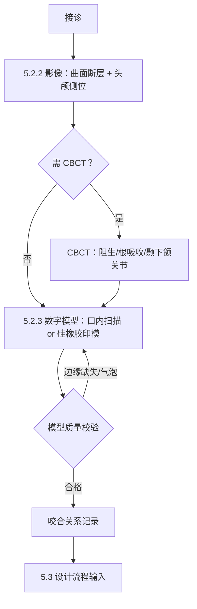

# 第 4 章 · 资料采集：影像与数字模型

> **层次**：本文件是**本库撰写层**（无底本表，不是源正文层）。依据是 T/CHSA 003—2021《口腔正畸无托槽隐形矫治技术指南》，条文登记于 `standards/kouqiang-zhengji/外源条文.json`。
> **依据**：`standards/kouqiang-zhengji/补源登记.json`（`python scripts/build_kouqiang_sources.py --all --check` 现算）。
> **免责**：本章为资料采集要求的教学整理，不构成诊断或治疗建议；影像种类、频次与辐射防护须遵循放射防护规范与机构规程。

---

## 本章要回答的问题

为什么排牙软件能排得漂亮，落地却脱轨？很多时候不是算法的问题，而是**输入的质量**：模型缺了边缘、影像没拍到根尖、咬合关系没记录。团标把资料采集单列条款，原因就在这里。

## N.1 概念与出处

| 环节 | 依据 | 要点 |
|---|---|---|
| 影像资料采集 | 外源·T/CHSA 003—2021 口腔正畸无托槽隐形矫治技术指南 第5.2.2条 | 曲面断层片与头颅侧位片；必要时 CBCT |
| 数字化模型获取 | 外源·T/CHSA 003—2021 口腔正畸无托槽隐形矫治技术指南 第5.2.3条 | 口内扫描或硅橡胶印模，用于模型分析与设计 |
| 方案设计流程 | 外源·T/CHSA 003—2021 口腔正畸无托槽隐形矫治技术指南 第5.3条 | 资料是设计流程的输入 |
| 病历资料的采集要求 | 外源·T/CHSA 003—2021 口腔正畸无托槽隐形矫治技术指南 第1条 | 指南范围六件事之一 |

三条构成一条**采集链**：影像回答「骨与根」，数字模型回答「冠与咬合」，两者共同回答「能不能按计划移动」。

## N.2 为什么可以这样翻译：三类资料四道校验

| 校验项 | 判据 | 依据 |
|---|---|---|
| 影像完整 | 曲面断层覆盖双侧髁突至颏部；头颅侧位可辨识标志点 | 第5.2.2条 |
| CBCT 必要性 | 阻生、根吸收可疑、颞下颌关节症状等 | 第5.2.2条 |
| 模型精度 | 扫描范围含全部牙冠与龈缘、无缺牙区空洞 | 第5.2.3条 |
| 咬合记录 | 正中关系或习惯性咬合的明确记录 | 第5.3条设计所必需 |
| 留档 | 资料与日期可追溯 | 第1条（病历采集要求） |

**为什么强调「边缘」**：隐形矫治的设计基准是牙冠外形与龈缘位置，扫描丢一段龈缘，软件给出的移动量就带系统误差。这个误差在排牙界面里看不出来，只会在复诊时以脱轨的形式出现。

**三道核对（本项目增补，团标未写）**：团标只列资料种类，不规定「什么时候核对」。实务上缺了核对，资料就会「收齐了但不可用」。建议把核对放在三个时点：

1. **采集当日**：影像覆盖范围与模型完整性（龈缘、缺牙区、腭侧），不合格当场重扫，不等设计端发现。
2. **设计前**：把分级所需的三项判据（牙冠高度、拥挤量、覆𬌗覆盖）从资料里量出来，量不出来即为资料不足。
3. **复诊首次**：把治疗前资料与首次复诊的口内实况对比，确认「资料描述的牙列」与「真实牙列」一致 —— 这一步能抓到少数「资料与临床不符」的病例（例如治疗前未记录的松动牙、未诊断的龋）。

三道核对的共同点是：**核对必须有记录，而不只是「看过」**。这与第 7 章去釉「复诊牙线核查」、第 3 章分级「留数值记录」是同一条原则。

## N.3 这个翻译丢掉了什么

1. **不给影像频次**。治疗中多久复查一次影像，团标不写。
2. **不给 CBCT 的指征清单**。第5.2.2条只说「必要时」，具体指征靠临床判断。
3. **不给模型精度的量化指标**。多少微米的偏差可接受，不写。
4. **不给口内扫描与硅橡胶印模的选择标准**。两者并列，未分优劣。
5. **不给照片、面像、功能检查的要求**。正畸资料通常还包含面像与功能检查，本指南此条只列影像与模型。
6. **不给资料缺失时的处置**。缺资料是否可启动治疗，团标不表态 —— 这是实务中最常见的越界点。

## N.4 与相邻学科的接口

| 去向 | 接口 |
|---|---|
| 第 3 章 分级 | 分级判据（牙冠高度、拥挤量）来自本章的模型与影像测量 |
| 第 5 章 方案设计 | 第5.3条的设计以本章资料为输入，资料质量决定设计上限 |
| 第 6–8 章 三条策略 | 推磨牙看磨牙区可用间隙（影像）；邻面去釉看去釉量与釉质厚度（影像）；分步看牙根位置（CBCT） |
| 第 9 章 间隙管理 | 儿童需额外记录替牙进度与牙根发育阶段 |
| 第 10 章 异位萌出 | 分型依赖影像（曲面断层），本章的采集质量直接决定分型可靠性 |
| 病历与质控 | 五道校验可勾选，是「资料齐备」的唯一机器可核证据 |

## N.5 争议与本项目立场

**争议一：口内扫描能否完全替代硅橡胶印模。** 第5.2.3条并列两者。本项目立场：**按病例选**——重度拥挤、龈下边缘、张口受限时印模更稳；多数常规病例扫描足够，但必须校验龈缘连续性。

**争议二：CBCT 用多了是过度医疗，用少了是漏诊。** 团标只给「必要时」。本项目立场：把 CBCT 指征**写在治疗计划里**（为什么做/为什么不做），使决策可复核。

**争议三：资料不全能不能开工。** 实务中常见「先扫描排牙，影像后补」。本项目立场：**影像与模型是设计的前置条件**，缺任一项不进入设计；如因特殊原因先做，须记录风险并注明补做期限。

**本项目立场**：资料采集的产出不是一堆文件，而是**五道校验的通过记录**。资料齐 ≠ 校验过；这条区别决定了脱轨时能否定位到输入侧。

> **免责**：本章所列条文与判据不构成诊断或治疗建议；条文取义以现行有效的团体标准原文为准，标准修订后须重新核对条号。

## 小结

1. 采集链：影像（骨与根）→ 数字模型（冠与咬合）→ 设计输入。
2. 影像两类：曲面断层 + 头颅侧位；必要时 CBCT（第5.2.2条）。
3. 模型两途：口内扫描或硅橡胶印模（第5.2.3条），须含全部牙冠与龈缘。
4. 五道校验：影像完整、CBCT 必要性、模型精度、咬合记录、留档。
5. 资料不全不进入设计，是项目要求（团标未表态）。
6. 采集质量决定设计上限，脱轨常可回溯到输入侧。

## 思考题

1. 一位患者张口受限、下颌后牙区重度拥挤，你会选口内扫描还是硅橡胶印模？请用第5.2.3条说明理由。
2. 扫描模型缺了 3 mm 龈缘，会在设计界面的哪个环节埋下误差？为什么排牙时看不出来？
3. 「资料不全不进入设计」若严格执行，会带来哪些现实成本？你如何折中？
4. CBCT 指征写进治疗计划，能减少哪两类错误？

## 延伸阅读

- 外源·T/CHSA 003—2021 口腔正畸无托槽隐形矫治技术指南 第1、5.2.2、5.2.3、5.3 条
- 本库专题：[`standards/kouqiang-zhengji/专题-正畸操作路径.md`](../../../standards/kouqiang-zhengji/专题-正畸操作路径.md)
