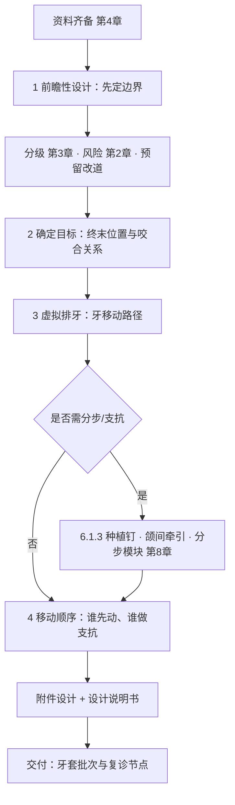

# 第 5 章 · 方案设计流程：目标、虚拟排牙、顺序与附件

> **层次**：本文件是**本库撰写层**（无底本表，不是源正文层）。依据是 T/CHSA 003—2021《口腔正畸无托槽隐形矫治技术指南》，条文登记于 `standards/kouqiang-zhengji/外源条文.json`。
> **依据**：`standards/kouqiang-zhengji/补源登记.json`（`python scripts/build_kouqiang_sources.py --all --check` 现算）。
> **免责**：本章为设计流程的教学整理，不构成诊断或治疗建议；具体设计以临床判断与现行标准为准。

---

## 本章要回答的问题

打开软件、把牙排到理想位置、生成一串牙套——这就是设计吗？团标的写法给出了一个更严格的顺序：**前瞻性设计 → 确定目标 → 虚拟排牙 → 移动顺序**（第5.3条）。顺序里最关键的是第一个词：前瞻。

> 「本指南按照矫治结果的可预测性，可将临床病例分为以下三类适应证，分别给予开展治疗的建议。」（外源·T/CHSA 003—2021 口腔正畸无托槽隐形矫治技术指南 第5.1.1条）

这句出现在设计章之前的理由是：**设计的自由度由分级决定**。高可预测病例可以按模拟目标一路做到底；低可预测病例在设计阶段就应该写入「改道」预案。

## N.1 概念与出处

| 环节 | 依据 | 要点 |
|---|---|---|
| 设计流程 | 外源·T/CHSA 003—2021 口腔正畸无托槽隐形矫治技术指南 第5.3条 | 前瞻性设计、确定目标、虚拟排牙、移动顺序 |
| 目标受分级约束 | 外源·T/CHSA 003—2021 口腔正畸无托槽隐形矫治技术指南 第5.1.1条 | 三级可预测性决定目标可实现的上限 |
| 分步移动是设计的一部分 | 外源·T/CHSA 003—2021 口腔正畸无托槽隐形矫治技术指南 第6.3.1条 | 分步模式属支抗设计的组成部分（第 8 章展开） |
| 附件与支抗 | 外源·T/CHSA 003—2021 口腔正畸无托槽隐形矫治技术指南 第6.1.3条 | 推磨牙时建议种植钉、颌间牵引加强支抗 |
| 数字模型输入 | 外源·T/CHSA 003—2021 口腔正畸无托槽隐形矫治技术指南 第5.2.3条 | 数字化模型用于模型分析与设计 |

## N.2 为什么可以这样翻译：四步设计表

| 步骤 | 产出 | 判据 |
|---|---|---|
| 前瞻 | 设计边界：目标上限 + 改道路径 | 分级档位与风险项已记录 |
| 定目标 | 终末位置（覆𬌗覆盖、中线、咬合关系） | 目标能否在分级上限内实现 |
| 虚拟排牙 | 分步序列与每步移动量 | 移动类型可分（倾斜/整体/压低） |
| 顺序与支抗 | 支抗方案（种植钉/牵引/分步） | 支抗是否足以支撑目标 |
| 附件与说明书 | 附件位置、力学说明、复诊节点 | 交付物完整 |

**「前瞻」两个字的实际含义**：在设计阶段就要回答「如果第 12 步没跟上，我改什么」。这不是悲观，而是隐形矫治的工程现实 —— 第2章已说明脱轨与重启属治疗路径的一部分。

**支抗的四种来源（把第6.1.3条与第6.3.1条并起来读）**：设计里的支抗不是只有种植钉。

1. **颌内支抗**：同一牙弓里互为支抗的模块（第6.3.2条尖牙—切牙交替）。
2. **颌间支抗**：上下颌之间的牵引（第6.1.3条）。
3. **骨性支抗**：种植钉（第6.1.3条建议用于推磨牙）。
4. **装置支抗**：附件、辅弓、局部固定装置。

四者的可靠性依次上升、成本也依次上升。设计说明书的用处就是把「用了哪几种、为什么够」写清楚 —— 否则验收时只能靠「看着像对」。

## N.3 这个翻译丢掉了什么

1. **不给每步允许的移动量**。倾斜、整体移动、压低各自的安全阈值，团标不写。
2. **不给附件设计的规则**。附件位置、形状与力学关系，第5.3条只提流程。
3. **不给目标优先级**。中线、覆𬌗覆盖、咬合关系冲突时如何取舍，不指定。
4. **不给设计复核机制**。谁审设计、是否需第二人复核，未规定。
5. **不给与技工/软件方的接口格式**。谁负责设计、谁负责验收，责任界面不清。
6. **不给「设计说明书」的内容清单**。教材只能按实务惯例补。

## N.4 与相邻学科的接口

| 去向 | 接口 |
|---|---|
| 第 3 章 分级 | 分级是设计边界，低可预测须在设计阶段写改道 |
| 第 4 章 资料 | 设计的输入精度决定移动量估算的可信度 |
| 第 6 章 推磨牙 | 第6.1.3条给出该策略的支抗要求（种植钉/颌间牵引） |
| 第 7 章 邻面去釉 | 去釉量是「预先给的间隙」，必须写进设计序列 |
| 第 8 章 分步移动 | 分步模式即设计顺序的骨架 |
| 第 2 章 风险 | 设计的改道预案对应风险告知内容 |

## N.5 争议与本项目立场

**争议一：设计由医师做还是由软件/技工做。** 分工普遍存在，但责任不能外移。本项目立场：**处方与验收在医师**，设计要求以书面清单交付，验收以「能否复述每步目的」为标准。

**争议二：目标是「理想咬合」还是「患者主诉」。** 团标要求确定目标但未排序。本项目立场：先满足功能与稳定（可长期维持），再满足主诉美观；两者冲突时写清取舍理由。

**争议三：改道预案写不写进同意书。** 写了像没信心，不写又违背第2章。本项目立场：**写成中性的路径说明**——「部分病例需在第 X 阶段评估是否辅以固定矫治」，既不承诺也不回避。

**本项目立场**：设计的产出不是一堆牙套，而是**四步各自的记录**：边界、目标、序列、支抗。四者缺一，设计不可复现；不可复现的设计，在出问题时也无法改进。

> **免责**：本章所列条文与判据不构成诊断或治疗建议；条文取义以现行有效的团体标准原文为准，标准修订后须重新核对条号。

## 小结

1. 四步：前瞻设计 → 确定目标 → 虚拟排牙 → 移动顺序（第5.3条）。
2. 前瞻的含义是「预设改道」，因为脱轨属路径的一部分。
3. 目标上限由可预测性分级决定（第5.1.1条）。
4. 支抗是设计项：种植钉、颌间牵引、分步移动（第6.1.3、6.3.1条）。
5. 附件与设计说明书是交付物，不是附加材料。
6. 责任在处方与验收的医师，不在软件。

## 思考题

1. 一个中度可预测病例，虚拟排牙显示第 15 步需要 2 mm 整体移动。你会调整目标还是补支抗？请写出判断依据。
2. 「前瞻性设计」在文书上应留下什么痕迹，才算真的做了？
3. 目标冲突（中线 vs 覆盖）时，你会按什么顺序取舍？为什么？
4. 若设计由第三方完成，验收清单至少应包含哪四项？

## 延伸阅读

- 外源·T/CHSA 003—2021 口腔正畸无托槽隐形矫治技术指南 第5.1.1、5.2.3、5.3、6.1.3、6.3.1 条
- 本库专题：[`standards/kouqiang-zhengji/专题-正畸操作路径.md`](../../../standards/kouqiang-zhengji/专题-正畸操作路径.md)
