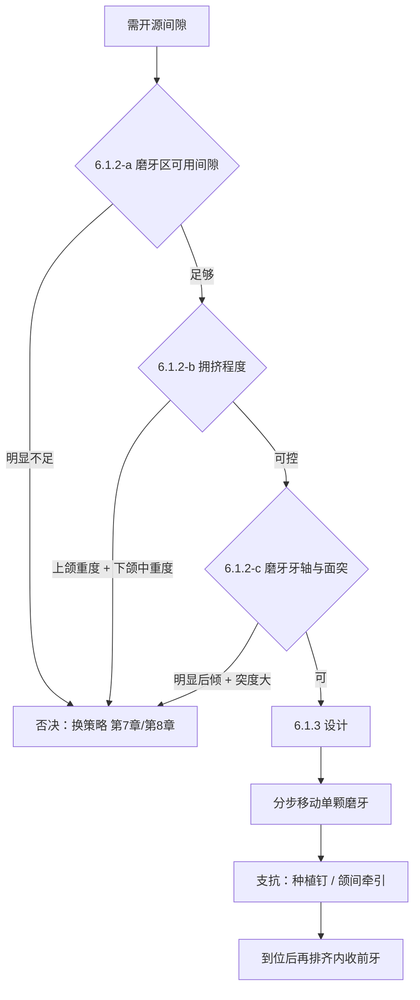

# 第 6 章 · 推磨牙向远中：适应证、禁忌与设计

> **层次**：本文件是**本库撰写层**（无底本表，不是源正文层）。依据是 T/CHSA 003—2021《口腔正畸无托槽隐形矫治技术指南》，条文登记于 `standards/kouqiang-zhengji/外源条文.json`。
> **依据**：`standards/kouqiang-zhengji/补源登记.json`（`python scripts/build_kouqiang_sources.py --all --check` 现算）。
> **免责**：本章为推磨牙策略的教学整理，不构成诊断或治疗建议；适应证与支抗设计以临床判断与现行标准为准。

---

## 本章要回答的问题

推磨牙向远中，是隐形矫治最常用的「开源」手段。但它也是最容易踩坑的策略：磨牙后方没有间隙、牙轴已经后倾、面部突度大 —— 这三类情况下硬推，会把一个可解的病例做成不可解的病例。

团标的写法很有特点：**先写适应证，紧接着写禁忌证，最后才写设计**。这个顺序本身是判据：禁忌在前，设计在后。

## N.1 概念与出处

| 环节 | 依据 | 要点 |
|---|---|---|
| 策略定位 | 外源·T/CHSA 003—2021 口腔正畸无托槽隐形矫治技术指南 第6.1条 | 常用策略之一的分则 |
| 适应证 | 外源·T/CHSA 003—2021 口腔正畸无托槽隐形矫治技术指南 第6.1.1条 | 哪些拥挤/关系可经远移磨牙解除 |
| 禁忌证 | 外源·T/CHSA 003—2021 口腔正畸无托槽隐形矫治技术指南 第6.1.2条 | 间隙不足、重度拥挤、磨牙后倾伴突度大 |
| 设计要点 | 外源·T/CHSA 003—2021 口腔正畸无托槽隐形矫治技术指南 第6.1.3条 | 分步移动单颗磨牙；种植钉或颌间牵引加强支抗 |
| 与分步的关系 | 外源·T/CHSA 003—2021 口腔正畸无托槽隐形矫治技术指南 第6.3.1条 | 分步模式属支抗设计（第 8 章） |

> 「经磨牙区间隙分析其可用间隙明显不足」（外源·T/CHSA 003—2021 口腔正畸无托槽隐形矫治技术指南 第6.1.2条）

这是禁忌证的第一条，也是最有操作意义的一条：**先做间隙分析，再决定推不推**。第6.1.2条列了三条禁忌 —— 可用间隙明显不足、上颌重度拥挤伴下颌中重度拥挤、磨牙牙轴明显后倾且面部突度较大。三条都指向同一个判断：磨牙后方是否有「可用的空间与可控的支抗」。

## N.2 为什么可以这样翻译：三道否决 → 一套设计

| 环节 | 判据 | 依据 |
|---|---|---|
| 间隙 | 磨牙区间隙分析：可用间隙是否足够远移量 | 第6.1.2条 a |
| 拥挤总量 | 上下颌拥挤度组合是否超出可解范围 | 第6.1.2条 b |
| 牙轴与面型 | 磨牙是否明显后倾、面部突度是否大 | 第6.1.2条 c |
| 分步 | 单颗磨牙分步远移，而非同时远移 | 第6.1.3条 |
| 支抗 | 种植钉、颌间牵引，避免前牙支抗消耗 | 第6.1.3条 |
| 时序 | 磨牙到位后再考虑排齐与内收前牙 | 第6.1.3条 |

**第6.1.3条的时序是本策略的核心技术点**：先把磨牙推到位，再动前牙。如果同时动，前牙会在磨牙远移过程中前移（支抗消耗），等于把「开源」变成「搬家」。

**「支抗消耗」为什么难以挽回**：推磨牙时，反作用力沿牙弓向前传，最先表现为前牙唇倾与覆盖增大。前牙一旦唇倾，后续再内收需要额外间隙 —— 而**间隙正是这次操作想获得的资源**。所以第6.1.3条要求先用种植钉或颌间牵引把反作用力接走，再谈移动。换句话说，支抗不是「让磨牙更容易后移」，而是「让前牙别乱动」。

**三种失效信号的观察点**（本项目增补，团标未写）：

| 信号 | 观察内容 | 出现时的处置 |
|---|---|---|
| 前牙唇倾 | 覆盖是否在磨牙远移期间增大 | 立刻加强支抗，暂停推磨牙 |
| 磨牙倾斜而非整体后移 | 牙冠后移但牙根未随之 | 改为分步+控根设计 |
| 后段贴合度下降 | 矫治器在磨牙区不贴合 | 评估是否脱轨，按第2章路径处置 |

## N.3 这个翻译丢掉了什么

1. **不给可用间隙的数值门槛**。「明显不足」是定性判断，没有毫米数。
2. **不给单颗磨牙每次移动量**。分步的步长与间隔不写。
3. **不给支抗选择的判据**。什么时候用种植钉、什么时候用牵引，不指定。
4. **不给「面突度大」的测量方法**。头影测量指标未指定。
5. **不给失败后的退路**。推不动时改拔牙还是改邻面去釉，团标不表态。
6. **不覆盖下颌磨牙远移的特殊限制**（下颌管、磨牙后区骨量），这些靠第4章影像判断。

## N.4 与相邻学科的接口

| 去向 | 接口 |
|---|---|
| 第 3 章 分级 | 需远移磨牙的病例常落在中度可预测档 |
| 第 4 章 资料 | 间隙分析与牙轴判断都依赖影像与模型测量 |
| 第 5 章 设计 | 分步与支抗是设计序列的组成部分 |
| 第 7 章 邻面去釉 | 远移不足时的补充止损手段 |
| 第 8 章 分步移动 | 单颗磨牙分步是第6.3.1条分步模式的具体应用 |
| 第 2 章 风险 | 支抗不足导致的「前牙前移」是主要风险项 |

## N.5 争议与本项目立场

**争议一：先推磨牙还是先去釉。** 两者都能开源。本项目立场：**先判间隙性质** —— 后段可用空间足则远移，釉质条件好且需量小则去釉；两者并用时先远移（去釉是不可逆的）。

**争议二：种植钉是否过度。** 第6.1.3条把种植钉列为「建议」而非必须。本项目立场：支抗需求超过可接受的前牙前移量时用钉；不用钉则须在设计里写明可接受的前移量。

**争议三：「明显不足」由谁判。** 单术者判断易乐观。本项目立场：间隙分析须留数值记录（可用间隙 mm 与需要间隙 mm），使「明显」可复核。

**本项目立场**：本策略的产出是**一张否决表 + 一条时序**。否决表三条全过才可设计；时序是「磨牙到位 → 前牙排齐内收」。两者缺一，都把技术问题变成不可逆的病例问题。

> **免责**：本章所列条文与判据不构成诊断或治疗建议；条文取义以现行有效的团体标准原文为准，标准修订后须重新核对条号。

## 小结

1. 推磨牙是「开源」策略，判据在禁忌证，不在适应证（第6.1.2条）。
2. 三条否决：可用间隙明显不足、上下颌拥挤组合过重、磨牙明显后倾伴面突大。
3. 设计要点：单颗磨牙分步远移；种植钉或颌间牵引加强支抗（第6.1.3条）。
4. 时序：磨牙到位后再排齐与内收前牙。
5. 「明显不足」须留数值记录，才可复核。
6. 去釉不可逆，故两种开源并用时先远移。

## 思考题

1. 一位患者上颌拥挤 6 mm、下颌拥挤 3 mm、磨牙区可用间隙 2 mm。按第6.1.2条，你的结论是什么？为什么？
2. 不用种植钉时，你如何设定「可接受的前牙前移量」并写进设计？
3. 为什么必须先远移磨牙、再排齐前牙？如果顺序反过来会发生什么？
4. 「磨牙牙轴明显后倾」用哪种影像判据最可靠？为什么？

## 延伸阅读

- 外源·T/CHSA 003—2021 口腔正畸无托槽隐形矫治技术指南 第6.1、6.1.1–6.1.3、6.3.1 条
- 本库专题：[`standards/kouqiang-zhengji/专题-正畸操作路径.md`](../../../standards/kouqiang-zhengji/专题-正畸操作路径.md)
