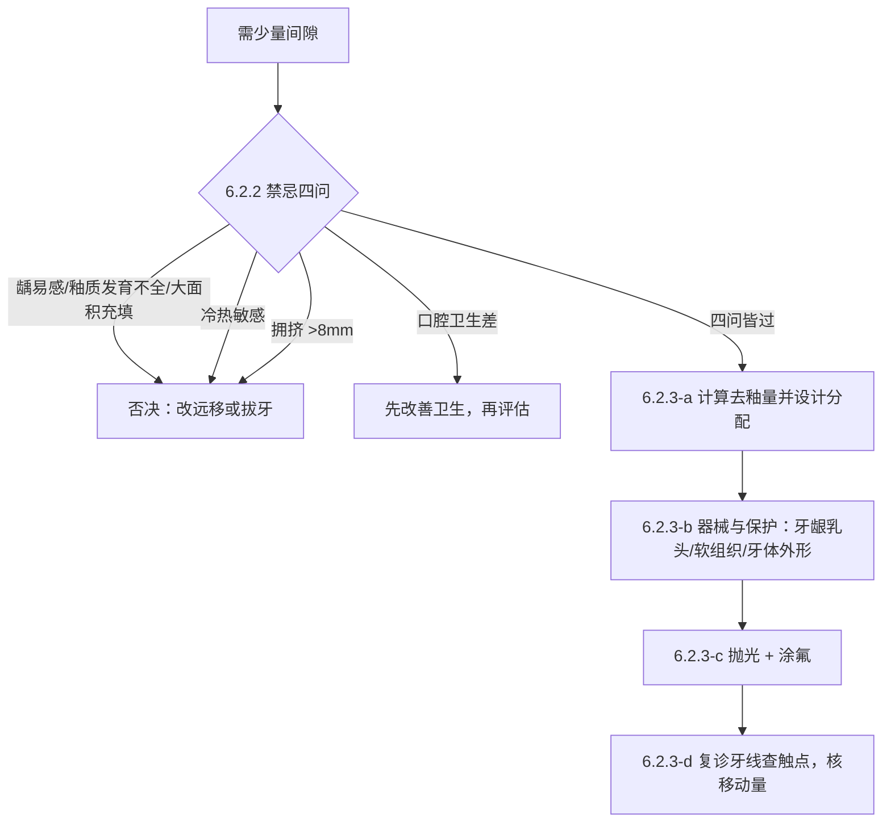

# 第 7 章 · 邻面去釉：适应证、禁忌与操作规范

> **层次**：本文件是**本库撰写层**（无底本表，不是源正文层）。依据是 T/CHSA 003—2021《口腔正畸无托槽隐形矫治技术指南》，条文登记于 `standards/kouqiang-zhengji/外源条文.json`。
> **依据**：`standards/kouqiang-zhengji/补源登记.json`（`python scripts/build_kouqiang_sources.py --all --check` 现算）。
> **免责**：本章为邻面去釉的教学整理，不构成诊断或治疗建议；去釉量、适应证与防龋处置以临床判断与现行标准为准。

---

## 本章要回答的问题

邻面去釉是**不可逆**的操作：磨掉的釉质不会长回来。团标因此把禁忌证写得很具体（牙齿条件、敏感、口腔卫生、拥挤程度），并把操作规范写成四步（计量与分配、器械与保护、抛光与氟化、复诊核查）。

本章的核心判断是：**去釉不是「磨一点」，而是一次需要事先计划的取舍**。

## N.1 概念与出处

| 环节 | 依据 | 要点 |
|---|---|---|
| 策略定位 | 外源·T/CHSA 003—2021 口腔正畸无托槽隐形矫治技术指南 第6.2条 | 获取间隙的常用策略 |
| 适应证 | 外源·T/CHSA 003—2021 口腔正畸无托槽隐形矫治技术指南 第6.2.1条 | 需少量间隙、釉质条件允许的病例 |
| 禁忌证 | 外源·T/CHSA 003—2021 口腔正畸无托槽隐形矫治技术指南 第6.2.2条 | 龋易感/釉质发育不全/大面积充填、敏感、口腔卫生差、重度拥挤（>8 mm） |
| 操作规范 | 外源·T/CHSA 003—2021 口腔正畸无托槽隐形矫治技术指南 第6.2.3条 | 计量分配 → 器械与保护 → 抛光与氟化 → 复诊核查 |

> 「龋病易感者，釉质发育不全或有大面积充填体的患牙」（外源·T/CHSA 003—2021 口腔正畸无托槽隐形矫治技术指南 第6.2.2条）

第一条禁忌就否掉了一整类患者：**釉质不够好的人不做**。这条与「微创」的逻辑一致 —— 去釉本身就是减法，减法只应在可承受的牙体上做。

## N.2 为什么可以这样翻译：禁忌四问 → 操作四步

| 步骤 | 判据 | 依据 |
|---|---|---|
| 计量与分配 | 每牙去釉量 + 间隙分配 + 时机与部位 | 第6.2.3条 a |
| 器械 | 高速金刚砂车针、慢速金刚砂片、金刚砂条结合使用 | 第6.2.3条 b |
| 保护 | 保护牙龈乳头与唇舌软组织；保证牙齿外形与触点正常 | 第6.2.3条 b |
| 防龋 | 去釉后抛光并涂氟化物凝胶或泡沫 | 第6.2.3条 c |
| 核查 | 复诊用牙线检查触点，确认是否实现预期移动量 | 第6.2.3条 d |

**第6.2.3条 d 是最容易被跳过的一步**：去釉后不复核，等于不知道间隙有没有真的被用上。这一步把「操作」变成「可验证的操作」。

**去釉量怎么算（方法而非数字）**：第6.2.3条 a 要求「计算去釉量并设计间隙分配」，但团标不给公式。可操作的做法是三步倒推：

1. **先算需要量**：由拥挤量或内收需求确定总共需要多少间隙（毫米），这个数来自第 3 章分级的拥挤测量。
2. **再算可用量**：逐邻面估算可去釉厚度（受釉质厚度与牙体形态限制，需影像与模型支持），得到上限。
3. **最后分配**：把需要量按牙位分配到具体邻面，并注明释放时点（与第 8 章的分步节奏一致）。

三步的意义是让「磨多少」变成**事先约定**，而不是术中的手感。触觉上「还能再磨一点」永远成立，这正是不可逆操作的陷阱。

**去釉的两个常见越界**（本项目立场）：

- **把去釉当止损手段**：远移磨牙失败后临时加去釉，等于在未做釉质评估的情况下做不可逆操作。
- **用去釉凑间隙以缩短疗程**：间隙够了但牙根位置不允许，移动仍然会脱轨。

## N.3 这个翻译丢掉了什么

1. **不给单牙去釉量的上限**。每颗牙最多去多少毫米，团标不写（这是牙体解剖与釉质厚度的领域）。
2. **不给单次就诊的去釉牙数上限**。一次能做几颗，不指定。
3. **不给拥挤的中间阈值**。只写「重度 >8 mm」不可单靠去釉，中间区间如何组合处理未写。
4. **不给抛光器械与氟化物的具体规格**。只给类别。
5. **不给「触点正常」的判据**。外形与触点「正常」如何核查（牙线通过感？肉眼？）不指定。
6. **不涉及患者感受与依从**。敏感是禁忌，但术后敏感的发生与处理未展开。

## N.4 与相邻学科的接口

| 去向 | 接口 |
|---|---|
| 第 4 章 资料 | 去釉量计算依赖模型测量的邻面釉质厚度与可用间隙 |
| 第 5 章 设计 | 去釉是「预先给的间隙」，必须写进设计序列的时点 |
| 第 6 章 推磨牙 | 两者并用时先远移（去釉不可逆） |
| 第 8 章 分步移动 | 去釉后的间隙按分步节奏释放，避免一次开太大 |
| 第 2 章 风险 | 敏感、釉质损伤、龋风险属告知范围 |
| 病历与质控 | 五步记录（计量/器械/保护/涂氟/核查）可勾选 |

## N.5 争议与本项目立场

**争议一：去釉算不算「微创」。** 支持者认为比拔牙微创；反对者指出它不可逆。本项目立场：**不可逆 ≠ 不微创，但必须前置判断** —— 禁忌四问就是把「可承受」写死。

**争议二：卫生差的患者要不要先做。** 第6.2.2条把口腔卫生差列为禁忌。本项目立场：**先改善再评估**，而不是永久拒绝；改善后按同一四问重评。

**争议三：去釉后一定要复诊核查吗。** 第6.2.3条 d 要求复诊牙线查触点。本项目立场：**核查入病历**，因为它同时验证了「间隙是否按设计释放」与「触点关系是否正常」两件事。

**本项目立场**：去釉的产出不是「磨完了」，而是**四条记录**：去釉量（每牙）、器械与保护措施、抛光与涂氟、复诊核查结果。四条齐，操作才可复现、可追溯。

> **免责**：本章所列条文与判据不构成诊断或治疗建议；条文取义以现行有效的团体标准原文为准，标准修订后须重新核对条号。

## 小结

1. 去釉是不可逆操作，判据在禁忌证（第6.2.2条）。
2. 四问：龋易感/釉质差/大面积充填、敏感、卫生差、拥挤 >8 mm。
3. 四步操作：计量分配、器械与保护、抛光与氟化、复诊核查（第6.2.3条）。
4. 去釉量必须事先计算并按牙分配，不能「边看边磨」。
5. 复诊牙线核查是操作的一部分，不是可选项。
6. 与远移并用时，先远移。

## 思考题

1. 一位患者拥挤 6 mm、口腔卫生一般、前牙有 2 颗树脂充填。按第6.2.2条，逐条判断能否去釉。
2. 为什么「去釉量」必须事先计算？如果不计算，哪一环节会失控？
3. 复诊牙线核查能同时验证哪两件事？
4. 口腔卫生差被判禁忌后，你会设定什么改善标准再复评？

## 延伸阅读

- 外源·T/CHSA 003—2021 口腔正畸无托槽隐形矫治技术指南 第6.2、6.2.1–6.2.3 条
- 本库专题：[`standards/kouqiang-zhengji/专题-正畸操作路径.md`](../../../standards/kouqiang-zhengji/专题-正畸操作路径.md)
