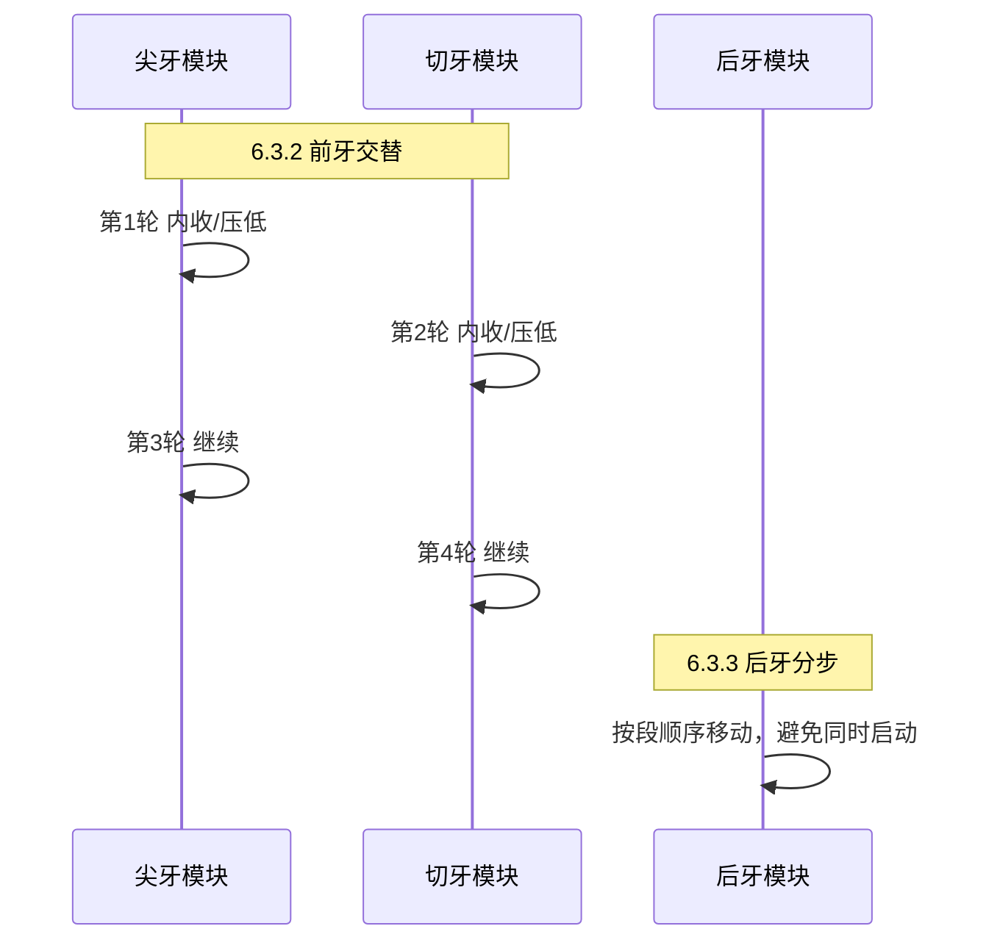

# 第 8 章 · 分步移动：为什么不能一次到位

> **层次**：本文件是**本库撰写层**（无底本表，不是源正文层）。依据是 T/CHSA 003—2021《口腔正畸无托槽隐形矫治技术指南》，条文登记于 `standards/kouqiang-zhengji/外源条文.json`。
> **依据**：`standards/kouqiang-zhengji/补源登记.json`（`python scripts/build_kouqiang_sources.py --all --check` 现算）。
> **免责**：本章为分步移动策略的教学整理，不构成诊断或治疗建议；具体设计以临床判断与现行标准为准。

---

## 本章要回答的问题

固定矫治可以「一次加力、多牙同时走」，隐形矫治为什么不行？团标给的理由是材料层面的：

> 「无托槽隐形矫治技术由于使用压膜材料制作矫治器，刚性不足，生物力学性能也与传统固定矫治器有所差异。」（外源·T/CHSA 003—2021 口腔正畸无托槽隐形矫治技术指南 第6.3.1条）

刚性不足 → 单靠矫治器无法同时精确控制多颗牙 → 必须**分步**：把牙分成模块，交替移动，用「少量多次」换「精度」。这句话解释了分步的技术必然性，也解释了为什么分步模式是**支抗设计**的一部分。

## N.1 概念与出处

| 环节 | 依据 | 要点 |
|---|---|---|
| 为什么分步 | 外源·T/CHSA 003—2021 口腔正畸无托槽隐形矫治技术指南 第6.3.1条 | 压膜材料刚性不足，生物力学不同于固定矫治，需单颗牙或组牙分步 |
| 分步的性质 | 外源·T/CHSA 003—2021 口腔正畸无托槽隐形矫治技术指南 第6.3.1条 | 分步模式是**支抗设计的组成部分** |
| 前牙分步 | 外源·T/CHSA 003—2021 口腔正畸无托槽隐形矫治技术指南 第6.3.2条 | 尖牙与切牙分组、交替移动，完成内收或压低 |
| 后牙分步 | 外源·T/CHSA 003—2021 口腔正畸无托槽隐形矫治技术指南 第6.3.3条 | 后牙分步移动的要点 |
| 推磨牙分步 | 外源·T/CHSA 003—2021 口腔正畸无托槽隐形矫治技术指南 第6.1.3条 | 单颗磨牙分步远移，配合支抗加强 |

## N.2 为什么可以这样翻译：模块交替的时序图

| 判据 | 可核内容 | 依据 |
|---|---|---|
| 是否分步 | 移动类型（倾斜/整体/压低）与牙数 | 第6.3.1条 |
| 分组方式 | 尖牙与切牙分组、交替；后牙分段 | 第6.3.2、6.3.3条 |
| 支抗支撑 | 种植钉、颌间牵引、模块间互为支抗 | 第6.3.1、6.1.3条 |
| 每步量 | 单步移动量在可控范围 | 第6.3.1条（刚性限制） |

**「分步即支抗设计」这句话的实际含义**：当尖牙在内收时，切牙是支抗；切牙移动时，尖牙是支抗。分步把「同时反作用」变成「轮流承担」，所以支抗不是外加的钉子，而是**模块之间的关系**。

**分步与疗程的权衡**（本项目增补）：分步越细，单步移动量越小、精度越高，但牙套数与复诊次数上升；分步越粗，疗程短，但脱轨概率上升、重启风险变大。取舍的判据不是「快慢」，而是**该步的移动类型**：

| 移动类型 | 建议粒度 | 理由 |
|---|---|---|
| 倾斜移动 | 可粗（多牙同步） | 力学需求低，刚性不足影响小 |
| 整体移动 | 宜细（少牙同步） | 需控根，刚性不足会表现为牙冠到位、牙根滞后 |
| 压低 | 宜细 | 压低对支抗与力的方向极敏感 |
| 旋转 | 宜细且需附件配合 | 隐形矫治对旋转控制最弱 |

**为什么旋转最难**：圆形的牙冠对矫治器的包裹力最难传递，旋转往往需要额外附件或局部固定装置。这也是第2章把「辅以其他装置」写进风险条款的原因之一 —— 它不是意外，而是可预判的分支。

## N.3 这个翻译丢掉了什么

1. **不给每步的移动量上限**。倾斜、整体、压低各自的安全步长，不写。
2. **不给模块划分的具体规则**。几颗一组、什么时候合并，靠分则与经验。
3. **不给步数与牙套数的换算**。每步对应几副牙套，不指定。
4. **不给失败判据**。分步没跟上时如何识别（贴合度？移动量？），未量化。
5. **不给后牙分步的完整清单**。第6.3.3条在指南中较简，细节需回原文。
6. **不涉及与附件的关系**。附件如何配合分步，只在设计流程层面提及。

## N.4 与相邻学科的接口

| 去向 | 接口 |
|---|---|
| 第 5 章 设计 | 分步序列即设计的「移动顺序」一步 |
| 第 6 章 推磨牙 | 单颗磨牙分步远移是本章的特例 |
| 第 7 章 邻面去釉 | 去釉释放的间隙按分步节奏使用，避免一次开太大 |
| 第 2 章 风险 | 分步不足 → 脱轨；分步过度 → 疗程延长 |
| 第 9–10 章 儿童 | 儿童牙根发育阶段影响可用的移动速度 |
| 病历与质控 | 分组方案 + 每步记录 = 可复核的执行链 |

## N.5 争议与本项目立场

**争议一：分步是为了精度还是为了省牙套。** 团标给的理由是精度（刚性不足）。本项目立场：**以精度为目的的分步才有意义**；为省牙套而合并步骤，是把材料限制当成可协商项。

**争议二：分步越细越好吗。** 不是。分步过细会拉长疗程、增加依从负担。本项目立场：**按移动类型定粒度** —— 整体移动与压低需细，倾斜移动可粗。

**争议三：分步失败如何认定。** 团标不给判据。本项目立场：以「贴合度 + 计划移动量与实际移动量的偏差」双判据，任一超限即判定该步未达成，进入第2章的重启/辅具路径。

**本项目立场**：分步章的产出是**一张模块时序表**：谁先动、谁做支抗、每步量。没有这张表，「分步」就只是一个说法，无法交接、无法复核。

> **免责**：本章所列条文与判据不构成诊断或治疗建议；条文取义以现行有效的团体标准原文为准，标准修订后须重新核对条号。

## 小结

1. 分步的技术原因是压膜材料刚性不足（第6.3.1条）。
2. 分步模式是支抗设计的组成部分，不是纯粹的技巧。
3. 前牙：尖牙与切牙分组交替移动，完成内收或压低（第6.3.2条）。
4. 后牙：按段分步，避免同时启动（第6.3.3条）。
5. 推磨牙策略要求单颗磨牙分步 + 支抗加强（第6.1.3条）。
6. 分步失败以「贴合度 + 移动偏差」双判据认定（项目增补）。

## 思考题

1. 为什么「分步即支抗设计」？请用模块互为支抗的关系解释一句。
2. 一个需要内收前牙 4 mm 的病例，你会把尖牙与切牙如何分组？为什么这样分？
3. 分步过细的代价是什么？你会用什么标准定粒度？
4. 「贴合度 + 移动偏差」双判据里，你认为哪一个更早发出警告？

## 延伸阅读

- 外源·T/CHSA 003—2021 口腔正畸无托槽隐形矫治技术指南 第6.1.3、6.3.1–6.3.3 条
- 本库专题：[`standards/kouqiang-zhengji/专题-正畸操作路径.md`](../../../standards/kouqiang-zhengji/专题-正畸操作路径.md)
