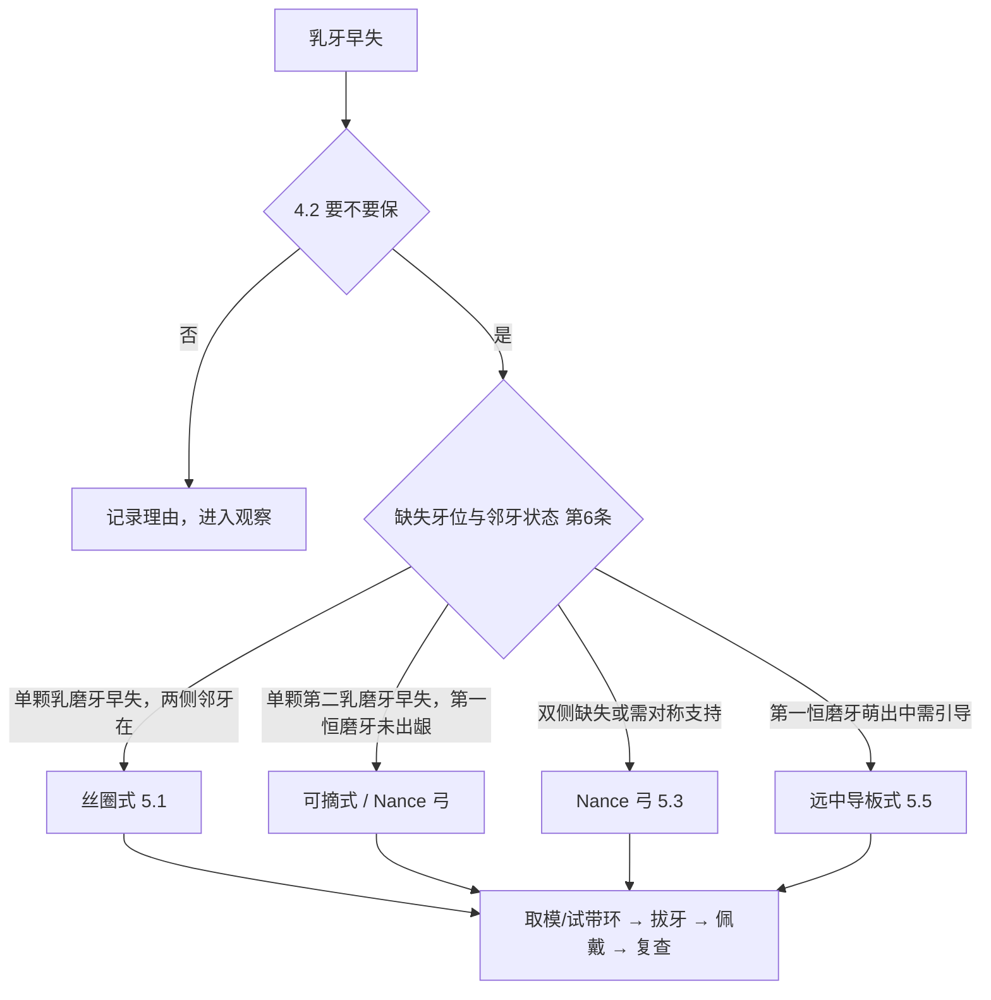

# 第 9 章 · 儿童间隙管理：五类保持器与选择

> **层次**：本文件是**本库撰写层**（无底本表，不是源正文层）。依据是中华口腔医学会团体标准 T/CHSA 010-2022《儿童间隙保持器临床应用专家共识》，条文登记于 `standards/kouqiang-zhengji/外源条文.json`。
> **依据**：`standards/kouqiang-zhengji/补源登记.json`（`python scripts/build_kouqiang_sources.py --all --check` 现算）。
> **免责**：本章为间隙管理的教学整理，不构成诊断或治疗建议；适应证与装置选择以临床判断与现行标准为准。

---

## 本章要回答的问题

乳牙早失，家长最常问的是「装哪个」。共识的写法是先回答另一个问题：**这段间隙会不会丢，丢了有什么后果**（第4.1、4.2条），然后才给分类（第4.4条）与选择建议（第6条）。

> 「间隙保持器按照能否自行摘戴分为固定式和活动式两种类型。」（外源·T/CHSA 010-2022 儿童间隙保持器临床应用专家共识 第4.4条）

分类只有两级：固定式与活动式。但第4.4条的表把每一类的优缺点写全了 —— 这正是选择建议的依据。

## N.1 概念与出处

| 环节 | 依据 | 要点 |
|---|---|---|
| 为什么会丢间隙 | 外源·T/CHSA 010-2022 儿童间隙保持器临床应用专家共识 第4.1条 | 乳牙早失后的间隙变化机制 |
| 要不要保 | 外源·T/CHSA 010-2022 儿童间隙保持器临床应用专家共识 第4.2条 | 间隙保持的意义与适应证边界 |
| 分类 | 外源·T/CHSA 010-2022 儿童间隙保持器临床应用专家共识 第4.4条 | 固定式（丝圈式、舌弓式、Nance 弓、远中导板式）与活动式（可摘式） |
| 丝圈式 | 外源·T/CHSA 010-2022 儿童间隙保持器临床应用专家共识 第5.1条 | 适应证、结构、步骤与注意事项 |
| Nance 弓 | 外源·T/CHSA 010-2022 儿童间隙保持器临床应用专家共识 第5.3条 | 适应证与结构 |
| 远中导板式 | 外源·T/CHSA 010-2022 儿童间隙保持器临床应用专家共识 第5.5条 | 适应证与结构 |
| 选择建议 | 外源·T/CHSA 010-2022 儿童间隙保持器临床应用专家共识 第6条 | 按缺失牙位与邻牙状态分档 |

**第4.4条表里的关键信息**：固定式「不需取戴、维持近远中径可靠」，但「口腔卫生不易清洁」；活动式「恢复咀嚼功能、美观便于发音、可预防不良习惯」，但「需定期更换及调磨、异物感强、不合作者效果差」。选择建议（第6条）就是在这两组优缺点之间配对。

## N.2 为什么可以这样翻译：两问 → 一表

| 情形（第6条口径） | 选型 | 依据 |
|---|---|---|
| 单颗乳磨牙早失、两侧邻牙存在 | 丝圈式 | 第6条 6.1、第5.1条 |
| 单颗第二乳磨牙早失、第一恒磨牙未出龈 | 可摘式（基托后缘与早失前远中面一致） | 第6条 6.2、第4.4条 |
| 双侧缺失、需腭侧支持 | Nance 弓 | 第5.3条 |
| 需引导第一恒磨牙萌出 | 远中导板式 | 第5.5条 |
| 患儿不合作、卫生极差 | 固定式优先（活动式效果差） | 第4.4条 |

第6条还给了一个**流程优化**的建议：在无法保留的乳牙拔除前，先完成基牙试带环或金属预成冠、取印模、灌注模型，拔牙创愈合后复诊佩戴 —— 这样可以减少就诊次数。这类「时序安排」是共识里最实用的部分。

## N.3 这个翻译丢掉了什么

1. **不给保持期限**。要保到什么时候（后继恒牙萌出到哪个阶段），未量化。
2. **不给复查间隔**。多久复诊、看什么，未指定。
3. **不给失败判据**。保持器脱落、变形、基牙龋的处理路径未写。
4. **不给活动式的依从门槛**。「不合作者效果差」是定性描述，没有判据。
5. **不覆盖第二恒磨牙区的间隙管理**。共识以乳磨牙早失为主。
6. **不给费用与家长接受度的讨论**。选择建议不谈经济因素。

## N.4 与相邻学科的接口

| 去向 | 接口 |
|---|---|
| 第 3 章 分级 | 儿童病例的分级需叠加牙列阶段（本项目增补） |
| 第 4 章 资料 | 选型依赖模型与影像：缺牙位、邻牙状态、恒牙胚位置 |
| 第 6 章 推磨牙 | 间隙保持与远移磨牙在「间隙管理」上是同一条逻辑 |
| 第 10 章 异位萌出 | 第一恒磨牙异位萌出常与乳磨牙早失并见，两者需联合判断 |
| 第 2 章 风险 | 依从性（儿童 + 家长）是活动式的主要风险 |
| 病历与质控 | 「要不要保 → 选哪型 → 时序」三步记录可勾选 |

## N.5 争议与本项目立场

**争议一：活动式还是固定式优先。** 第4.4条列出各自优缺点，未排序。本项目立场：**先看合作度与卫生**，再谈功能与美观 —— 不合作者用活动式等于没装。

**争议二：早期拔牙前取模算不算过度。** 第6条建议拔牙前完成试带环与取模以减少就诊次数。本项目立场：这是**流程优化**，前提是诊断已定、拔牙不可避免；否则先取模会做无用功。

**争议三：保持期限由谁定。** 共识不给期限。本项目立场：以**后继恒牙萌出阶段**为节点，并在病历里写明「下一个评估节点」而非笼统的「定期复查」。

**本项目立场**：间隙管理的产出是**三步记录**：要不要保（含理由）、选哪一型（含优缺点配对）、时序（拔牙前/后各做什么）。三步之外，还要写清「谁负责复查」——儿童病例的随诊最容易在换医生时断掉。

> **免责**：本章所列条文与判据不构成诊断或治疗建议；条文取义以现行有效的团体标准原文为准，标准修订后须重新核对条号。

## 小结

1. 先答「要不要保」（第4.2条），再答「装哪个」（第6条）。
2. 分类两级：固定式（丝圈、舌弓、Nance、远中导板）与活动式（第4.4条）。
3. 选型的关键判据是缺失牙位 + 邻牙状态 + 恒牙萌出阶段。
4. 固定式可靠但难清洁；活动式功能美观好但不合作者无效。
5. 时序优化：拔牙前完成试带环与取模，减少就诊次数（第6条）。
6. 保持期限与复查间隔共识不给，须以恒牙萌出阶段为节点自定。

## 思考题

1. 一位 7 岁儿童第二乳磨牙早失、第一恒磨牙尚未出龈。按第6条，你会选哪一型？基托后缘如何确定？
2. 患儿卫生极差、家长配合度低，你会在固定式与活动式之间如何取舍？理由是什么？
3. 「拔牙前取模」的流程优化在什么情况下会变成浪费？请给出两条前提。
4. 保持期限若以后继恒牙萌出阶段为节点，你会设哪几个评估点？

## 延伸阅读

- 外源·T/CHSA 010-2022 儿童间隙保持器临床应用专家共识 第4.1、4.2、4.4、5.1、5.3、5.5、6 条
- 本库专题：[`standards/kouqiang-zhengji/专题-正畸操作路径.md`](../../../standards/kouqiang-zhengji/专题-正畸操作路径.md)
