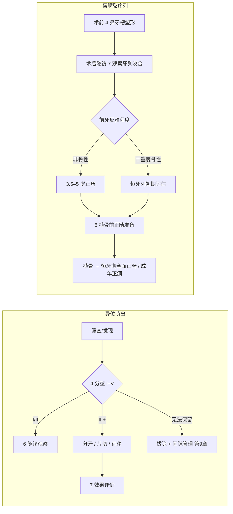

# 第 10 章 · 异位萌出与唇腭裂序列中的正畸

> **层次**：本文件是**本库撰写层**（无底本表，不是源正文层）。依据是 T/CHSA 005—2022《上颌第一恒磨牙异位萌出临床诊疗专家共识》（4 条）与 T/CHSA 001-2022《唇腭裂序列治疗指南》（3 条相关条），条文登记于 `standards/kouqiang-zhengji/外源条文.json`。
> **依据**：`standards/kouqiang-zhengji/补源登记.json`（`python scripts/build_kouqiang_sources.py --all --check` 现算）。
> **免责**：本章为异位萌出与唇腭裂序列正畸的教学整理，不构成诊断或治疗建议；分型、手术与正畸时点须由序列治疗团队决定。

---

## 本章要回答的问题

这一章把两个看似无关的题目放在一起，因为它们共享同一个结构：**时点决定方案**。

- 上颌第一恒磨牙异位萌出：五条处理路径（随诊观察、分牙、片切、远移、拔除）按分型与时点排列，顺序本身是决策树。
- 唇腭裂序列：正畸在序列中的位置由「术前干预 → 植骨 → 恒牙期矫治」的时间轴决定。

两者都验证了一件事：儿童期的干预不是「做不做」，而是「什么时候做」。

## N.1 概念与出处

### 一、上颌第一恒磨牙异位萌出

> 「上颌第一恒磨牙异位萌出应遵循早发现、早诊断、早治疗的原则」（外源·T/CHSA 005—2022 上颌第一恒磨牙异位萌出临床诊疗专家共识 第6条）

| 环节 | 依据 | 要点 |
|---|---|---|
| 检查与诊断分型 | 外源·T/CHSA 005—2022 上颌第一恒磨牙异位萌出临床诊疗专家共识 第4条 | 分型是路径选择的前提 |
| 危险因素与危害 | 外源·T/CHSA 005—2022 上颌第一恒磨牙异位萌出临床诊疗专家共识 第5条 | 为什么必须早期干预 |
| 五条治疗路径 | 外源·T/CHSA 005—2022 上颌第一恒磨牙异位萌出临床诊疗专家共识 第6条 | 随诊观察、分牙、片切、远移、拔除 |
| 效果评价 | 外源·T/CHSA 005—2022 上颌第一恒磨牙异位萌出临床诊疗专家共识 第7条 | 干预后如何判定成功 |

第6条的细节值得抄下来：**I 级或 II 级**（相邻第二乳磨牙牙根仅牙骨质或少量牙本质吸收）建议保守治疗、先随诊观察；随分型加重再升级到分牙、片切、远移，最后才是拔除。五条路径从「不动」到「拔除」，**顺序即决策树**。

### 二、唇腭裂序列治疗中的正畸

> 「腭裂术后建议密切观察患儿牙列、咬合及生长发育情况。」（外源·T/CHSA 001-2022 唇腭裂序列治疗指南 第7条）

| 环节 | 依据 | 要点 |
|---|---|---|
| 外科前治疗 | 外源·T/CHSA 001-2022 唇腭裂序列治疗指南 第4条 | 鼻牙槽塑形等术前干预 |
| 正畸的位置与时机 | 外源·T/CHSA 001-2022 唇腭裂序列治疗指南 第7条 | 前牙反𬌗分骨性/非骨性定时点；植骨前可先正畸 |
| 植骨与正畸衔接 | 外源·T/CHSA 001-2022 唇腭裂序列治疗指南 第8条 | 牙槽突裂植骨与正畸的衔接 |

第7条给了一套**按程度定时点**的判据：非骨性前牙反𬌗可于 3 岁半至 5 岁开始治疗，以解除反𬌗、防止骨性化；中重度骨性反𬌗可延迟至恒牙列初期评估；植骨术前若骨段落差明显，可先正畸旋转骨段、排齐牙弓、竖直倾斜牙，为植骨做准备；严重骨性畸形则需成年后正畸—正颌联合治疗。

## N.2 为什么可以这样翻译：两条时间轴

| 判据 | 记录内容 | 依据 |
|---|---|---|
| 异位萌出分型 | I–V 级 + 第二乳磨牙牙根吸收程度 | YY 第4、6条 |
| 处置路径 | 观察/分牙/片切/远移/拔除 + 选择理由 | YY 第6条 |
| 效果 | 咬合建立、间隙与牙根状况 | YY 第7条 |
| 唇腭裂反𬌗类型 | 骨性/非骨性 + 程度 | CL 第7条 |
| 时点 | 3.5–5 岁 / 恒牙列初期 / 成年 | CL 第7条 |
| 植骨衔接 | 骨段落差、牙弓排齐、牙轴竖直 | CL 第7、8条 |

## N.3 这个翻译丢掉了什么

1. **不给分型的影像量化标准**。I–V 级的判定依赖第二乳磨牙牙根吸收程度，但具体影像判读阈值不写。
2. **不给「观察」的复查间隔**。随诊观察是路径之一，多久看一次不指定。
3. **不给五条路径的成功率**。共识给路径不给预后数字。
4. **不给唇腭裂各阶段的年龄硬边界**。第7条给的是区间（3 岁半至 5 岁）与相对表述（可延迟至恒牙列初期），最终由团队判断。
5. **不覆盖心理与家庭因素**。序列治疗长达十余年，依从与家庭支持未展开。
6. **两份文件之间没有交叉引用**。异位萌出与唇腭裂同时存在时如何排序，需自行判断。

## N.4 与相邻学科的接口

| 去向 | 接口 |
|---|---|
| 第 4 章 资料 | 分型依赖曲面断层；本章的判据质量由第 4 章决定 |
| 第 9 章 间隙管理 | 异位萌出导致第二乳磨牙早失时，进入第 9 章的保持器路径 |
| 第 3 章 分级 | 儿童特殊病例的可预测性分级需叠加生长因素（项目增补） |
| 第 6 章 推磨牙 | 「远移」在异位萌出里是治疗手段，在隐形矫治里是开源策略，同名不同义 |
| 第 2 章 风险 | 序列治疗的长周期属于风险告知内容 |
| 病历与质控 | 两张时间轴表可勾选，是跨科室协作的记录骨架 |

## N.5 争议与本项目立场

**争议一：早干预 vs 等生长。** 异位萌出强调早发现早治疗；唇腭裂的中重度骨性反𬌗则倾向等到恒牙列初期甚至成年。两者不矛盾 —— 判据在**是否可逆**：可逆的（牙根尚轻吸收）早做成本低；需骨性改变的晚做收益大。

**争议二：五条路径是否必须逐级升级。** 第6条给的是从保守到有创的序列。本项目立场：**允许跨级，但须记录理由**（如牙根吸收迅速，观察无意义）。

**争议三：谁来做序列决策。** 唇腭裂序列需要团队（外科、正畸、语音、心理）。本项目立场：**正畸在序列里是参与者不是决定者**，教材应写明「时点由团队定」，避免单科越权。

**本项目立场**：本章的产出是**两张时间轴 + 一个排序规则**。当两份文件同时适用时，按「可逆性」排序：先做不可逆后果最小的干预。

> **免责**：本章所列条文与判据不构成诊断或治疗建议；条文取义以现行有效的团体标准原文为准，标准修订后须重新核对条号。

## 小结

1. 异位萌出：先分型（第4条），再按 I/II 级保守、III 级以上升级处理（第6条）。
2. 五条路径：随诊观察 → 分牙 → 片切 → 远移 → 拔除，顺序即决策树。
3. 唇腭裂：非骨性反𬌗 3 岁半至 5 岁可治；中重度骨性延迟至恒牙列初期。
4. 植骨前若骨段落差明显，可先正畸为植骨做准备（第7、8条）。
5. 严重骨性畸形需成年后正畸—正颌联合。
6. 两文件同时适用时，按「可逆性」排序干预。

## 思考题

1. 一位 8 岁儿童上颌第一恒磨牙异位萌出、第二乳磨牙牙根吸收达牙本质深层。按第6条，你会选哪条路径？为什么不是观察？
2. 唇腭裂患儿 4 岁、前牙非骨性反𬌗，家长希望等换牙后再治。请用第7条说明为什么不应等。
3. 「五条路径允许跨级但须记录理由」——你会把理由写成哪几个要素？
4. 当异位萌出与唇腭裂并存时，按「可逆性排序」你会先处理哪一个？理由是什么？

## 延伸阅读

- 外源·T/CHSA 005—2022 上颌第一恒磨牙异位萌出临床诊疗专家共识 第4–7 条
- 外源·T/CHSA 001-2022 唇腭裂序列治疗指南 第4、7、8 条
- 本库专题：[`standards/kouqiang-zhengji/专题-正畸操作路径.md`](../../../standards/kouqiang-zhengji/专题-正畸操作路径.md)
