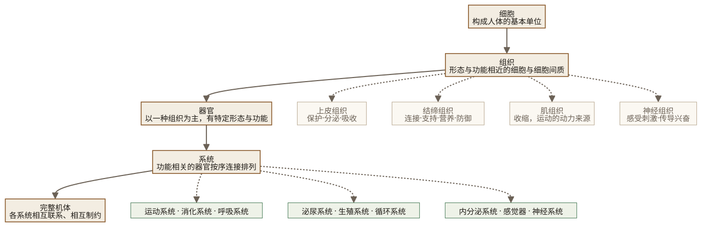

# 第 1 章 · 绪论

> **源**：`qhzy-人体解剖学.xlsx` · 表「01 绪论」 · 源文 22,911 字
> **抽取**：`node scripts/import_textbooks.js --only 人体解剖学` · sha256 `170a40b43590f4d0…` · 2026-10-21
> **层次**：本文件是**源教材正文层** —— 节次取自源表的结构列，文字未改写、未压缩、未抽样。改写层（N.3「这个翻译丢掉了什么」/ N.5「争议与本项目立场」）尚未撰写，见 `textbooks/README.md` 章契约。

---

## 1.1 人体解剖学的定义与人体的组成

### 1.1.1 人体解剖学的定义与研究对象

人体解剖学的定义与研究对象（只写结构与功能与位置与毗邻的类别与关系，不写数值与单位与尺寸与数量与角度，不作诊断与病情与预后判定）

【学习目标】 1. 说出人体解剖学的定义与研究对象，理解这门课程在医学基础课程体系中的位置。 2. 说明人体的组成层次与系统划分的类别，认识系统划分所依据的统一口径。 3. 归纳器官与组织与细胞之间的层次关系，体会结构与功能相互依存的联系。 4. 列举解剖学分科的类别，比较各分科在观察角度与应用范围上的差别。 5. 概括学习方法与观察方法的类别，能按六要素完成标本与模型与影像资料的观察与记录。 6. 梳理国外与我国解剖学发展史的类别，认识学科发展中伦理与规范的演进。 7. 陈述解剖学姿势与方位术语与轴与面的类别，按平台承载口径与数据门禁要求完成观察与表述。 人体解剖学（human anatomy）是研究正常人体形态结构的科学，属于形态学的范畴。它以肉眼观察所能辨认的层次为主要窗口，借助观察与描述与记录的方法，回答人体由哪些部分构成、这些部分位于何处、彼此如何毗邻、结构的形态与功能之间保持着怎样的联系。对中医药院校的本科生而言，这门课程是进入医学殿堂的入门课程，也是后续学习组织学与胚胎学与生理学与病理学以及中医基础理论的共同基础。 从研究对象上看，人体解剖学关注正常人体的躯体形态与内部结构以及结构与功能的联系，包括由骨与骨连结与肌构成的运动装置，由消化管与肝与肺与肾与胃与膀胱与生殖器官构成的内脏，由心与动脉与静脉与淋巴管道构成的脉管系统，由甲状腺与垂体等构成的内分泌器官，由眼球与内耳等构成的感觉器，以及由脊髓与脑与脑神经与神经构成的神经系统。它描述结构本身的形态与位置与毗邻的类别与关系，而不针对某个具体的人作出判断。 课程的边界需要在开篇讲清。本书的内容属于形态结构的知识范畴，用于学习与认识人体结构，不作疾病诊断，不作正常与异常判定，不作病情与预后判定。凡涉及功能状态与病理变化的判断，都应由具备资质的人员以现行规范与机构制度为准作出，学习者不得越界。这一表述既是对课程的约束，也是人体解剖学数据门禁 E1 的由来。 人体解剖学的观察对象是具体而可见的结构。观察骨与肌的形态，描述器官的位置与毗邻，记录管道与神经与血管的走行，分析各层次之间的连接关系，这些活动构成学习的日常。与此相应，学科建立了一整套方位术语，把结构的位置关系表述清楚，使不同的人能够在同一口径下交流。 研究方法以观察与描述为起点，以比较与归纳为手段。观察之后要形成准确的描述，描述之后要形成可以复核的记录，记录之后再作分析，分析的结果应当能够被他人依据同样的材料加以核对。这样的过程在本平台被概括为人体解剖学认识流程，其要点将在本章末交代，各章按同一流程执行。 在平台承载方面，本书各章与单元库 RTJP-01 至 RTJP-10 逐行对应一章一单元。第 1 章绪论对应 RTJP-01，运动系统对应 RTJP-02，其后按章序依次排列，直至神经系统对应 RTJP-10。在系统中调入相应单元，即可获得该章的结构清单与观察要点与表述范例，便于教学与自学时对照使用。 学习这门课程需要同时把握结构与功能两条线索。结构是功能的物质承担者，功能反过来解释结构存在的道理。心与动脉与静脉构成的管道装置与血液的流动相适应，肺与胸膜构成的呼吸装置与气体的交换相适应，骨与关节与肌构成的运动装置与肢体的活动相适应。把结构写清楚、把功能说明白，是本书对每一段正文的基本要求。 本章作为绪论，还承担着介绍学科全貌的任务。绪论依次说明人体的组成与系统划分的类别，解剖学分科的类别与学习方法，学科的发展简史与研究方向，以及解剖学姿势与常用方位术语与轴与面的类别。这些内容共同构成认识人体的框架。掌握了这套框架，后面各章写到的骨与肌与器官与神经便可以安放到恰当位置上。 观察与描述必须建立在真实而合规的材料之上。学习中所使用的人体标本与遗体与人体图像与断层影像，一律按敏感个人信息处理，须经伦理审查与知情同意前置，做到去标识化并留痕。观察者只记录与形态结构有关的内容，不记录可以指向具体个人的信息，也不把去标识化与脱敏随意混称。尊重与不歧视、不作标签化，是使用这些材料时的基本态度。 术语与口径的统一是学科能够交流的前提。同一结构在不同教材与不同机构可能存在写法上的差别，本书按现行规范与教材约定统一使用中文术语，术语域 T01 收录常用方位术语与结构术语。遇到写法不一致的情况，以现行规范与机构制度为准，由具备资质的人员核定。 凡涉及数值与单位与测量结果的内容，本书一律不写。凡涉及解剖学名词的部分，则要求写准写全。骨与肌的名称、器官的名称、神经与血管的名称，都是后续临床课程与中医课程共用的语言，须在本科阶段牢固掌握。

### 1.1.2 人体的组成与系统划分的类别

人体的组成与系统划分的类别（只写结构与功能与位置与毗邻的类别与关系，不写数值与单位与尺寸与数量与角度，不作诊断与病情与预后判定）

人体由细胞与组织与器官与系统依次相连的层次构成，由微细到宏观层层组合，形成完整的机体。细胞是构成人体的基本单位，具有自身的形态与内部构造。形态与功能相近的细胞与细胞间质组合起来，构成组织。几种组织按一定的形式组合，构成具有一定形态与功能特点的器官。功能相关的器官按一定的顺序连接与排列，构成系统，各系统在结构与功能上相互联系、相互制约，共同完成人体的生命活动。 人体的系统通常划分为九大系统，即运动系统、消化系统、呼吸系统、泌尿系统、生殖系统、循环系统、内分泌系统、感觉器与神经系统。运动系统由骨与骨连结与肌构成，承担支持与保护与运动的功能。消化系统由消化管与消化腺构成，承担食物的消化与吸收。呼吸系统由呼吸道与肺构成，承担气体的交换。泌尿系统由肾与输尿管与膀胱与尿道构成，承担代谢产物的排出。生殖系统由生殖腺与生殖管道与附属器官构成，承担生殖的功能。循环系统由心与动脉与静脉与淋巴管道构成，承担运输的功能。内分泌系统由甲状腺与垂体等器官构成，通过激素调节生命活动。感觉器由眼球与内耳等器官构成，接受内外的刺激。神经系统由脊髓与脑与脑神经与神经构成，承担支配与调节的功能。 系统划分的依据在于结构与功能的类别与关系。凡是形态相近、位置相邻、功能相关的器官，通常归入同一系统，这样划分便于观察与描述与记录。划分的口径并非随意而定，它以现行规范与机构制度为准，由具备资质的人员在教学与编书中统一执行，既不按个人习惯增删，也不按研究热点随意改动。 对器官还可以按内部构造的类别再作区分。内部有空腔并与管道相连的器官称为中空性器官，例如胃与膀胱与子宫与食管。内部以实质组织为主的器官称为实质性器官，例如肝与肾与脾与胰。中空性器官的管壁通常分层排列，实质性器官常有门与分叶的结构，它们的观察重点不同，描述的顺序也不同。 各系统在人体中的位置与毗邻关系，是观察时的重点。运动系统位于体壁与四肢，构成人体的支架，保护内部器官。消化管与呼吸道多位于头颈与躯干的腔隙之内，与体腔的划分相对应。胸腔与腹腔与盆腔的界线由膈与骨盆等结构限定，内脏各器官的归属由此确定。观察时先确定器官所在的腔隙，再确定它与邻近器官的毗邻关系，描述就有明确的坐标。 系统划分在教学上的作用是让庞杂的结构变得有条理。学习中先记住系统的大致范围，再逐步把器官安放到具体的位置上，然后补充毗邻与血管与神经分布。这样的顺序便于形成连续的认识，也便于在模型与影像资料之间相互印证。需要说明的是，系统的划分是认识人体的方法，人体本身是完整的整体，各系统之间并不存在截然分开的界限。 层次之间的关系不是简单的堆积，而是结构与功能的统一。细胞的功能状态影响组织的特性，组织的特性决定器官的功能范围，器官的功能又服务于系统的整体活动。以消化管为例，食管与胃与小肠与大肠的管壁都可分出黏膜与黏膜下层与肌层与外膜，但各段肌层的排列与黏膜的形态各有特点，这些特点与各段承担的消化与吸收与运送任务相适应。 观察的顺序对初学者尤其重要。通常的做法是由整体到局部，由体表到深部，由粗大的结构到细小的结构。观察某一器官时，先确定它属于哪个系统、位于哪个区域，再辨明它的形态与分部的类别，然后寻找与它相连的管道与血管与神经，最后记录它与邻近器官的位置关系，即毗邻关系。这样的顺序可以减少遗漏，也使描述具备层次。把器官安放在系统与局部构成的坐标中，是初学阶段最有效的方法。 与前置课程的联系同样值得提示。组织学与胚胎学从微观角度说明组织的构成与发生，生理学说明各系统的功能活动，人体解剖学提供的是宏观结构的基础。这些课程对同一结构从不同角度加以说明，学习中把它们放在一起理解，能够形成较为完整的图景。本平台把这些角度汇总为单元库 RTJP-01 至 RTJP-10，按章对应，便于检索与对照。 系统划分还带来表述上的便利。描述某一结构时，只要说明它属于哪个系统、位于哪个局部，听者就能大致定位。反之，如果只说名称而不说明归属，描述就失去坐标。因此本书要求每一段正文在写到器官时，尽量写出它的系统归属与位置与毗邻，使描述本身具备可复核性。 在观察中逐步积累结构名称与位置记忆，是从记住名称走向理解结构的关键一步。观察与记忆相互配合，系统的归属与观察的顺序才不会彼此脱节。 本章介绍组成与划分是为了建立认识框架，不涉及疾病诊断，不作病情与预后判定，也不作正常与异常判定。若在观察中发现与形态常例不同的情况，应如实记录并交由具备资质的人员判断，学习者不作个案裁断。

### 1.1.3 器官与组织与细胞的层次关系

器官与组织与细胞的层次关系（只写结构与功能与位置与毗邻的类别与关系，不写数值与单位与尺寸与数量与角度，不作诊断与病情与预后判定）

细胞与组织与器官与系统之间的层次关系，是认识人体结构的基本线索。细胞是构成人体的基本单位，形态与功能相近的细胞与细胞间质组合起来构成组织，几种组织按一定形式组合构成器官，功能相关的器官连接起来构成系统。层层组合的结果不是各部分特征的简单相加，而是形成了新的整体特点。 人体的组织按形态与功能的类别通常归入四类，即上皮组织、结缔组织、肌组织与神经组织。上皮组织覆盖在体表与管腔的内表面，具有保护与分泌与吸收的功能。结缔组织分布广泛，具有连接与支持与营养与防御的功能，骨与软骨与血液都属于结缔组织。肌组织由肌细胞与肌纤维构成，具有收缩的功能，是运动的动力来源。神经组织由神经细胞与神经胶质构成，具有感受刺激与传导兴奋的功能。 器官是组织按一定形式组合而成的结构单位。器官通常由几种组织构成，其中以一种组织为主，体现该器官的主要功能特点。胃与小肠以肌组织与上皮组织为主，构成可以蠕动并分泌的管状器官。心以肌组织为主，构成可以节律收缩的中空器官。肝以结缔组织与上皮组织为主，构成实质性的器官。组织之间不是平铺并列，而是按功能需要排列成层次，形成管壁的分层或实质的分带。 从层次上看，细胞是组织的基本成分，组织是器官的构成材料，器官是系统的基本单元。学习时若把层次关系搞清，就不至于把胃的黏膜与胃混为一谈，也不至于把神经组织与神经系统混为一谈。名称混淆往往是概念不清的表现，而概念不清又会导致观察与记录出现差错，最终影响分析的可信程度。 层次关系的另一面是结构与功能的对应。组织的排列方式决定器官能够完成什么活动，器官的活动又反过来解释组织排列的道理。血管壁中的肌组织与弹性组织使血管能够舒缩，小肠黏膜的形态与小肠的吸收功能相适应，肺泡与肺泡壁的结构与气体交换的需要相适应。把结构写清、把功能说明白，是本书各段正文的共同要求。 层次关系在观察中的具体表现，是把同一结构放在不同放大层次下加以认识。肉眼观察可以辨认器官的外形与分部与管壁的分层，借助放大装置或影像资料可以进一步认识组织排列的特点，而更微细的构造属于组织学与胚胎学的学习范围。人体解剖学主要讨论肉眼可见的层次，同时说明这些层次与更微细层次之间的联系，避免把不同层次的认识混为一谈。 层次关系的清晰程度直接影响表述质量。描述某一器官，通常先写它的位置与形态，再写它的分部与管壁层次，然后写它的毗邻与血管与神经分布。这样的次序既是学科长期形成的表述习惯，也是教材与图谱共同采用的口径。学习者按同一口径练习，写出的描述才能被他人复核。 观察这些层次时，方法上要遵守统一的规范。观察与描述与记录与分析构成学习的基本环节，判断与结论则应留待具备资质的人员作出，学习者不作个案裁断。对人体标本与遗体与人体图像与断层影像，一律按敏感个人信息处理，须经伦理审查与知情同意前置，做到去标识化并留痕，尊重与不歧视，不作标签化。 【教学改写案例（脱敏合成）】某学习者观察一件教学模型，先记录器官的名称与所在区域，再描述其外形的类别与分部的边界，接着写出与它相连的管道与血管与神经，最后核对教材与图谱中的相应内容，把描述修订一遍。整个过程中只出现结构名称与位置关系，不出现任何可以指向具体个人的信息，也不出现数值与单位与测量结果。这样的改写案例用于训练描述的规范性，观察所得只作学习参考，临床判断由具备资质的人员作出。 层次关系还提醒学习者注意观察的次序。由整体到局部，由浅层到深层，由主干到分支，是解剖学观察中常用的次序。次序清楚，记录才不会遗漏。记录完整，分析才有依据。若一开始就陷入细枝末节，就容易失去对整体的把握。 细胞与组织与器官与系统构成依次相连的层次，层次之间以结构与功能的联系相互贯通。理解这条线索，是学习人体解剖学的起点，也是后续各章讨论骨与肌与器官与神经的基础。本书的单元库 RTJP-01 至 RTJP-10 按章对应这条线索，逐章展开各层次的具体内容。 层次关系的把握还依赖反复练习，同一件标本在不同阶段能看出的内容并不相同。 【本节要点】 1. 人体解剖学以正常人体的形态结构与位置与毗邻为研究对象，只写结构与功能与位置与毗邻的类别与关系，不写数值与单位。 2. 人体由细胞与组织与器官与系统的层次构成，通常划分为九大系统，划分口径以现行规范与机构制度为准，由具备资质的人员统一执行。 3. 层次关系体现结构与功能的对应，观察与描述与记录与分析按六要素进行，人体标本与遗体与人体图像与断层影像按敏感个人信息处理，须经伦理审查与知情同意前置。

## 1.2 解剖学的分科与学习方法

### 1.2.1 解剖学分科的类别

解剖学分科的类别（只写结构与功能与位置与毗邻的类别与关系，不写数值与单位与尺寸与数量与角度，不作诊断与病情与预后判定）

解剖学在发展过程中形成了不同的分科，各分科从不同的角度处理同一批结构，适用的场合与表述口径也不相同。按研究对象的类别划分，有系统解剖学与局部解剖学。按观察材料的类别划分，有断层解剖学与影像解剖学。按认识手段的类别划分，有数字解剖学与表面解剖学。按应用方向划分，还有运动解剖学与艺术解剖学与年龄解剖学。 系统解剖学（systematic anatomy）按人体系统的类别依次叙述各器官的形态与位置与毗邻，是本科教学的主要形式，也是本书采用的编排方式。它便于建立整体框架，也便于把结构与功能对应起来。局部解剖学（regional anatomy）按人体局部的层次与器官排列展开，着眼于同一区域内各结构的相互关系，在外科与针灸等应用领域使用较多。 断层解剖学（sectional anatomy）按断面的类别认识结构，关注结构在某一断面上的形态与毗邻，与影像资料的阅读关系密切。影像解剖学（imaging anatomy）以影像资料呈现的结构为依据，讨论结构在影像上的表现与识别方法，其结论的解读由具备资质的人员作出，学习者不作个案裁断，不作疾病诊断。 数字解剖学（digital anatomy）依托数字模型与三维重建呈现结构，可以反复旋转与拆分与叠加，便于观察者从不同方向认识同一结构。表面解剖学（surface anatomy）通过体表标志确定深部结构的位置，是触诊与针灸取穴共同关心的内容。年龄解剖学（age anatomy）讨论不同年龄段结构特点的类别与关系，用于说明结构的发育变化。 运动解剖学（sports anatomy）分析运动时骨与关节与肌的活动形式与相互关系，为运动训练提供形态学基础。艺术解剖学（artistic anatomy）研究人体外形的比例与体表起伏，服务于绘画与雕塑。体质人类学（physical anthropology）关注人群形态特征的统计规律，其材料的收集与使用须按敏感个人信息处理，做到去标识化，尊重与不歧视，不贴标签，不作标签化。 各分科之间不是相互替代的关系，而是同一学科在不同应用场合的展开。学习本科阶段的课程，先掌握系统解剖学提供的框架，再按自己的专业方向补充相应分科的内容。读影像资料时借重断层解剖学，做局部操作时借重局部解剖学，用数字资源学习时借重数字解剖学。 选择分科内容时要注意口径的统一。不同分科对同一结构的名称与描述次序可能略有差别，本书按现行规范与教材约定统一，遇到差别以现行规范与机构制度为准，由具备资质的人员核定。描述结构时采用中性表述，不把形态的差别写成优劣的差别，也不对人群与体质作出标签化评价。 【教学示例数据】某教学单元的观察记录条目均为合成数据，字段包括结构名称与所属系统与所在区域与毗邻结构，数据由教学方按条目样式合成，不含可以指向具体个人的信息，也不含数值与单位与测量结果，仅用于说明类别划分与表格填写的样式，使用时不作个案裁断。 分科的内容还可以按研究对象的层次分类。以肉眼可见结构为对象的大体解剖学，是本科阶段的主要内容。借助放大装置观察组织与细胞层次的微体解剖学，与组织学相互衔接。以结构的发生过程为对象的发生解剖学，说明结构从胚胎到成体的变化。以功能活动中的结构为对象的功能解剖学，把形态与功能联系起来考察。这些分类各有其使用场合，学习时按教学要求选定观察角度。 分科的类别还会随着方法的发展而调整。新的观察手段与呈现方式出现之后，往往先在既有的分科中试用，成熟之后才形成相对独立的分支。因此，学习时重在对类别与关系有清楚的认识，而不必急于记忆分科的名称。名称是形式，观察与描述与记录与分析的能力才是本课程真正要培养的内容。 无论选择哪个分科，观察与表述的规范是一致的。观察要如实，描述要用统一的术语，记录要完整并且可以复核，分析要区分所见与所推，报告与转介须由具备资质的人员完成，全过程留痕。凡涉及人体标本与遗体与人体图像与断层影像的材料，都须经伦理审查与知情同意前置，这项要求在本章末的专条中统一交代。 分科的名称并非固定不变。教材的编排与教学的需要会推动内容的调整，有的部分逐步增加，有的部分并入相邻分科。了解这一情况，可以避免把分科名称当作固定不变的分类框。 各分科在学习顺序上也有先后之分。本科低年级先学系统解剖学与组织学，高年级与毕业后教育再按专业方向补充断层解剖学与影像解剖学或数字解剖学的内容。分科虽多，处理结构的基本方法相通，把握了共通的方法，转向其他分科时只需补充相应的观察角度与应用背景。

### 1.2.2 学习方法与观察方法的类别

学习方法与观察方法的类别（只写结构与功能与位置与毗邻的类别与关系，不写数值与单位与尺寸与数量与角度，不作诊断与病情与预后判定）

学习人体解剖学的第一步是把书上的名称与眼前的实物对应起来。观察方法的类别，按观察对象的类别可分为对标本的观察、对模型的观察、对影像资料的观察与对数字资源的观察。按观察的方式可分为整体观察与局部观察、表面观察与内部观察、静态观察与动态观察。方法可以不同，但都要求如实记录与统一表述。 标本是学习的主要材料，观察时要先看整体再分局部，先看外形再剖入内部，看完一处再转到下一处，避免反复跳跃。模型与数字资源便于反复观察与旋转，可以用来补足标本不易显示的部位。影像资料便于观察在体结构的位置与毗邻，但影像资料的解读属于专业判断，由具备资质的人员作出。 观察之后的表述需要一套完整的过程。习惯上把这一过程概括为六要素，即观察、描述、记录、分析、报告与复核。观察要求看到实际的结构，描述要求用统一的术语，记录要求留下可以查阅的依据，分析要求区分所见与所推，报告要求说明结果与限度，复核要求他人按同一材料核对一遍。六要素配合使用，学习过程才具备可复核性。 在学习方法上，比较与归纳是常用的手段。比较可以在同一结构的左右之间进行，也可以在不同个体的同一结构之间进行，还可以在不同物种之间进行。归纳则把零散的观察结果整理成类别与关系，例如把具有相似形态与功能的器官归入同一系统，把走行相似的神经与血管归为一组。 记忆与练习的方法同样有讲究。结合图形记忆比单纯背诵名称更可靠，结合功能记忆比孤立记录形态更牢固，结合应用场景记忆比脱离语境的罗列更容易保持。绘制简图、填写结构表、复述描述次序，都是常用的练习方式。 使用材料时须遵守伦理与信息要求。所接触的人体标本与遗体与人体图像与断层影像，按敏感个人信息处理，须经伦理审查与知情同意前置，做到去标识化并留痕。去标识化与脱敏不得混称，它们在做法与限度上并不相同。材料的观察结果只用于学习，不作疾病诊断，不作正常与异常判定，不作预后判定，不作疗效断言，也不作优越性断言。遇有需要专业判断的问题，应报告与转介，由具备资质的人员处理。 观察还要讲究材料的配合。肉眼观察把握整体与毗邻，放大观察补充细微结构，影像资料提供在体的位置关系，数字资源便于重复与旋转。四类材料各有长处，配合使用可以减少盲区。观察一件标本时，可以先看整体，再用模型补充不易显示的部位，最后用影像资料核对在体的位置关系，然后回到标本上确认。无论使用哪一类材料，观察所得都须落到记录上，写明材料类别与观察部位与观察次序，便于他人复核。 学习方法还包括合作与交流。小组内互相复述与提问，能够暴露自己描述中的模糊之处。用统一的术语交流，能够减少误解。遇到术语写法不一致时，以现行规范与机构制度为准，由具备资质的人员核定，并在记录中说明所采用的口径。评估学习效果时看重的是描述的准确与记录的完整，而不在于罗列名称的多少。 观察与学习的最终目的是形成可靠的认识。可靠来自如实观察、规范描述、完整记录、谨慎分析与反复复核，也来自对自身限度与课程边界的清醒认识。凡超出课程范围的问题，都不在本书讨论之列，学习者不得越界作出判断。 本节讨论的方法，在本书后续各章都会用到。观察骨要看清骨面的形态与关节面的朝向，观察肌要看清起止与作用的方向，观察内脏要看清位置与毗邻与管道的走行，观察神经与血管要看清分支与分布的范围。方法相同，对象不同，反复练习，描述就会越来越准确。 描述的训练要从短句开始。先用简短的语句说明一处结构的位置与形态，再逐步扩展到分部与毗邻与血管与神经的分布。句子写得短而准确，比用长句堆砌名称更有效。写完之后回头读一遍，检查术语是否统一、方位是否明确、有无超出课程范围的内容。这样的自查习惯一旦养成，后续各章的学习与答题都会受益。 学习方法还要区分不同阶段的重点。入门阶段重点在建立框架与熟悉术语，随后重点转向结构与功能的对应，再往后重点转向结构与应用的关联。各阶段的观察与记录要求随之提高，同一件标本在不同阶段能看出的内容并不相同。 观察所得的记录应当写成结构名称与位置关系的直接陈述，少用推测性的词语，写清所见的类别与范围即可。 学习时间的安排也有讲究。观察时专注重看结构，复习时专注复述与描画与整理表格，看与复述分开进行，比混在一起更能保持注意。 学习资源的类别也值得说明。除教材之外，图谱与模型与影像资料与数字资源都可作为补充。使用补充资源时须注意其来源与适用对象，来源不明的图片与影像资料不得使用，涉及人体材料的须确认伦理审查与知情同意前置的手续齐备，做到留痕可查。

### 1.2.3 与中医药学的关系类别

与中医药学的关系类别（只写结构与功能与位置与毗邻的类别与关系，不写数值与单位与尺寸与数量与角度，不作诊断与病情与预后判定）

人体解剖学与中医药学的关系可以用形与用两条线索来概括。中医药学在长期的医疗实践中形成了以藏象与经络为核心的形态认识，人体解剖学则提供了现代意义上的结构描述。它们观察的角度不同，讨论的对象有交叠，关系需要分类说明，而不能简单等同。 形体结构与藏象学说的关系是其中一方面。藏象学说讨论的是以功能活动为中心的整体认识，其中提到的腑与形体官窍，多以位置与形态为依据，例如胃与小肠与大肠与膀胱在形态上属于中空性器官，与消化与排泄的功能相应。学习解剖学有助于理解这些名称所指的部位与毗邻，但不能把藏象概念与解剖学器官直接对号，它们所依据的口径并不相同。 经络与腧穴的关系是又一方面内容。经络循行的描述涉及体表标志与深部结构的位置关系，针灸取穴依赖骨度与体表标志确定部位，推拿手法的作用部位涉及肌与筋与骨的排列。这些内容与表面解剖学及局部解剖学关心的对象相近，因此解剖学知识对针灸与推拿的学习有直接的支撑作用。 骨伤与外科方向与解剖学的关系更为直接。骨与关节与肌的名称与位置，是理解损伤部位与整复手法的前提。外科对局部层次与血管与神经走行的了解，关系到操作的部位选择与安全考虑。这些应用都需要由具备资质的人员在现行规范与机构制度允许的范围内进行，学习者只掌握结构知识，不涉及操作参数与疗效的判断。 学习中还要注意口径的差别。解剖学名词按现行规范与教材约定使用，中医术语按中医教材的口径使用，它们在教材中并存时须分别说明，不得混称。把解剖学器官名称直接替换中医脏腑名称，或者反过来以中医脏腑概念解释解剖学结构，都是口径混淆的表现。遇到交叉内容，以现行规范与机构制度为准。 从教学目标看，中医药院校开设人体解剖学，是为了让学生在进入中医课程之前先建立形态学的基础。有了骨与肌与器官与神经的位置概念，再读中医古籍中的形体描述与针灸歌赋中的部位记载，理解就会具体得多。这种先基础后应用的顺序，符合学习的一般规律。 需要强调的是，上述知识体系不构成替代关系。解剖学说明结构与位置，中医药学在自身的理论框架内讨论功能与病机，它们讨论的层面不同。本书只作结构层面的说明，不作疗效断言，不作优越性断言，也不对中西医学作出高低评价。凡涉及临床判断的内容，都由具备资质的人员以现行规范与机构制度为准处理。 在平台的承载上，本章内容归入单元库的 RTJP-01，术语域 T01 与 T02 收录方位术语与形体术语，数据门禁 E1 按章适用于各章正文。平台把这些内容做成可检索的条目，便于在后续课程中反复调用。平台提示只作学习参考，不替代专业判断，使用者的表述仍须经人工复核。 教材在编排上也为这种衔接作了安排。本书各章在写到具体结构时，只写形态与位置与毗邻，不展开中医理论的论证，也不对经络的实质作出结论。相关讨论留给相应的中医课程，避免超出本课程的边界与教材口径。 学习者常有的疑问是把经络走向与神经血管走行直接对应。这类比对在教学中可以作为记忆的辅助，但不能作为结论。两种体系描述的对象与依据不同，学术层面的对应关系应由具备资质的人员在相应课程中说明，学习者不作个案裁断，也不贴标签。 从应用的角度看，解剖学知识在中医各科课程中出现得相当频繁。中药学讨论药物的作用部位时要提到脏腑的位置，方剂学与针灸学要提到体表标志，中医外科学与骨伤科学要提到层次与毗邻。把结构基础打牢，后面的课程会轻松许多。 人体解剖学与中医药学的关系可以概括为形体与藏象的对应关系、经络与腧穴的结构关系、骨伤与外科的应用关系以及术语与口径的并存关系。把握这些关系的类别，有助于在解剖学课程与中医课程之间建立清晰的界限与顺畅的衔接。 与中医药学的关系还体现在后续课程的分工上。针灸学与推拿学在讲取穴与手法时，会用到体表标志与局部层次的名称。中医骨伤科学在讲损伤与整复时，会用到骨与关节与肌的名称。中医外科学在讲部位时，会用到层次与毗邻的名称。本书把这些名称按结构逐一交代，为后续课程留出接口。接口清楚，课程之间的衔接才不会出现空档。 课程之间的分工清楚，学习中的界限才不容易混淆。 【本节要点】 1. 解剖学的分科按研究对象与观察材料与认识手段与应用方向区分为系统解剖学与局部解剖学与断层解剖学与数字解剖学与表面解剖学等类别。 2. 学习方法以标本与模型与影像资料与数字资源为材料，按观察与描述与记录与分析等六要素展开，比较与归纳是常用的手段。 3. 与中医药学的关系表现为形体与藏象与经络与腧穴与应用方向的类别，上述知识不构成替代关系，不作优越性断言，术语并存时不得混称。

## 1.3 解剖学的发展简史

### 1.3.1 国外解剖学发展史的类别

国外解剖学发展史的类别（只写结构与功能与位置与毗邻的类别与关系，不写数值与单位与尺寸与数量与角度，不作诊断与病情与预后判定）

解剖学的历史可以从不同角度归类。按时代的类别可分为古代与中古与近代与现代，按推动力量的类别可分为医疗实践的需要与教学的需要与外科发展的刺激，按观察手段的类别可分为肉眼解剖与显微解剖与影像解剖，按关注对象的类别可分为形态描述与结构功能联系。本书只择要说明，不作人物与学派的高下评价。 古代文明中，埃及与印度与希腊都有关于人体结构的记载。古希腊的医学文献中出现了对骨与关节与内脏的直观描述，其中一些名称沿用至今。由于当时禁止或限制对遗体进行解剖，许多认识建立在动物观察之上，由此产生了不少以动物结构推断人体结构的错误。 古罗马时期的医学家盖仑（Galen）集前人之说，建立了影响深远的解剖学体系。他的观察主要来自动物，因此把动物特有的结构当作人体的结构，例如把某种动物的骨与肌与器官的形态直接移植到人体描述之中。这一体系的权威长期未被怀疑，教材与讲授沿用其结论，实际观察反而被置于服从旧说的地位。 近代解剖学的转折出现在文艺复兴时期。维萨里（Vesalius）坚持亲自观察遗体，把看到的实际结构与旧说逐条核对，写出了《人体的构造》一书。书中纠正了许多沿袭已久的错误，并把观察与描述确立为解剖学的基本方法。从此，以实物为依据的观察取代了以旧说为依据的转述，学科的面貌发生改变。 此后，显微观察的引入把解剖学推向更细微的层次。马尔皮基等人借助放大装置观察组织与微小结构，逐步形成了组织的分类认识，最终促成了组织学与细胞学的建立。与此同时，比较解剖学与胚胎学的发展把结构的形态与发生联系起来，为理解结构的由来提供了依据。 近代后期，器官系统解剖学与局部解剖学先后成形。前者按系统整理材料，便于教学与记忆。后者按局部整理材料，服务于外科操作。影像技术的出现又催生了影像解剖学，使在体结构的观察成为可能。学科的分科由此逐步细化，观察手段与呈现方式也随之丰富。 现代解剖学的工作方式也在这段历史中逐步形成，观察与记录与复核的习惯，与教材和术语的统一相互配合。 发展的历史也留下了教训。某些时期对遗体的获取与处置缺乏规范，既损害了逝者的尊严，也引发了社会的质疑。当代的做法是把人体标本与遗体与人体图像与断层影像按敏感个人信息处理，获取与使用须依现行法律法规与规范履行审批程序，做到伦理审查与知情同意前置，不得事后追认，做到去标识化与留痕。尊重与不歧视，是一切人体材料工作的前提。 与国外发展史相伴的还有术语的传播与定型。解剖学名词在各语言之间转译，出现过同一结构并存几种名称的情况。国际间的术语整理工作使名称逐步统一，为教材与文献的交流提供了基础。本书使用的术语以现行规范为准，中英或中拉对照只在首次出现处给出，其后一律使用中文术语。 历史的类别还可以从学术交流的角度看。学派与教材的传播，使术语体系逐步统一。期刊与图谱的出版，使描述可以相互核对。今天的术语域 T01 与平台条目的编写，延续的正是这种统一口径的努力，其内容以现行规范与机构制度为准，由具备资质的人员审定。 从方法演进可以看出两条脉络。间接推断走向直接观察是其中一方面，它纠正了以动物结构推断人体结构的错误。单纯的形态描述走向结构与功能的联系是又一方面，它使形态描述具备了功能解释。两条线索共同塑造了今天的学科面貌，也说明了为什么本书在每一章都要求把结构与功能写清。 学习历史的意义在于理解方法的由来。观察与描述之所以被置于首位，医学伦理之所以被置于前置位置，都是历史选择的结果，而不是单纯的程序要求。掌握了这条线索，学习者面对标本与文献时，就会自然地先观察、后描述、再分析，并对结论保留复核的余地。 从观察材料的变化也可以看出学科演进的方向。早期主要依靠肉眼观察遗体，随后依靠放大装置观察组织，再后依靠影像资料观察在体结构，如今依靠数字模型观察与模拟。材料的更新并不改变观察与描述的基本要求，反而使规范表述与留痕记录更加重要。 与材料更新相伴的是学科之间的交叉。解剖学与人类学与工程学与信息学的结合，产生了体质人类学与数字解剖学等方向。交叉带来新的问题，例如人体图像的使用边界与智能提示的限度，这些内容将在本章后面两节讨论。 需要注意的是，历史叙述只作背景交代，不涉及人物与学派的评价，也不作分值与等级判定。 历史知识在本书中只作背景交代，不涉及人物与学派的评价与高下，不作分值与等级判定，也不作任何绝对化表述。所列内容以教材与现行规范为准，细节上的分歧由具备资质的人员在相应课程中说明，学习者按教学要求掌握主线即可。

### 1.3.2 我国解剖学发展史的类别

我国解剖学发展史的类别（只写结构与功能与位置与毗邻的类别与关系，不写数值与单位与尺寸与数量与角度，不作诊断与病情与预后判定）

我国对人体结构的认识有久远的传统。早期的医书中已有关于脏腑位置与骨度与体表标志的记载，其中对骨的部位与长短的描述被后世用于取穴与定部位。这些记载以经验与观察为依据，带有当时条件的限制，却构成了我国形态认识的重要来源。 古代文献中的脏腑图与存真图，是把观察结果绘制成图的尝试。宋代有以刑场观察为依据编成的五脏图，历代医家也绘有脏腑与骨度的图说，清代王清任通过观察遗体写成《医林改错》，纠正了前人对脏腑位置的一些错误认识。这些工作说明，观察的传统在我国医学中一直存在。 我国古代的解剖记载也受到伦理与习俗的约束。由于传统观念对身体完整十分重视，系统的遗体解剖难以普遍开展，观察多依赖间接材料与零散的记录。理解这一点，有助于说明为什么古代文献中的位置描述有的准确有的模糊，而不宜据以作出医学水平高低的评判。 古代文献与近代教材之间还存在过渡的阶段，译介与自编并存，术语与体例逐步调整，教学在这一时期主要依靠引进的图谱与模型，观察与描述的习惯也在这一过程中逐步建立。 近代以来，随着医学教育的建立，解剖学成为院校课程中的基础课。解剖学陈列室与标本室相继建立，教材与图谱逐步译介，术语体系也逐步统一。教学与研究相互结合，使我国的解剖学工作从零散的记述走向系统的整理，为后续发展打下基础。 现代的发展体现在几个方面，包括教学内容与教材体系的完善、研究方法与影像技术的结合、临床解剖学与数字解剖学等交叉方向的拓展以及遗体捐献与标本使用规范的确立。上述方向都以现行规范与机构制度为准，由具备资质的人员推进，学习者按教学要求掌握结构与功能的基础内容。 遗体捐献在我国的实践尤其值得说明。捐献者以自愿为前提，相关程序须依现行法律法规与规范履行，做到伦理审查与知情同意前置，并对捐献者的意愿表示尊重，不得事后追认。教学机构在使用时按敏感个人信息处理，做到去标识化与留痕，尊重与不歧视，不作标签化。 纪念与教育是遗体捐献工作的延伸内容。许多院校设有纪念设施与纪念活动，用以表达对捐献者的敬意。这类活动不作分值与等级判定，也不作优越性断言，其意义在于提醒学习者，每一件标本与每一份影像资料背后，都有真实的人与家庭的付出。 我国解剖学发展的另一方面的线索是术语与规范的统一。早期译名不一，同一结构有几种写法，交流多有不便。经过长期的整理，教材与规范逐步统一了中文术语，术语域 T01 收录的正是这类经过核定的常用术语。遇到写法上的差别时，以现行规范与机构制度为准。 教学内容的组织也随着课程体系的调整而变化。解剖学在中医药院校的课程中，既要完成形态学基础的讲授任务，又要为中医课程群提供结构名称与位置关系，编排上需要兼顾两方面的需要。 中医药院校的解剖学工作还有自身的特点。教材在内容上兼顾形态学基础与中医药应用，教学内容与针刺与推拿与骨伤等方向的部位知识相互配合。这样的编排使解剖学成为中医课程群的支撑课程，也要求学习者把结构知识与应用场景联系起来理解。 我国的解剖学工作还包括基础性的整理内容，例如结构名称的核定与统一、图谱的编绘与修订、标本的收集与保存。这些工作不直接产生研究成果，却是教学与交流得以进行的前提，其价值往往在长期使用中才显现出来。 历史上的观察材料与今天的教学材料在使用要求上差别很大。古代文献中的记述多来自零散观察，今天的标本与影像资料则须经过伦理审查与知情同意前置的程序，并做到去标识化与留痕。规范的完善，使观察活动得以在尊重与不歧视的前提下进行。 我国古代文献中还有关于体表标志与骨度的专门记载，这类内容与今天的表面解剖学关心的对象相近。骨度以体表可以触摸的标志为依据确定部位，用于取穴与定位，其表述方式与解剖学的方位术语有相通之处，也有明显差别。学习中把它们对照阅读，可以理解传统形态认识的特点。 回顾我国解剖学发展的类别，可以概括为古代观察记载的传统阶段、近代课程与陈列体系建立的阶段、现代教学与研究体系完善的阶段以及遗体捐献与规范确立的阶段。各阶段之间是延续与递进的关系，而不是彼此否定与替代的关系。 近代解剖学教材的编写也值得注意。早期教材多直接译自外文，术语与叙述方式带有译文痕迹。随着教学经验的积累，教材逐步按国内的教学需要重新编排，插图的绘制与注释的写法也趋于规范。这一过程反映的是学科本土化的努力。 学习这一段历史，重点在于理解学科的价值取向，即以观察为依据，以规范为约束，以尊重为前提。上述要求在本书的每一章中都会以不同的形式出现，也是各段正文共同遵守的口径。

### 1.3.3 解剖学发展方向与研究领域的类别

解剖学发展方向与研究领域的类别（只写结构与功能与位置与毗邻的类别与关系，不写数值与单位与尺寸与数量与角度，不作诊断与病情与预后判定）

解剖学的研究方向正随着方法与材料的变化而扩展。数字解剖学与三维重建把结构信息转化为可以交互的数字模型。影像重建把断层影像还原为立体的结构关系。虚拟仿真把观察与操作结合起来，供学习者在模拟环境中练习。运动与康复方向把结构知识与功能训练联系起来。 数字模型的价值在于可以反复观察与拆分。学习者能够从不同方向查看同一结构，也可以把结构逐层显示或暂时隐藏，从而看清层次与毗邻。数字资源通常以真实标本或影像资料为基础建成，其原始材料的获取与使用同样须依现行法律法规与规范履行程序。 【智能边界声明】三维重建与数字解剖与影像重建与智能辅助在本书中只作学习与提示之用，不替代专业判断，不替代教材与图谱的核对，不替代教师与具备资质的人员的指导。凡由智能工具给出的名称提示与结构标注与位置推断，均须经人工复核，须说明依据以便理解，须留痕，使用者须在记录中写清所采用的口径。 智能工具的限度需要如实说明。结构标注可能因材料质量与模型差异而出现偏差，名称提示可能混用不同术语体系，位置推断可能忽略个体之间的结构差异。这些偏差不构成对结构的判定，也不构成对个体状况的说明。使用者发现疑问时，应报告给相应课程的教师，由具备资质的人员核定，学习者不作个案裁断。 研究领域的类别还包括与解剖学相邻的方向。体质人类学讨论人群形态特征的分布与变化，其材料须按敏感个人信息处理，做到去标识化，尊重与不歧视，不作标签化，不贴标签，不把形态差异写成优劣差异。生物力学与医学工程方向讨论结构的力学行为与替代材料的匹配，其结论不用于临床判断。 影像方向的发展最为迅速。断层影像与重建技术的进步，使在体结构的观察日益细致，影像解剖学的内容随之更新。需要提醒的是，影像资料的判读属于专业活动，由具备资质的人员作出，学习者只掌握结构的形态与位置与毗邻，不作疾病诊断，不作病情与预后判定。 教学方向的发展同样值得关注。虚拟仿真与数字资源进入课堂，使观察可以在任何时间重复进行，弥补了标本数量与观察时间的限制。使用这些资源时须遵循同一套伦理与信息要求，并把观察与描述与记录与分析纳入统一的评估口径，评估只看描述的准确与记录的完整。 研究方向的扩展并不意味着基础内容的重要性下降。骨与关节与肌与器官与神经的名称与位置与毗邻，仍然是各类研究方向共同的起点。方法越新，对结构描述的准确性要求越高，因为数字模型与影像重建的可靠性直接取决于原始描述的准确性。 研究方向的类别之间常有交叉，数字解剖与影像解剖与临床解剖彼此借助，教学中的编排也按这一关系把相关内容归入同一单元，便于对照使用。 平台在发展方向上提供的支持是条目化与可检索。方向相关的内容被整理成单元，与单元库 RTJP-01 至 RTJP-10 的编排对应，便于按章调用。平台只提供学习与提示，不作出判断，也不替代教材与教师。使用者在引用平台条目时，仍须核对现行教材与规范。 研究方向的选择需要考虑条件与规范。数字模型与影像资料的建设涉及材料来源与数据处理，须依现行法律法规与规范履行程序，做到伦理审查与知情同意前置，并按敏感个人信息处理，做到去标识化与留痕。材料的获取与使用不作事后追认，使用范围限于教学与学习，不得超出授权。材料的建库与调用还须写明用途与时限，便于复核与追溯。 研究中的结论表述也须守边界。讨论结构差异时，只说明形态与位置的类别与关系，不作优劣判断，不作个体判断，不把形态差异写成缺陷。涉及人群的材料，尊重与不歧视，不作标签化，不贴标签，采用中性表述。 与研究方向相关的新工具需要说明其能力边界。工具可以辅助标注与检索，可以辅助呈现与比较，但不能替代观察本身，也不能替代教材与教师的指导。使用之后的核对与记录，仍由学习者按规范要求完成。 从学习的角度看，了解发展方向的类别有助于建立长远的眼光。学习者可以在掌握基础之后，按自己的兴趣选择数字解剖或影像解剖或运动解剖等方向深入，但无论选择哪个方向，都要遵守共同的规范与边界，不替代专业判断，不作超出课程范围的结论。 【本节要点】 1. 国外解剖学发展史有古代与近代与现代的类别，观察与描述取代旧说转述的过程，也是伦理与规范逐步确立的过程。 2. 我国解剖学发展史有古代记载与近代建课与现代体系完善的类别，遗体捐献与标本使用须依现行法律法规与规范，做到伦理审查与知情同意前置。 3. 发展方向包括数字解剖与影像重建与虚拟仿真与运动康复等类别，智能工具只作学习与提示，不替代专业判断，须人工复核与留痕。

## 1.4 解剖学姿势和常用术语与观察表述要求

### 1.4.1 解剖学姿势与常用方位术语

解剖学姿势与常用方位术语（只写结构与功能与位置与毗邻的类别与关系，不写数值与单位与尺寸与数量与角度，不作诊断与病情与预后判定）

统一姿势是统一表述的前提。解剖学姿势（anatomical position）规定人体直立，两眼平视前方，上肢自然下垂于躯干两侧，掌心向前，下肢并拢，足尖向前。无论被观察者处于何种姿势，也无论标本与模型的摆放方向如何，描述时都以这一姿势为准。有了共同的参照，方位术语才有一致的含义。 方位术语按成对的关系组织，每组成对的术语都以解剖学姿势下的方向为依据。上与下以前后方向为参照，颅侧与尾侧是与之相应的表述。前与后以腹侧与背侧为参照。内侧与外侧以正中线为参照，靠近正中线的为内侧，远离正中线的为外侧。内与外用于描述器官内部的腔与结构的位置关系。浅与深用于描述与体表距离的关系。 四肢的方位术语另有约定。近侧与远侧以躯干与肢体的连接处为参照，靠近连接处的为近侧，远离的为远侧。上肢还有尺侧与桡侧之分，内侧为尺侧，外侧为桡侧。下肢有胫侧与腓侧之分，内侧为胫侧，外侧为腓侧。手掌与足底另有掌侧与足底的表述。这些术语在使用时须成对出现，单独使用容易引起误解。 术语的类别与关系是学习这部分内容的重点。方位术语的作用是给结构定位，说明位置关系时通常需要同时使用成对的术语，例如某结构位于某器官的内侧并偏后，或者位于某关节的近侧并偏浅。位置关系写清楚，后续的毗邻描述才有基础。 术语的写法须统一。同一方位的表述在不同教材与不同机构可能有不同写法，本书按现行规范与教材约定统一使用，术语域 T01 收录方位术语并给出对应的中文表述。遇到写法上的差别时，以现行规范与机构制度为准，由具备资质的人员核定，学习者不作个案裁断。 方位术语与体表标志的关系也需要注意。骨性标志与肌性标志是确定深部结构位置的依据，观察时先找到可以辨认的标志，再按方位术语推算结构的位置。表面解剖学关心的正是这类内容，它在针灸取穴与体格检查中都有应用。学习者只掌握标志与方位，不据此作出判断。 使用方位术语时容易出现的差错是把观察者与被观察者的左右混淆。解剖学姿势下，被观察者的左与右同观察者的左与右并不一致，描述时必须明确以被观察者为准。此外，把上与颅侧混用，把前与腹侧混用，虽然意思相近，在规范表述中仍应保持统一。 方位术语在针灸与推拿等方向的取穴定位中经常使用，讲课时通常先指出体表标志，再按方位说明与深部结构的位置关系，最后核对模型与图谱中的相应结构，这样的次序与表面解剖学的要求一致。 表述的顺序也有习惯。描述某一器官，通常先写它的位置，再写它的形态与分部，然后写它的毗邻与血管与神经。位置的表述依赖于方位术语，形态的表述依赖于形状的类别，毗邻的表述依赖于周围结构的名称。次序固定，读起来才顺畅，也便于他人复核。 方位术语的数目有限，组合起来却能准确描述任意位置。描述时先确定参照，再给出方向，最后补充程度，例如说某结构位于某器官的内侧并偏上方。若方向相反，须明确写成外侧或下方，而不宜用笼统的邻近来替代。参照与方向写清楚，读描述的人才能复原出同样的位置关系。 方位术语还与断层影像的判读有关。读影像资料时，需要先确定图像的方向与对应的断面，再按方位术语说明结构的位置关系。影像资料的判读由具备资质的人员作出，学习者只按教学要求识别结构并说明方位关系，不作疾病诊断，不作正常与异常判定。 汉语与外语的方位表述并不完全对应，直译有时会造成误解。本书只在中英或中拉对照首次出现的地方给出对照写法，其后各章只写中文术语，以免同一术语在全书出现写法不一而影响口径的统一。习惯的表述与规范的表述不一致时，以规范表述为准。 学习中还可以把方位术语与部位名称结合起来使用。体表可以按部位划分，例如头颈与躯干与上肢与下肢，躯干又可以分胸与腹与背与盆等区域。部位名称给出大致范围，方位术语给出精确关系，配合使用，描述既有范围又有方向。教材中各章的位置描述，通常都按这一方式组织。 需要强调的是，方位术语只用来说明位置关系，不用来评价结构的优劣，也不用来说明个体的差异。描述时采用中性表述，不把形态的差别写成优劣的差别。 方位术语的掌握程度直接影响后续各章的学习。运动系统要说明骨与关节与肌的位置，内脏学要说明器官的位置与毗邻，脉管学要说明管道与神经的走行方向，神经系统要说明结构的分布范围。可以说，方位术语是全部章节共用的工具。 学习这部分内容时，建议把术语与图形结合起来记忆。可以在一件模型上按术语逐项指认，也可以在简图上标注方位。术语的记忆不靠背诵，而靠反复指认与描述。能用自己的话把一处结构的方位关系讲清楚，说明术语已经掌握。

### 1.4.2 人体的轴和面

人体的轴和面（只写结构与功能与位置与毗邻的类别与关系，不写数值与单位与尺寸与数量与角度，不作诊断与病情与预后判定）

为了说明结构与运动的方向，解剖学规定了轴与面的类别。轴是假想的直线，用于说明运动的方向与关节活动的转轴。面是假想的平面，用于说明结构在人体上的分布与断面关系。轴与面本身不是实际存在的结构，而是描述与比较时使用的参照。 轴与面的概念在描述运动与位置时通常配合使用。说明一处结构的运动方向时，先指出运动所依的轴，再说明运动形式与方向。说明它的分布范围时，先指出分布所在的平面，再说明与邻近结构的关系。 轴与面在绘图与标注中也有约定的画法，标注的方向以解剖学姿势为准，图上的方位与实物一致，读图时不需要另行换算。 常用的轴可分为垂直轴与矢状轴与冠状轴。垂直轴与身体的长轴一致，呈上下方向。矢状轴呈前后方向，与身体长轴垂直。冠状轴呈左右方向，与前述的轴均垂直。关节的运动形式与这些轴相关，例如屈与伸依冠状轴进行，收与展依矢状轴进行，旋转依垂直轴进行。理解轴的类别，有助于理解运动名称的含义。 常用的面可分为矢状面与冠状面与水平面。矢状面按前后方向将人体纵切，正中矢状面把人体分为对称的左右两半。冠状面按左右方向将人体纵切，把人体分为前后两部分。水平面与上述的面垂直，把人体分为上下两部分。断层的取面通常在这些面的基础上加以调整，以适应观察的需要。 轴与面的关系需要整体把握。三类轴相互垂直，三类面也相互垂直，轴与面之间同样保持垂直或平行关系。描述某一结构的方位时，说明它在哪一类面上分布，在哪一类轴的方向上延伸，位置关系就会清楚。这种立体的表述方式，是影像重建与数字模型呈现结构的基础。 轴与面在教学中还有记忆上的提示作用。骨与关节的运动形式往往可以按轴来归类，肌的作用也可以按它跨越的关节与所在的方位来说明，例如某块肌位于某关节的前方，收缩时使该关节沿某一轴运动。把结构放在轴与面的坐标中，描述就具备了方向感。 轴与面的划分在关节运动名称的学习中作用明显。屈与伸是沿冠状轴的运动，使相邻两骨之间的角度发生改变。收与展是沿矢状轴的运动，使结构向正中线靠近或远离。旋转是沿垂直轴的运动，例如前臂的旋转与头部的转动都属于这一类。环转则是上述运动形式的组合。按轴理解运动名称，比孤立记忆术语更容易把握。 影像资料中常见的断层取面与本节所说的面相通，但取面的方向与所显示的范围要看具体资料的规定。使用影像资料时，须先确认它的取面方向与标注习惯，再按方位术语说明结构的关系。影像资料的判读与结论由具备资质的人员作出，学习者不作个案裁断，不作预后判定。 数字资源与三维重建同样建立在轴与面的坐标系上。模型的旋转与剖切，本质上是把同一结构放在不同方向的面上加以显示。使用这类资源时须注意模型与实体之间可能存在差异，标注结果须经人工复核，留痕备查，不替代专业判断。 面在描述器官的分布范围时也用得很多。位于正中矢状面上的结构称为居中的结构，位于两侧且大致对称的结构称为成对的结构，位于前部与后部的结构按冠状面加以区分，位于上部与下部的结构按水平面加以区分。用面来归纳结构分布的类别，可以在不写数值的前提下把范围说清楚。 观察与表述的六要素在涉及轴与面时同样适用。观察要看清结构在哪一类面上分布，描述要用统一的方位术语，记录要注明所采用的参照，分析要区分实际结构与假想参照，报告只说明结构关系，复核由他人按同一参照核对。参照说明不清，是描述中最常见的缺陷。 轴与面的知识在后续各章反复使用。讲骨时要说明骨的长轴方向，讲关节时要说明运动所依的轴，讲肌时要说明肌纤维的方向与跨越的关节，讲内脏时要说明器官在体腔内的方位，讲神经与血管时要说明走行的方向。这部分内容虽短，却是全书的共同坐标。 在断层影像与三维重建的学习中，常见的做法是把一组断层按次序叠合起来，从整体上观察结构的连续变化。叠合的过程依赖取面的方向与相邻层面的关系，这些属于资料本身的属性，本书只说明其类别与关系，不涉及具体数值与操作参数。使用资料时按教学要求完成辨认与描述，结论由具备资质的人员作出。 轴与面的参照还需要与方位术语配合使用。说明一处结构的位置时，先说它在哪一类面上分布，再说它在哪一类轴的方向上延伸，最后用方位术语给出与邻近结构的关系。参照清楚，描述就具备可复核性。 学习这部分内容时，可以在自己的身上比划，也可以在模型上指出方向。把轴与面与实际结构结合起来，比单独记忆定义更容易理解。轴与面只作描述工具，不用于测量，本书不给出任何数值与角度。凡涉及角度与方向的具体测量，都属于按要求开展的专门工作，学习者不涉及具体数值与操作参数。

### 1.4.3 观察与表述与边界要求

观察与表述与边界要求（只写结构与功能与位置与毗邻的类别与关系，不写数值与单位与尺寸与数量与角度，不作诊断与病情与预后判定）

本章末段集中说明观察与表述以及平台承载的要求。观察与表述按六要素展开，即观察、描述、记录、分析、报告与复核。观察要求如实，描述要求规范，记录要求完整，分析要求区分所见与所推，报告要求说明结果与限度，复核要求他人按同一材料核对一遍。 人体解剖学认识流程把上述要求组织成连贯的次序，内容为①标本与模型与影像资料的类别认识，②观察与记录，③分析与解释，④联系形态与位置与功能，⑤复核与留痕。各个环节按次第推进，前一环节的记录是后一环节的依据。学习者按此流程练习，观察与表述便能保持一致。 数据门禁 E1 按章适用于各章正文，共设四禁。禁一为不得出现数值与单位与参考值与检验数值。禁二为不得出现试剂与仪器与耗材的型号与规格与解剖操作与测量的操作参数。禁三为不得作出诊断与病情与预后判定，也不得作出疗效与优越性断言。禁四为不得出现可以定位到具体个人的信息与隐私泄露，不得作出遗传信息标签化。 围绕人体材料的使用，本书另设伦理与信息专条六项。最小必要要求只获取与教学目的直接相关的内容。去标识化要求移除可以指向具体个人的信息并以编码替代，做到去标识化并留痕。留痕要求材料的来源与使用过程与观察记录均可追溯。不得事后追认要求审批与知情同意须在材料使用之前完成，须伦理审查与知情同意前置。不得混称要求把脱敏与去标识化区分对待，它们的做法与限度不同，不得混称。不得以智能替代专业判断要求凡由智能工具给出的提示均经人工复核。 六项专条的落实依靠制度与人员。材料的获取与使用须依现行法律法规与规范履行程序，由具备资质的人员负责，并以现行规范与机构制度为准。人体标本与遗体与人体图像与断层影像一律按敏感个人信息处理，尊重与不歧视，不作标签化，不贴标签，采用中性表述。 平台承载的口径在本章集中给出。单元库 RTJP-01 至 RTJP-10 按章序逐行编排，其中绪论一章为 RTJP-01，其余各章按章序依次占用 RTJP-02 至 RTJP-09，神经系统一章为 RTJP-10。术语域 T01 至 T15 按域收录常用术语。数据门禁 E1 四禁对各章正文统一适用。上述内容在其余各章只作呼应，不再重复展开。 表述的边界还包括材料类别的区分。教学用的图谱与模型与数字资源同真实标本在信息含量上并不相同，引用时须写明材料类别，避免把模型的特征当作实体的特征，也避免把影像资料的表现直接等同于结构的形态。材料类别写清楚，复核才有依据。平台条目的引用同样如此，须注明条目来源与核对情况。 表述的边界还包括不作个案裁断。学习者可以记录疑问并申请复核，但不得据此对个体的结构特点与功能状态作出结论。凡涉及个体的判断，均由具备资质的人员处理。遇有需要处理的问题，按报告与转介的要求交由相应人员。平台条目与智能提示只作学习参考，不替代专业判断。 【本节要点】 1. 解剖学姿势以人体直立与两眼平视与掌心向前为基准，方位术语按上与下与前与后与内侧与外侧与浅与深与近侧与远侧成对使用。 2. 人体的轴分为垂直轴与矢状轴与冠状轴，面分为矢状面与冠状面与水平面，轴与面只作描述参照，不用于测量。 3. 观察与表述按六要素与人体解剖学认识流程执行，须遵守数据门禁 E1 四禁与伦理与信息专条六项，不作个案裁断，不替代专业判断。 【本章小结】本章围绕结构与功能两条线索，说明了人体解剖学的定义与研究对象、人体的组成层次与九大系统的划分、解剖学的分科与学习方法及其与中医药学的关系，梳理了国外与我国解剖学发展的类别，交代了解剖学姿势与常用方位术语与轴与面的类别，并把平台承载口径与伦理与信息要求集中给出。学习本章的目标是建立认识框架与规范表述的习惯。后续各章按同一框架展开，各章在边界要求上与本段呼应。凡涉及数值与单位与测量结果的内容一律不写，凡涉及人体材料与影像资料的观察与记录一律按敏感个人信息处理，做到去标识化与留痕。 思考题 1. 试述人体解剖学的定义与研究对象，说明本课程为什么只写结构与功能与位置与毗邻的类别与关系。 2. 人体由哪些层次构成，九大系统分别承担什么功能，试举例说明结构与功能之间的对应关系。 3. 解剖学的主要分科有哪些类别，各分科在观察角度与适用场合上有什么不同。 4. 结合标本与模型与影像资料的观察，说明六要素在观察与表述中的具体做法。 5. 试述人体解剖学与中医药学的关系类别，并说明术语并存时为什么不得混称。 6. 国外与我国的解剖学发展各有哪些类别，遗体捐献与人体标本的使用须履行哪些前置程序。 7. 试述解剖学姿势与常用方位术语与轴与面的类别，说明它们在描述位置关系时的作用。

---

> **免责声明**：本教材内容仅用于教育与科研，不构成任何诊疗建议。
> 本文件由 `scripts/import_textbooks.js` 从源工作簿生成，请勿手改 —— 需要修改请改源工作簿后重跑。
