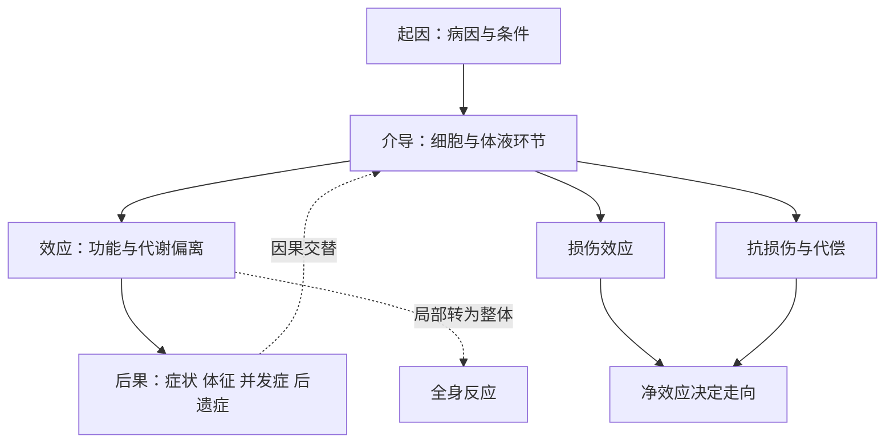

# 第 1 章 · 病理生理学导论（Introduction to Pathophysiology）

> **源**：`standards/binglishengli/supplements/jiangyi/U01-基本过程.md`（讲义第 1 章，本仓原创；`standards/binglishengli/supplements/jiangyi/`）
> **抽取**：`python scripts/build_binglishengli_textbook.py` · 2026-10-30 · sha256 `54771aae110fe5b7e61128993001ae88e37cabd4836af6ccc2d44810ef066ff1…` · 正文一字未改
> **层次**：**源正文层**（讲义该章逐节照录）+ **改写层**（N.1–N.5 与思考题，见文末标记块，人工撰写）
> **规模**：11 节 · 4,654 汉字（现算；含学习目标/术语表/小结/自测题，与讲义索引的「节正文」口径不同）
> **免责**：本章为教学材料，只写类别与关系与机制，不写数值与正常值，不构成诊断、治疗或用药依据。

## 学习目标

完成本章学习后，你应当能够：

1. 定义病理生理学，说明它在基础医学与临床医学之间的桥梁地位，并说清它与病理解剖学的分工边界；
2. 列出病理生理学的四大研究内容并各举一例；
3. 区分病因与条件（诱因），列举常见病因类别，说明必要病因、充分病因与危险因素的区别；
4. 阐释「损伤与抗损伤」「因果交替」「局部与整体」「稳态失衡」四条疾病发生发展规律，说明四者为何是四种视角；
5. 描述健康—亚健康—疾病的连续谱，说明疾病定义的三个要素与连续谱对预防分层的意义；
6. 说明病理生理学与临床判断、循证实践的关系；
7. 说明研究方法的限度与证据层级的读法，识别五类常见推理错误。

## 1.1 什么是病理生理学

**病理生理学（pathophysiology）**是研究疾病发生、发展与转归的规律及其机制的科学。它从**功能和代谢**的角度（区别于以形态结构为主的病理解剖学）回答四个问题：疾病**是什么**、**为什么**发生、**如何**发展、会**怎样**转归。

- 研究对象：疾病状态下机体的功能代谢变化及其发生机制；
- 学科定位：连接基础医学（生理、生化、免疫、微生物等）与临床医学的**桥梁学科**；
- 服务对象：为诊断、治疗、护理与预防提供机制依据，是护理学「临床判断（clinical judgment）」的重要知识基础。

四个问题构成一条推理链：先辨认「是什么」，再追问「为什么」，再展开「如何」，最后落到「怎样」。与病理学的分工是**截面之分**：前者答「结构变成了什么样」，后者答「功能为什么变了」——心肌梗死的形态是坏死与瘢痕，功能是泵功能下降、节律紊乱与酸碱连锁；结构改变轻微而功能紊乱显著（如某些离子通道病）与结构改变显著而功能长期代偿都常见，两个截面必须同读。

## 1.2 病因学（Etiology）

病因学研究疾病发生的原因与条件。

- **病因（cause / etiological agent）**：引起疾病必不可少的、决定疾病特异性的因素。
- **条件（conditional factors）**：能影响疾病发生发展的内外环境因素，如年龄、性别、营养状态、免疫水平、气候等；其中促使疾病在病因作用下发生的条件称**诱因（precipitating factor）**（如受凉诱发肺炎、情绪波动诱发心绞痛）。
- 病因分类：
  | 类别 | 举例 |
  |---|---|
  | 生物性 | 细菌、病毒、真菌、寄生虫（病原微生物） |
  | 物理性 | 机械损伤、高温低温、电离辐射、电击、气压变化 |
  | 化学性 | 毒物、药物不良反应、强酸强碱、一氧化碳 |
  | 营养性 | 营养缺乏（维生素、蛋白质）与营养过剩 |
  | 遗传性 | 基因突变、染色体异常 |
  | 免疫性 | 超敏反应、自身免疫、免疫缺陷 |
  | 精神心理社会性 | 应激、丧亲、职业压力、社会隔离 |

**一句话记法**：病因决定「会不会得、得什么病」，条件决定「何时得、得多重」。

必要病因无之则必不得该病，充分病因有之则必得（罕见）。多数慢性病是**多因素网络**，单一因素既不必要也不充分，只提高概率，这类因素称**危险因素（risk factor）**。条件则经三条途径起作用：**增加暴露**、**削弱防御**、**改变反应性**。

## 1.3 发病机制（Pathogenesis）

**发病机制**是病因作用于机体后，疾病发生、发展的具体过程与原理，涉及分子、细胞、组织器官与整体多个层次。

- 基本环节：病因 → 与机体相互作用（损伤与抗损伤）→ 功能代谢紊乱 → 临床表现；
- 机制类型：直接损伤（如烧伤热力）、间接机制（免疫损伤、炎症介质、神经-体液调节紊乱、代谢障碍）；
- 典型链条（因果交替）：缺氧 → 无氧代谢增强 → 乳酸堆积 → 酸中毒 → 血管舒缩障碍 → 血压下降 → 组织灌注进一步减少 → 缺氧加重。

**先分层，再谈机制**：同一过程在分子、细胞、器官、系统与整体五个尺度上有不同读法，层次之间有**涌现**——单个心肌细胞的代谢改变推不出患者的活动耐力，却是其必要条件。机制也不总单向恶化：心率加快与心肌肥厚早期维持功能，后期自身成为负担，这个「代偿—失代偿」的转折正是 1.7 讨论转归的基础。

**共同通路**：不同病因常汇入少数几条损伤通路——能量不足、氧化应激、钙超载、炎症。正因存在共同通路，才可能有「基本病理过程」这一层概念（见 1.4）。

## 1.4 基本病理过程与临床表现

- **基本病理过程（basic pathologic processes）**：多种疾病中共有的、成套的功能代谢变化，如发热、炎症、缺氧、水肿、脱水、酸碱失衡、休克、弥散性血管内凝血（DIC）等；
- **临床表现（clinical manifestations）**：
  - 症状（symptoms）：患者主观感受（疼痛、乏力、恶心）；
  - 体征（signs）：体格检查可发现的客观表现（发热、黄疸、水肿、啰音）；
  - 实验室与影像学改变：血常规、生化、心电图、影像检查结果；
- **并发症（complication）**：疾病过程中继发的另一种疾病或病理过程（如肺炎并发脓胸）；
- **后遗症（sequelae）**：疾病恢复期遗留的持久性功能障碍或结构异常。

**综合征**是一组常同时出现的表现而未必共享病因，**并发症**是原发病过程中继发的新过程，**后遗症**是恢复期遗留的持久改变，归类其实是在判断它在时间轴与因果链上的位置。

**不典型表现**是另一个陷阱：老年、婴幼儿与免疫抑制者常偏离教科书——感染可以不发热，休克可以血压尚可而灌注已差。纠正办法是回到机制问「这条机制还有没有别的出口」，而不是问「有没有这个症状」。

## 1.5 疾病发生发展的一般规律

1. **损伤与抗损伤（damage vs. anti-damage）**：贯穿疾病全程的两股力量，其对比决定转归方向。例：感染时细菌毒素（损伤）与发热、白细胞吞噬、抗体产生（抗损伤）的博弈；抗损伤过度也会造成损害（如炎症风暴）。
2. **因果交替（chain of causation）**：某一过程的**结果**成为新过程的**原因**，形成连锁（见 1.3 缺氧链条）。
3. **局部与整体（local vs. whole）**：局部病变可引起全身反应（如龋齿→败血症→休克），全身状态也影响局部病变（如营养不良者伤口愈合差）。
4. **稳态失衡（homeostatic imbalance）**：疾病本质上可看作内环境稳态的破坏与机体修复能力不足的表现。

**四条规律是四种视角**，不是四张互相竞争的清单：损伤与抗损伤看**方向**，因果交替看**路径**，局部与整体看**尺度**，稳态失衡看**本质**。

**代偿的三个层次**：功能代偿（心率加快维持输出）、结构代偿（心肌肥厚、单侧肾切除后对侧肥大）、代谢代偿（慢性缺氧时红细胞生成增加）。代偿有代价——肥厚心肌耗氧更高、储备更少，故**「代偿」不等于「无害」**。

## 1.6 健康、疾病与疾病连续谱

- **健康（health）**：WHO 定义——身体、心理和社会适应三方面均处于完好状态，而不仅仅是没有疾病或虚弱；
- **疾病（disease）**：机体在病因作用下，因自稳调节紊乱而发生的异常生命活动过程；
- **亚健康（suboptimal health）**：介于健康与疾病之间的过渡状态，功能代谢轻度偏离但未达疾病诊断标准（如疲劳、睡眠障碍、反复感冒）；
- **疾病连续谱**：健康 → 亚健康 → 疾病（轻→重）→ 慢性化 / 康复 / 恶化。

**疾病定义含三个要素**：病因的作用、自稳调节的紊乱、异常的生命活动过程。三者缺一不可——有病因作用而无调节紊乱（如带菌状态）通常不称疾病；有调节紊乱而病因难寻（部分功能性疾患）仍按疾病处理，但机制解释须留余地。故「查出病原体」不等于「患病」，「查不出原因」也不等于「没病」。

**疾病连续谱**对应预防的三个层次——减少暴露、早发现早处理、防并发症与防残，护理在三层都有落点而第二层最能体现评估的价值。**亚健康**缺乏统一判定标准，宜作风险提示而非诊断标签。

## 1.7 疾病的转归（Outcome）

| 转归 | 含义 | 说明 |
|---|---|---|
| 完全康复 | 病因清除，功能代谢完全恢复 | 如普通感冒 |
| 不完全康复 | 损伤留有代偿性改变或后遗症 | 如心肌梗死后瘢痕形成，心功能靠代偿维持 |
| 慢性化 | 病程迁延，反复发作 | 如慢性支气管炎 |
| 恶化与死亡 | 疾病进行性加重至死亡 | 死亡标准已从心肺死亡演进为**脑死亡（brain death）**，即全脑（含脑干）功能不可逆丧失 |

**决定转归的三要素**：损伤与抗损伤的力量对比、代偿储备的多少、干预的时机与恰当性。前两者由病情与个体条件决定，第三者部分可由照护者影响——这正是护理在转归中的位置。

**「完全」与「不完全」的界线在功能而不在结构**：心肌梗死后瘢痕永久存在，若泵功能与活动能力恢复，仍归不完全康复但功能良好；反之结构「愈合」而功能长期受限也不属完全康复。**脑死亡与植物状态**的区别在脑干：前者全脑（含脑干）功能不可逆丧失，后者保留脑干功能而意识丧失。

## 1.8 病理生理学与临床护理实践

- **临床判断**：护士依据症状、体征与机制推理形成护理假设（如「术后少尿」先想到低血容量还是肾损伤，需结合机制与线索鉴别）；
- **护理诊断**：NANDA 诊断（如「体液不足」「组织灌注无效」）直接建立在病理生理机制之上；
- **循证实践（evidence-based practice, EBP）**：将最佳研究证据、病理生理机制理解与患者偏好结合，做出个体化决策；
- **用药与干预**：理解机制才能正确选择与评价干预（如脱水补液时机、休克时的体位与液体管理）。

临床判断由**模式识别**（快、凭经验）与**分析推理**（慢、凭机制）共同完成；熟练者多靠前者，但遇到不典型表现「认不出来」时，机制是唯一的纠偏工具。

最实用的一条是**同一症状、不同机制、相反处理**：术后少尿若源于低血容量，方向是补充容量；若源于肾实质损伤，方向是限制进一步损伤并监测，仅凭「尿少」无法决定方向。

## 1.9 主要研究方法

- 实验研究：动物实验、离体器官/细胞实验、分子生物学实验（机制研究的主要途径）；
- 临床研究：临床试验、观察性研究（前瞻/回顾）；
- 流行病学研究：横断面调查、队列研究、病例对照研究、系统评价/Meta 分析（揭示病因与危险因素、评价干预）。

三类方法各答一个问题：实验研究答「机制是否存在、是否必要」，可控可干预但脱离整体；临床研究答「在人身上有没有效果、是否安全」，直接可用但受混杂与伦理限制；流行病学答「在人群中如何分布、与哪些因素相关」，规模大却难定个体因果。三者是分工，不是优劣排序。

实验的基本逻辑有四条：**对照**排除自然病程与安慰剂效应，**随机**平衡已知与未知混杂，**盲法**减少测量与期待偏倚，**可重复**排除偶然；缺一条，结论强度就打折。

## 1.10 研究方法的限度与证据层级

方法的结论只能用在它覆盖的范围内。

- **动物模型**：种属差异明显，诱导方式模拟的多是「某环节被突然打断」，而人类疾病多为长期、缓慢、多因素累积，且实验动物少有共病与用药。故它擅长回答「这条通路是否成立」，不擅长回答「这个患者会不会受益」。
- **离体与细胞实验**：去除整体调节与灌注条件，能把机制拆到分子层，却说不出它在完整机体中占多大权重。
- **观察性研究**：混杂与反向因果是两个基本威胁——可能是暴露致病，也可能是疾病本身改变了暴露。
- **随机对照试验**：内部效度最好，但严格入组使受试者与真实患者有差距（外部效度）。

**证据层级**（机制研究、病例报告、横断面、队列与病例对照、随机对照、系统评价）是一条从「解释力强、可推广性弱」到「可推广性强、解释力弱」的连续谱。它描述**证据强度**而非**真理性**。正确用法是各司其职——基础研究解释机制，人群研究判断效果。

## 1.11 病理生理学推理的常见错误

以下五类错误出现频率最高，且都有明确的纠正办法。

1. **以症代病**：把症状当诊断（「发热」即病名）。纠正：先列机制假设，再找区分线索。
2. **以偏概全**：用单个指标定论。纠正：要求至少两条独立线索同向。
3. **把相关当因果**：两个变化同时出现即断定因果。纠正：问时间先后、问有无共同原因、问有无剂量—反应关系。
4. **把机制当疗效**：因「机制上应该有效」认定有效，或因「机制上说不通」否定观察到的效果。纠正：机制提出假设，证据判定效果。
5. **忽视时间与个体**：把代偿期与失代偿期混为一谈，把典型表现套到老年、婴幼儿或共病患者身上。纠正：标注「哪个阶段、哪类人」。

**可复用的四问**：涉及哪条机制？在哪一层？方向如何？此刻处于病程哪个时点？四问不保证结论正确，但能挡掉大部分「说得通却站不住」的推理。本章把「稳态失衡」列为一般规律却未展开其内容，第2章正从内环境与稳态的定义出发补上这一层。

## 关键术语表（中英对照）

| 术语 | 中文 | 术语 | 中文 |
|---|---|---|---|
| pathophysiology | 病理生理学 | pathology | 病理学 |
| etiology | 病因学 | cause / etiological agent | 病因 |
| condition | 条件 | precipitating factor | 诱因 |
| risk factor | 危险因素 | necessary / sufficient cause | 必要病因 / 充分病因 |
| pathogenesis | 发病机制 | basic pathologic processes | 基本病理过程 |
| clinical manifestations | 临床表现 | symptoms | 症状 |
| signs | 体征 | syndrome | 综合征 |
| complication | 并发症 | sequelae | 后遗症 |
| prognosis | 预后 | outcome | 转归 |
| recovery | 康复 | chronicity | 慢性化 |
| brain death | 脑死亡 | vegetative state | 植物状态 |
| health | 健康 | disease | 疾病 |
| suboptimal health | 亚健康 | homeostasis | 稳态 |
| evidence-based practice | 循证实践 | clinical judgment | 临床判断 |
| internal validity | 内部效度 | external validity | 外部效度 |

## 本章小结（Key Points）

- 病理生理学 = 以功能代谢视角研究疾病规律与机制的桥梁学科；与病理解剖学是同一疾病的两个截面；
- 四大内容：病因学、发病机制、基本病理过程与临床表现、转归；
- 病因决定疾病特异性，条件/诱因影响发生与轻重；慢性病多为多因素网络，宜用「危险因素」描述；
- 四条规律是四种视角：方向、路径、尺度、本质；代偿分功能、结构、代谢三层，且「代偿不等于无害」；
- 疾病的三要素是病因作用、自稳调节紊乱、异常生命活动；健康—亚健康—疾病是连续谱，对应预防的三个层次；
- 转归由力量对比、代偿储备与干预时机决定；完全与不完全康复的界线在功能；脑死亡与植物状态的区别在脑干；
- 方法各有其限度：动物与离体实验解释机制，人群研究判断效果；证据层级描述强度而非真理性；
- 五类推理错误可用「机制—层次—方向—时点」四问纠偏。

## 自测题

**A 型选择题**

1. 疾病发生必不可少的、决定疾病特异性的因素是（　）
   A. 诱因　B. 病因　C. 条件　D. 环境因素　E. 遗传素质
2. 下列属于基本病理过程的是（　）
   A. 高血压　B. 发热　C. 糖尿病　D. 肺炎　E. 骨折
3. 受凉后发生肺炎，受凉在发病中属于（　）
   A. 病因　B. 诱因　C. 后遗症　D. 并发症　E. 病理过程
4. 关于疾病转归，说法正确的是（　）
   A. 完全康复后不留任何功能改变　B. 脑死亡指大脑皮层功能丧失　C. 慢性化是康复的一种　D. 脑死亡指全脑功能不可逆丧失　E. 后遗症即并发症
5. 关于必要病因与危险因素，说法正确的是（　）
   A. 慢性病通常存在单一必要病因　B. 危险因素指有之则必得该病的因素　C. 必要病因指无之则必不得该病的因素　D. 危险因素与诱因是同义语　E. 充分病因在慢性病中最常见
6. 下列对「证据层级」的读法最恰当的是（　）
   A. 机制上成立即可直接用于临床　B. 随机对照试验结论适用于所有患者　C. 队列研究足以确定个体因果　D. 机制研究解释「为什么」，人群研究判断「有没有效」　E. 系统评价合并的研究越多越可靠

**简答题**

7. 简述「因果交替」规律，并举例说明。
8. 为什么说病理生理学是护理「临床判断」的基础？试举一例。
9. 简述「代偿」与「稳态失衡」的关系，并说明为什么「代偿不等于无害」。

**参考答案**：1.B　2.B　3.B　4.D　5.C　6.D　7.（缺氧→酸中毒→血管舒缩障碍→血压下降→灌注减少→缺氧加重）8.（如术后少尿需依据「低血容量 vs 肾损伤」机制鉴别，才能决定补液还是进一步检查）9.（功能、结构、代谢三层代偿使被调变量维持在可接受范围，失衡在早期不外显；但代偿有代价——肥厚心肌耗氧更高、储备更少，故代偿期是「稳态被维持而储备被消耗」，储备耗竭即转失代偿）

---
<!-- REWRITE:BEGIN -->
## 本章要回答的问题

为什么病理生理学要先把「疾病的类别」讲清，而不是先给病名——以及这套类别语言能算出什么、算不出什么。

## N.1 概念与出处

本章的六个概念各自落在讲义的具体节上，出处写到节号级，因为本课程**没有**可引的教材原文（见下）。

| 概念 | 讲义出处 | 代用底本对应 | 说明 |
|---|---|---|---|
| 四问框架（是什么／为什么／如何／怎样转归） | `补充·hermes-病理生理学讲义·第1章·1.1` | `教材·疾病学基础·第1章·1.1` | 四问是「问题清单」而非章节顺序 |
| 病因·条件·诱因三段分工 | `第1章·1.2` | 同章 1.2 | 条件不等于病因：必要条件与充分条件不可互换 |
| 发病机制的四段环节 | `第1章·1.3` | 同章 1.3 | 起因—介导—效应—后果，段间不是严格线性 |
| 基本病理过程与症状·体征·并发症·后遗症 | `第1章·1.4` | 同章 1.4 | 「过程」是跨器官复用的模块 |
| 疾病发生发展的一般规律 | `第1章·1.5` | 同章 1.5 | 因果交替、损伤—抗损伤、局部—整体 |
| 证据层级与常见推理错误 | `第1章·1.10`、`1.11` | **无**（底本不涉及方法学） | 这两节是讲义独有 |

**出处口径要先说清**：本机没有《病理生理学》教材（`E:\textbooks` 的 100 份工作簿里没有这一本），
课程用的代用底本是《疾病学基础》——一本把病理学与病理生理学合并的 18 章书。
所以本章的「出处」只能落到两级：**讲义节号**（本仓原创，可逐字核）与**代用底本小节号**（可核）。
凡底本没有的内容（如 1.10 证据层级），就在表里写「无」，不拿讲义冒充教材原文。

## N.2 为什么可以这样翻译




把「疾病」写成一个可计算的对象的做法是：

```
疾病状态 D = (状态变量 v, 机制图 G, 转归转移 T)
v：功能与代谢的观测量（方向、快慢、可逆性）
G：有向图，节点＝环节（起因/介导/效应/后果），边＝「导致」
T：从一个状态到另一个状态的转移（好转/迁延/并发症/死亡）
```

为什么这样翻译对得上：讲义通篇在给**方向与关系**，不给数值（`1.3` 讲环节顺序，`1.5` 讲同类关系反复出现）。
方向与关系正好是有向图能表达的；反过来说，若讲义给的是具体阈值，这个图就画不出来。

四条一般规律在图上各有一个对应物，这也是翻译能自洽的原因：

| 讲义规律 | 图上的性质 |
|---|---|
| 因果交替（`1.5`） | 图里有**环**——环让「起因已去除、疾病仍在进展」变得可解释 |
| 损伤与抗损伤并存（`1.5`） | 同一条边带**两个方向的权**（同一机制既修补又致损） |
| 局部与整体（`1.5`） | 子图之间存在**跨层边**（局部炎症→全身反应） |
| 转归四格（`1.7`） | `T` 的取值集合（好转／迁延／并发症／死亡） |

什么条件下翻译失效：需要**量化**时。图能说「这条边更强」，说不出「强多少」；
而临床判断常需要强度。这正是本章 1.10 要讲的证据层级问题——机制图给的是结构，不是效应量。

## N.3 这个翻译丢掉了什么

1. **时间尺度被压平。** 图里「代偿→失代偿」只是相邻两个节点，实际两者可能相隔数年到数小时（`1.5` 讲规律，未给时标）。同一张图用在急性与慢性上，会让人误以为机制相同、节奏也相同。
2. **个体的意义被去掉。** 疾病对当事人是体验（疼痛、恐惧、失去工作），不是状态变量。讲义 1.6 讲连续谱，讲的是群体意义上的状态，不是一个人的处境。
3. **价值判断无处安放。** 「好转」在图上是一个转移，但什么叫好——能自理、能工作、还是指标正常——属于价值选择，不属于机制。翻译把它们合并成一个节点标签，等于替人做了决定。
4. **干预的多样性被压缩。** 同一环节常有多个可干预点（上游阻断、旁路代偿、下游保护），图只标「这条边存在」，不区分「改哪一处代价最小」。这是临床决策的核心信息，图给不出。
5. **不确定性没有被量化。** 图是确定的；而病因推断、证据外推都带概率（`1.10`）。把不确定的东西画成确定的边，是最容易发生的误读。

一句话：**这套翻译擅长讲「为什么会这样」，不擅长讲「有多严重、该改哪里、对谁有意义」。**

## N.4 与相邻学科的接口

- **病理学**（同院系 `10-bingli-xue`）：以形态为轴。同一病变，病理学说「细胞与组织变成什么样」，本章说「功能与代谢往哪个方向偏」。两门课的接口是**互相印证**：形态改变解释功能偏离，功能偏离反过来提示该看哪些形态。
- **生理学**（`06-shengli-xue`）：提供「正常」这一侧的参数与调节回路。病理生理学的每个「偏离」都以生理学的正常环节为参照系；生理学的正常值层（`standards/shengli/normal-values/`）是本课程**刻意不复制**的另一套数据。
- **中医学**：证候是**状态的聚类**，病机是**环节的链条**，与本章的状态—图结构同构，但语言不同（寒热虚实 vs 参数升降）。接口形式是「同一现象的两套描述」，不是互相翻译。
- **tcmP 平台**：本章的桥接句是「病机演变→状态机 / 代偿失调→阈值模型」。也就是说，平台把 `G` 当状态机、把 `T` 当转移、把代偿当阈值判据——本章是这套映射的文字版。

## N.5 争议与本项目立场

**争议一：病理生理学该不该独立成科。** 一派主张与病理学合并为「疾病学基础」（本仓的代用底本走的就是这条路，18 章一本）；另一派主张分设，理由是形态与功能的认识方法不同，合并会稀释功能视角。**本项目立场：分设，但承认合并本的合理性。** 依据是本仓实测——合并本《疾病学基础》216 个单元里，形态视角占 178、机能视角仅 58（见 `standards/binglishengli/README.md` 三视角矩阵）。合并确实压低了功能一侧的笔墨，这是取舍，不是错误。

**争议二：「基本病理过程」的清单是否封闭。** 传统清单（炎症、发热、缺氧、休克、DIC 等）按教科书沿袭，缺少纳入标准。**本项目立场：清单开放。** 判定标准写成「跨器官复用 + 有独立机制链 + 有可观察的偏离方向」，不按书名沿袭。

**争议三：机制解释与循证证据的张力。** 机制讲得通不等于干预有效（`1.11` 已把「机制当疗效」列为常见错误）。**本项目立场：机制只用于解释与定位，不用于推断疗效**；凡涉及疗效与剂量，一律不进本课程正文，交回具备资质者的规范与制度。

> 本章改写层是教学解读，不构成诊断、治疗或用药依据。

## 思考题

1. 用本章的四问框架描述一个你熟悉的疾病，指出哪一问在本课程里只能给方向、给不出数值，为什么。
2. 「条件不等于病因」——举一个必要条件不充分、充分条件不必要的例子，并说明它在图 `G` 上表现为哪种边。
3. 因果交替在图上是一个环。若一个环里有两个可干预点，你会先改上游还是下游？用什么信息决定（本章范围内能给什么、不能给什么）？
4. 为什么本课程把正常值放在生理学数据层，而不在病理生理学正文里写？

## 延伸阅读

- 讲义 `standards/binglishengli/supplements/jiangyi/U01-基本过程.md` 第 1 章（本仓原创，可逐字核）。
- 代用底本《疾病学基础》第 1 章（`standards/binglishengli/底本.json`，本仓留档；**不是**《病理生理学》教材）。
- 同院系《病理学》教材第 1 章（`textbooks/09-jichu/10-bingli-xue/01-第1章-绪论.md`），对照「形态为轴」的写法。
- 本仓 `textbooks/README.md` 的教材章契约（N.1–N.5 的来源与硬规则）。
- Banasik, *Pathophysiology*, 8th ed. 的目录结构（本课程按它的单元—章结构组织，但正文为原创，**本仓未持有原书**，不作引用）。
<!-- REWRITE:END -->
