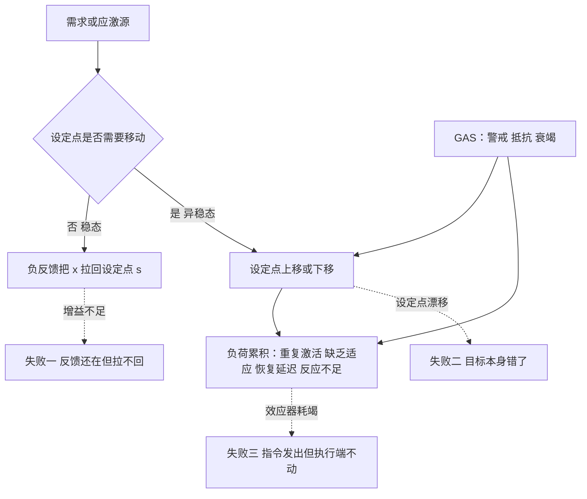

# 第 2 章 · 稳态、异稳态与对应激源的适应性反应（Homeostasis, Allostasis, and Adaptive Responses to Stressors）

> **源**：`standards/binglishengli/supplements/jiangyi/U01-基本过程.md`（讲义第 2 章，本仓原创；`standards/binglishengli/supplements/jiangyi/`）
> **抽取**：`python scripts/build_binglishengli_textbook.py` · 2026-10-30 · sha256 `54771aae110fe5b7e61128993001ae88e37cabd4836af6ccc2d44810ef066ff1…` · 正文一字未改
> **层次**：**源正文层**（讲义该章逐节照录）+ **改写层**（N.1–N.5 与思考题，见文末标记块，人工撰写）
> **规模**：12 节 · 5,159 汉字（现算；含学习目标/术语表/小结/自测题，与讲义索引的「节正文」口径不同）
> **免责**：本章为教学材料，只写类别与关系与机制，不写数值与正常值，不构成诊断、治疗或用药依据。

## 学习目标

完成本章学习后，你应当能够：

1. 定义稳态与内环境，说明稳态的生理学意义；
2. 区分负反馈、正反馈与前馈调节并举例，说明增益与延迟如何影响调节效果；
3. 定义异稳态与异稳态负荷，说出异稳态负荷的四种类型；
4. 分类列举常见应激源，说明可控性与可预测性为何决定反应强度；
5. 描述交感-肾上腺髓质轴与下丘脑-垂体-肾上腺轴的应激反应过程及效应；
6. 描述全身适应综合征的三个阶段，并说明这一框架的价值与局限；
7. 解释慢性应激致病的机制（异稳态负荷、心理神经免疫）；
8. 列举降低异稳态负荷的护理与自我管理干预；
9. 说明稳态失败的三种方式，并界定「应激致病」的证据限度。

## 2.1 稳态与内环境

- **内环境（internal environment）**：即细胞外液，是细胞直接生活的环境。Claude Bernard 首先指出内环境恒定是自由生命的必要条件；
- **稳态（homeostasis）**：机体通过神经、体液、免疫等调节系统维持内环境理化性质（温度、pH、渗透压、电解质、血糖、氧分压等）相对恒定的**动态平衡**状态（Walter Cannon 命名）；
- 意义：内环境相对恒定是细胞正常代谢与功能的前提；**稳态调节能力下降或失效 → 内环境偏离 → 疾病**。

一个稳态回路含四个要素：被调变量、**设定点（set point）**、检测偏差的**感受器**、执行纠正的**效应器**；任一环节失灵都会失衡——感受器失灵是「偏差很大而纠正迟到」，效应器失灵是「信号很强而反应很弱」（详见 2.11）。

稳态**不等于不变**：它是围绕设定点的波动。**储备（reserve）**则是稳态的隐形部分：正常值上看不出差别，只在负荷时才显现——这正是 2.10 中老年储备下降的由来。

## 2.2 稳态的调节机制

| 调节方式 | 机制 | 特点 | 举例 |
|---|---|---|---|
| 负反馈（negative feedback） | 输出抑制输入，使变量回归设定点 | 最常见，维持稳定 | 体温、血糖、血压、血钙、甲状腺激素 |
| 正反馈（positive feedback） | 输出增强输入，滚雪球式放大 | 用于需快速完成的生理过程 | 分娩宫缩、凝血级联、动作电位去极化 |
| 前馈（feed-forward） | 变化发生前提前调节 | 预见性、省时 | 看到食物分泌唾液与胰岛素、运动前心率预升 |
| 拮抗调节 | 成对系统反向作用 | 双向精细调节 | 交感/副交感、胰岛素/胰高血糖素 |

**临床联系**：降压药、降糖药本质上是「外源性恢复负反馈平衡」；正反馈失控（如 DIC 中凝血瀑布恶性循环、感染中的炎症风暴）常是疾病恶化机制。

反馈的效果还取决于**增益**（偏差被放大的倍数）与**延迟**（纠正生效所需时间）：增益过低则纠正不足，过高或延迟过长则过冲与振荡。正反馈用于「必须一次完成」的过程（分娩、凝血、动作电位）。

## 2.3 异稳态与异稳态负荷

- **异稳态（allostasis）**：机体通过**主动改变稳态设定点**来适应内外环境需求的过程——「通过变化而维持稳定（stability through change）」。如应激时血压、血糖、体温设定点上调，以动员资源应对威胁；
- **异稳态负荷（allostatic load）**：长期或反复应激造成的**累积生理代价**。McEwen 归纳四种类型：
  1. 频繁重复应激（反复激活同一系统）；
  2. 缺乏适应（对应激原持续高反应）；
  3. 应激后恢复延迟（激活后久久不能回到基线）；
  4. 反应不足（某一系统低反应，其他系统代偿性过度激活）。
- 异稳态负荷累积 → 高血压、代谢综合征、内脏脂肪增加、免疫抑制、认知衰退、焦虑抑郁、睡眠障碍。

两者的关系是分工：稳态把设定点视为固定、靠反馈把变量拉回，解释「扰动后为何能复原」；异稳态把设定点视为可调、靠改变来适应，解释「持续压力下为何能撑住」。

负荷本身不是病理，超过承受与修复能力时（**异稳态过载**）才出现结构性损害。它在研究中由一组指标与量表综合评估，本书只到**类别层**，不给分界值。

## 2.4 应激源（Stressors）

应激源是威胁或挑战机体稳态的内外刺激，常见分类：

| 类别 | 举例 |
|---|---|
| 物理性 | 创伤、疼痛、过冷过热、噪声、辐射 |
| 化学性 | 缺氧、毒物、药物 |
| 生物性 | 感染、营养不良、睡眠剥夺 |
| 心理社会性 | 考试/工作压力、人际关系冲突、丧亲、经济困难、搬迁 |
| 生活事件 | 手术住院、照顾重病家属、轮班 |

**应激源不是事件本身**，而是被**评价（appraisal）**为「要求超出资源」的刺激：初级评价判断它意味着威胁、挑战还是丧失，次级评价判断有无资源应对。

五个属性决定反应强度：强度、**可控性**、**可预测性**、持续时间、意义。还需留意**内在应激源**：疼痛、发热、低血糖、缺氧、失眠无需外部事件，本身即是稳态偏离，却常被「最近有什么压力」这一问漏掉。

## 2.5 应激反应的两大神经内分泌系统

**（1）交感-肾上腺髓质轴（SAM axis）**
应激 → 下丘脑/脑干 → 交感神经兴奋 → 肾上腺髓质释放**肾上腺素与去甲肾上腺素** → 心率增快、心肌收缩力增强、血压升高、支气管扩张、肝糖原分解（血糖升高）、血流重分布（骨骼肌/心肌/脑优先）——即**「战斗或逃跑（fight-or-flight）」**反应。特点：反应快、时程短。

**（2）下丘脑-垂体-肾上腺轴（HPA axis）**
应激 → 下丘脑室旁核释放**促肾上腺皮质激素释放激素（CRH）** → 垂体前叶分泌**促肾上腺皮质激素（ACTH）** → 肾上腺皮质释放**皮质醇（cortisol）** → 糖异生增强、蛋白质与脂肪分解、抗炎、免疫抑制、维持血管对儿茶酚胺的反应性；皮质醇通过负反馈抑制 CRH/ACTH 分泌。

| 对比项 | SAM 轴 | HPA 轴 |
|---|---|---|
| 主要激素 | 肾上腺素、去甲肾上腺素 | CRH、ACTH、皮质醇 |
| 作用时程 | 秒—分钟，快速 | 分钟—小时，持久 |
| 主要效应 | 循环、呼吸、代谢速动员 | 代谢重编程、免疫调节、抗炎 |
| 慢性激活风险 | 血压升高、动脉粥样硬化 | 免疫抑制、代谢综合征、海马损伤、抑郁 |

**临床联系**：长期大剂量糖皮质激素治疗（外源性皮质醇）抑制 HPA 轴，骤停可致肾上腺皮质功能不全（肾上腺危象），须逐渐减量。

两轴是**点火与供油**的关系：SAM 先启动，HPA 随后维持。没有皮质醇的**允许作用**，血管对儿茶酚胺的反应性下降。

## 2.6 全身适应综合征（General Adaptation Syndrome, GAS）

Selye 提出应激的非特异性反应三阶段：

1. **警觉期（alarm stage）**：应激源出现数分钟至数小时，SAM+HPA 快速动员，交感兴奋、皮质醇升高，机体处于「战斗或逃跑」状态；
2. **抵抗期（resistance stage）**：激素水平回落但仍高于基线，机体适应应激源，抵抗力上升；可持续数天至数周；
3. **衰竭期（exhaustion stage）**：储备耗竭、适应失败，出现器官功能紊乱、免疫低下、疾病甚至死亡。

三阶段的判断线索：警觉期以交感症状为主（心悸、出汗、手抖）；抵抗期是「外表恢复、指标仍偏高」（自述能应付，但睡眠浅、易疲劳）；衰竭期是储备耗竭的表现（体重下降、反复感染、伤口愈合慢）。

**局限**主要两条：结论主要来自动物实验且强调反应的非特异性，后来研究显示不同应激源的激素谱并不相同；GAS 描述时间进程而不描述累积代价。

## 2.7 急性应激与慢性应激的病理意义

- **急性应激**：有适应性价值（提高警觉与体能）；但反复急性应激（如频繁加班、睡眠剥夺）造成累积损害；
- **慢性应激**：异稳态负荷持续累积，与以下疾病密切相关：
  - 心血管：高血压、冠心病、心律失常；
  - 代谢：向心性肥胖、胰岛素抵抗、2 型糖尿病；
  - 消化：消化性溃疡、肠易激综合征、食欲改变；
  - 免疫：感染易感性升高、自身免疫病加重、伤口愈合减慢；
  - 神经精神：焦虑、抑郁、失眠、慢性疼痛、认知减退；
  - 其他：骨质疏松（皮质醇抑制成骨）、月经紊乱。

**「应激有害」是误解**：急性应激提高警觉、动员体能、促进伤口早期炎症反应，是生存所需。有害的不是应激本身，而是**频率、时长与恢复不足**。

慢性应激也不是「直接」致病，而经**四条路径**起作用：生理（皮质醇与儿茶酚胺持续偏高）、行为（睡眠减少、饮食结构改变、活动减少、烟酒增加）、心理（焦虑抑郁降低自我照护动力）、社会（退缩、冲突、就医延迟）。

## 2.8 心理神经免疫（Psychoneuroimmunology, PNI）

研究应激、神经内分泌与免疫系统之间的相互作用：

- 应激通过儿茶酚胺与皮质醇调节免疫细胞功能；
- **急性应激**短期内可增强部分免疫应答；**慢性应激**抑制细胞免疫（Th1 偏移减弱）、升高炎症因子（IL-6、CRP 等），与感染易感、肿瘤进展、自身免疫病活动相关；
- 意义：心理社会因素 → 神经内分泌 → 免疫状态 → 疾病易感性，构成「身心疾病」的机制链条。

三条通路支撑这条链条：交感末梢直接支配脾、淋巴结与胸腺，释放儿茶酚胺作用于免疫细胞受体；皮质醇经血循环抑制免疫细胞增殖；炎症因子又经迷走传入回传中枢，引起发热、食欲下降、嗜睡、兴趣减退，即**疾病行为（sickness behavior）**。

急性与慢性在此分岔：急性偏向调动（免疫细胞重新分布、警戒提高），慢性则是「抑制与低度炎症并存」——细胞免疫下降而炎症因子基线升高。

## 2.9 应对、适应与护理干预

- **应对策略（coping）**：问题中心应对（制定计划、解决问题）、情绪中心应对（寻求支持、倾诉、放松）、回避/否认（短期缓解，长期不利）；
- **促进适应的干预**：
  1. 应激评估：识别应激源、感知强度、支持资源与既往应对方式；
  2. 生理稳定：保证睡眠、规律运动、均衡营养、避免过度咖啡因与酒精；
  3. 心理技术：正念/放松训练、呼吸练习、认知重构、时间管理；
  4. 社会支持：家庭、同伴、专业心理支持；
  5. 识别异稳态负荷信号：持续疲劳、失眠、血压血糖波动、反复感染、情绪低落——及时干预并必要时转介；
  6. 药物与医疗干预：必要时抗焦虑/抑郁治疗、应激相关疾病的规范治疗。

由评价可推出**匹配假说**：情境可控时问题中心应对更有效，情境不可控时（等待检查结果、亲人濒死）情绪中心应对更有效，用错方向会造成二次损耗。

干预须覆盖个体、家庭、组织与政策四个层次。

## 2.10 生命周期考量（Pediatric / Older Adult Considerations）

- **儿童**：早产儿体温调节、血糖与体液稳态不成熟；应激反应系统处于发育期；**不良童年经历（adverse childhood experiences, ACEs）**可造成终身异稳态负荷增高，与成年期心血管病、抑郁等风险相关；
- **老年**：稳态储备下降、调节阈变窄；交感应答减弱、皮质醇清除减慢、HPA 负反馈抑制减弱，应激恢复慢；对应激的临床表现常不典型（如感染不发热、休克血压变化迟钝），需更温和、分步的干预强度。

儿童期的关键在于调节系统「按经验校准」：早年反复、不可预测的应激会把反应阈值与回落速度设定在偏向「高反应、慢恢复」的位置，成年后仍可观察到。

老年期有三重变化叠加：**储备下降**使同样负荷更易越过代偿界限；**感受器敏感性下降**使口渴感减退、温度觉迟钝；**清除与反馈减慢**使恢复时间延长。

## 2.11 稳态失败的三种方式

「稳态失衡」是 1.5 的第四条规律，但失衡本身有多种发生方式，区分它们才能判断干预该落在哪一环。

1. **设定点被移动**：回路完好而目标值被长期上调。应激时血压设定点上移本是适应，若被固定下来就成为持续的高血压倾向。特征是**调节有反应，但反应指向一个偏离的目标**。
2. **调节增益不足**：感受器不敏感、传入受损或效应通路反应弱，使偏差很大而纠正迟迟不到——老年口渴感减退致脱水。特征是**偏差持续存在，纠正迟到且幅度不足**。
3. **效应器失效**：信号与通路都正常，终末器官却不再响应（胰岛素抵抗、受体下调）。特征是**信号越强、代偿分泌越多，效果越差**，于是出现「指标在动、功能没改善」的困惑。

临床读法因此是方向性的：设定点上移者降低长期驱动，增益不足者减少波动情境，效应器失效者则落在终末环节。

## 2.12 从应激到疾病的证据限度

「应激致病」是一个方便但过于简化的说法。逐层看其证据结构，才能知道能说到什么程度。

- **横断面研究**：能显示负荷高的群体中某病更多，但无法定方向——可能是应激致病，也可能是疾病（及其治疗、失眠、疼痛）提高了负荷。
- **纵向队列**：能确定时间先后，却难排混杂——社会经济地位、健康行为、基线健康状况同时影响两者。
- **动物模型**：慢性束缚、隔离等范式能显示因果链，但应激源单一、种属差异明显、时间尺度被压缩。
- **干预研究**：减压干预能改善症状与部分指标，但效应多为中小、随访较短，故「改善主观感受」比「改变硬终点」的证据更稳。

**稳妥的表述**是：应激**参与**疾病发生、**增加**风险、**影响**病程与恢复。对护理的三条含义是：不把异稳态负荷当诊断；不做「减压即治病」的承诺；把评估用于分层与转介。

## 关键术语表（中英对照）

| 术语 | 中文 | 术语 | 中文 |
|---|---|---|---|
| homeostasis | 稳态 | internal environment | 内环境 |
| negative feedback | 负反馈 | positive feedback | 正反馈 |
| feed-forward | 前馈 | set point | 设定点 |
| gain | 增益 | reserve | 储备 |
| allostasis | 异稳态 | allostatic load | 异稳态负荷 |
| allostatic overload | 异稳态过载 | resilience | 恢复力 |
| stressor | 应激源 | stress response | 应激反应 |
| appraisal | 评价 | coping | 应对 |
| fight-or-flight | 战斗或逃跑 | catecholamines | 儿茶酚胺 |
| cortisol | 皮质醇 | CRH / ACTH | 促肾上腺皮质激素释放激素 / 促肾上腺皮质激素 |
| HPA axis | 下丘脑-垂体-肾上腺轴 | SAM axis | 交感-肾上腺髓质轴 |
| general adaptation syndrome | 全身适应综合征 | alarm / resistance / exhaustion stage | 警觉 / 抵抗 / 衰竭期 |
| psychoneuroimmunology | 心理神经免疫 | sickness behavior | 疾病行为 |
| adaptation | 适应 | adverse childhood experiences (ACEs) | 不良童年经历 |
| permissive action | 允许作用 | effector failure | 效应器失效 |

## 本章小结（Key Points）

- 稳态是内环境理化性质的动态平衡，由负反馈、正反馈、前馈与拮抗调节共同维持；回路含变量、设定点、感受器与效应器；
- 稳态不等于不变：设定点随状态移动；「看起来正常」常因储备被动用，储备耗竭才显失代偿；
- 异稳态是「通过改变设定点维持稳定」的适应机制，短期是动员、长期是磨损；异稳态负荷是累积代价，过载才致结构损害；
- 应激源不是事件本身而是评价为「要求超出资源」的刺激；可控性与可预测性高则反应轻，内在应激源常被漏评；
- 应激反应两大系统：SAM（快速动员）与 HPA（持久代谢-免疫调节）；皮质醇长期升高是慢性应激致病的关键；
- GAS 三阶段描述时间进程，异稳态负荷描述累积代价，两者互补而非重复；
- 慢性应激经生理、行为、心理、社会四路参与高血压、代谢综合征、免疫抑制与精神障碍；
- 护理要点：评估应激源与负荷信号，用睡眠、运动、放松、社会支持降低负荷；关注儿童 ACEs 与老年储备下降；稳态失败有三种方式（设定点移动、增益不足、效应器失效），「应激致病」宜表述为「参与、增加风险、影响病程」。

## 自测题

**A 型选择题**

1. 关于稳态，下列说法错误的是（　）
   A. 稳态是动态平衡　B. 内环境即细胞外液　C. 负反馈是维持稳态的主要方式　D. 正反馈常用于维持变量恒定　E. 稳态破坏可导致疾病
2. 分娩时宫缩逐渐增强属于（　）
   A. 负反馈　B. 正反馈　C. 前馈　D. 拮抗调节　E. 稳态调节失败
3. 长期慢性应激导致免疫功能抑制，主要与下列哪项持续升高有关（　）
   A. 肾上腺素　B. 去甲肾上腺素　C. 皮质醇　D. 胰高血糖素　E. 醛固酮
4. 全身适应综合征中，机体储备耗竭、出现器官功能紊乱的阶段是（　）
   A. 警觉期　B. 抵抗期　C. 衰竭期　D. 恢复期　E. 代偿期
5. 关于异稳态（allostasis），说法正确的是（　）
   A. 指设定点固定不变的状态　B. 指通过改变设定点来适应需求的过程　C. 应激时上调设定点必然有害　D. 与稳态是同义语　E. 只出现在病理状态
6. 下列最符合「效应器失效」型稳态失败的是（　）
   A. 长期应激使血压设定点上移　B. 老年口渴感减退致饮水不足　C. 组织对胰岛素反应减弱　D. 失血后心率加快　E. 发热时出汗增多

**简答题**

7. 简述异稳态负荷的四种类型，并说明其与疾病的关系。
8. 一名护士应如何评估并干预一位长期照护重病家属、出现失眠与血压升高者？
9. 为什么「应激致病」宜表述为「参与、增加风险、影响病程」？请从研究设计角度说明。

**参考答案**：1.D　2.B　3.C　4.C　5.B　6.C　7.（反复应激/缺乏适应/恢复延迟/反应不足 → 累积负荷 → 心血管代谢免疫神经精神疾病）8.（评估应激源、负荷信号与支持资源；睡眠运动营养与放松技术；必要时转介心理与医疗干预）9.（横断面难定方向，队列难排混杂，动物模型应激源单一且有种属差异，干预研究多为中小效应、随访短、盲法困难；故只能支持「参与/增加风险/影响病程」）

---

## 单元临床案例（HPP-U01-CASE-01）

**病例（示意，参数仅供推理练习）**：王女士，45 岁，全职工作并长期照护患病父母。近 3 个月出现入睡困难、晨起疲劳、反复感冒，体重增加 4 kg（以腰腹为主），血压波动在 140–150/90–95 mmHg，情绪低落、易烦躁。查体无特殊阳性体征，血糖、血脂正常高值。

**问题**：
1. 王女士的应激反应主要涉及哪些系统？请用 SAM 与 HPA 轴解释其表现。
2. 如何用「异稳态负荷」解释她血压升高、反复感染、体重增加与情绪变化？
3. 作为护士，你会给出哪些干预建议以降低其异稳态负荷？

**要点参考**：
1. 长期照护压力为心理社会性应激源；SAM 反复激活（血压升高、睡眠中交感张力高），HPA 持续激活（皮质醇升高 → 向心性肥胖、免疫抑制致反复感冒、情绪与睡眠紊乱）；
2. 属「频繁重复应激 + 恢复延迟」型异稳态负荷累积，表现为心血管（血压）、代谢（体重血糖血脂）、免疫（反复感染）、神经精神（失眠抑郁）多系统受累；
3. 干预：应激源与负荷评估、睡眠卫生、规律有氧运动、均衡饮食（控糖控脂）、正念/放松训练、喘息照护与社会支持、必要时就医评估降压与心理治疗；监测血压、体重、情绪与睡眠变化。

---

*本阶段正文完。下一阶段（阶段2 · U02 细胞功能，C03–C07）可随时继续。*
<!-- REWRITE:BEGIN -->
## 本章要回答的问题

「稳态」这个用了近百年的词，为什么需要「异稳态」来补充——以及这两套说法各自把什么放进了模型、把什么留在了模型外面。

## N.1 概念与出处

| 概念 | 讲义出处 | 代用底本对应 | 说明 |
|---|---|---|---|
| 内环境与稳态 | `补充·hermes-病理生理学讲义·第2章·2.1` | **无**（底本把稳态并入第 7 章应激讲） | 稳态是「区间维持」不是「数值不变」 |
| 四种调节方式（神经／内分泌／旁分泌／自身调节） | `第2章·2.2` | 同章间接 | 负反馈的前提是「有设定点」 |
| 异稳态与异稳态负荷 | `第2章·2.3` | **无** | 设定点可移动；负荷是「调用方式的代价」 |
| 应激源五类（含内在应激源） | `第2章·2.4` | `教材·疾病学基础·第7章·7.3` | 应激源不等于外部刺激 |
| SAM 与 HPA 两轴 | `第2章·2.5` | 同章 7.3 | 点火与供油，时间尺度不同 |
| GAS 三期（警戒／抵抗／衰竭） | `第2章·2.6` | 同章 7.3 | 只作阶段骨架，不做时限断言 |
| PNI 三条通路 | `第2章·2.8` | **无** | 神经—内分泌—免疫互作 |
| 稳态失败的三种方式 | `第2章·2.11` | **无** | 设定点移动／增益不足／效应器失效 |

出处口径：讲义节号可逐字核；底本《疾病学基础》把稳态与应激合并在第 7 章，**没有**为本章的 2.3、2.8、2.11 提供对应文字——这几节是讲义独有。凡标「无」的，不去底本里找近似段落顶替。

## N.2 为什么可以这样翻译




本章的核心翻译是**两层控制模型**：

```
稳态（homeostasis）：x(t) 被拉回设定点 s，误差 e = x − s 由负反馈消除
异稳态（allostasis）：设定点 s 本身随需求移动，s = s(需求)；代价由「移动的频率与幅度」累积
失败三方式：① s 漂移（设定点被改到不可接受处）
           ② 增益不足（反馈还在，但拉不回）
           ③ 效应器失效（指令发出，执行端不动）
```

为什么对得上：讲义 2.2 把调节写成「检测—比较—执行」三段，2.3 把异稳态写成「改设定点」而不是「加大反馈」。
这两句话正好区分了控制论里的**调节器**（改输出）与**参考值**（改目标）——一个模型里两个不同的旋钮。

GAS 三期在这套模型里对应三种「代价形态」：警戒=快速改设定点；抵抗=新设定点维持（负荷累积）；
衰竭=维持失败（回到 ②③）。这解释了讲义为什么强调「抵抗期的回落不等于回基线」——回落是设定点仍在移动，
而不是误差被消除。

三种失败方式的价值在于**故障可分**：临床上「治不好」常被笼统归为「代偿失调」，而模型要求先问是哪一类——
设定点错了要改目标，增益不足要补调节，效应器失效要修执行端。三类对应三种完全不同的方向。

## N.3 这个翻译丢掉了什么

1. **多层同时调节被压成单环。** 实际有分子、细胞、器官、整体四层各自稳态（体温、血糖、渗透压、血压同时调），模型一次只画一个环。真实情形是**多环耦合**，某个环的「代偿」常以另一个环的偏离为代价——单环模型看不见这笔账。
2. **时间尺度被抹平。** 神经调节以秒计、激素以小时计、结构重构以天到周计。把三类塞进同一个 `s(t)` 里，会让人以为改设定点和改结构是同一节奏的事。
3. **负荷的路径依赖被简化。** 异稳态负荷是累积量，与「怎么调用、调用了多久」有关；模型里它只是一个标量，丢掉了「同样幅度、不同节律，代价不同」这一层（讲义 2.3 的四种调用错误正是这层）。
4. **主观体验不在模型里。** 疲惫、焦虑、失眠是当事人最直接的信号，模型里没有对应变量，因此也解释了为什么「指标正常」与「感觉不好」可以同时成立（讲义 2.9 讨论应对，不在模型内）。

## N.4 与相邻学科的接口

- **生理学**：提供正常调节回路与参照区间，是本章的「参照系」。生理学讲「怎么维持」，本章讲「维持失败分成哪几类」。
- **病理学**：结构改变是异稳态负荷的可见代价（心肌肥厚、肾上腺增生）。病理学给形态证据，本章给「为什么会有这笔形态账」。
- **中医学**：「阴阳自和」近似负反馈，「正邪相争」近似损伤—抗损伤，「久病及肾」近似负荷累积与效应器衰竭。接口是**同构不同语**：不互相翻译，只并列描述同一现象的两个侧面。
- **tcmP 平台**：桥接句「代偿失调→阈值模型」在本章落地为 `s` 与 `e` 的判据；平台的阈值就是「`e` 超出可接受区间多久」。

## N.5 争议与本项目立场

**争议一：异稳态是否取代稳态。** Sterling 一派主张以 allostasis 全面替代 homeostasis，理由是「恒定」从来不存在；保守派认为稳态作为一阶抽象仍有效，异稳态是它的扩容。**本项目立场：两套并存，稳态为默认、异稳态为例外。** 理由：绝大多数教学场景只需一阶模型，把两套并列写成「稳态 vs 异稳态」会制造虚假对立；但凡是「设定点被改」的情形（慢性应激、成瘾、代谢综合征）必须切到第二套，否则解释不了「为什么回到原位反而更糟」。

**争议二：异稳态负荷能否测量。** 一派用复合指标（皮质醇、血压、腰围等）构造负荷评分；另一派认为这些指标各自意义不同，合成分数掩盖机制。**本项目立场：不合成单一分数。** 与仓库对数值层的处理一致——不同机制的指标不合并，宁可分条列出（见 `standards/shengli/normal-values/` 的「差异值不合并」原则）。

**争议三：GAS 三期的经验基础。** 三期来自动物实验的概括，用在人身上缺时限依据。**本项目立场：保留骨架、删去时限。** 讲义 2.6 明确「不抄时限句」，只写阶段与环节差别；这是本课程与一般教材的差别之一。

> 本章改写层是教学解读，不构成诊断、治疗或用药依据。

## 思考题

1. 「把血压拉回正常」与「把设定点拉回正常」是两件事。用一个慢性应激的例子说明两者为何可能方向相反。
2. 三种失败方式中，哪一种最容易被误判为「病人不配合」？为什么？
3. 单环模型看不见「一个环的代偿以另一个环的偏离为代价」。举一个这样的例子，并说明需要补什么变量才能看见这笔账。
4. 为什么本课程拒绝把异稳态负荷合成为一个分数？

## 延伸阅读

- 讲义 `standards/binglishengli/supplements/jiangyi/U01-基本过程.md` 第 2 章（本仓原创，可逐字核）。
- 代用底本《疾病学基础》第 7 章 7.3–7.4（`standards/binglishengli/底本.json`；稳态在此仅作应激前置，**不含异稳态**）。
- 同院系《生理学》教材的体温、血糖、血压调节章（`textbooks/09-jichu/06-shengli-xue/`），对照「正常一侧」的写法。
- 本仓 `standards/binglishengli/README.md` §4「三视角 × 四层级」——为什么本课程把「机能」单列为一轴。
- Banasik, *Pathophysiology*, 8th ed.（目录结构来源；**本仓未持有原书**，不作引用）。
<!-- REWRITE:END -->
