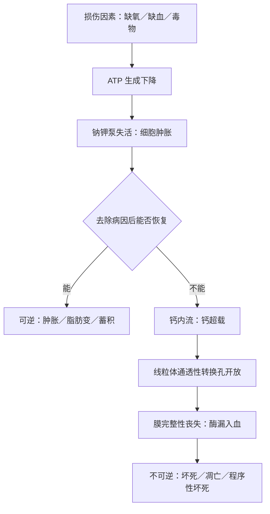

# 第 4 章 · 细胞损伤、衰老与死亡（Cell Injury, Aging, and Death）

> **源**：`standards/binglishengli/supplements/jiangyi/U02-细胞功能.md`（讲义第 4 章，本仓原创；`standards/binglishengli/supplements/jiangyi/`）
> **抽取**：`python scripts/build_binglishengli_textbook.py` · 2026-10-30 · sha256 `55be60de6ffcbcf6eae20eaf8205de7f6b31826b05e3c9427a6a44968b1be083…` · 正文一字未改
> **层次**：**源正文层**（讲义该章逐节照录）+ **改写层**（N.1–N.5 与思考题，见文末标记块，人工撰写）
> **规模**：11 节 · 4,339 汉字（现算；含学习目标/术语表/小结/自测题，与讲义索引的「节正文」口径不同）
> **免责**：本章为教学材料，只写类别与关系与机制，不写数值与正常值，不构成诊断、治疗或用药依据。

## 学习目标

完成本章学习后，你应当能够：

1. 列出细胞损伤的主要病因类别，并说明缺氧为何是最常见者；
2. 区分可逆性与不可逆性细胞损伤的关键判据，描述细胞肿胀与脂肪变的机制；
3. 比较坏死与凋亡在机制、形态与后果上的差异；
4. 说出坏死的四种形态学类型及其好发部位；
5. 解释缺血-再灌注损伤的三大机制；
6. 概述细胞衰老的主要学说与衰老细胞的表型特征。

## 4.1 正常细胞的稳态与损伤阈值

正常细胞依靠膜完整性、线粒体产能、钙稳态、蛋白质与 DNA 质量控制系统维持稳态。细胞对损伤的耐受存在**阈值**：轻度、短暂的作用可被修复或经适应而存活；作用强度或持续时间超过修复能力，则进入不可逆阶段。

决定损伤程度的因素包括：**损伤的性质与强度**、**作用持续时间**、**细胞类型与代谢状态**、**血供与营养状况**、**既往适应状态**。代谢活跃、耗氧高的细胞（心肌细胞、近端肾小管上皮、中枢神经元）对缺氧最敏感；而皮肤成纤维细胞、肝细胞相对耐受。这一差异直接决定了不同器官在全身性缺氧时的受累顺序。

阈值是一个比值而非固定数值：分子是损伤强度与持续时间，分母是细胞的修复与缓冲能力。同一程度缺氧对耗氧高的心肌是致命打击，对成纤维细胞只是应激；适应后阈值上移，营养不良、老年与感染时下移。

## 4.2 细胞损伤的病因

| 类别 | 举例 | 主要作用环节 |
|---|---|---|
| 缺氧与缺血（hypoxia / ischemia） | 冠脉阻塞、休克、窒息、贫血 | ATP 生成不足 |
| 物理性 | 机械创伤、高温低温、辐射、电击 | 膜与蛋白变性、DNA 断裂 |
| 化学性 | 毒物、药物、酒精、强酸强碱 | 代谢干扰、自由基、膜溶解 |
| 生物性 | 细菌毒素、病毒、寄生虫 | 直接破坏或免疫介导 |
| 免疫性 | 自身抗体、补体、超敏反应 | 膜与组织抗原攻击 |
| 遗传性 | 基因突变致蛋白缺陷 | 代谢通路或结构蛋白异常 |
| 营养性 | 蛋白质-能量不足、维生素缺乏 | 合成原料与辅因子不足 |

**缺血（ischemia）比单纯缺氧（hypoxia）更严重**：缺血不仅断绝氧供，还阻断代谢废物清除与营养输送，因此同样程度的缺血比贫血性缺氧造成更快、更重的损伤。这是临床上「恢复灌注越早越好」的机制依据。

**缺氧**按环节可分四型：低氧性、贫血性、循环性与组织中毒性。四型最终都落在 ATP 不足，但循环性同时阻断代谢产物清除，故比贫血性更凶险；化学性损伤则分「直接破坏结构」与「经代谢活化生成活性中间产物」两路，后者存在个体差异。

## 4.3 可逆性细胞损伤

可逆性损伤的特征是**去除病因后结构功能可恢复**，其共同机制是 ATP 下降与离子泵失活，尚未发生膜完整性的不可逆破坏。

- **细胞肿胀（cellular swelling / 水样变）**：最常见、最早的可逆改变。ATP 不足 → 钠钾泵失活 → 细胞内 Na⁺ 与水潴留 → 细胞体积增大、胞质淡染、内质网扩张。肉眼见器官体积增大、包膜紧张、切面外翻。
- **脂肪变（fatty change / steatosis）**：多见于肝细胞与心肌。脂质合成增加、载脂蛋白合成减少、脂肪酸氧化障碍，使甘油三酯在胞质内蓄积成空泡。肝脏脂肪变常见于酒精性肝损伤、肥胖与代谢综合征。
- **细胞内蓄积与沉积**：糖原（糖尿病时的肾小管、肝细胞）、脂褐素（消耗性色素，见于衰老与慢性消耗）、含铁血黄素（出血后巨噬细胞）、胆红素（黄疸）、钙盐（营养不良性钙化）。
- **细胞适应性改变**：萎缩（atrophy）、肥大（hypertrophy）、增生（hyperplasia）、化生（metaplasia）——化生是分化方向的改变，如长期吸烟者支气管柱状上皮变为鳞状上皮，属适应但削弱了原有功能。

## 4.4 不可逆性细胞损伤

不可逆损伤的两个关键判据是**膜完整性丧失**与**线粒体功能不可恢复**，形态上表现为细胞膜破裂、酶漏出、核改变。

- **线粒体损伤**：缺氧与钙超载使线粒体膜通透性转换孔开放，质子梯度消失、ATP 合成终止，细胞色素 c 外漏。
- **膜损伤**：氧自由基脂质过氧化、补体膜攻击复合物、磷脂酶 A₂ 激活、细胞骨架断裂均可破坏膜。膜破损后细胞内酶（如肌酸激酶、转氨酶、乳酸脱氢酶）漏入血液——这是临床检测组织损伤的生化基础。
- **钙超载（calcium overload）**：正常细胞游离 Ca²⁺ 浓度极低，损伤后钙泵失效、Ca²⁺ 大量内流，激活蛋白酶、磷脂酶、核酸内切酶与 ATP 酶，造成「酶性自毁」并进一步加重线粒体损伤。
- **ATP 耗竭与蛋白质合成障碍**：核糖体从内质网脱落、蛋白质合成停止，结构蛋白与酶无法更新。

「不可逆」在实践中是回溯判断：只能由「去除病因后功能不恢复、酶持续漏出」反推。更实用的是找**早期标志**——膜通透性升高使胞内钾外流、酶漏入血；钙超载与线粒体转换孔开放互为因果，一旦成环，恢复供氧也难以回退。

## 4.5 坏死（Necrosis）

**坏死**是病理性、被动性的细胞死亡，伴随明显的炎症反应。形态学上出现**核固缩、核碎裂、核溶解**，胞质嗜酸性增强，膜破裂，内容物释放引起周围组织炎症。

| 类型 | 特点 | 好发部位 |
|---|---|---|
| 凝固性坏死（coagulative necrosis） | 蛋白变性为主，结构轮廓暂时保留 | 心、肾、脾的缺血性梗死 |
| 液化性坏死（liquefactive necrosis） | 酶性消化为主，组织变为液体 | 脑梗死、脓肿 |
| 干酪样坏死（caseous necrosis） | 灰白细腻、结构完全消失 | 结核病灶 |
| 脂肪坏死（fat necrosis） | 脂肪被分解为脂肪酸与钙皂 | 急性胰腺炎、乳腺创伤 |
| 纤维素样坏死（fibrinoid necrosis） | 血管壁蛋白沉积、壁增厚 | 恶性高血压、免疫性血管炎 |

坏死的结局包括：溶解吸收、分离排出（形成溃疡、空洞）、机化与包裹（肉芽组织替代或纤维包膜）、钙化。坏死范围大或继发感染时，全身可出现发热、白细胞升高甚至感染性休克。

各型形态可用「水解酶从哪来」解释：凝固性坏死见于缺血，缺血同时带走外来的水解酶，故蛋白变性占主、轮廓暂存；脑组织酶与脂质均多，酶性消化占优故液化；干酪样坏死介于两者之间。

## 4.6 凋亡（Apoptosis）

**凋亡**是程序性、主动的细胞死亡，**不引起炎症**，是发育塑形、组织更新与清除受损细胞的方式。形态特征：细胞皱缩、染色质边集浓缩、核碎裂成凋亡小体、膜完整并出芽形成**凋亡小体（apoptotic body）**，被巨噬细胞或邻近细胞吞噬清除。

主要通路：

1. **内源性（线粒体）通路**：损伤、DNA 断裂、生长因子撤除 → Bcl-2 家族中促凋亡成员（Bax、Bak）活化 → 线粒体外膜通透性增高 → 细胞色素 c 释放 → 与 Apaf-1 组装凋亡体 → 激活 **caspase-9** → 激活执行型 caspase-3、6、7。**Bcl-2** 抑制此通路，属抗凋亡蛋白。
2. **外源性（死亡受体）通路**：Fas 配体、TNF 等与死亡受体结合 → 招募衔接蛋白 → 激活 **caspase-8** → 激活执行型 caspase。细胞毒性 T 细胞清除病毒感染细胞即经此途径。
3. **穿孔素-颗粒酶途径**：细胞毒性淋巴细胞释放颗粒酶 B，直接激活 caspase 或经线粒体途径放大。

**凋亡不足**与自身免疫病、肿瘤发生相关；**凋亡过度**见于神经退行性疾病、缺血-再灌注损伤与艾滋病中 CD4⁺ T 细胞耗竭。

## 4.7 其他细胞死亡方式

近年来「坏死」与「凋亡」的二分被扩展，几种程序性坏死方式已进入病理生理学视野：

- **坏死性凋亡（necroptosis）**：当 caspase-8 被抑制时，RIPK1/RIPK3 通路启动，形态似坏死、有炎症，见于缺血与某些感染；
- **焦亡（pyroptosis）**：炎症小体激活 caspase-1，切割 gasdermin 形成膜孔，释放 IL-1β、IL-18，是强烈的促炎性死亡，与脓毒症相关；
- **铁死亡（ferroptosis）**：铁依赖的脂质过氧化累积，谷胱甘肽过氧化物酶 4 失效时发生，见于缺血性器官损伤与神经退行性变；
- **自噬依赖性细胞死亡**：自噬过度或关键自噬基因缺失时发生；需注意自噬在多数情况下是**促存活**的适应机制。

理解这些方式的价值在于：不同死亡方式释放的分子信号不同，因而对炎症与组织修复的影响不同，这决定了干预思路的差异。

四者可沿三条轴比较：**形态**、**炎症**与**可干预性**。坏死性凋亡与焦亡均伴炎症，因膜孔形成使内容物外泄；铁死亡不依赖 caspase，故 caspase 抑制剂思路无效；自噬多数情形下促存活，只在过度或关键基因缺失时才转向死亡。

## 4.8 缺血-再灌注损伤

血流恢复本应挽救缺血组织，但**再灌注（reperfusion）**本身可加重损伤，称为**缺血-再灌注损伤（ischemia-reperfusion injury）**。三大机制：

1. **氧自由基爆发**：恢复供氧后，受损的电子传递链与黄嘌呤氧化酶系统产生大量**活性氧（reactive oxygen species, ROS）**，超出抗氧化防御，引起脂质过氧化、蛋白氧化与 DNA 损伤；
2. **钙超载**：再灌注时细胞内外离子梯度骤变，钙泵功能尚未恢复，Ca²⁺ 大量内流，激活降解酶并促使线粒体通透性转换孔开放；
3. **炎症与微血管障碍**：补体激活、中性粒细胞黏附聚集、内皮细胞肿胀与无复流现象，使部分微血管重新闭塞，形成「再灌注但不能有效灌注」的矛盾。

临床对应：急性心肌梗死溶栓或介入后出现再灌注心律失常、心肌顿抑；器官移植后的原发性移植物无功能；休克复苏后的多器官功能损伤。护理上强调**尽早恢复灌注**同时**监测再灌注后的功能变化**。

## 4.9 细胞衰老

**细胞衰老（cellular senescence）**指细胞在经历多次分裂或受到损伤后，永久退出细胞周期但保持代谢活性的状态。主要机制：

- **端粒缩短（telomere shortening）**：染色体末端的重复序列在每次复制后缩短，达到临界长度即触发 DNA 损伤反应与周期停滞，称**复制性衰老**；
- **氧化应激与线粒体功能障碍**：ROS 累积损伤 DNA、蛋白与脂质，是「自由基学说」的核心；
- **DNA 损伤累积与修复能力下降**；
- **表观遗传改变**：甲基化模式漂移、组蛋白修饰失衡；
- **蛋白质稳态失衡**：错误折叠蛋白聚集，自噬-蛋白酶体清除能力下降。

衰老细胞分泌炎症因子、蛋白酶与生长因子，形成**衰老相关分泌表型（senescence-associated secretory phenotype, SASP）**，可诱导邻近细胞衰老并促进慢性炎症——这解释了为何衰老是多种慢性病与肿瘤的共同风险背景。机体层面则表现为组织再生能力下降、免疫功能衰退、伤口愈合变慢。

端粒并非唯一计时器：干细胞靠**端粒酶**维持长度，多数体细胞端粒酶活性低；而衰老也可由损伤直接诱发（**应激性早衰**），不必经历多次分裂——这解释了年轻患者的纤维化器官中为何同样可见大量衰老细胞。

## 4.10 细胞损伤后的修复与适应

组织对损伤的反应是「适应—损伤—修复」的连续过程：

- **适应**：萎缩、肥大、增生、化生，是细胞在持续刺激下调整自身以存活；
- **再生（regeneration）**：由存活细胞或组织干细胞增殖补充，**稳定型细胞**（上皮、造血）再生能力强，**稳定型/永久型细胞**（心肌、神经元）几乎不能再生；
- **纤维性修复（fibrosis / repair by connective tissue）**：以肉芽组织填充缺损，最终形成瘢痕。瘢痕可恢复连续性但丧失原功能，过度纤维化导致器官硬化与功能衰竭。

修复受多因素影响：局部血供、感染、异物、组织类型，以及全身营养状态、血糖控制、免疫抑制与年龄。**营养不良与高血糖是伤口愈合不良的两个可干预因素**。

再生与纤维性修复常同时进行，结局取决于二者竞速：缺损小、支架完整则以再生为主，缺损大、炎症持续则以瘢痕为主。肉芽组织的作用是双面的——它填充缺损、为上皮爬行提供支架，但肌成纤维细胞收缩造成挛缩。胶原合成需蛋白质、维生素 C 与锌，高血糖则经糖基化产物、微血管病变与感染三条途径削弱修复。

## 4.11 临床联系

- **急性心肌梗死**：冠脉闭塞 → 心肌缺血 → 20 分钟内以可逆改变为主，随后进入凝固性坏死；坏死后酶（肌钙蛋白、CK-MB）释放入血成为诊断依据，坏死区最终由瘢痕替代，丧失收缩功能。
- **缺血性肝损伤**：肝细胞脂肪变与细胞肿胀先出现，持续缺血则中央区凝固性坏死；转氨酶升高反映膜通透性增加与细胞坏死。
- **急性胰腺炎**：胰酶异常激活导致胰腺自身消化，出现脂肪坏死（钙皂形成，可致低钙）与出血。
- **神经退行性疾病**：阿尔茨海默病、帕金森病中异常蛋白聚集与凋亡/自噬失衡共同导致神经元进行性丢失；此类细胞属永久型，损失不可逆。
- **护理判断要点**：观察组织灌注、尿量、意识与实验室指标的动态变化，识别「可逆窗口」；对再灌注后的患者加强心律、血压与器官功能监测；对慢性病与老年患者关注营养、血糖与皮肤完整性以改善修复能力。

## 关键术语表（中英对照）

| 术语 | 中文 | 术语 | 中文 |
|---|---|---|---|
| hypoxia | 缺氧 | ischemia | 缺血 |
| cellular swelling | 细胞肿胀 | fatty change | 脂肪变 |
| metaplasia | 化生 | atrophy | 萎缩 |
| calcium overload | 钙超载 | reactive oxygen species | 活性氧 |
| necrosis | 坏死 | coagulative necrosis | 凝固性坏死 |
| liquefactive necrosis | 液化性坏死 | caseous necrosis | 干酪样坏死 |
| fibrinoid necrosis | 纤维素样坏死 | apoptosis | 凋亡 |
| apoptotic body | 凋亡小体 | caspase | 半胱天冬酶 |
| necroptosis | 坏死性凋亡 | pyroptosis | 焦亡 |
| ferroptosis | 铁死亡 | reperfusion injury | 再灌注损伤 |
| autophagy | 自噬 | dystrophic calcification | 营养不良性钙化 |
| telomere | 端粒 | cellular senescence | 细胞衰老 |
| SASP | 衰老相关分泌表型 | regeneration | 再生 |
| fibrosis | 纤维化 | granulation tissue | 肉芽组织 |

## 本章小结（Key Points）

- 缺血比单纯缺氧更凶险，因其同时阻断废物清除与营养供应；
- 可逆损伤以 ATP 下降、离子泵失活所致细胞肿胀为标志；不可逆损伤以膜完整性丧失与线粒体功能崩溃为标志；
- 钙超载是「酶性自毁」的共同枢纽，激活蛋白酶、磷脂酶与核酸内切酶；
- 坏死为被动死亡伴炎症，凋亡为主动程序性死亡不伴炎症，二者由 caspase 与 Bcl-2 家族调控；
- 再灌注损伤由氧自由基爆发、钙超载与炎症微血管障碍共同造成；
- 细胞衰老以端粒缩短、氧化损伤与 SASP 为核心，是慢性病与肿瘤的共同背景；
- 修复能力取决于细胞类型、局部条件与全身营养代谢状态。

## 自测题

**A 型选择题**

1. 判断细胞损伤不可逆的最关键标志是（　）
   A. 细胞肿胀　B. 脂肪变　C. 细胞膜完整性丧失　D. 内质网扩张　E. 核糖体脱落
2. 脑梗死灶的坏死类型属于（　）
   A. 凝固性坏死　B. 液化性坏死　C. 干酪样坏死　D. 脂肪坏死　E. 纤维素样坏死
3. 执行型凋亡蛋白酶主要是（　）
   A. caspase-1　B. caspase-3　C. caspase-8 前体　D. 颗粒酶 A　E. 补体 C3
4. 下列不属于再灌注损伤主要机制的是（　）
   A. 氧自由基爆发　B. 钙超载　C. 中性粒细胞黏附　D. 端粒延长　E. 微血管无复流
5. 长期吸烟者支气管上皮由柱状变为鳞状，属于（　）
   A. 萎缩　B. 肥大　C. 增生　D. 化生　E. 间变

**简答题**

6. 比较坏死与凋亡在机制、形态学与生物学后果上的差异。
7. 为什么说钙超载是细胞不可逆损伤的「共同枢纽」？

**参考答案**：1.C　2.B　3.B　4.D　5.D　6.（坏死：被动、膜破裂、细胞肿胀、核固缩碎裂溶解、内容物释放引发炎症；凋亡：主动程序性、细胞皱缩、膜完整形成凋亡小体、被吞噬清除、不引起炎症）7.（损伤后钙泵失效致胞质 Ca²⁺ 升高，激活蛋白酶、磷脂酶、核酸内切酶与 ATP 酶，既降解结构又加剧线粒体损伤与 ATP 耗竭，形成自我放大环路）
---
<!-- REWRITE:BEGIN -->
## 本章要回答的问题

从细胞肿胀到细胞死亡之间，究竟有没有一条线——如果有，它凭什么算一条线，又凭什么能被看见。

## N.1 概念与出处

| 概念 | 讲义出处 | 代用底本对应 | 说明 |
|---|---|---|---|
| 损伤阈值（强度与时间／修复能力） | `补充·hermes-病理生理学讲义·第4章·4.1` | `教材·疾病学基础·第2章·2.1.1`（仅两类划分） | 比值口径是讲义独有 |
| 病因七类与「缺血重于缺氧」 | `第4章·4.2` | `教材·疾病学基础·第2章·2.1.3` | 底本写类别对应，不写为何更凶 |
| 可逆损伤四类（肿胀／脂肪变／蓄积／适应） | `第4章·4.3` | `教材·疾病学基础·第2章·2.1.1` 与 `2.2.1` 至 `2.2.3` | 适应四类在底本另立一节 |
| 不可逆两判据与钙超载 | `第4章·4.4` | `教材·疾病学基础·第2章·2.1.2` | 底本只写形态，不写回溯判断 |
| 坏死五型与四种结局 | `第4章·4.5` | `教材·疾病学基础·第2章·2.3.1` | 底本另列坏疽一类 |
| 凋亡三条通路 | `第4章·4.6` | `教材·疾病学基础·第2章·2.3.2` | 底本不作通路表述 |
| 其他死亡方式四种 | `第4章·4.7` | **无** | 底本只有坏死与凋亡两类 |
| 缺血-再灌注三机制 | `第4章·4.8` | **无** | 底本全书无「再灌注」命中 |
| 衰老五机制与衰老相关分泌表型 | `第4章·4.9` | **无** | 底本不涉细胞衰老 |
| 修复：再生与纤维性修复 | `第4章·4.10` | `教材·疾病学基础·第2章·2.4.1` 与 `2.4.2` | 再生能力三类口径一致 |
| 临床联系（心梗、肝损伤、胰腺炎、神经退变） | `第4章·4.11` | **无** | 底本不作个案与判定 |

出处口径：本章是全书里底本与讲义重叠最多、口径差异也最大的一章。底本第 2 章有完整的形态类别，却没有阈值、没有钙超载的环节表述、没有再灌注、没有衰老；讲义四节的骨架（4.1、4.4、4.8、4.9）在底本里找不到对应文字。所以四行标「无」，另有几行只标到形态一侧。

## N.2 为什么可以这样翻译

本章可用的形式化是**两量判定**：



写成一句话是：

```
可逆  ⇔  膜完整性 m 保持  且  线粒体产能 p 可回
不可逆 ⇔  m 失守  或  p 不可回       （两者任一，不必同时）
耦合项：钙超载 —— 钙升高使孔开、p 下降；p 下降使泵更失效、钙更升
```

为什么对得上：4.4 明写不可逆的两个关键判据是膜完整性丧失与线粒体功能不可恢复；4.1 把阈值写成强度与时间对修复能力的比值，即「越没越过」不是绝对量；4.7 又沿形态、炎症与可干预性三条轴把四种方式分开。三者共用同一组变量，所以能画在一张图上。图上的菱形是判据而不是时间点——这是本章最容易被误读的一处。

这个模型有实用价值：它把「可逆窗口」从形容词变成一个可观察的差集——膜还完整、线粒体还能回，就在窗口内；任一失守，窗口关闭。4.11 的护理落点本质是在盯这两个量，而不是盯某一个症状。

## N.3 这个翻译丢掉了什么

1. **时间尺度被压平。** 心肌的可逆窗口以分钟计，肝与肾以小时计，脑又不同。图上两个节点之间没有时长，容易被当成同一个长度。
2. **空间与位置被去掉。** 坏死分型取决于部位与水解酶从哪来（4.5 已这么解释），图上却没有位置变量。同一机制在脑与在心，结局形态完全不同。
3. **主观经验不出现。** 「不可逆」对当事人是某个功能再也回不来，是生活方式的改变；模型里它只是一个状态标签，4.11 列的也全是可观察项。
4. **个体差异被均值替代。** 4.1 说心肌、近端肾小管、神经元最敏感，成纤维细胞相对耐受——同一张图，人群里是分布而非一点。年龄、营养与既往适应都在移动分母，图上不显示。
5. **价值判断无处安放。** 「抢救到哪一步为止」「什么样的恢复算恢复」不是机制问题。模型能说窗口在关，说不出该不该继续投入。
6. **不确定性没有被量化。** 酶漏入血是膜通透性升高的提示，不等于坏死已经成立；判据在个体身上常是概率判断，而图上的箭头是确定的。

一句话：**这套翻译擅长讲「越没越过这条线」，不擅长讲「这条线对谁、在什么时候、以什么代价才算数」。**

## N.4 与相邻学科的接口

- **病理学**（`textbooks/09-jichu/10-bingli-xue/` 第 3 章与第 15 章）：形态与再灌注是它的主场。本章只保留机制侧（阈值、判定链、三机制），形态分类引用不重写，两门课不撞车。
- **生物化学**（`07-shenghua-xue` 第 8 章）：氧化磷酸化与活性氧在这里是反应式与酶，本章只用 ATP 收支与脂质过氧化两个结论。
- **医学细胞生物学**（`04-yixue-shengwu-xue` 第 7 章）：细胞增殖、分化、衰老和死亡的分子细节由它承担，本章 4.6 与 4.9 只取通路名与判据。
- **生理学**（`06-shengli-xue`）：钙稳态与兴奋收缩耦联的正常版本在生理学，本章的钙超载是它的失效镜像。
- **中医学**：「正气」近于修复能力，「久病入络」近于纤维化。并列描述，不作互译。
- **tcmP 平台**：桥接句「可逆与不可逆→阈值判据」的落点是把膜完整性与线粒体产能当两个并行指标，平台不给合并总分，也不自动下结论。

## N.5 争议与本项目立场

**争议一：坏死与凋亡的二分是否还成立。** 一派坚持二分，理由是形态与炎症差别稳定；另一派认为 4.7 的四种方式已超出二分。**本项目立场：二分留作教学骨架，另取两条轴**——膜是否破裂、是否释放促炎信号。4.7 已列出形态、炎症与可干预性三条轴，本章取前两条作分类轴，第三条留作干预讨论。

**争议二：「不可逆」能否前瞻判定。** 一派主张存在可靠的早期标志，另一派认为只能回溯。**本项目立场：只作回溯判据加早期提示，不作前瞻断言。** 依据是 4.4：不可逆在实践中是回溯判断，只能由去除病因后功能不恢复反推。

**争议三：细胞衰老是程序还是损伤累积。** 一派以端粒为计时器，一派以氧化损伤与应激性早衰为主。**本项目立场：两条并存，按是否经历复制分开讲。** 依据是 4.9：干细胞靠端粒酶维持长度，而损伤可直接诱发早衰，不必经历多次分裂。合成一个衰老时钟会把两种情形混为一谈。

**争议四：与病理学的重叠怎么处理。** 底本第 2 章整章就是这块内容，本仓已判定它属病理学（`standards/binglishengli/README.md` §5 记着底本第 2 章属病理学内容、本课程故意不取），病理学教材第 3 章也确实写过形态。**本项目立场：机制侧保留、形态侧引用。** 本章因此不重述五型的形态细节，只讲它们为何按水解酶从哪来分。

> 本章改写层是教学解读，不构成诊断、治疗或用药依据。

## 思考题

1. 判定链上的菱形是判据而不是时间点。这个区别对「可逆窗口」的用法有什么实际影响？
2. 「不可逆 ⇔ 膜失守 或 产能不可回」是「或」而不是「且」。举一个只有一项失守的情形，说明它为何仍判为不可逆。
3. 4.5 用「水解酶从哪来」解释坏死分型。这个解释若成立，脑与心的差异应该表现在哪一步？
4. 本章把形态细节留给病理学。这样分工的代价是什么？

## 延伸阅读

- 讲义 `standards/binglishengli/supplements/jiangyi/U02-细胞功能.md` 第 4 章（本仓原创，可逐字核）。
- 代用底本《疾病学基础》第 2 章（`standards/binglishengli/底本.json`；形态类别完整，**不含**阈值、再灌注与衰老）。
- 同院系《病理学》教材第 3 章与第 15 章（`textbooks/09-jichu/10-bingli-xue/`），对照形态侧与再灌注的写法。
- 同院系《医学细胞生物学》教材第 7 章（`04-yixue-shengwu-xue`），对照凋亡与衰老的分子层。
- 本仓 `standards/binglishengli/README.md` §5（底本与课程的分工记录）。
<!-- REWRITE:END -->
