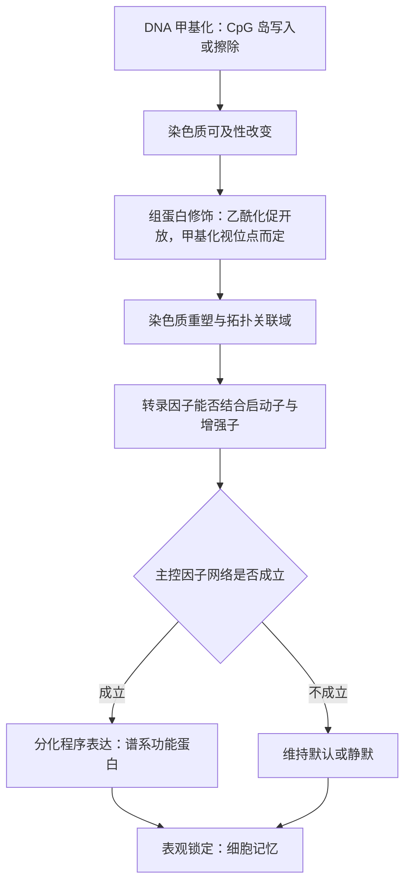

# 第 5 章 · 基因组结构、调控与组织分化（Genome Structure, Regulation, and Tissue Differentiation）

> **源**：`standards/binglishengli/supplements/jiangyi/U02-细胞功能.md`（讲义第 5 章，本仓原创；`standards/binglishengli/supplements/jiangyi/`）
> **抽取**：`python scripts/build_binglishengli_textbook.py` · 2026-10-30 · sha256 `55be60de6ffcbcf6eae20eaf8205de7f6b31826b05e3c9427a6a44968b1be083…` · 正文一字未改
> **层次**：**源正文层**（讲义该章逐节照录）+ **改写层**（N.1–N.5 与思考题，见文末标记块，人工撰写）
> **规模**：10 节 · 4,565 汉字（现算；含学习目标/术语表/小结/自测题，与讲义索引的「节正文」口径不同）
> **免责**：本章为教学材料，只写类别与关系与机制，不写数值与正常值，不构成诊断、治疗或用药依据。

## 学习目标

完成本章学习后，你应当能够：

1. 描述 DNA 双螺旋结构、碱基互补配对规则与染色质的层级组装；
2. 说明人类基因组中编码序列与非编码序列的组成特点；
3. 区分转录水平、转录后水平与翻译水平的基因表达调控；
4. 解释表观遗传的四类主要机制及其可逆性特征；
5. 说明细胞分化的转录因子网络与谱系决定过程；
6. 概述干细胞的分级潜能与组织再生策略。

## 5.1 DNA 结构与染色体组装

**脱氧核糖核酸（deoxyribonucleic acid, DNA）**由两条反向平行的多核苷酸链构成右手双螺旋，磷酸-脱氧核糖骨架在外，碱基对在内。碱基配对遵循固定规则：**腺嘌呤（A）与胸腺嘧啶（T）**之间形成两个氢键，**鸟嘌呤（G）与胞嘧啶（C）**之间形成三个氢键。这一互补性是 DNA 复制高保真与分子杂交检测（如 PCR、测序、FISH）的技术基础。

人类体细胞含 46 条染色体（22 对常染色体 + 2 条性染色体），DNA 总长约两米，须经多级压缩才能装入直径数微米的细胞核：

1. DNA 缠绕**组蛋白八聚体**（H2A、H2B、H3、H4 各两个）形成**核小体（nucleosome）**，约 147 个碱基对绕 1.65 圈；
2. 核小体串珠经 H1 组蛋白与 linker DNA 折叠为 30 nm 纤维；
3. 进一步形成襻环、常染色质与**异染色质（heterochromatin）**。

**常染色质（euchromatin）**结构疏松、转录活跃；**异染色质**高度浓缩、转录沉默（如着丝粒区、失活的 X 染色体——**巴氏小体**）。染色质的开放与关闭状态，是基因能否被转录的第一道闸门。

压缩并非单纯「打包」：组蛋白尾部伸出核小体之外，可被乙酰化、甲基化修饰，从而改变与 DNA 及邻近核小体的亲和力，压缩程度因此可调。异染色质也非全然沉默——着丝粒区仍有少量转录参与其自身维持。

## 5.2 人类基因组的组成

**基因组（genome）**指一个细胞所包含的全部遗传信息。人类基因组约 30 亿碱基对，其组成有几个反直觉的特点：

- **蛋白质编码基因约两万个**，仅占基因组序列的很小一部分；编码区（外显子）总长更短；
- **内含子（intron）**占单个基因的绝大部分，转录后须经剪接去除；
- **非编码序列**占绝大多数，包括调控元件（启动子、增强子、沉默子）、非编码 RNA 基因（rRNA、tRNA、miRNA、lncRNA）以及大量重复序列；
- **重复序列**包括串联重复（着丝粒卫星 DNA、微卫星）与散在重复（转座元件如 Alu、LINE-1）。微卫星长度多态性是法医学与亲子鉴定的基础；重复序列的不稳定扩增则是多种**动态突变疾病**的病因。

**基因（gene）**的现代定义已从「编码一条多肽的 DNA 片段」扩展为「产生一个有功能产物（蛋白或 RNA）的基因组区段」，包含编码序列与全部调控序列。

编码序列占比小的推论是：多数致病变异落在非编码区，改变的是表达量与时空调度而非蛋白结构，表型更依赖环境。重复序列亦非无用——着丝粒卫星 DNA 是动粒装配的底物，而 Alu 等散在重复可经**不等交换**造成缺失或重复。

## 5.3 转录水平的调控

基因表达的第一步是**转录（transcription）**：RNA 聚合酶以 DNA 为模板合成 RNA。转录调控依赖三类元件与蛋白的相互作用：

- **启动子（promoter）**：位于转录起始点上游，含 TATA 框等元件，结合基础转录因子与 RNA 聚合酶Ⅱ；
- **增强子（enhancer）与沉默子（silencer）**：可位于基因远距离的上游、下游或内含子中，通过染色质空间折叠与启动子接触，正向或负向调节转录效率；
- **转录因子（transcription factor）**：序列特异性 DNA 结合蛋白，分为通用转录因子与特异性转录因子。后者决定「哪个基因在哪种细胞中表达」。

**组织特异性表达**的分子基础就在这里：肝细胞表达白蛋白基因，是因为肝细胞核内存在激活白蛋白增强子的转录因子组合，而其他细胞缺乏这套组合。**激素与信号通路**最终也通过激活或抑制转录因子来改变基因表达程序——如类固醇激素受体本身即为配体激活的转录因子。

增强子依赖三维接触：染色质折叠使远距离增强子与启动子贴近，黏连蛋白与 CTCF 划定**拓扑关联域**；域边界破坏时增强子可「错接」到不该表达的基因，是部分畸形与肿瘤的机制。转录另有**启动子近端暂停**，故「已起始」不等于「已表达」。

## 5.4 转录后与翻译水平的调控

转录生成的前体 mRNA 须经加工才能成为成熟模板，这些步骤同样是调控节点：

- **5′ 加帽与 3′ 加多聚腺苷酸尾**：保护 mRNA、协助出核与翻译起始；
- **剪接（splicing）**：由**剪接体（spliceosome）**去除内含子、连接外显子。**可变剪接（alternative splicing）**使同一基因产生多种 mRNA 异构体，是蛋白质多样性的重要来源；剪接位点突变可导致剪接异常，是许多遗传病的机制；
- **RNA 编辑**：少数转录本在转录后改变碱基序列；
- **mRNA 稳定性与降解**：mRNA 半衰期差异可达数十倍，直接影响蛋白产量；
- **微小 RNA（microRNA, miRNA）**：约 22 个核苷酸的非编码 RNA，与靶 mRNA 的 3′ 非翻译区互补配对，抑制翻译或促其降解，一个 miRNA 可调控数十至上百个靶基因；
- **翻译调控**：通过起始因子磷酸化、铁反应元件等机制调节蛋白合成速率。

**RNA 干扰**与反义寡核苷酸技术正是利用上述机制发展出的调控手段，说明这些环节具有可干预性。

剪接受**外显子定义**影响：剪接体先识别外显子两侧的弱信号，组织特有的剪接因子比例不同，同一前体 mRNA 便可产出不同异构体。细胞另有质量控制——含提前终止密码的转录本被**无义介导降解**清除，避免截短蛋白堆积。

## 5.5 表观遗传调控

**表观遗传（epigenetics）**指不改变 DNA 碱基序列、但可稳定遗传给子代细胞（有时跨代）的表达状态改变。四类主要机制：

| 机制 | 内容 | 效应 |
|---|---|---|
| DNA 甲基化（DNA methylation） | 胞嘧啶甲基化为 5-甲基胞嘧啶，多在 CpG 岛 | 通常抑制转录 |
| 组蛋白修饰（histone modification） | 乙酰化、甲基化、磷酸化、泛素化 | 乙酰化多促开放；甲基化视位点而定 |
| 染色质重塑（chromatin remodeling） | 重塑复合物移动或排出核小体 | 改变可及性 |
| 非编码 RNA | miRNA、lncRNA 招募修饰酶 | 沉默或激活 |

**基因组印记（genomic imprinting）**是表观遗传的典型现象：某些基因的表达取决于亲本来源，父源或母源等位基因之一被甲基化沉默，因此个体实际只有一份功能性拷贝。印记异常导致**印记疾病**（如以 15 号染色体区域异常为代表的两类表现迥异的综合征），说明「同样一段 DNA，亲本来源不同则表型不同」。

表观遗传标记的可塑性解释了：**环境与生活方式**（营养、应激、毒物暴露、运动）能通过改变甲基化与组蛋白修饰影响基因表达，且部分改变可在发育关键期留下长期影响。这一机制把「遗传」与「环境」从对立变为交互。

甲基化是「写入—读取—擦除」的动态过程：甲基转移酶写入，甲基结合蛋白读取并招募共抑制复合物，去甲基化酶擦除。印记正在这套酶系上完成——生殖细胞先擦除旧印记，再按亲本性别重建，故亲本来源的信息是被写进 DNA 的。

## 5.6 细胞分化与谱系决定

**分化（differentiation）**是细胞获得特定形态与功能的过程，其核心是**差异基因表达**。分化的推进遵循「**决定（determination）→ 分化（differentiation）**」两步：先由转录因子网络锁定谱系身份（此时表型尚未显现，但命运已定），再逐步表达功能蛋白形成成熟表型。

分化的调控要点：

- **主控转录因子（master regulator）**：单一或少数转录因子即可启动整套分化程序，并可诱导已分化细胞**转分化（transdifferentiation）**；
- **级联与网络**：主控因子激活次级因子，形成稳定的自维持环路，一旦建立即可在多次分裂中保持（**细胞记忆**）；
- **表观遗传锁定**：谱系特异基因的增强子去甲基化并保持开放，无关基因被甲基化关闭；
- **信号微环境**：邻近细胞信号、ECM 力学性质与可溶性因子共同决定分化方向。

**去分化（dedifferentiation）**与**化生**是分化程序的逆转或替换；**间变**则是分化程序近乎丧失，见于高度恶性肿瘤。

决定与分化之间有**时间窗**：窗口内撤除诱导信号，细胞可退回或改向；窗口关闭后，表观锁定使身份稳定。主控因子的充分性由此得到证明，但单一因子在成体细胞中通常不足以完成完整重编程，还须克服增殖与表观两道屏障。

## 5.7 干细胞与潜能分级

**干细胞（stem cell）**的两个本质属性是**自我更新（self-renewal）**与**多向分化潜能**。按潜能分级：

- **全能性（totipotent）**：受精卵与早期卵裂球，可形成完整个体及胎盘等胚外组织；
- **多能性（pluripotent）**：胚胎干细胞，可形成三个胚层的各类细胞，但不能独立形成完整个体；
- **多潜能/专能（multipotent / unipotent）**：成体组织干细胞，如造血干细胞可产生各系血细胞，上皮干细胞只产生该上皮的细胞类型。

**诱导多能干细胞（induced pluripotent stem cell, iPS）**通过导入少数转录因子使成体细胞重编程为多能状态，证明了分化状态的可逆性，也带来畸胎瘤风险与伦理讨论。

成体干细胞的**微环境（niche）**由支持细胞、ECM 与信号分子构成，决定干细胞是静息、自我更新还是分化。niche 被破坏（如放疗、纤维化）会导致再生能力长期下降。

自我更新有两种模式：**不对称分裂**产生一个干细胞与一个祖细胞，维持池的大小；**对称分裂**则扩增或耗竭。组织在损伤时偏向对称扩增，故干细胞数量是动态量；中文「多能」兼指 pluripotent 与 multipotent，读文献须看定义而非字面。

## 5.8 组织更新与再生策略

不同组织的更新策略差异极大，决定了损伤后的修复结局：

| 组织类型 | 更新特点 | 举例 |
|---|---|---|
| 持续分裂型（labile） | 终生快速更新，干细胞持续增殖 | 表皮、胃肠道上皮、骨髓造血 |
| 稳定型（stable / quiescent） | 平时静息，损伤时被激活 | 肝细胞、肾小管上皮、胰腺腺泡 |
| 永久型（permanent） | 出生后基本不再分裂 | 心肌细胞、中枢神经元、骨骼肌纤维 |

**肝再生**是稳定型组织的典范：部分肝切除后，成熟肝细胞重新进入细胞周期，通过增生恢复体积与功能。**心肌与神经元**缺乏有效再生能力，损伤后由纤维瘢痕替代，功能永久损失——这是心梗后心力衰竭与脑梗死后神经功能缺损的结构基础。

**再生医学**的三条路径：干细胞移植、内源性再生激活（生长因子、信号调控）、组织工程（支架 + 细胞 + 因子）。其共同前提是理解该组织的更新类型与 niche 条件。

三类划分并非绝对：稳定型组织在持续损伤后也可呈现持续分裂特征，永久型组织亦有极低比例更新，只是速率不足完成修复——「有更新」与「能修复」是两件事。肝再生的终止同样重要：恢复原体积即停，靠生长因子撤退与负反馈。

## 5.9 基因调控失常与疾病

基因表达调控的任一层次出错，都可导致疾病：

- **转录调控异常**：增强子突变使癌基因过量表达（如将强增强子易位至原癌基因旁）；转录因子融合蛋白阻断正常分化程序，是某些白血病的核心机制；
- **剪接异常**：剪接位点突变导致外显子跳跃或内含子保留，产生无功能或功能异常的蛋白；
- **miRNA 失调**：抑癌性 miRNA 缺失或促癌性 miRNA 扩增，参与肿瘤发生与转移；
- **表观遗传异常**：肿瘤细胞常呈「全基因组低甲基化 + 抑癌基因启动子高甲基化」模式，即同时激活不该表达的基因、沉默本该表达的基因；印记异常导致过度生长或发育迟缓综合征；
- **染色质结构异常**：组蛋白修饰酶突变影响神经发育，是智力障碍与自闭症谱系的重要病因类别。

这些机制的共同启示是：**疾病不一定源于 DNA 序列改变**，「序列正常而表达错误」同样致病，且理论上更易被药物逆转。

调控失常可分**剂量效应**与**结构效应**：前者如增强子易位使原癌基因过量表达，理论上可被调节表达的手段逆转；后者产生融合或截短蛋白，必须针对异常产物本身。表观药物属前者，效应可逆但缺乏基因选择性。

## 5.10 临床与检测联系

基因与基因组层面的检测按层次分类（只列类别，不涉具体阈值）：

- **染色体水平**：核型分析（数目与结构异常）、FISH（特定序列定位）、染色体微阵列（拷贝数变异）；
- **基因水平**：Sanger 测序（单基因已知位点）、二代测序（panel、外显子组、全基因组）、PCR 与片段分析（重复扩增）；
- **表达与表观水平**：RNA 测序、甲基化检测、蛋白免疫组化。

**临床判断要点**：检测结果须与表型、家族史结合解读——同样的变异在不同个体可有不同表现（**外显率与表现度**差异），检出意义未明的变异不应直接作为诊断依据。护理工作中应关注患者对遗传信息的理解程度、隐私与心理社会影响，并协助其获得遗传咨询。

检测层次的选择取决于要回答的问题：染色体水平回答「多或少了一段」，基因水平回答「哪个碱基变了」，表达与表观水平回答「序列正常而产物为何异常」。检测越细越易遇到**意义未明**的变异，故解读须依分级框架并做家系共分离；阴性结果的价值取决于覆盖面。

## 关键术语表（中英对照）

| 术语 | 中文 | 术语 | 中文 |
|---|---|---|---|
| deoxyribonucleic acid (DNA) | 脱氧核糖核酸 | nucleosome | 核小体 |
| euchromatin | 常染色质 | heterochromatin | 异染色质 |
| genome | 基因组 | exon / intron | 外显子 / 内含子 |
| promoter | 启动子 | enhancer | 增强子 |
| transcription factor | 转录因子 | alternative splicing | 可变剪接 |
| microRNA | 微小 RNA | epigenetics | 表观遗传 |
| DNA methylation | DNA 甲基化 | histone modification | 组蛋白修饰 |
| genomic imprinting | 基因组印记 | determination | 决定 |
| differentiation | 分化 | dedifferentiation | 去分化 |
| totipotent | 全能性 | pluripotent | 多能性 |
| induced pluripotent stem cell | 诱导多能干细胞 | stem cell niche | 干细胞微环境 |
| labile / stable / permanent tissue | 持续分裂型 / 稳定型 / 永久型组织 | penetrance | 外显率 |
| nonsense-mediated decay | 无义介导降解 | topologically associating domain | 拓扑关联域 |

## 本章小结（Key Points）

- DNA 的碱基互补配对是复制保真与分子检测的共同基础；染色质压缩层级决定基因的可及性；
- 人类基因组中编码序列占比很小，非编码调控元件与重复序列承担大量调控与结构功能；
- 基因表达受转录、转录后（剪接、miRNA）、翻译三层调控，任一层的异常均可致病；
- 表观遗传（甲基化、组蛋白修饰、染色质重塑、非编码 RNA）不改变序列却稳定改变表达，且可受环境影响；
- 分化的本质是差异基因表达，由主控转录因子网络与表观遗传锁定共同维持；
- 组织更新类型决定修复结局：持续分裂型与稳定型可再生，永久型只能瘢痕修复；
- 检测结果须与表型、家族史结合解读，关注外显率与表现度差异。

## 自测题

**A 型选择题**

1. DNA 双螺旋中形成三个氢键的碱基配对是（　）
   A. A-T　B. G-C　C. A-G　D. T-C　E. A-U
2. 关于人类基因组，说法正确的是（　）
   A. 全部序列均编码蛋白质　B. 编码基因约两万个，占比很小　C. 内含子不转录　D. 重复序列无任何功能　E. 非编码 RNA 基因不存在
3. 基因组印记的本质是（　）
   A. DNA 序列突变　B. 染色体数目异常　C. 亲本来源依赖的表观遗传沉默　D. 剪接位点改变　E. 线粒体 DNA 缺失
4. 心肌梗死后的修复方式主要依赖（　）
   A. 心肌细胞大量再生　B. 纤维瘢痕替代　C. 干细胞自动转分化　D. 化生为骨骼肌　E. 端粒延长
5. 一个 miRNA 通常可调控的靶基因数量为（　）
   A. 仅一个　B. 两个　C. 数十至上百个　D. 全部基因组　E. 不调控基因

**简答题**

6. 说明表观遗传调控的四类机制，并解释「序列正常而表达错误」为何也能致病。
7. 为什么心肌与神经元损伤后功能难以恢复？从组织更新类型角度回答。

**参考答案**：1.B　2.B　3.C　4.B　5.C　6.（DNA 甲基化、组蛋白修饰、染色质重塑、非编码 RNA；这些机制改变基因可及性而不改序列，故突变阴性仍可因表达程序错误而发病，如肿瘤中抑癌基因启动子高甲基化）7.（二者属永久型组织，出生后基本不再分裂且缺乏有效干细胞池，损伤后由成纤维细胞增生形成瘢痕，原功能细胞不能被替代）
---
<!-- REWRITE:BEGIN -->
## 本章要回答的问题

同一套 DNA 为什么能长成两百多种细胞——以及调控被拆成三层之后，哪一层可逆、哪一层可遗传、哪一层只是被观测到的相关。

## N.1 概念与出处

| 概念 | 讲义出处 | 代用底本对应 | 说明 |
|---|---|---|---|
| DNA 双螺旋、碱基配对与互补性 | `补充·hermes-病理生理学讲义·第5章·5.1` | **无** | 底本十八章无分子层内容 |
| 染色质三级压缩与常／异染色质 | `第5章·5.1` | **无** | 可及性是转录的第一道闸门 |
| 基因组组成（编码少、非编码多、重复序列） | `第5章·5.2` | **无** | 基因定义已扩为「有功能产物的区段」 |
| 转录调控三元件（启动子／增强子／转录因子） | `第5章·5.3` | **无** | 组织特异性＝转录因子组合 |
| 转录后与翻译调控（剪接、miRNA、稳定性） | `第5章·5.4` | **无** | 已起始不等于已表达 |
| 表观遗传四机制与基因组印记 | `第5章·5.5` | **无** | 写入、读取、擦除是三个酶系 |
| 决定与分化、主控因子、表观锁定 | `第5章·5.6` | `教材·疾病学基础·第8章·8.3.1`（只有异型性的形态表述） | 底本无调控层 |
| 干细胞潜能分级与微环境 | `第5章·5.7` | **无** | 中文「多能」兼指两级 |
| 组织更新三型与再生策略 | `第5章·5.8` | `教材·疾病学基础·第2章·2.4.1` | 三类口径与底本一一对应 |
| 调控失常五类与剂量／结构效应 | `第5章·5.9` | **无** | 序列正常而表达错误 |
| 检测三层次与解读边界 | `第5章·5.10` | **无** | 底本不涉检测 |

出处口径：代用底本十八章里没有遗传学或分子生物学章，只有第 2 章的再生能力分类与第 8 章的良恶性形态两处能对上，所以十一行里九行标「无」。这一章与第 3 章同源：凡涉及分子层，讲义是唯一文本，出处只落到讲义节号，不拿底本相邻文字凑数。

## N.2 为什么可以这样翻译

本章可用的形式化是**可及性与识别分离**：



写成式子：

```
表达 E(g, 细胞) = 可及性 A(g, 细胞) × 转录因子组合 T(g, 细胞)
A：甲基化与组蛋白修饰给出，可逆但半衰期长（跨细胞周期）
T：信号与主控因子网络给出，可逆且半衰期短（分钟级）
分化 = 把 A 稳定成「该开的开、该关的关」，并降低对 T 的依赖
```

为什么对得上：5.5 把甲基化写成「写入—读取—擦除」的动态过程，说明 A 不是开关而是有酶系维护的状态；5.6 说决定先锁定谱系身份、分化再表达功能蛋白，且窗口关闭后表观锁定使身份稳定——这正是 A 的半衰期被拉长。两说合起来就是先大面积关掉，再小范围打开，最后把开的那一小块记住。

乘积式还有解释力：5.9 说肿瘤常呈「全基因组低甲基化 + 抑癌基因启动子高甲基化」，即 A 在两处同时错，一处在不该开处开了，一处在该开处关了。相加或单层模型都写不出这种同时反向的错误。

失效条件：**需要定量归因时**。乘积式能说这一项掉了，说不出掉多少来自环境、多少来自序列。5.10 的「意义未明」正是这个边界的临床形态。

## N.3 这个翻译丢掉了什么

1. **时间尺度被压平。** 转录因子结合以分钟计，甲基化写入与擦除以细胞周期计，发育窗口以天计。三层画在一张图上，容易被当成同一节奏、可被同一个干预同时改掉。
2. **空间与三维被压成一条边。** 增强子与启动子的接触靠染色质折叠，拓扑关联域边界决定谁能碰到谁。图上一条箭头，实际是核内几何。
3. **个体差异与细胞间异质被均值替代。** 同一基因的甲基化在细胞之间并不一致，一部分细胞关了、一部分没关，图上不可见；5.10 讲的外显率与表现度差异，本质就是这种分布。
4. **主观经验与心理社会重量不出现。** 遗传信息对当事人是家族、生育与自我理解的问题，5.10 只用一句隐私与心理社会影响带过。模型里没有这个变量。
5. **价值判断无处安放。** 做不做检测、告不告诉亲属、胚胎研究的边界，都不是机制问题。图能说这一层可逆，说不出该不该动。
6. **不确定性没有被量化。** 图上的箭头都是确定的；而「这个变异是否致病」常是概率与分级判断，且随家系资料变化。

一句话：**这套翻译擅长讲「为什么这块 DNA 读不出来」，不擅长讲「读不出来对他意味着什么」。**

## N.4 与相邻学科的接口

- **生物化学**（`textbooks/09-jichu/07-shenghua-xue/` 第 17 至 20 章）：复制、转录、翻译与表达调控的反应与酶在那里，本章只保留层与可逆性。
- **医学细胞生物学**（`04-yixue-shengwu-xue` 第 9 至 13 章）：遗传学概述、基因突变、单基因与多基因遗传、染色体病。它讲序列变异，本章 5.9 讲序列正常而表达错误，两者互补。
- **病理学**（`10-bingli-xue` 第 6 章）：间变与异型性是分化程序丧失的形态面，本章给的是程序为何松动。
- **本课程第 6 章与第 7 章**：遗传与发育性疾病、肿瘤都用本章三层作解释框架。本章是机制库存，后两章是用例。
- **中医学**：「先天之本」「肾藏精」与遗传发育只是类比，不作互译。
- **tcmP 平台**：桥接句「表达层→可及性状态机」的落点，是把 A 当慢变量、T 当快变量，两者分开建模而不合并成一个「活性分」。

## N.5 争议与本项目立场

**争议一：表观遗传改变是否算「遗传」。** 一派把有丝分裂可传的细胞记忆与跨代传递一并称为遗传；另一派要求分开，理由是跨代证据在人身上弱且不稳定。**本项目立场：分两级写，不合并。** 5.5 原文用「有时跨代」四字，本课程要求把这四字讲成条件句：细胞记忆是常态，跨代是需额外证据的例外。

**争议二：基因决定论还是环境决定论。** **本项目立场：不站队，用乘积式。** 依据是两条实测结论——5.2 说多数致病变异落在非编码区、改变的是表达量与时空调度；5.9 说序列正常而表达错误同样致病。两条都在削弱「一个基因一个病」的直觉。

**争议三：该不该讲检测技术。** 一派主张讲清方法才看得懂报告；另一派认为技术细节属专业课。**本项目立场：只讲层次与解读边界，不讲阈值与判读。** 依据是 5.10 自己的措辞（只列类别，不涉具体阈值），也与本仓零裸值口径一致。

**争议四：干细胞的「多能」怎么译。** 中文「多能」同时对应 pluripotent 与 multipotent，5.7 已点出。**本项目立场：术语表按英文分级，中文只作注。** 分级一旦混用，「可形成三个胚层」与「只能形成本谱系」就会互相冒充。

> 本章改写层是教学解读，不构成诊断、治疗或用药依据。

## 思考题

1. 为什么把可及性与转录因子写成乘积而非相加？用 5.9 的肿瘤表观模式说明相加为何写不出那种错误。
2. 「已起始不等于已表达」在图上对应哪一处？属于三层里的哪一层？
3. 5.6 说窗口关闭后身份稳定。要在成体细胞里重编程，需克服的是 A 还是 T？
4. 本章九行出处标「无」。在这种覆盖条件下，N.2 的模型凭什么还敢说对得上？

## 延伸阅读

- 讲义 `standards/binglishengli/supplements/jiangyi/U02-细胞功能.md` 第 5 章（本仓原创，可逐字核）。
- 代用底本《疾病学基础》第 2 章 2.4.1 与第 8 章 8.3.1（`standards/binglishengli/底本.json`；只有再生能力与良恶性形态，**不含**调控层）。
- 同院系《生物化学》教材第 20 章（`07-shenghua-xue`），对照表达调控的反应式写法。
- 同院系《医学细胞生物学》教材第 10 章与第 13 章（`04-yixue-shengwu-xue`），对照突变与染色体病。
- 本仓 `standards/binglishengli/README.md` §3（零裸值口径）。
<!-- REWRITE:END -->
