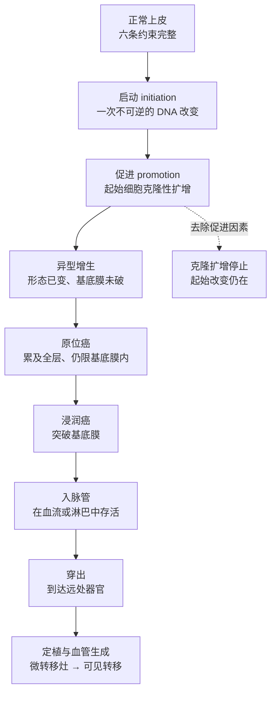

# 第 7 章 · 肿瘤（Neoplasia）

> **源**：`standards/binglishengli/supplements/jiangyi/U02-细胞功能.md`（讲义第 7 章，本仓原创；`standards/binglishengli/supplements/jiangyi/`）
> **抽取**：`python scripts/build_binglishengli_textbook.py` · 2026-10-30 · sha256 `55be60de6ffcbcf6eae20eaf8205de7f6b31826b05e3c9427a6a44968b1be083…` · 正文一字未改
> **层次**：**源正文层**（讲义该章逐节照录）+ **改写层**（N.1–N.5 与思考题，见文末标记块，人工撰写）
> **规模**：11 节 · 4,953 汉字（现算；含学习目标/术语表/小结/自测题，与讲义索引的「节正文」口径不同）
> **免责**：本章为教学材料，只写类别与关系与机制，不写数值与正常值，不构成诊断、治疗或用药依据。

## 学习目标

完成本章学习后，你应当能够：

1. 区分良性肿瘤与恶性肿瘤的生物学与形态学差异，并正确判断癌、肉瘤与母细胞瘤的所指；
2. 解释原癌基因、抑癌基因与 DNA 修复基因在癌变中的角色；
3. 描述肿瘤侵袭与转移的关键步骤；
4. 列举致癌因素的主要类别及其作用机制；
5. 概述肿瘤的全身效应与副肿瘤综合征；
6. 说明肿瘤预防的分级策略与筛查原则。

## 7.1 正常生长调控回顾

多细胞组织中细胞数量恒定，依赖**增殖、分化、凋亡**三者的精确平衡。正常调控的要点：

- **生长因子信号**：配体结合受体 → 经信号通路 → 激活转录 → 推进细胞周期。正常情况下信号依赖外源配体，具**可逆性与依赖性**；
- **接触抑制与密度依赖**：细胞铺满单层后停止增殖；
- **锚定依赖**：正常上皮细胞须附着于基质才能增殖，脱离基质则凋亡（**失巢凋亡 anoikis**）；
- **凋亡与清除**：损伤细胞与多余细胞被程序性清除；
- **DNA 修复与检查点**：错配修复、核苷酸切除修复、双链断裂修复，配合细胞周期检查点阻止突变传递；
- **端粒限制**：正常体细胞端粒随分裂缩短，构成**复制性屏障**，限制无限增殖。

**癌变（carcinogenesis）**的本质，就是上述约束被逐条突破的过程——这也解释了为什么肿瘤是**多步骤、多基因改变累积**的结果，而非单一事件。

## 7.2 肿瘤的定义与命名

**肿瘤（neoplasia / neoplasm）**是细胞在基因层面发生改变后，获得**自主性生长**能力所形成的异常组织团块，其生长不受机体正常调控，且在病因去除后仍持续存在。

**命名规则**（按组织来源 + 良恶性）：

| 组织来源 | 良性 | 恶性 |
|---|---|---|
| 上皮组织 | 乳头状瘤、腺瘤 | **癌（carcinoma）**：鳞癌、腺癌 |
| 间叶组织（纤维、脂肪、肌肉、骨） | 纤维瘤、脂肪瘤、平滑肌瘤 | **肉瘤（sarcoma）**：纤维肉瘤、骨肉瘤 |
| 淋巴造血组织 | — | 淋巴瘤、白血病 |
| 神经组织 | 神经纤维瘤、脑膜瘤 | 神经母细胞瘤、胶质母细胞瘤 |
| 生殖细胞 | 成熟畸胎瘤 | 未成熟畸胎瘤、精原细胞瘤 |
| 幼稚组织 | — | **母细胞瘤（blastoma）**：视网膜母细胞瘤、肾母细胞瘤 |

几个必须记住的例外：**黑色素瘤**、**淋巴瘤**、**白血病**、**精原细胞瘤**、**霍奇金病**虽以「瘤/病」结尾，均为恶性；**错构瘤**并非真性肿瘤，而是局部组织异常混合生长。

## 7.3 肿瘤的形态与分化

**分化程度（differentiation）**与**异型性（atypia）**是判断良恶性的核心形态学依据：

- **良性肿瘤**：分化好，异型性小，包膜完整，生长缓慢，呈**膨胀性生长**，不转移，很少引起全身消耗；但位于关键部位（如颅内、气道）仍可致命。
- **恶性肿瘤**：分化差乃至**间变（anaplasia）**，细胞大小形态不一、核大深染、核质比增高、核分裂象增多且可见**病理性核分裂**；呈**浸润性生长**，无包膜，边界不清，可转移，常伴坏死与出血。

**分级（grading）**依据分化程度与核分裂活性描述肿瘤的「恶性程度」；**分期（staging）**依据原发灶范围、区域淋巴结受累与远处转移（通行的 TNM 体系）描述「扩散范围」。二者意义不同：分级反映生物学侵袭性，分期反映疾病进程，分期通常对预后判断权重更大。

**异型增生（dysplasia）**指上皮细胞出现排列紊乱与细胞学异型但未突破基底膜，属**癌前病变**；一旦突破基底膜侵入间质即为**浸润癌**。**原位癌（carcinoma in situ）**是异型细胞累及上皮全层而未突破基底膜的状态。

## 7.4 癌基因与抑癌基因

肿瘤发生涉及三类关键基因的改变：

**（1）原癌基因（proto-oncogene）→ 癌基因（oncogene）**

原癌基因是正常细胞中促进增殖或抑制凋亡的基因（如 RAS、MYC、ERBB 家族、BCL-2）。其活化方式为**功能获得**，只需一个等位基因改变即可：

- **点突变**：如 RAS 基因突变使蛋白持续处于活化状态；
- **基因扩增**：基因拷贝数增加导致蛋白过量；
- **染色体易位**：将强启动子/增强子置于原癌基因旁（如伯基特淋巴瘤中 MYC 与免疫球蛋白位点并置），或形成融合基因产生持续活化的激酶（如慢性髓性白血病的 BCR-ABL）。

**（2）抑癌基因（tumor suppressor gene）**

抑癌基因正常时限制增殖、促进修复或诱导凋亡（如 **TP53**、**RB**、**APC**、**BRCA1/2**、**PTEN**）。其失活需**两次打击**（两个等位基因均失效），符合 Knudson 的**二次打击学说**：家族性病例出生时已携带一个突变等位基因，故发病早、常双侧或多发；散发病例需在同一细胞中先后发生两次体细胞突变，故发病晚、多单侧。

**TP53** 被誉为「基因组卫士」，在 DNA 损伤时诱导周期停滞或凋亡，是人类肿瘤中最常失活的基因。

**（3）DNA 修复基因**

错配修复、核苷酸切除修复、双链断裂修复基因的失活不直接驱动增殖，而是使**突变率大幅升高**（**突变表型**），加速其他癌基因与抑癌基因的累积改变。遗传性非息肉病性结直肠癌即源于错配修复基因缺陷。

**多步骤致癌**：以结直肠癌为例，典型路径为「正常上皮 → 腺瘤 → 异型增生 → 原位癌 → 浸润癌」，每一步伴随特定基因改变（APC 失活、KRAS 活化、TP53 失活等）的累积，说明癌变是渐进演化而非一次跳跃。

## 7.5 致癌因素

| 类别 | 举例 | 主要机制 |
|---|---|---|
| 化学性 | 多环芳烃（烟熏烧烤）、亚硝胺、黄曲霉毒素、苯、石棉 | 形成 DNA 加合物、点突变；部分为**促癌物** |
| 物理性 | 电离辐射、紫外线、慢性炎症与异物 | DNA 双链断裂；紫外线致嘧啶二聚体 |
| 病毒 | HPV（宫颈癌）、HBV/HCV（肝癌）、EBV（淋巴瘤、鼻咽癌）、HTLV-1 | 插入突变、病毒癌基因、慢性炎症促增殖 |
| 细菌 | 幽门螺杆菌（胃癌、胃淋巴瘤） | 慢性炎症、细胞增殖与突变累积 |
| 遗传易感 | 上述抑癌/修复基因的胚系突变 | 起始突变已存在，外显率高 |
| 激素与代谢 | 长期雌激素暴露、肥胖、高胰岛素血症 | 促增殖信号持续 |
| 生活方式 | 吸烟、饮酒、高脂低纤饮食、缺乏运动、肥胖 | 综合暴露，可干预 |

**起始与促进（initiation and promotion）**两阶段模型：起始剂造成不可逆的 DNA 改变，促进剂本身不致癌但反复刺激使起始细胞扩增。这解释了为什么致癌作用常需长期、反复暴露，也解释了去除促进因素后风险可下降——是**一级预防**的理论基础。

## 7.6 侵袭与转移

**转移（metastasis）**是恶性肿瘤最本质的生物学特征，也是主要致死原因。经典级联步骤：

1. **脱离与原位增殖**：细胞间黏附分子（如 E-钙黏蛋白）下调，细胞松解；
2. **上皮-间质转化（epithelial-mesenchymal transition, EMT）**：上皮细胞获得间质表型，运动与侵袭能力增强，同时获得干性特征；
3. **降解基底膜与基质**：分泌基质金属蛋白酶（MMP）等降解 ECM；
4. **局部侵袭**进入周围组织；
5. **进入脉管（intravasation）**，在血流或淋巴中存活（逃避失巢凋亡与免疫细胞杀伤，可形成瘤栓或与血小板聚集）；
6. **滞留与穿出（extravasation）**至远处器官；
7. **定植与血管生成**：在靶器官形成微转移灶，分泌**血管内皮生长因子（VEGF）**等诱导**血管生成（angiogenesis）**以支持生长。

**转移途径**：淋巴道（多为癌的首站）、血道（肉瘤与部分癌，常至肺、肝、骨、脑）、种植性转移（体腔表面，如胃癌的腹膜种植）。

**「种子与土壤」学说**解释器官倾向性：肿瘤细胞（种子）能否在某一器官（土壤）定植，取决于该处的微环境、血流分布与趋化因子谱。这解释了为何不同肿瘤有各自偏好的转移部位。

## 7.7 肿瘤的全身效应

恶性肿瘤的影响远不止局部占位：

- **恶病质（cachexia）**：进行性体重下降、肌肉与脂肪消耗、厌食与代谢紊乱，由肿瘤坏死因子-α、白细胞介素-6 等炎症因子介导，不能单靠增加摄食逆转；
- **副肿瘤综合征（paraneoplastic syndrome）**：肿瘤通过分泌激素或抗体、或经免疫交叉反应引起的远处效应，与肿瘤直接侵占无关。例如某些肺癌分泌类激素物质导致内分泌异常，某些肿瘤引起神经肌肉综合征或血液学异常。副肿瘤综合征可先于肿瘤被发现，具提示价值；
- **造血与免疫影响**：慢性病性贫血、血小板减少、白细胞异常；放化疗后骨髓抑制；
- **发热、疼痛、疲乏**：由肿瘤坏死、炎症因子与治疗副作用共同引起；
- **梗阻与压迫**：按部位不同引起相应功能障碍（如气道、胆道、消化道、颅内压升高）；
- **代谢与电解质紊乱**：肿瘤溶解、异位激素分泌、摄入不足等。

**护理评估要点**：体重与肌肉量变化、食欲与摄食能力、疼痛强度与性质、疲乏程度、感染征象、情绪与睡眠——这些是判断全身效应严重度的实用维度。

## 7.8 肿瘤免疫与免疫编辑

免疫系统对肿瘤具有监视功能，主要效应细胞为**细胞毒性 T 细胞（CD8⁺）**与**自然杀伤细胞（NK）**；树突状细胞呈递肿瘤抗原启动应答。

**免疫编辑（immunoediting）**三阶段：

1. **清除（elimination）**：免疫系统识别并杀灭肿瘤细胞；
2. **平衡（equilibrium）**：残余肿瘤细胞被控制但不被完全清除，处于「潜伏」状态；
3. **逃逸（escape）**：肿瘤细胞获得逃避免疫的能力，肿瘤进展。

**免疫逃逸机制**：肿瘤抗原下调或丢失、MHCⅠ 类分子表达降低、分泌免疫抑制因子（如 TGF-β、IL-10）、招募调节性 T 细胞与抑制性髓系细胞、上调免疫检查点分子（如 PD-L1）使 T 细胞失能。

**免疫检查点抑制剂**的原理正是阻断这些「刹车」信号，恢复 T 细胞对肿瘤的杀伤——这也说明免疫逃逸是可被药理学逆转的机制。同时，免疫治疗的副作用（自身免疫样反应）恰好印证了检查点在维持自身耐受中的作用。

## 7.9 肿瘤诊断的类别

按层次归类（只列类别，不涉具体判读标准）：

- **病理学**：组织学与细胞学检查是确诊的**金标准**；**活检**（切取、切除、穿刺）与**术中冰冻**用于确定性质与切缘；免疫组化用于判断组织来源与分子标志（如中间丝类型、激素受体）；
- **影像学**：超声、X 线、CT、MRI、PET，用于定位、范围评估与疗效随访；
- **实验室**：**肿瘤标志物**（如 AFP、CEA、CA 系列、PSA）主要用于疗效监测与随访，**不能单独用于确诊**——因其在良性疾病中也可升高；
- **分子病理**：基因突变、扩增、融合与表达谱检测，用于分类、预后分层与靶向治疗选择；
- **分级与分期**：如前述，分级看分化，分期看扩散。

**临床判断要点**：标志物正常不能排除肿瘤，标志物升高不等于患癌；确诊依赖病理。这一区分是向患者解释检查结果时最容易出错的地方。

## 7.10 预防与筛查原则

**三级预防**框架：

- **一级预防（病因预防）**：控烟、限酒、人乳头瘤病毒与乙肝疫苗接种、减少职业与环境致癌物暴露、控制肥胖与代谢异常、合理膳食与运动。控烟是投入产出比最高的单项措施；
- **二级预防（早发现早处理）**：针对特定人群的**筛查**（如宫颈细胞学与 HPV 检测、乳腺影像、结直肠癌的粪便检测与内镜、高危人群肝癌监测）。筛查的价值取决于该肿瘤的患病率、有无可检测的癌前阶段、检测方法的准确性与可接受性，以及阳性后的处理链条是否完善；
- **三级预防（康复与功能维护）**：规范治疗后的功能康复、心理支持、疼痛管理、复发监测与生活质量维护。

**筛查的边界**：筛查可能带来假阳性所致的焦虑与过度检查、惰性病变的过度处理（**过度诊断 overdiagnosis**），因此筛查策略须权衡收益与 harms，并遵循人群层面的循证推荐，而非对所有人一律适用。

## 7.11 临床联系

- **肺癌**：与吸烟剂量和年限强相关，起源于支气管上皮；早期可无症状，常见表现包括咳嗽性质改变、咯血、胸痛、体重下降。分子分型（如驱动基因改变）决定治疗方向类别。
- **结直肠癌**：多数经腺瘤-癌序列演变，筛查可在癌前阶段干预，是二级预防效益最明确的肿瘤之一；遗传性类型（如错配修复缺陷相关）发病早、需家系管理。
- **乳腺癌**：与激素暴露、遗传易感（BRCA 类基因）相关；分期与受体状态（雌激素受体、HER2）决定治疗类别选择。
- **宫颈癌**：与人乳头瘤病毒持续感染因果关系明确，故疫苗预防与筛查结合可显著降低发病率——是「病因明确 + 癌前可查」的典范。
- **护理角色**：症状识别与及时转诊、治疗期不良反应监测（骨髓抑制、黏膜炎、恶心、疲乏）、疼痛与营养管理、心理支持与沟通、生存者随访与健康教育。沟通中应避免绝对化表述，尊重患者的知情与决策权。

## 关键术语表（中英对照）

| 术语 | 中文 | 术语 | 中文 |
|---|---|---|---|
| neoplasia | 肿瘤形成 | neoplasm | 肿瘤 |
| carcinoma | 癌 | sarcoma | 肉瘤 |
| blastoma | 母细胞瘤 | hamartoma | 错构瘤 |
| differentiation | 分化 | anaplasia | 间变 |
| atypia | 异型性 | dysplasia | 异型增生 |
| carcinoma in situ | 原位癌 | grading / staging | 分级 / 分期 |
| proto-oncogene | 原癌基因 | oncogene | 癌基因 |
| tumor suppressor gene | 抑癌基因 | two-hit hypothesis | 二次打击学说 |
| metastasis | 转移 | epithelial-mesenchymal transition | 上皮-间质转化 |
| angiogenesis | 血管生成 | intravasation / extravasation | 入血管 / 出血管 |
| cachexia | 恶病质 | paraneoplastic syndrome | 副肿瘤综合征 |
| immunoediting | 免疫编辑 | immune escape | 免疫逃逸 |
| tumor marker | 肿瘤标志物 | overdiagnosis | 过度诊断 |

## 本章小结（Key Points）

- 肿瘤是基因改变导致的自主性生长，其发生是多步骤、多基因累积的过程；
- 命名以组织来源 + 良恶性为基础：上皮来源为癌，间叶来源为肉瘤，幼稚组织为母细胞瘤，并有若干命名例外；
- 分化与异型性判断良恶性，分级看分化、分期看扩散，二者意义不同；
- 癌基因活化属功能获得（一次打击即可），抑癌基因失活需两次打击，修复基因缺陷抬高整体突变率；
- 转移是致死主因，EMT、基质降解、脉管进出与血管生成构成级联；
- 肿瘤通过恶病质与副肿瘤综合征产生远隔效应；免疫编辑的逃逸阶段是免疫治疗的理论基础；
- 病理是确诊金标准，肿瘤标志物不能单独确诊；预防遵循三级框架，筛查须权衡过度诊断风险。

## 自测题

**A 型选择题**

1. 下列属恶性肿瘤的是（　）
   A. 脂肪瘤　B. 纤维瘤　C. 黑色素瘤　D. 腺瘤　E. 错构瘤
2. 抑癌基因失活通常需要（　）
   A. 一个等位基因突变　B. 两个等位基因均失效　C. 基因扩增　D. 染色体易位　E. 病毒整合
3. 上皮细胞获得间质表型、运动侵袭能力增强的过程称为（　）
   A. 化生　B. 异型增生　C. 上皮-间质转化　D. 凋亡　E. 血管生成
4. 关于肿瘤标志物，说法正确的是（　）
   A. 可单独确诊肿瘤　B. 正常即可排除肿瘤　C. 主要用于疗效监测与随访　D. 良性病变不会升高　E. 与预后无关
5. 肿瘤细胞逃避免疫杀伤的机制不包括（　）
   A. MHCⅠ 类分子表达降低　B. 分泌 TGF-β　C. 上调 PD-L1　D. 招募调节性 T 细胞　E. 增强抗原呈递

**简答题**

6. 简述恶性肿瘤转移的主要级联步骤。
7. 为什么说「筛查阳性不等于患癌，标志物正常不等于无癌」？

**参考答案**：1.C　2.B　3.C　4.C　5.E　6.（黏附下降脱离→EMT→降解基底膜与基质→局部侵袭→入脉管并在循环中存活→穿出至远处器官→定植与血管生成形成转移灶）7.（筛查与标志物均存在假阳性与假阴性，且良性病变与生理波动也可致标志物升高；确诊依赖病理学检查，结果须结合影像、临床表现与随访综合判断）

---

## 单元临床案例（HPP-U02-CASE-01）

**病例（示意，参数仅供推理练习）**：李先生，58 岁，吸烟 30 余年，每日约一包。近 2 个月出现干咳、活动后气短，伴不明原因体重下降约 5 kg、食欲减退与持续疲乏。查体：右下肺呼吸音减弱，可见杵状指；无发热。实验室检查示轻度贫血，某肿瘤标志物轻度升高；胸部影像见右肺下叶一类圆形占位，伴同侧肺门淋巴结增大。既往其父亲 60 岁死于"肺部疾病"，母亲有乳腺癌史。

**问题**：

1. 该患者的表现涉及本章哪些病理生理机制？请从细胞损伤（第4章）、基因调控（第5章）与肿瘤生物学（第7章）三个层面串联解释。
2. 杵状指、体重下降与贫血分别可用哪些机制解释？它们与肿瘤的直接占位效应有何区别？
3. 面对"标志物轻度升高"这一结果，护士应如何向患者解释，并说明下一步需要哪一类检查？

**要点参考**：

1. 长期吸烟使支气管上皮反复受损，经历「损伤—修复—化生—异型增生」的适应与失控链条（第4章的反复损伤与化生、第5章的基因表达与表观遗传改变），累积原癌基因活化与抑癌基因失活（如 TP53），最终形成自主性生长的肿瘤；淋巴结增大提示已发生淋巴道播散，属分期评估内容（第7章）。年龄、吸烟史与家族史构成风险背景，但不能据此作个体诊断。
2. 体重下降与厌食、疲乏可由**恶病质**（炎症因子介导的代谢消耗）解释；贫血可由慢性病性贫血、摄入不足或慢性失血解释；杵状指与部分胸部肿瘤相关，机制涉及慢性缺氧与生长因子类物质，属**副肿瘤/远隔效应**范畴，与肿瘤直接压迫气道所致的通气障碍性质不同。二者可并存，需分别评估。
3. 应说明：标志物升高可见于良性病变与生理波动，**不能据此确诊，也不能据其排除**；确诊依赖**病理学检查**（如经支气管镜或穿刺获取组织），并需影像学完成范围评估与分期类别判断。沟通中避免使用"一定是癌"或"肯定没事"的绝对表述，同时说明后续检查的目的与可能的不适，尊重患者的知情与决策权；对焦虑情绪给予回应并协助其获得专科随访。

---

*本单元正文完。下一单元（阶段3 · U03 机体防御，C08–C12）可随时继续。*
<!-- REWRITE:BEGIN -->
## 本章要回答的问题

为什么肿瘤必须被写成「多阶段、可累积、每一阶段都能被不同机制绕过」的过程，而不是「细胞疯了」的一个状态——以及这条链画成图之后，哪几段画得出、哪几段画不出。

## N.1 概念与出处

| 概念 | 讲义出处 | 代用底本对应 | 说明 |
|---|---|---|---|
| 正常生长的六条约束 | `第7章·7.1` | 部分：`教材·疾病学基础·第2章·2.2.2`（肥大与增生类别的形态特点） | 底本讲增生作为适应，无约束清单 |
| 定义与命名：癌、肉瘤、母细胞瘤及例外 | `第7章·7.2` | `教材·疾病学基础·第8章·8.1.1`（肿瘤的概念类别） | 底本按组织来源分四类，未列命名例外 |
| 分化、异型性、分级与分期 | `第7章·7.3` | `第8章·8.1.2`（形态结构类别）、`8.3.1`（形态差异）、`8.3.3`（不作分级分期数值） | 底本明写不写数值，与讲义同向 |
| 三类基因与二次打击 | `第7章·7.4` | 无（`8.1.1` 只到「基因水平失去调控」一句） | 分子分类是讲义独有 |
| 致癌因素与起始—促进 | `第7章·7.5` | 部分：`第2章·2.1.3`（损伤类别与原因的关系） | 底本给原因—损伤对应，无两阶段模型 |
| 侵袭与转移的级联 | `第7章·7.6` | `第8章·8.2.2`（扩散途径）、`8.2.3`（转移环节） | 底本也拆七环节，但切法与讲义不同 |
| 全身效应：恶病质、副肿瘤综合征 | `第7章·7.7` | `第8章·8.4.2`（全身影响的类别） | 底本只写「全身影响」，不点这两个名 |
| 免疫编辑三阶段 | `第7章·7.8` | 无（`第12章·12.1.3` 只讲应答环节） | 免疫监视与逃逸是讲义独有 |
| 诊断类别、三级预防与筛查边界 | `第7章·7.9`、`7.10` | `第8章·8.3.3`；`教材·疾病学基础·第16章·16.1.1`、`16.1.2`、`16.2.1` | 底本有一二三级预防，无「过度诊断」；「病理是金标准」讲义独有 |

**出处口径**：底本第 8 章就是肿瘤章，逐节对得上。但两者口径不同：底本全章刻意不写分级分期的数值（`8.3.3`），讲义写了「分级看分化、分期看扩散」这层**关系**也不给数值。所以「无」只出现在三处——分子三类基因、免疫编辑、病理金标准。

## N.2 为什么可以这样翻译

把讲义 `7.1`–`7.6` 连起来，得到一条有向链：

为什么对得上：`7.5` 的起始与促进是图的前两段，`7.4` 的多步骤累积是「节点逐个出现」，`7.6` 的级联是最后一段。三节各自只讲一段，接起来才是「演进」——结直肠癌的腺瘤—癌序列之所以被当范例，就是因为它把每一段都走完了。

三类基因在图上的位置各不相同，这是翻译最有用的一处：原癌基因活化是**一条边变粗**（一次打击就够）；抑癌基因失活是**两个节点上的删除**（二次打击）；修复基因缺陷不落在任何边上，它是**整张图的变异速率**——抬高所有边出现的概率。三者混讲，学生会以为它们都在「推动生长」；分开画，才知道修复基因是背景参数。

那条虚线是这张图最要紧的一笔：去掉促进因素，克隆扩增停止，起始改变还在。这正是 `7.5` 说「风险可下降」而没说「风险归零」的理由。

失效条件也明确：图没有时间轴、没有概率、没有并行路径。不同肿瘤走的是不同子图，图上这条只是走得最全的一条；`7.8` 的免疫编辑不在这张图上——它是宿主侧的筛子，决定「能不能留在图上」。

## N.3 这个翻译丢掉了什么

1. **形态学的可读性。** 「分化好／差」「核大深染」是镜下的判断，图上只有一个「异型增生」节点；病理医生看图，学生看标签。
2. **分期的空间信息。** 分期要同时说原发范围、淋巴结与远处，三处并行；图是单线，把「已有多处转移」画成链的末端，丢掉并行与不均衡。
3. **时间与概率。** 图上没有停留时间。原位癌可停留很久，浸润后可以很快，同一张图看不出这个差别，而它决定随访节奏。
4. **宿主这一侧。** 免疫、营养、共病决定跑到哪一步、跑多快。图上没有宿主节点，「同样的肿瘤、不同的结局」在图上是空白。
5. **治疗对路径的改写。** 图是自然史。手术与药物让病程离开这条链，图上没有「治疗后回到哪个节点」这种走法。
6. **病人的意义。** 「转移」在图上一个节点，在人是判决书；这一层被完全去掉，而沟通恰恰发生在这一层。

一句话：**它擅长讲「哪一步发生了什么」，不擅长讲「多久、多可能、对他意味着什么」。**

## N.4 与相邻学科的接口

- **病理学**（`10-bingli-xue`）：形态、分级与切缘在彼处；本章只取「形态改变对应链上哪一段」。同一张切片，一说「像什么」，一说「走到哪」。
- **第 4、5 章**：反复损伤与化生是链的入口，基因与表观改变是链的燃料。本章不重复它们，只把它们放到节点上。
- **第 9、10 章（炎症与免疫）**：免疫编辑是两章的交界。免疫章讲「怎么识别与杀伤」，本章讲「识别失败之后肿瘤怎么长」。
- **中医学**：「痰核」「癥瘕」「积聚」是形态与病程的类别名，「正气」是宿主一侧的表述。接口是并列：中医给聚类名，本章给节点与边，不互相定义。
- **tcmP 平台**：桥接句「演进图→状态机」；六条约束落为六个判据，转移倾向落为偏好边。

## N.5 争议与本项目立场

**争议一：「肿瘤是基因病」这个说法够不够。** 够作主线，不够作全部解释：同一驱动改变在不同宿主身上结局差别很大。**本项目立场：作主线，声明不完备。** 依据是本章结构——`7.8` 单列免疫编辑，`7.7` 单列全身效应，两节都在基因之外；第 5 章又讲表观调控。把「基因病」当唯一解释就与本章自相矛盾。

**争议二：筛查的净收益能否通则化。** 一派主张「早查总比晚查好」，一派指出过度诊断与假阳性链条的代价。**本项目立场：按肿瘤分别判断，不给通则。** 依据是 `7.10` 把筛查价值拆成患病率、癌前阶段、方法准确性、阳性后处理链四个条件；底本 `16.2.1` 只给筛查**途径**，不给强度。本课程不写数值，也无从替人算净收益——不写这条边界，等于暗示「查了就好」。

**争议三：命名例外该不该改。** 黑色素瘤、淋巴瘤、精原细胞瘤都以「瘤」结尾而是恶性。**本项目立场：保留沿袭名，加显式标注。** 依据是 `7.2` 已把例外单列成句；改名收益是减少误读，成本是病历、教材与检索词的重写，而标注几乎不花成本。

> 本章改写层是教学解读，不构成诊断、治疗或用药依据。

## 思考题

1. 用图上的节点说明：为什么「原位癌」到「浸润癌」那一小步，在机制上比在形态上更重要？
2. 三类基因分别改的是「边」「节点」还是「整张图的速率」？这个区分对理解二次打击有什么用？
3. 图上的虚线表示「去除促进因素后克隆扩增停止」。它能支持哪一类预防，又不能支持哪一类？
4. 若把宿主一侧画进这张图，加节点还是加一条「过滤」的边？两种画法各丢掉什么？

## 延伸阅读

- 讲义 `standards/binglishengli/supplements/jiangyi/U02-细胞功能.md` 第 7 章（本仓原创，可逐字核）。
- 代用底本《疾病学基础》第 8 章 8.1–8.4（`standards/binglishengli/底本.json`）。底本也拆转移环节，可与讲义七步逐条对照。
- 同院系《病理学》教材的肿瘤章（`textbooks/09-jichu/10-bingli-xue/`），对照形态与分级写法。
- 本仓第 5 章与第 9 章：链的燃料与链的对手。
- Banasik, *Pathophysiology*, 8th ed.（目录结构来源；**本仓未持有原书**，不作引用）。

> 本章只写类别与关系，涉及个体的判断由具备资质的人员作出；不构成诊断、治疗或用药依据。
<!-- REWRITE:END -->
