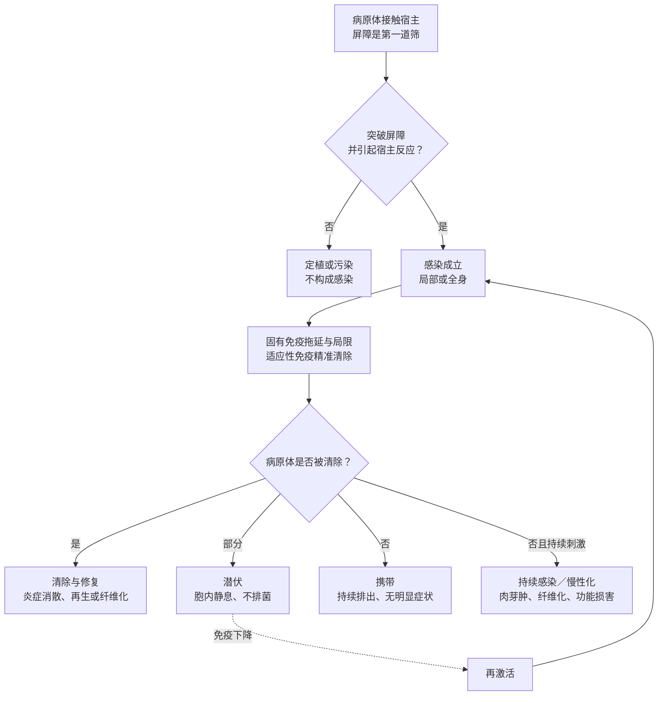

# 第 8 章 · 感染过程（Infectious Processes）

> **源**：`standards/binglishengli/supplements/jiangyi/U03-机体防御.md`（讲义第 8 章，本仓原创；`standards/binglishengli/supplements/jiangyi/`）
> **抽取**：`python scripts/build_binglishengli_textbook.py` · 2026-10-30 · sha256 `0af951783ae10a39b06df2d5979f68384b67c34488f101a33b4f02a7b987e64e…` · 正文一字未改
> **层次**：**源正文层**（讲义该章逐节照录）+ **改写层**（N.1–N.5 与思考题，见文末标记块，人工撰写）
> **规模**：10 节 · 4,709 汉字（现算；含学习目标/术语表/小结/自测题，与讲义索引的「节正文」口径不同）
> **免责**：本章为教学材料，只写类别与关系与机制，不写数值与正常值，不构成诊断、治疗或用药依据。

## 学习目标

完成本章学习后，你应当能够：

1. 复述机体三道防御防线，并说明各层缺损时感染风险如何改变；
2. 区分定植、隐性感染、潜伏感染与携带状态，说明其流行病学意义；
3. 从侵袭力、毒力因子、接种量与进入门户四方面解释病原体的致病力；
4. 用传播链六环节说明感染控制措施的着力点；
5. 描述发热与急性期反应的发生机制及其防御意义与代价；
6. 解释局部感染向脓毒症演进的机制主线，说明「感染」与「脓毒症」的区别；
7. 概述感染诊断的标本、实验室与影像思路，说明培养阴性的解释边界；
8. 针对儿童、老年与免疫抑制者说明感染表现的不典型性及护理要点。

## 8.1 正常防御机制回顾：三道防线

机体的防御是分层的。理解感染，首先要理解「平时为什么不生病」——健康不是没有病原体接触，而是接触被限制在屏障之外或被迅速清除。

- **第一道防线——屏障（barrier）**：完整皮肤与黏膜的角质层与紧密连接、黏液纤毛清除、胃酸、溶菌酶、泪液与唾液的冲刷，以及**正常菌群（normal flora）**提供的**定植抵抗（colonization resistance）**。这层防线即时、广谱、无记忆。
- **第二道防线——固有免疫（innate immunity）**：吞噬细胞、自然杀伤细胞、补体、急性期蛋白与炎症反应。它在数分钟至数小时内启动，识别的是「危险信号」而非某一特定病原体，不产生免疫记忆。
- **第三道防线——适应性免疫（adaptive immunity）**：T 细胞、B 细胞与抗体，具有特异性与记忆，首次应答需数天，再次应答迅速而强烈。

三层的接续关系值得记住：屏障破损后，固有免疫负责「拖延与局限」，适应性免疫负责「精准清除与记住」。临床上常见的防御缺损各有对应位置——大面积烧伤、留置导管、气管插管破坏第一道；粒细胞缺乏、补体缺陷削弱第二道；脾切除后对荚膜菌的清除能力下降，属第二道与第三道之间的接口缺损。护理上「保持屏障完整、减少不必要的侵入性装置」不是口号，而是成本最低、证据最稳的感染预防。

## 8.2 病原体的致病力：从定植到损伤

**定植（colonization）**指病原体在皮肤或黏膜表面繁殖，未侵入组织、未引起宿主反应；**感染（infection）**指病原体侵入组织并引起宿主反应，可伴或不伴明显临床表现。二者的界限由「屏障是否被突破」与「宿主是否应答」共同决定，而不是由病原体种类单独决定——同一株菌在皮肤上是常驻菌，进入血流就是致病菌。

致病力由几组因素叠加：

- **侵袭力（invasiveness）**：黏附素识别宿主受体完成附着；分泌酶类降解基质、跨越上皮；借助运动或细胞侵入进入深层。
- **免疫逃避（immune evasion）**：荚膜抗吞噬、表面抗原不断变异、分泌蛋白酶降解黏膜抗体、寄居细胞内躲避抗体、抑制补体在表面沉积。
- **毒力因子（virulence factors）**：**外毒素（exotoxin）**多由革兰阳性菌产生，作用有明确靶点（神经、细胞膜、蛋白质合成）；**内毒素（endotoxin）**是革兰阴性菌外膜的脂多糖，经模式识别受体触发炎症，是发热与休克的重要推手；**超抗原（superantigen）**绕过常规提呈方式，非特异性地大量激活 T 细胞，引起强烈细胞因子释放。
- **接种量（inoculum）与进入门户（portal of entry）**：数量越大、门户越「深」（血流、深部组织）越易发病。
- **机会性病原体（opportunistic pathogen）**：在屏障完整、免疫正常时通常不致病，在免疫受损时成为主力。

由此可以理解一个常见临床困惑：培养出某种微生物，不等于该微生物就是当前感染的病因；必须结合部位、数量、炎性细胞与宿主状态判断。

## 8.3 传播链与宿主决定因素

**传播链（chain of infection）**把感染的发生拆成六个可干预的环节，任一环被打断，传播即终止。

| 环节 | 含义 | 干预举例 |
|---|---|---|
| 病原体 | 致病微生物 | 灭菌、消毒、手卫生 |
| 储存宿主 | 人、动物、环境储源 | 隔离、环境清洁、病媒控制 |
| 排出门户 | 呼吸道、消化道、泌尿道、伤口、血液 | 分泌物与敷料管理、密闭式引流 |
| 传播途径 | 接触、飞沫、空气、媒介、血液体液 | 手套、口罩、通风、安全注射 |
| 进入门户 | 破损皮肤、黏膜、导管、手术切口 | 无菌技术、导管维护、皮肤准备 |
| 易感宿主 | 免疫低下、老年、婴幼儿、营养不良 | 疫苗、营养支持、免疫调节 |

**宿主因素**决定同样的病原体为何有人清除、有人重症：屏障完整性、粒细胞数量与功能、抗体与补体水平、营养状态（蛋白质、铁、维生素）、共生菌群构成、合并症（糖尿病、肝硬化、尿毒症）、以及年龄。这些因素多数可在护理评估中被识别，也正是「高危患者」这一概念的病理生理基础。

## 8.4 感染的临床类型与病程

同一病原体可呈现完全不同的临床类型，取决于宿主免疫与接种量——这解释了为何「接触者」中只有少数人发病。

- 按范围：**局部感染（local infection）**（脓肿、蜂窝织炎）与**全身感染（systemic infection）**（菌血症、脓毒症）。
- 按病程：**急性（acute）**、**亚急性（subacute）**、**慢性（chronic）**。慢性感染常伴肉芽肿形成、纤维化与持续抗原刺激。
- 按表现：
  - **显性感染（overt infection）**：有明确的症状与体征；
  - **隐性感染（inapparent / subclinical infection）**：无明显表现，但产生免疫应答，是人群免疫的重要来源；
  - **潜伏感染（latent infection）**：病原体长期存留于细胞内、可无复制，在免疫下降时**再激活（reactivation）**；
  - **携带状态（carrier state）**：持续排出病原体而无明显症状，是重要的传播源。
- 按来源：**社区获得性（community-acquired）**、**医疗相关（health care-associated）**、**机会性（opportunistic）**。

这四类之间可以互相转换，判据是两个彼此独立的维度——「有无症状」与「有无排出病原体」，而不是病程长短。潜伏感染一般不排菌，因而**不构成传染源**；携带状态持续排菌而无症状，是隐性传播的主要来源。把「病程长」等同于「慢性携带」是常见误判。另有一种中间状态：病原体附着于器械或坏死组织表面形成**生物膜（biofilm）**，代谢低下、被基质包裹，对药物与吞噬细胞都不敏感，可长期无症状存在且培养常为阴性，一旦基质被破坏便重新表现为显性感染。

「隐性感染多、显性感染少」是多数传染病的共同规律，也是为何防控要着眼于群体而非仅盯着确诊者。

## 8.5 感染的全身反应：发热与急性期反应

**发热（fever）**是感染最常见的全身表现，其机制是一条可完整复述的链条：病原体产物（**外源性致热原，exogenous pyrogen**）→ 单核巨噬细胞释放**内源性致热原（endogenous pyrogen，如白细胞介素-1、白细胞介素-6、肿瘤坏死因子）**→ 下丘脑局部合成前列腺素 E2 → **体温调定点（set point）上移** → 产热增加、散热减少 → 体温升高。理解这一链条就能理解临床现象：调定点上移阶段患者畏寒、寒战（产热），随后才出汗退热；因此单纯物理降温只能缓解不适，不能改变调定点。

**急性期反应（acute-phase response）**是肝脏在细胞因子驱动下改变蛋白合成谱：

- **C 反应蛋白（CRP）**、血清淀粉样蛋白 A 升高；
- **铁调素（hepcidin）**升高 → 肠道铁吸收减少、巨噬细胞扣留铁 → **血清铁下降**，这是一种「营养免疫」，通过剥夺病原体必需的铁来抑制其增殖；
- 纤维蛋白原升高 → 红细胞沉降率加快；
- 白细胞总数升高并出现**核左移（left shift）**，即未成熟中性粒细胞进入外周血。

同时出现**疾病行为（sickness behavior）**：乏力、食欲下降、嗜睡、注意力下降，由细胞因子作用于中枢所致。这些反应有防御价值，但持续过久会造成肌肉分解、负氮平衡与功能衰退，尤其在老年与慢病患者中。

**临床联系**：老年、免疫抑制、严重营养不良者的感染可以不发热，CRP 也可不显著升高。以「没有发烧」排除感染是危险的推理；应结合功能状态改变（谵妄、跌倒、进食减少）与局部线索综合判断。

## 8.6 从局部感染到脓毒症：一条连续谱

局部感染若未被局限，可沿「局部 → 入血 → 全身炎症 → 器官功能障碍」演进。现代概念把最严重的环节表述为**脓毒症（sepsis）**：宿主对感染的反应失调所致的、危及生命的器官功能障碍；**脓毒性休克（septic shock）**是其中伴更严重循环、细胞与代谢异常的亚群（此处只列类别，不展开分级标准）。

机制主线可分为五步：

1. 病原体分子（**病原体相关分子模式，PAMP**）被**模式识别受体（PRR）**识别；
2. 促炎细胞因子大量释放，抗炎反应同时启动，二者失衡；
3. 内皮活化与损伤 → 毛细血管通透性增加、**毛细血管渗漏**、微血管血栓形成；
4. 血管扩张与心肌抑制 → 有效循环血量相对不足 → 组织灌注下降；
5. 细胞氧利用障碍 → 乳酸升高 → 多器官功能障碍（脑、肾、肺、肝、凝血）。

这一主线解释了两个临床要点：其一，决定预后的往往不是病原体数量，而是**宿主反应失调的程度**；其二，「感染」与「脓毒症」不是同义词——存在感染不等于存在脓毒症，而脓毒症也不总有血培养阳性。护理观察的重心因此落在**灌注与器官功能的动态变化**（意识、尿量、皮肤温度与花斑、毛细血管再充盈），而非单一体温数值。

这条主线不依赖病原体类别：细菌、真菌、病毒与寄生虫都能启动同一套宿主反应，差别只在被识别的分子模式与识别受体不同。因此「培养阴性」不能推翻脓毒症的判断，临床上确实存在培养始终阴性的病例；反过来说，血培养阳性而器官功能完好也不等于脓毒症。把「阳性结果」当作诊断门槛，会同时造成过度诊断与漏诊两种错误。

## 8.7 感染的诊断思路

诊断是把四个问题依次回答：有没有感染、在哪里、由什么引起、到什么程度。

- **病史与体检**：起病时间与速度、局部症状、暴露与接触史、旅行史、既往抗菌药物与侵入性操作史；
- **标本**：血液、尿液、痰、脑脊液、伤口分泌物、脓液、组织。**无菌部位标本**（血液、脑脊液、胸腔积液、关节液）临床意义最大，因不易被常驻菌污染；
- **实验室**：涂片染色观察形态与炎性细胞；培养与药敏确定病原体及敏感类别；抗原检测与**核酸扩增检测（NAAT）**缩短窗口期；血清学检测抗体动态变化，需双份血清比较；
- **炎症标志物**：CRP、降钙素原等用于动态观察与辅助判断，**不能单独作为诊断依据**；
- **影像与病理**：定位病灶、评估并发症（脓肿、积液、坏死、梗阻）。

三条原则值得反复强调：**先取样、后用药**（否则培养阳性率大幅下降）；**培养阴性不能排除感染**（已用抗菌药物、标本量不足、苛养菌、深部病灶、生物膜）；**结果须结合临床解释**，避免把定植当感染、把污染当病原。

## 8.8 感染的转归

| 转归 | 机制与表现 |
|---|---|
| 清除与修复 | 病原体被清除，炎症消散，组织再生或纤维化修复 |
| 携带状态 | 病原体持续存在并排出，宿主无明显症状 |
| 潜伏与再激活 | 病原体在细胞内静息，免疫下降时复发 |
| 慢性化 | 持续抗原刺激 → 肉芽肿、纤维化、功能损害 |
| 并发症 | 脓肿、菌血症、脓毒症、感染性心内膜炎、免疫复合物相关损害 |

转归取决于**病原体毒力与数量**同**宿主防御**之间的对比，而非单一因素。这也解释了为何不同感染的清除动力学差异很大：胞内寄生病原体需要细胞免疫参与，生物膜内的病原体难以被药物与吞噬细胞触及，无血管区域（如瘢痕、死腔）则两者都难以到达。

## 8.9 医疗相关感染与感染防控

**医疗相关感染（health care-associated infection, HAI）**指在医疗活动中获得的感染。常见类别包括**导管相关血流感染**、**呼吸机相关肺炎**、**导尿管相关尿路感染**、**手术部位感染**。其共同机制是：屏障被器械突破 + 器械表面生物膜形成 + 宿主防御下降。

防控分两个层次：

- **标准预防（standard precautions）**：视所有血液与体液为潜在传染源——手卫生、手套、隔离衣、面屏、锐器安全处置、废弃物管理；
- **额外预防（transmission-based precautions）**：按传播途径加用**接触隔离**、**飞沫隔离**或**空气隔离**；病原体未明确时，按最可能的途径先行处置，不等待结果。

其他关键点：严格无菌技术；每日评估并尽早移除导管；床头抬高与口腔护理以减少误吸；围手术期血糖与体温管理；环境清洁；以及**抗微生物药物的合理使用**——耐药不是「某种药对某个人不管用」，而是群体层面的选择结果，因此防控带有集体责任的性质。

## 8.10 生命周期考量与护理联系

- **儿童**：免疫系统尚在成熟过程中，集体环境接触密集，表现常不典型——婴儿可仅表现为喂养差、反应弱、体温不稳；皮疹性疾病的形态与年龄相关。
- **老年**：**免疫衰老（immunosenescence）**使应答减弱，皮肤黏膜屏障变薄，咳嗽与吞咽功能下降，感染常以**谵妄、跌倒、进食减少**为首发，发热可不明显。
- **免疫抑制者**：炎症反应弱，局部红肿热痛不显著，标志物可不升高，需要更低的检查门槛与更密的观察。

护理动作可归纳为四组：**评估**（风险画像与早期信号）、**监测**（生命体征、灌注、意识、尿量与标志物趋势）、**控制**（手卫生、隔离、导管与伤口管理）、**支持**（水化、营养、休息、疼痛与发热的舒适管理、疫苗与健康教育）。与感染者的沟通应中性、以行为与风险为中心，避免把疾病与道德评价挂钩——这既是伦理要求，也直接影响患者是否愿意配合检测与随访。

## 关键术语表（中英对照）

| 术语 | 中文 | 术语 | 中文 |
|---|---|---|---|
| infection | 感染 | colonization | 定植 |
| virulence | 毒力 | invasiveness | 侵袭力 |
| exotoxin | 外毒素 | endotoxin | 内毒素 |
| superantigen | 超抗原 | opportunistic pathogen | 机会性病原体 |
| chain of infection | 传播链 | normal flora | 正常菌群 |
| latent infection | 潜伏感染 | carrier state | 携带状态 |
| endogenous pyrogen | 内源性致热原 | acute-phase response | 急性期反应 |
| left shift | 核左移 | sepsis | 脓毒症 |
| septic shock | 脓毒性休克 | health care-associated infection | 医疗相关感染 |
| standard precautions | 标准预防 | immunosenescence | 免疫衰老 |
| biofilm | 生物膜 | subclinical infection | 隐性感染 |

## 本章小结（Key Points）

- 防御分三层：屏障、固有免疫、适应性免疫；缺损位置决定易感病原体类别与感染部位。
- 定植与感染的分界在于「是否侵入组织并引起宿主反应」，不由病原体种类单独决定。
- 致病力 = 侵袭力 + 毒力因子 + 接种量 + 进入门户，再乘以宿主易感性。
- 传播链六环节中任一环被打断，传播即终止；标准预防 + 额外预防是落地形式。
- 发热的本质是体温调定点上移；急性期反应包含 CRP 升高、血清铁下降、核左移与疾病行为。
- 脓毒症的关键是「宿主反应失调 + 器官功能障碍」，不是「有感染」本身。
- 培养阴性不能排除感染；先取样后用药是提高诊断率的最简单办法。

## 自测题

**A 型选择题**

1. 关于定植与感染的区别，正确的是（　）
   A. 定植即感染早期　B. 感染必须有血培养阳性　C. 定植必然引起发热　D. 定植指病原体在体表繁殖而未侵入组织　E. 定植不需处理即为感染
2. 内毒素的化学本质是（　）
   A. 革兰阳性菌分泌的蛋白质　B. 革兰阴性菌外膜的脂多糖　C. 细菌荚膜多糖　D. 细菌 DNA　E. 宿主补体片段
3. 发热时畏寒、寒战出现的主要机制是（　）
   A. 散热增加　B. 甲状腺激素减少　C. 汗腺分泌增加　D. 下丘脑体温调定点下移　E. 体温调定点上移、实际体温低于调定点
4. 急性期反应中血清铁下降的意义是（　）
   A. 属于「营养免疫」，限制病原体获取铁　B. 提示缺铁性贫血　C. 表示肝功能衰竭　D. 与炎症无关　E. 提示溶血
5. 关于脓毒症，说法正确的是（　）
   A. 等同于一过性菌血症　B. 必须有血培养阳性　C. 是宿主对感染的反应失调导致器官功能障碍　D. 仅由革兰阴性菌引起　E. 与宿主反应强度无关

**简答题**

6. 用传播链六环节说明，为什么「手卫生」能同时阻断多种传播途径。
7. 一位 82 岁患者突发谵妄、进食减少、尿量偏少，体温 36.8 ℃。请说明为何不能据此排除感染，并提出两项进一步评估。

**参考答案**：1.D　2.B　3.E　4.A　5.C　6.（手是接触传播与间接接触的核心载体，也是飞沫沉降后的常见污染环节；洗手切断「传播途径」一环，对多种病原体同时有效，且不受病原体是否已明确限制）7.（老年免疫衰老与炎症反应减弱，发热可缺如；应评估意识与功能基线变化、局部症状、灌注与尿量、炎症标志物与必要标本；谵妄本身即为老年感染的常见首发表现）

---
<!-- REWRITE:BEGIN -->
## 本章要回答的问题

为什么感染的结局要按「有无症状」与「有无排出病原体」两个独立维度分，而不是按病程长短分——以及这条判据画成图之后，哪几种转归画得出、哪几种画不出。

## N.1 概念与出处

| 概念 | 讲义出处 | 代用底本对应 | 说明 |
|---|---|---|---|
| 三道防线：屏障、固有、适应 | `第8章·8.1` | `教材·疾病学基础·第12章·12.1.1`（固有免疫）、`12.1.2`（适应性免疫） | 底本分两层，屏障层讲义独有 |
| 定植与感染的界限 | `第8章·8.2` | `第12章·12.4.1`（病原类别的分类思路） | 底本给病原分类，不给这条判据 |
| 毒力因子：外毒素、内毒素、超抗原 | `第8章·8.2` | 无 | 底本无毒素类别 |
| 传播链六环节 | `第8章·8.3` | `第12章·12.4.3`（传播环节类别） | 底本也写链式环节，且明写不污名化 |
| 四种临床类型与病程 | `第8章·8.4` | 部分：`第12章·12.4.2`（感染途径类别） | 潜伏与携带的判据是讲义独有 |
| 发热链条与急性期反应 | `第8章·8.5` | `教材·疾病学基础·第6章·6.3.1`（致热原）、`6.3.2`（体温调节环节）、`6.4.1`（体温上升期） | 底本有完整链条与分期 |
| 脓毒症：宿主反应失调加器官功能障碍 | `第8章·8.6` | 部分：`教材·疾病学基础·第7章·7.1.1`（休克概念）、`7.2.2`（进展期微循环） | 底本讲休克，不含「感染」这个前提 |
| 诊断思路与培养阴性的解释边界 | `第8章·8.7` | 无 | 底本不涉检验 |
| 转归五类 | `第8章·8.8` | 部分：`教材·疾病学基础·第1章·1.4.1`（完全康复）、`第3章·3.3.1`（修复环节） | 底本按康复程度分，不按排菌分 |
| 医疗相关感染与防控 | `第8章·8.9` | `第12章·12.4.3` | 底本给环节干预，无器械相关类别 |

**出处口径**：底本没有独立的「感染过程」章，相关正文分散在第 12 章（免疫与病原）与第 6、7 章（发热、休克）。所以本章的对应是**按主题拼出来的**，不是逐节对得上：三处写「无」，是因为底本确实没有。

## N.2 为什么可以这样翻译

结局可以画成一个以「是否清除」为主轴的分叉：

为什么对得上：`8.4` 明说这四类之间的判据是两个**彼此独立**的维度——有无症状、有无排出病原体；`8.8` 的转归表是同一组再加「并发症」。图把它们画成同一个分叉节点的几个出口，而不是时间上的先后。四个出口可以互转：携带者能清除，潜伏能再激活，慢性化能叠加并发症——这是「结局」而非「终点」的意思。

有一处最容易画错：**脓毒症不是四个出口之一**。`8.6` 的五步讲的是宿主反应这一侧，与「病原体去哪了」正交。把脓毒症画成结局，等于把「宿主反应」与「病原体归宿」压成一根轴，于是「培养阴性却是脓毒症」就无处安放。

失效条件：图说不出时间尺度，也说不出病原体一侧的差异（胞内寄生、生物膜、无血管死腔三种「难清除」在图上是同一条边）。

## N.3 这个翻译丢掉了什么

1. **病原体一侧的差异被抹平。** 胞内寄生病原体要细胞免疫参与，生物膜内者药物与吞噬细胞都够不着，无血管区域两者都到不了。`8.8` 末尾点了这三种，图上却只有一条「未清除」的边。
2. **「不排菌」是推断出来的。** 潜伏与携带靠采样阴性区分，而采样有假阴性；图把「没查到」写成「没有」，这一跳在临床上代价很高。
3. **时间尺度。** 潜伏可以以年计，脓毒症以小时计，图上都在同一层。读者容易以为四种结局的「节奏」差不多。
4. **宿主是连续量。** 免疫衰老、营养不良、糖尿病都是程度问题，图上只有一条「免疫下降」的边，把程度压成了开关。
5. **人的行动不在图里。** 是否就医、是否隔离、是否因病因被区别对待，直接决定传播是否继续。`8.4` 说携带者是「重要传染源」，而传染源是人。
6. **治疗对自然史的改写。** 图是未干预的走向；抗菌药物与支持治疗会把病程从某条边拉回来，图上没有这种走法。

一句话：**它擅长讲「病原体去哪了」，不擅长讲「用了多久、这个人为什么没清掉、他还能不能正常上班」。**

## N.4 与相邻学科的接口

- **微生物学**：病原类别、毒力因子、培养特性是零件。本章只取「它们如何改变结局的分叉」。
- **免疫学**（`09-jichu` 的炎症与免疫两章）：三道防线的第二、三层在此展开。免疫章讲识别与效应，本章讲「效应不足或过度时结局怎么变」。
- **流行病学**：传播链与群体免疫是人群侧的语言。本章给单例的机制，流行病学给「多少人、往哪传」。
- **中医学**：「疠气」讲病因的特殊性，「伏邪」讲邪伏而待发——与潜伏感染在结构上同构（静息—再激活），但这是**结构对应**，不是等同：伏邪的判据是证候，潜伏的判据是病原学。「正气存内，邪不可干」落在宿主一侧。
- **tcmP 平台**：桥接句「传播链→有向图」「结局→状态机」。平台把六环节实现为六个可干预节点，把四类结局实现为状态的转移而不是标签。

## N.5 争议与本项目立场

**争议一：「感染」与「脓毒症」的边界画在哪。** 一派以病原学证据为界，一派以宿主反应与器官功能障碍为界。**本项目立场：后者。** 依据是 `8.6` 明说培养阴性不能推翻判断、血培养阳性而器官功能完好也不等于脓毒症；底本 `7.1.1` 的休克概念只到循环，不含器官功能这一层——两处合起来说明这条边界不在病原体一侧。

**争议二：潜伏与携带该不该合并成一类。** 两者都无症状，合并省事。**本项目立场：不合并，按「是否排菌」分。** 依据是 `8.4` 的两个独立维度：潜伏一般不排菌，不构成传染源；携带持续排菌，是隐性传播的主要来源。合并会把「不必隔离」与「必须管理」写成同一件事。

**争议三：发热能不能当感染的筛查门槛。** 便利，但不安全。**本项目立场：只能作线索。** 依据是 `8.5` 与 `8.10`：老年、免疫抑制、严重营养不良者可以无发热，谵妄、跌倒、进食减少可以是唯一首发。本课程不写数值，也不给任何体温阈值——门槛一旦写成数字，就会取代判断。

> 本章改写层是教学解读，不构成诊断、治疗或用药依据。

## 思考题

1. 用那个分叉节点说明：为什么「携带者」与「潜伏者」必须分开画，而病历上常被写成同一句「无症状」？
2. 脓毒症为什么不是四类结局之一？如果把它画进图里，会与哪一条已经成立的判断冲突？
3. 图上的「再激活」是一条回边。回边的存在说明这套分类是「状态」还是「阶段」？
4. 「不排菌」是采样阴性推出来的。这条推断在什么条件下最不可靠，为什么？

## 延伸阅读

- 讲义 `standards/binglishengli/supplements/jiangyi/U03-机体防御.md` 第 8 章（本仓原创，可逐字核）。
- 代用底本《疾病学基础》第 12 章 12.1 与 12.4、第 6 章 6.3 与 6.4、第 7 章 7.1 与 7.2（`standards/binglishengli/底本.json`）。本章的底本对应是按主题拼的，不是逐节对得上。
- 本仓第 9 章（炎症与免疫）与第 10 章（免疫功能异常）：三层防线的展开与缺损。
- 本仓第 34 章（性传播感染）：传播链与不污名化要求在一个具体场景里的用法。
- Banasik, *Pathophysiology*, 8th ed.（目录结构来源；**本仓未持有原书**，不作引用）。

> 本章只写类别与关系，涉及个体的判断由具备资质的人员作出；不构成诊断、治疗或用药依据。
<!-- REWRITE:END -->
