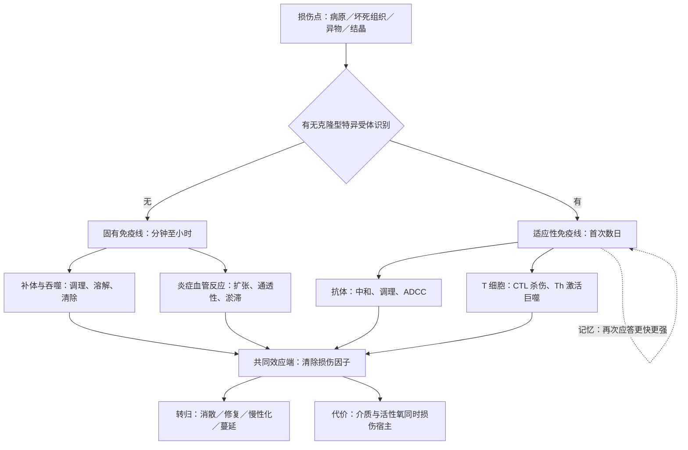

# 第 9 章 · 炎症与免疫（Inflammation and Immunity）

> **源**：`standards/binglishengli/supplements/jiangyi/U03-机体防御.md`（讲义第 9 章，本仓原创；`standards/binglishengli/supplements/jiangyi/`）
> **抽取**：`python scripts/build_binglishengli_textbook.py` · 2026-10-30 · sha256 `0af951783ae10a39b06df2d5979f68384b67c34488f101a33b4f02a7b987e64e…` · 正文一字未改
> **层次**：**源正文层**（讲义该章逐节照录）+ **改写层**（N.1–N.5 与思考题，见文末标记块，人工撰写）
> **规模**：11 节 · 5,166 汉字（现算；含学习目标/术语表/小结/自测题，与讲义索引的「节正文」口径不同）
> **免责**：本章为教学材料，只写类别与关系与机制，不写数值与正常值，不构成诊断、治疗或用药依据。

## 学习目标

完成本章学习后，你应当能够：

1. 定义炎症并说明其目的，区分炎症与感染、炎症与免疫；
2. 描述炎症的血管反应（血管扩张、通透性增加、血流改变）及其临床表现的对应关系；
3. 复述白细胞募集的步骤与吞噬杀菌的三个阶段；
4. 列举主要炎症介质及其效应，说明介质的「防御—损伤」双重性；
5. 按渗出物性质区分炎症的形态学类型，并说明各类的临床意义；
6. 说明炎症的四种转归及慢性炎症的后果；
7. 区分固有免疫与适应性免疫的识别方式、时相与记忆特征；
8. 说明抗体类别的主要功能与 T 细胞亚群的分工；
9. 论证「炎症不等于免疫」，并指出二者在临床上的交汇点。

## 9.1 炎症的定义与目的

**炎症（inflammation）**是活体组织对损伤因子所发生的、以血管反应和细胞反应为主的防御性反应，目的是**清除损伤因子、清除坏死组织、为修复创造条件**。它的经典局部表现是红、肿、热、痛与功能障碍，全身表现是发热、白细胞升高与急性期反应。

理解炎症要先立三条界限：

1. 炎症是**反应过程**，不是疾病实体，也不是病原体。临床上说「肺炎」「肾炎」，指的是「某部位的炎症性疾病」，炎症只是其中的过程成分。
2. 炎症可由感染引起，也可由**无菌性因素**引起：创伤、烧伤、缺血再灌注、化学刺激、结晶体、异物、自身免疫反应。因此「没有感染」不等于「没有炎症」。
3. **炎症不等于免疫**。炎症是血管与细胞层面的效应程序，免疫是具备特异识别与记忆的系统能力。二者共享细胞与介质，却不能互相替代——本章前半讲炎症，后半讲免疫，最后在 9.11 处把两者合起来并说清区别。

## 9.2 炎症的血管反应

血管反应是炎症最先出现、也最能解释局部体征的环节。

- **短暂的血管收缩**（数秒至数分钟）随后转为**血管扩张（vasodilation）**：小动脉与毛细血管床开放，局部血流增加 → **红（redness）与热（heat）**。
- **通透性增加（increased permeability）**：内皮细胞收缩使细胞间隙增宽、内皮损伤直接漏出、白细胞黏附后穿越内皮、以及新生毛细血管本身较脆弱。富含蛋白的液体渗入组织间隙 → **肿（swelling）**，并因组织张力升高与介质刺激神经末梢 → **痛（pain）**。
- **血流减慢与淤滞**：血液黏稠度上升、红细胞聚集，血流由轴流变为摆动，白细胞离开中心轴趋向血管壁，称**边集（margination）**。这一改变是白细胞游出的前提。
- **渗出液与漏出液的区分**：**渗出液（exudate）**蛋白含量高、比重高、细胞多，提示通透性显著增加（炎症）；**漏出液（transudate）**蛋白少、细胞少，多因静水压升高或胶体渗透压降低（如心力衰竭、低蛋白血症）。这一区分是判断积液性质的基本功。
- **功能障碍（loss of function）**：疼痛、肿胀与组织损伤共同限制活动，本身具有「制动休息」的保护意义。

## 9.3 炎症的细胞反应：募集与吞噬

细胞反应的目标是把吞噬细胞送到损伤现场。**白细胞募集**可分五步：

1. **边集与滚动（rolling）**：内皮表面的选择素与白细胞表面糖配体低亲和力结合，白细胞沿血管壁滚动；
2. **黏附（adhesion）**：趋化因子激活白细胞整合素，与内皮细胞间黏附分子结合，形成牢固黏附；
3. **跨内皮迁移（transmigration）**：白细胞穿过内皮细胞间隙与基底膜；
4. **趋化（chemotaxis）**：沿补体片段、白三烯、趋化因子等浓度梯度向病灶移动；
5. **激活与吞噬**。

**吞噬（phagocytosis）**与杀灭分三步：**识别与调理（opsonization）**——抗体 IgG 的 Fc 段与补体 C3b 包被病原体，使吞噬细胞易于识别；**吞入**——伪足包绕形成吞噬体，与溶酶体融合成吞噬溶酶体；**杀灭**——**氧化爆发（respiratory burst）**产生活性氧，配合溶酶体水解酶、防御素、一氧化氮等完成降解。

参与细胞各有分工：**中性粒细胞**数量多、到达早、寿命短，是急性炎症与化脓性炎症的主力；**单核巨噬细胞**到达较晚、存活久，负责清理、提呈抗原与组织重塑，是慢性炎症与肉芽肿的主角；**嗜酸性粒细胞**参与寄生虫防御与过敏反应；**淋巴细胞**在慢性炎症与病毒感染中聚集。巨噬细胞还可按 microenvironment 信号呈现不同功能表型（促炎表型与修复表型），这解释了同一细胞在早期与修复期行为相反。

## 9.4 炎症介质

介质是炎症的「化学语言」，可来自血浆（补体、激肽、凝血系统）或来自细胞（预存于颗粒或新合成）。

| 介质类别 | 代表 | 主要效应 |
|---|---|---|
| 血管活性胺 | 组胺、5-羟色胺 | 血管扩张、通透性增加、瘙痒 |
| 脂质介质 | 前列腺素、白三烯、血小板活化因子 | 发热、疼痛、支气管收缩、趋化、血小板聚集 |
| 细胞因子 | 肿瘤坏死因子、白细胞介素-1、白细胞介素-6、趋化因子 | 局部内皮活化、全身急性期反应、白细胞募集 |
| 补体片段 | C3a、C5a、C5b-9 | 过敏毒素、趋化、膜攻击复合物溶解细胞 |
| 激肽系统 | 缓激肽 | 血管扩张、疼痛、通透性增加 |
| 凝血与纤溶 | 凝血酶、纤维蛋白降解产物 | 纤维蛋白沉积、趋化、血管改变 |
| 酶与活性氧 | 蛋白酶、活性氧 | 组织降解、杀灭病原体，过量则损伤宿主 |

必须记住介质的**双重性**：同一套工具既用于防御也造成损伤。蛋白酶溶解病原体周围基质的同时也溶解宿主组织；活性氧杀灭细菌的同时也损伤内皮与实质细胞。慢性炎症之所以致病，很大程度上是这套工具长期开启的结果。这也是抗炎治疗的理论基础——不是「消灭炎症」，而是调节其强度与时长。

## 9.5 炎症的形态学类型与全身表现

按渗出物性质与细胞构成，炎症可分为若干类型，类型本身提示病因与病程：

- **浆液性炎（serous inflammation）**：以浆液渗出为主，细胞少，如烫伤水疱、胸膜腔浆液性积液；一般较轻，可完全吸收。
- **纤维蛋白性炎（fibrinous inflammation）**：血管通透性显著增加，纤维蛋白原大量渗出并凝固，发生于体腔或黏膜表面；在黏膜可形成**假膜（pseudomembrane）**。纤维蛋白机化可致粘连。
- **化脓性炎（suppurative / purulent inflammation）**：大量中性粒细胞浸润并坏死，形成**脓液（pus）**；局限化则成**脓肿（abscess）**，可被肉芽组织包裹形成脓肿壁。
- **肉芽肿性炎（granulomatous inflammation）**：巨噬细胞转化为上皮样细胞并融合为多核巨细胞，外周环绕淋巴细胞与纤维组织。它是机体对「难以清除的病原体或异物」的应对方式，常见于结核、真菌感染与异物反应。
- **溃疡（ulcer）**：黏膜或皮肤表层坏死脱落形成的缺损，愈合可留瘢痕。

全身表现包括发热、乏力、食欲下降、白细胞升高与急性期反应物升高，机制已在第 8 章叙述。类型判断的临床价值在于：它提示病程阶段（急性渗出 vs 慢性增生）、可能的病因类别，以及是否已形成需要引流的局限化病灶。

## 9.6 炎症的转归

炎症有四种去向，取决于损伤程度、病原体能否清除与组织再生能力：

1. **消散（resolution）**：病因清除，渗出物被吸收，细胞回到原位，组织完全恢复。见于轻度、短时的损伤。
2. **修复（repair）**：组织缺损由**再生（regeneration）**或**纤维化（fibrosis）**填补。再生能力取决于细胞类型——上皮、肝细胞等稳定细胞可再生；心肌、神经元等永久细胞不能，只能瘢痕修复。瘢痕能恢复连续性，但不具备原组织的功能。
3. **慢性化（chronicity）**：炎症持续数周至数年，浸润细胞由中性粒细胞转为单核细胞、淋巴细胞与浆细胞，伴血管新生与纤维化。结局是功能受损、粘连、狭窄、挛缩。
4. **蔓延与并发症**：向周围扩散（蜂窝织炎）、经管道蔓延（窦道、瘘管）、入血（菌血症、脓毒症）、或长期刺激导致上皮异型增生。

过度炎症同样是损害来源：肺泡毛细血管膜损伤可致急性呼吸窘迫，全身反应失调可致脓毒症，组织破坏可致器官功能丧失。因此「抗炎」与「促修复」在临床上常需同时考虑，而不是一味压制。

## 9.7 免疫系统的组成

从炎症转到免疫，先看系统的「硬件」。

- **中枢免疫器官**：骨髓（B 细胞发育与全部血细胞生成场所）、胸腺（T 细胞发育与选择）。
- **外周免疫器官**：淋巴结、脾、扁桃体、黏膜相关淋巴组织。它们是抗原被集中提呈、淋巴细胞相遇并增殖的场所。
- **细胞**：淋巴细胞（T 细胞、B 细胞、自然杀伤细胞）、**抗原提呈细胞（antigen-presenting cell, APC）**（树突状细胞、巨噬细胞、B 细胞）、各类粒细胞与肥大细胞。
- **分子**：抗体、补体、细胞因子、急性期蛋白、抗菌肽。

功能上分两大臂：**固有免疫（innate immunity）**与**适应性免疫（adaptive immunity）**。

| 比较项 | 固有免疫 | 适应性免疫 |
|---|---|---|
| 识别方式 | 模式识别受体识别保守分子模式 | 抗原受体特异性识别单一抗原表位 |
| 应答速度 | 数分钟至数小时 | 首次数天，再次迅速 |
| 特异性 | 广谱、低特异 | 高度特异 |
| 记忆 | 无经典记忆 | 有免疫记忆 |
| 主要成分 | 吞噬细胞、NK 细胞、补体、细胞因子 | T 细胞、B 细胞、抗体 |

两臂并非接力式的先后关系，而是持续对话：固有免疫提供「危险信号」与共刺激，决定适应性免疫是否启动、朝哪个方向分化；适应性免疫的产物（抗体、细胞因子）又反过来增强固有免疫的效应。

## 9.8 固有免疫：识别与效应

固有免疫的识别逻辑是「识别危险，而非识别某一种敌人」。细胞通过**模式识别受体（pattern recognition receptor, PRR）**识别病原体表面的**病原体相关分子模式（PAMP）**，以及损伤细胞释放的**损伤相关分子模式（DAMP）**。

主要效应包括：

- **吞噬与胞内杀灭**：巨噬细胞与中性粒细胞清除病原体与细胞碎片；
- **自然杀伤细胞（NK cell）**：识别「自我标记缺失」或应激配体上调的细胞并直接杀伤，是抗病毒与抗肿瘤的早期力量，不需要预先致敏；
- **补体系统**：经**经典途径**（抗体结合后启动）、**替代途径**（病原体表面直接激活）与**凝集素途径**（识别病原体表面糖结构）级联放大，产生调理、趋化与膜攻击复合物溶解；
- **细胞因子**：**I 型干扰素**诱导邻近细胞进入抗病毒状态；促炎细胞因子启动炎症与急性期反应；
- **屏障与化学防御**：抗菌肽、溶菌酶、低 pH。

固有免疫的「无记忆」需加一句限定：近年研究提示某些固有免疫细胞经刺激后可呈现增强的再应答（常被称作训练免疫），但其特异性和持久性都远不及适应性免疫，不宜与免疫记忆等同。

## 9.9 体液免疫：B 细胞与抗体

**B 细胞**在骨髓中发育，表面**B 细胞受体（BCR）**即膜型抗体，每条 B 细胞克隆只识别一个抗原表位。

- **活化**：多数蛋白质抗原需要 **T 细胞辅助**——B 细胞内吞抗原、加工后以 MHC II 类分子提呈给辅助性 T 细胞，获得共刺激与细胞因子信号，进入淋巴结生发中心，发生**类别转换（class switching）**与**亲和力成熟（affinity maturation）**；多糖类抗原可在无 T 细胞辅助下直接激活 B 细胞，主要产生 IgM，记忆较弱。
- **抗体类别与功能**：

| 类别 | 主要分布 | 主要功能 |
|---|---|---|
| IgM | 血清、初次应答 | 高效凝集与激活补体，五聚体结构 |
| IgG | 血清与组织液、再次应答 | 中和、调理、激活补体、**唯一可经胎盘** |
| IgA | 黏膜分泌液、乳汁 | 黏膜免疫屏障，分泌片保护其不被降解 |
| IgE | 结合于肥大细胞与嗜碱性粒细胞 | 过敏反应与抗寄生虫 |
| IgD | B 细胞表面 | 作为 BCR 组分参与成熟 |

- **效应方式**：**中和（neutralization）**阻断病原体黏附或毒素活性；**调理（opsonization）**促进吞噬；**激活补体**；**抗体依赖细胞介导的细胞毒作用（ADCC）**；黏膜表面的免疫排斥。
- **记忆 B 细胞**使再次接触同一抗原时产生更快、更高亲和力、以 IgG 为主的应答，这是疫苗起效的基本原理。

## 9.10 细胞免疫：T 细胞、提呈与记忆

**T 细胞**在胸腺中发育，经**阳性选择**（能识别自身 MHC 者存活）与**阴性选择**（对自身抗原高亲和力者删除）形成**中枢耐受（central tolerance）**，随后进入外周。

T 细胞的识别受 **MHC（主要组织相容性复合体）**限制：

- **MHC I 类分子**表达于几乎所有有核细胞，提呈**内源性**抗原（如病毒蛋白、肿瘤抗原）给 **CD8⁺ 细胞毒性 T 细胞**；
- **MHC II 类分子**主要表达于抗原提呈细胞，提呈**外源性**抗原给 **CD4⁺ 辅助性 T 细胞**。

CD4⁺ 细胞按细胞因子谱分化，分工明确：**Th1** 增强巨噬细胞杀灭胞内病原体的能力；**Th2** 促进 B 细胞产生抗体并参与过敏反应；**Th17** 招募中性粒细胞、参与黏膜防御；**调节性 T 细胞（Treg）**抑制过度应答、维持**外周耐受（peripheral tolerance）**。

**细胞毒性 T 细胞（CTL）**的杀伤机制包括释放穿孔素与颗粒酶、通过 Fas-FasL 诱导凋亡。其意义在于清除「藏在自己细胞里的病原体」——这是抗体无法完成的任务，也是抗病毒与抗肿瘤免疫的核心。

**免疫记忆**由记忆 T 细胞与记忆 B 细胞共同承担，使再次应答在量与质上都优于初次应答。理解这一点，就理解了为何有些感染一生只得一次，而有些（如流感）因抗原变异而反复发生。

## 9.11 合起来看：炎症与免疫的分工、交汇与区别

把两半放在一起，可以得到一张对照表：

| 比较项 | 炎症 | 免疫 |
|---|---|---|
| 本质 | 血管-细胞效应程序（反应过程） | 具备识别与记忆的系统能力 |
| 触发 | 任何损伤：感染、创伤、缺血、化学物、结晶体 | 抗原被特异性受体识别 |
| 特异性 | 无（同一套反应应对不同原因） | 有（克隆选择，高度特异） |
| 时相 | 急性（分钟至天）或慢性（周至年） | 初次应答数天，记忆可维持数年 |
| 记忆 | 无 | 有 |
| 主要细胞 | 中性粒细胞、巨噬细胞、内皮、血小板 | T 细胞、B 细胞、抗原提呈细胞 |
| 共享成分 | 补体、细胞因子、巨噬细胞、肥大细胞 | 同左 |

**「炎症不等于免疫」的三条判据**：

1. **无菌性炎症证明炎症不需要免疫识别**：烧伤、痛风结晶沉积、缺血再灌注、异物存留都能引起典型炎症，全程没有特异性抗原识别参与。
2. **免疫应答可以不伴显著炎症**：黏膜 IgA 的中和、针对毒素的抗体中和、以及某些耐受状态，都可以在缺乏明显红肿热痛的情况下完成。
3. **记忆维度不同**：炎症没有记忆，第二次烧伤的反应不会更快；免疫有记忆，第二次接触同一抗原的反应显著增强。

**二者的交汇点**同样重要：免疫识别之后往往借用炎症作为效应手段（迟发型超敏反应即典型）；炎症现场为抗原提呈提供了细胞与淋巴引流条件；补体与细胞因子是两套系统共用的语言；而临床上最常见的困境正是「免疫驱动的炎症」——宿主对自身或对无害抗原发起攻击，炎症成为损伤的执行者（第 10 章展开）。

因此，面对一个红、肿、热、痛的患者，正确的推理顺序是：先问「炎症的原因是什么」（感染？损伤？免疫？），再问「免疫系统在其中扮演什么角色」（防御、误伤，还是缺位）。把两者混为一谈，容易导致两种错误：把所有炎症当感染来治，或把所有免疫问题当炎症来压。

## 关键术语表（中英对照）

| 术语 | 中文 | 术语 | 中文 |
|---|---|---|---|
| inflammation | 炎症 | exudate / transudate | 渗出液 / 漏出液 |
| vasodilation | 血管扩张 | margination | 边集 |
| chemotaxis | 趋化 | opsonization | 调理 |
| phagocytosis | 吞噬 | respiratory burst | 氧化爆发 |
| granuloma | 肉芽肿 | resolution | 消散 |
| fibrosis | 纤维化 | innate immunity | 固有免疫 |
| adaptive immunity | 适应性免疫 | PAMP / DAMP | 病原体/损伤相关分子模式 |
| antigen-presenting cell | 抗原提呈细胞 | MHC | 主要组织相容性复合体 |
| cytotoxic T cell | 细胞毒性 T 细胞 | regulatory T cell | 调节性 T 细胞 |
| class switching | 类别转换 | central / peripheral tolerance | 中枢 / 外周耐受 |

## 本章小结（Key Points）

- 炎症是血管-细胞反应，目的是清除损伤因子并为修复创造条件；可由感染也可由无菌因素引起。
- 局部五征（红、肿、热、痛、功能障碍）分别对应血管扩张、通透性增加、介质刺激与制动。
- 白细胞募集五步：边集、滚动、黏附、跨内皮迁移、趋化；吞噬三步：识别调理、吞入、杀灭。
- 介质具双重性：防御与损伤共用一套工具，慢性炎症的损害源于长期开启。
- 炎症四转归：消散、修复（再生或纤维化）、慢性化、蔓延与并发症。
- 固有免疫快、广谱、无经典记忆；适应性免疫慢、特异、有记忆，二者持续对话。
- **炎症不等于免疫**：前者是效应程序，后者是识别与记忆系统；共享介质但不可互替。

## 自测题

**A 型选择题**

1. 炎症局部「肿」的主要机制是（　）
   A. 血管收缩　B. 血管通透性增加致富含蛋白的液体渗出　C. 白细胞减少　D. 纤维蛋白溶解　E. 动脉血流增加
2. 下列属于无菌性炎症的是（　）
   A. 细菌性肺炎　B. 病毒性肝炎　C. 痛风急性发作　D. 结核性肉芽肿　E. 化脓性阑尾炎
3. 吞噬细胞识别并吞入病原体前，被 IgG 与 C3b 包被的过程称为（　）
   A. 趋化　B. 边集　C. 跨内皮迁移　D. 氧化爆发　E. 调理
4. 唯一能通过胎盘为新生儿提供被动免疫的抗体类别是（　）
   A. IgM　B. IgA　C. IgG　D. IgE　E. IgD
5. 提呈内源性抗原、被 CD8⁺ T 细胞识别的分子是（　）
   A. MHC I 类分子　B. MHC II 类分子　C. CD4　D. 补体 C3b　E. 分泌片
6. 下列最能支持「炎症不等于免疫」的是（　）
   A. 炎症与免疫都涉及巨噬细胞　B. 烧伤后无抗原识别也出现典型炎症　C. 补体参与两者　D. 细胞因子参与两者　E. 炎症可伴发热

**简答题**

7. 比较渗出液与漏出液，并说明其鉴别意义。
8. 为什么说细胞免疫在抗病毒与抗肿瘤中不可替代？请从识别方式角度说明。
9. 一位患者因关节红肿就诊，医师考虑「感染性关节炎」与「痛风发作」两种可能。请用本章的炎症与免疫概念，说明两者的病理生理差异及鉴别思路。

**参考答案**：1.B　2.C　3.E　4.C　5.A　6.B　7.（渗出液蛋白与细胞含量高、比重高，源于通透性增加，提示炎症；漏出液蛋白细胞少，源于静水压升高或胶体渗透压降低；据此判断积液性质与病因方向）8.（抗体只能识别细胞外抗原，对寄居胞内的病原体与胞内肿瘤抗原无效；CTL 通过 MHC I 类分子识别细胞表面的内源性抗原肽，直接杀伤感染细胞与肿瘤细胞）9.（感染性关节炎有病原体侵入，炎症由感染驱动，关节液为脓性渗出、可检出病原体；痛风为结晶体触发的无菌性炎症，关节液无菌、可见结晶，炎症剧烈但无特异性免疫识别参与）

---
<!-- REWRITE:BEGIN -->
## 本章要回答的问题

为什么要把「炎症」与「免疫」拆成两半讲，又非要在最后合起来——因为面对一个红、肿、热、痛的就诊者，判错这两条线，处置方向会整个反过来：把无菌性炎症当感染去压，或把免疫驱动的损伤当普通炎症去消。本章要回答：两条线在机制图上从哪里分开、在哪里必须合上，这条界线凭什么划。

## N.1 概念与出处

| 概念 | 讲义出处 | 代用底本对应 | 说明 |
|---|---|---|---|
| 炎症的界定（效应程序，不是疾病实体） | `第9章·9.1` | `教材·疾病学基础·第3章·3.1.1` | 底本写成「变质／渗出／增生」三类变化，不写「目的」 |
| 血管反应与局部五征的对应 | `第9章·9.2` | `教材·疾病学基础·第3章·3.1.2` | 底本只到「渗出类别」，不分解 |
| 白细胞募集五步与吞噬三步 | `第9章·9.3` | **无**（底本不列步骤） | 五步与三步是讲义独有的粒度 |
| 炎症介质及其双重性 | `第9章·9.4` | **无** | 底本全章不出现介质名，只在类别层表述 |
| 形态学类型（浆液性／纤维蛋白性／化脓性／肉芽肿性） | `第9章·9.5` | `教材·疾病学基础·第3章·3.2.2` | 底本按「病理变化」分类，同源不同切口 |
| 转归四格（消散／修复／慢性化／蔓延） | `第9章·9.6` | `教材·疾病学基础·第3章·3.3.1`、`2.4.1` | 再生能力的细胞差异在底本 2.4.1 |
| 固有免疫与适应性免疫的识别差异 | `第9章·9.7`、`9.8`、`9.9`、`9.10` | `教材·疾病学基础·第12章·12.1.1`、`12.1.2` | 底本按「组成」分，本章按「识别方式」分 |
| 「炎症不等于免疫」的三条判据 | `第9章·9.11` | `教材·疾病学基础·第3章·3.4.2` | 底本有「与免疫的联系类别」，没有判据 |

出处口径：本章各节在底本都有对应小节，唯独 9.4（介质）与 9.11（判据）没有——底本第 3 章写「变化类别」，不写化学语言；第 12 章写「应答组成」，不写两条线的边界。凡拿介质或判据说事处，出处只写讲义节号，底本写「无」。

## N.2 为什么可以这样翻译

本章的翻译是一张**单入口、双通道、单出口**的图：

为什么对得上讲义：9.1 把炎症定义成「以血管反应与细胞反应为主的防御性反应」，说的是**效应**；9.7 用「识别方式」区分固有与适应，说的是**识别**。识别与效应正交，两条线才并列而不打架：任何损伤都从 A 进，只有具备克隆型受体的线才需「被认出」；9.1 的三条界限划的正是入边与通道数。

三个不变量，缺一不成立：

1. **分流在前，汇合在后。** 分岔点是识别，汇合点是清除。免疫缺陷就是 D 侧边变细、C 侧照常——正对应第 10 章反复化脓性感染而炎症仍在。
2. **入边不由抗原决定。** A 是「损伤点」，烧伤、结晶、缺血都能进；这是 9.11 第一条判据的图形版本。
3. **记忆只挂在一条线上。** 唯一的虚线回边在 D 侧：炎症无记忆，第二次烧伤不会更快；免疫有记忆，再次应答更强。

失效条件是强度：图答不了「多强才通、通到什么程度会伤宿主」，9.4 的双重性在图上只剩 E 的两条出边，没有比例。

## N.3 这个翻译丢掉了什么

1. **阈值。** 图上没有「多强才启动」。同样走 C2，烫伤水疱与痛风发作的启动门槛与放大倍数差得远；画成一根线，读者容易以为机制相同则强度相同。
2. **时标。** 两条线并排，视觉上等权，实际相差三个数量级（分钟对天）。数小时内进展的病灶不可能靠适应性免疫解释，两周后才出现的反应也不该按急性炎症处理。
3. **空间。** 同一介质在关节腔、肺泡、脑膜里的后果不同，肉芽肿只在特定组织构型下形成。位置在图上无坐标。
4. **权衡。** 9.6 说抗炎与促修复常需同时考虑。图把「清除」与「代价」画成 E 的两个出边，看似能分别调节；实际是一个杠杆。图也不标「改哪一处代价最小」，上游阻断与下游保护在图上对称，在临床上并不对称。
5. **主体经验。** 疼痛、发热、乏力是当事人的处境，不是状态变量。图上「痛」只是一条边，表达不出「痛得睡不着」与「痛但能忍」的差别，而这决定照护的先后。

一句话：这张图擅长回答「这是哪条线、断在哪一步」，不擅长回答「有多重、多久、在哪里、先动哪一处」。

## N.4 与相邻学科的接口

- **病理学**（`10-bingli-xue`）：以形态为轴。底本 3.2.2 是形态学语言，本章 9.5 用同一批名字讲机制；同一张切片，前者说「变成了什么样」，后者说「哪一步在起作用」。
- **生理学**（`06-shengli-xue`）：内皮通透性、血管张力、补体级联的正常版本。本章每条边都是生理回路被异常触发，不是新造回路。
- **第 8 章（感染过程）**：8 章答「谁进来了」，本章答「机体怎么应」。缺一侧，就会把「检出病原」当成「就是炎症」——9.1 已把这条列为界限。
- **中医学**：卫气营血与「正邪相争」是同一批现象的另一套聚类名，与「固有／适应」大致对应而不严格等号。并列描述，不逐条对译——把「正气」等同于适应性免疫，会丢掉「无记忆的防御」。
- **tcmP 平台**：「病机演变→状态机」落在「触发—识别—效应」三段式：A→B 是判定入口，C 与 D 是并行通道，E 是汇聚节点，于是「同一表现、不同通道」可查询。

## N.5 争议与本项目立场

**争议一：炎症与免疫该不该分章。** 一派主张合并，理由是共享细胞、介质与补体；一派主张分设，理由是识别方式与记忆这两个属性完全不同。**本项目立场：分设，但必须设一节合并（9.11），且合并节要写判据而不是写并列。** 依据是本仓实测：底本第 3 章与第 12 章在 `standards/binglishengli/triaxis.json` 里主视角都落在「机制」（全书机制 120 单元、机能 58、病因 9），词频分不开，能分开的只有「有没有判据」。

**争议二：无菌性炎症算不算炎症。** 一种读法把炎症默认等同感染，凡培养阴性就转向「功能性问题」；另一种以血管-细胞反应为准。**本项目立场：以反应为准。** 9.2 的五征与 9.3 的细胞募集在烧伤、结晶、缺血中都完整出现，不需抗原识别参与（9.11 第一条判据）。实际后果是把「培养阴性」从排除项降为一项信息。

**争议三：「抗炎」是不是越强越好。** 通俗语境里抗炎等于压制，越彻底越好。**本项目立场：抗炎是调节强度与时长，不是消灭炎症**（9.4 的双重性、9.6 的不宜一味压制）。药物类别与使用边界见底本第 14 章 14.2.1、14.2.2 与 14.4.3；本章不写药名与剂量。

> 本章改写层是教学解读，不构成诊断、治疗或用药依据。

## 思考题

1. 用 N.2 的图解释：为什么免疫缺陷的患者仍可以有典型的急性炎症？答案在哪一条边上？
2. 9.11 给了三条判据。若只保留一条，你保留哪条？它在图上对应哪个结构？
3. 数小时内迅速肿起的关节，与两周后才出现的血尿，分别落在图上哪一侧？这对「先做什么检查」有什么影响（只答方向）？
4. 举一个「压炎症」与「促修复」方向相反的情形，指出图上哪两个节点被同一个杠杆连着。

## 延伸阅读

- 讲义 `standards/binglishengli/supplements/jiangyi/U03-机体防御.md` 第 9 章（本仓原创，可逐字核）。
- 代用底本《疾病学基础》第 3 章（炎症与修复）与第 12 章（免疫与病原相关疾病），`standards/binglishengli/底本.json` 留档。
- 同院系《病理学》教材的炎症部分（`textbooks/09-jichu/10-bingli-xue/`），对照「形态为轴」的写法。
- 本仓 `standards/binglishengli/README.md` §4 的三视角统计，N.5 第一条立场的依据。
- 本课程第 8 章与第 10 章，是本章两条线的上下游。
<!-- REWRITE:END -->
