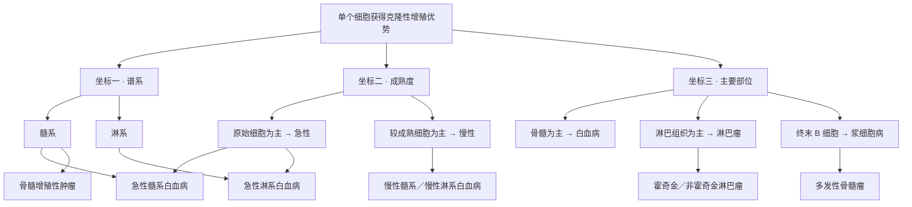

# 第 11 章 · 白细胞恶性肿瘤（Malignant Disorders of White Blood Cells）

> **源**：`standards/binglishengli/supplements/jiangyi/U03-机体防御.md`（讲义第 11 章，本仓原创；`standards/binglishengli/supplements/jiangyi/`）
> **抽取**：`python scripts/build_binglishengli_textbook.py` · 2026-10-30 · sha256 `0af951783ae10a39b06df2d5979f68384b67c34488f101a33b4f02a7b987e64e…` · 正文一字未改
> **层次**：**源正文层**（讲义该章逐节照录）+ **改写层**（N.1–N.5 与思考题，见文末标记块，人工撰写）
> **规模**：10 节 · 4,874 汉字（现算；含学习目标/术语表/小结/自测题，与讲义索引的「节正文」口径不同）
> **免责**：本章为教学材料，只写类别与关系与机制，不写数值与正常值，不构成诊断、治疗或用药依据。

## 学习目标

完成本章学习后，你应当能够：

1. 回顾造血的分层结构与白细胞发育成熟过程；
2. 说明克隆性增殖的共同机制：基因改变、分化阻滞、凋亡受阻与微环境支持；
3. 按谱系、成熟度与主要累及部位建立白细胞恶性肿瘤的分类框架；
4. 描述急性白血病的病理生理与「骨髓衰竭 + 髓外浸润」双线表现；
5. 区分慢性白血病、骨髓增殖性肿瘤、淋巴瘤与浆细胞病的主要特征；
6. 用四大机制解释贫血、感染、出血与全身症状的共同出现；
7. 概述诊断与监测的检查类别，说明治疗相关并发症（肿瘤溶解、粒细胞缺乏伴发热）的机制；
8. 提出以感染预防、出血预防与症状管理为核心的护理要点。

## 11.1 正常造血与白细胞发育回顾

造血是分层放大的过程：**多能造血干细胞（hematopoietic stem cell）**位于骨髓，具有自我更新与多向分化能力；向下分化为**共同髓系祖细胞**与**共同淋系祖细胞**，再经定向祖细胞、前体细胞逐步成熟，最终释放入血。这一过程受骨髓微环境（基质细胞、细胞因子、黏附分子）与生长因子调控，也受转录因子程序控制——某一转录因子缺失或异常，细胞就会停在某个幼稚阶段，这一现象称为**分化阻滞（maturation arrest）**。

外周血白细胞的组成与寿命差异很大：中性粒细胞数量最多、寿命短（血中数小时至数天），是急性抗感染的主力；淋巴细胞可再循环并在淋巴组织中长期存留；单核细胞进入组织后成为巨噬细胞。理解「谁寿命短、谁在骨髓中分裂最活跃」，就能理解为什么骨髓受抑时最先出现粒细胞减少与血小板减少，而贫血出现相对较晚。

## 11.2 克隆性增殖的共同机制

白细胞恶性肿瘤的根本特征是**克隆性（clonal）**：单个细胞获得增殖与生存优势，其子代占据骨髓或淋巴组织。多步骤演进大致包括：

- **基因结构改变**：染色体易位形成融合基因，把调控增殖或分化的基因置于异常控制之下；缺失、扩增与点突变同样常见。不同疾病有相对特征性的改变，这些改变既是诊断标志，也是治疗靶点的来源。
- **原癌基因激活与抑癌基因失活**：促进细胞周期推进、抑制凋亡（如凋亡通路失调使异常细胞免于死亡）。
- **分化阻滞**：细胞获得无限增殖能力却无法成熟，于是骨髓中充满「有用功能不足」的幼稚细胞——这是急性白血病病理生理的核心。
- **微环境与免疫监视逃逸**：骨髓基质与淋巴组织微环境提供生存信号；肿瘤细胞通过下调抗原表达、分泌抑制性因子、招募调节性细胞来逃避免疫清除。

「两次打击」或多步骤累积的概念很重要：单一基因改变通常不足以致病，需多环节协同，这也解释了为何发病随年龄增长而上升，以及为何某些治疗（尤其损伤 DNA 的治疗）本身会增加继发肿瘤风险。

## 11.3 分类框架：谱系、成熟度与部位

面对一组名称繁杂的疾病，先立三个坐标轴，命名就不再混乱。

| 坐标 | 分类 | 含义 |
|---|---|---|
| 谱系 | 髓系 / 淋系 | 起源的祖细胞系列 |
| 成熟度 | 急性 / 慢性 | 急性以原始细胞为主、进展快；慢性以较成熟细胞增多为主、病程惰性 |
| 主要部位 | 骨髓为主 / 淋巴组织为主 / 浆细胞 | 白血病、淋巴瘤、浆细胞病 |

由此得到四个基本类别：**急性白血病**（髓系或淋系）、**慢性白血病**（髓系或淋系）、**淋巴瘤**（霍奇金与非霍奇金）、**浆细胞病**（以多发性骨髓瘤为代表）。此外还有**骨髓增殖性肿瘤**，其特征是一系或多系成熟细胞过度产生。具体亚型繁多，本章只到类别层面；临床上的精确分型依赖形态学、免疫表型、细胞遗传与分子检测的综合。

三个坐标必须一起用，单用任何一个都会给出错误印象。**「急性/慢性」说的是细胞成熟度，不是病程快慢**：急性白血病以原始细胞为主，即使起病隐匿、经数周才被认出，仍属急性；慢性白血病以较成熟细胞为主，即使某日突然恶化（急性变），也仍归入原有疾病实体，而不是新得了一种急性白血病。同理，「白血病/淋巴瘤」的分界看主要累及部位而非起源细胞，同一克隆可以先在骨髓出现、也可以先在淋巴结出现，因此存在交界与重叠的病例。命名是分类工具，不是疾病本质——这一点在向患者解释病名时尤其有用。

## 11.4 急性白血病

**病理生理**有两条主线，理解这两条即理解全部临床表现。

**第一条：骨髓被原始细胞占据 → 正常造血受抑。**
- 红细胞生成减少 → **贫血**：乏力、面色苍白、活动后心悸气短；
- 中性粒细胞减少且功能异常 → **感染**：可为细菌、真菌或病毒，且因炎症反应弱而表现不典型；
- 巨核细胞生成减少 → **血小板减少**：皮肤瘀点瘀斑、黏膜出血、鼻衄、牙龈出血。

**第二条：原始细胞浸润骨髓外组织 → 器官肿大与压迫。**
- 淋巴结、肝、脾肿大；
- 牙龈增生、皮肤浸润；
- 骨与关节疼痛（骨髓腔压力升高）；
- 中枢神经系统受累（头痛、呕吐、脑神经症状），因血脑屏障使部分药物难以到达，成为需要特别关注的「庇护所」。

**起病**多急骤，也可先有数周乏力与反复感染。实验室特点：白细胞计数可升高、正常或降低（**白细胞不升高不等于不是白血病**）；外周血涂片可见原始细胞；贫血与血小板减少常见；确诊依赖骨髓检查显示原始细胞比例显著增高，并结合免疫表型与遗传学改变。**临床联系**：对「反复感染 + 苍白 + 瘀斑」三联征的年轻人，血常规加涂片是最经济的第一步。

白细胞计数为何可高、可正常、也可降低？因为外周血计数反映的是「骨髓产出 − 组织消耗」的净值，而不是骨髓内原始细胞的总量。原始细胞在骨髓中堆积却不成熟、不能释放入血时，计数可以正常甚至偏低；大量释放入血或合并感染时则显著升高。**计数水平与肿瘤负荷并不同向**，它既不能用来确诊，也不能用来排除——这正是外周血涂片在血液病中不可省略的原因：看细胞形态比看总数更能说明问题。

## 11.5 慢性白血病与骨髓增殖性肿瘤

**慢性白血病**的特点是分化相对保留、以较成熟细胞增多为主，病程惰性，但可发生**急性变（blast crisis）**——原始细胞突然增多，临床转为急性白血病的表现。

- **慢性髓系白血病**：粒细胞系显著增生并伴特征性染色体易位，早期常以乏力、体重下降、**脾大与腹胀**为线索；血象见白细胞显著升高、各阶段粒细胞均可见。其靶向治疗是「分子机制转化为治疗」的经典范例（此处不涉及方案参数）。
- **慢性淋巴细胞白血病**：克隆性成熟小淋巴细胞在血、骨髓、淋巴结与脾中蓄积；多见于老年，早期可无症状；因正常免疫球蛋白减少而**反复感染**，并可并发自身免疫性血细胞减少。

**骨髓增殖性肿瘤**包括真性红细胞增多症、原发性血小板增多症与原发性骨髓纤维化等类别。共同特征是骨髓一系或多系过度产生成熟细胞，临床以**脾大、血栓与出血风险并存、以及向急性白血病转化的可能**为要点。其症状常源于血容量增加（头痛、瘙痒、面部潮红）或脾大压迫，而非「白细胞高」本身。

## 11.6 淋巴瘤

**淋巴瘤（lymphoma）**起源于淋巴细胞，主要累及淋巴结与结外淋巴组织。按类别分**霍奇金淋巴瘤**与**非霍奇金淋巴瘤**；后者按起源细胞又分 B 细胞、T 细胞与 NK 细胞来源，按生物学行为分**惰性**与**侵袭性**（此处只列类别，不作分期编号）。

临床线索：

- **无痛性、进行性淋巴结肿大**，质地偏韧，可为多发或融合；这是最典型的首发表现；
- **B 症状**：不明原因发热、夜间盗汗、体重下降——由肿瘤细胞与反应性细胞释放细胞因子所致；
- **结外受累**：胃肠道、皮肤、中枢神经系统、骨髓，引起相应器官症状；
- **压迫症状**：纵隔淋巴结肿大可致咳嗽、气促、上腔静脉受压；腹膜后病变可致腹痛与肾积水；
- **免疫异常**：部分惰性淋巴瘤可伴自身免疫性血细胞减少或免疫球蛋白异常。

惰性与侵袭性的区别具有临床意义：前者生长缓慢、可长期带瘤生存，但难以根治；后者进展快、对治疗反应可能更好，但若不及时处理危及生命。「长得慢」不等于「良性」，「长得快」也不等于「无望」——这是向患者解释时常需澄清的误解。

## 11.7 浆细胞病

**浆细胞病**源于终末分化的 B 细胞（浆细胞）。**多发性骨髓瘤（multiple myeloma）**是最重要的代表，其病理生理可概括为「克隆性浆细胞在骨髓聚集 + 单克隆免疫球蛋白大量产生」。

由此产生的临床谱（记忆口诀式的五组）：

- **骨病变**：浆细胞激活破骨细胞、抑制成骨细胞 → 溶骨性损害 → 骨痛（尤其腰背）、病理性骨折、**高钙血症**（多尿、便秘、意识改变、心律失常）；
- **贫血**：骨髓被占据，促红细胞生成素相对不足；
- **肾功能损害**：单克隆轻链经肾小球滤过造成小管损伤，加之高钙、脱水、感染，共同导致肾功能下降；
- **反复感染**：正常多克隆免疫球蛋白被单克隆成分取代，抗体功能下降，荚膜菌感染常见；
- **高黏滞与淀粉样变**：大量免疫球蛋白使血液黏度升高（头痛、视物模糊、黏膜出血），异常蛋白沉积于组织造成器官功能障碍。

护理上需特别留意：骨痛与活动安全、水化与肾功能监测、感染预防、以及高钙相关症状的早期识别。

## 11.8 临床表现的四大机制

把第 11.4～11.7 的现象统一起来，可用四条机制解释几乎所有症状：

| 机制 | 直接后果 | 表现 |
|---|---|---|
| 骨髓正常造血受抑 | 红细胞、粒细胞、血小板减少 | 贫血、感染、出血 |
| 髓外浸润与占位 | 器官结构受压与功能受损 | 淋巴结与肝脾肿大、骨痛、中枢症状、压迫症状 |
| 细胞因子释放 | 全身炎症与代谢改变 | 发热、盗汗、体重下降、乏力、食欲减退 |
| 免疫功能异常 | 抗体与细胞免疫缺陷 | 反复感染、自身免疫性血细胞减少 |

这张表的价值在于：当患者同时出现「贫血 + 感染 + 出血 + 淋巴结肿大」时，不需要四个诊断，而可能是一个疾病的四种表现。这也是「一元论」思维在临床推理中的体现。

## 11.9 诊断与监测思路

诊断是把形态、表型、遗传与临床四类信息拼合：

- **血液学**：全血细胞计数与**外周血涂片**（观察细胞形态与有无原始细胞，是最快获得线索的检查）；
- **骨髓**：穿刺与活检，评估细胞增生程度、原始细胞比例、浸润模式；
- **免疫表型**：流式细胞术确定细胞谱系与分化阶段，是分型的核心手段；
- **细胞遗传与分子检测**：染色体核型、荧光原位杂交、基因测序，用于分型、预后判断与靶点识别；
- **影像**：CT、磁共振、正电子发射断层显像用于评估病变范围与疗效；
- **特殊部位**：脑脊液检查（中枢受累）、血与尿的免疫球蛋白检测（浆细胞病）。

监测的重点随疾病而异：急性白血病关注缓解与**微小残留病（measurable residual disease）**；淋巴瘤关注影像与代谢活性；骨髓瘤关注单克隆免疫球蛋白水平、游离轻链与骨病变。护理上应理解「为什么反复抽血、反复骨穿」——这些是判断疗效与调整策略的依据，事先解释可显著减少患者的抵触与恐惧。

## 11.10 治疗相关病理生理与护理联系

治疗手段类别包括化学治疗、靶向治疗、免疫治疗、放射治疗与造血干细胞移植（不涉及具体方案与参数）。理解其病理生理，才能预判并发症：

- **骨髓抑制期**：治疗后 1～2 周出现粒细胞与血小板最低点，感染与出血风险最高。**粒细胞缺乏伴发热是急症**，需立即评估并按规范处置，不能等待「明天再看」。
- **肿瘤溶解综合征（tumor lysis syndrome）**：大量肿瘤细胞快速死亡，细胞内钾、磷与核酸代谢产物释放入血 → **高钾、高磷、高尿酸、继发低钙** → 急性肾损伤与心律失常。风险在治疗初期最高，尤其是肿瘤负荷大、增殖快者。预防的核心是**水化与监测**，部分患者需用药降低尿酸。
- **黏膜损伤**：口腔与胃肠道黏膜炎导致疼痛、进食困难与感染门户开放。
- **感染风险**：中性粒细胞减少、黏膜屏障破坏、免疫抑制治疗共同作用，病原体谱随免疫缺陷类型而变。
- **其他**：贫血与疲乏、生育功能影响、治疗相关继发肿瘤、心理社会压力与家庭经济负担。

护理要点可归为五组：**感染预防**（手卫生、环境、避免生食与拥挤场所、体温监测与及时报告）、**出血预防**（软毛牙刷、避免锐器、观察皮肤黏膜与排泄物颜色、避免肌肉注射）、**症状管理**（疼痛、口腔护理、营养支持、疲乏管理）、**安全**（跌倒与病理性骨折预防、活动指导）、**沟通与心理支持**（解释检查与疗程逻辑、识别焦虑抑郁、连接社会资源）。对年轻患者，生育力保存的告知应在治疗开始前完成。

## 关键术语表（中英对照）

| 术语 | 中文 | 术语 | 中文 |
|---|---|---|---|
| hematopoietic stem cell | 造血干细胞 | maturation arrest | 分化阻滞 |
| clonal proliferation | 克隆性增殖 | oncogene | 原癌基因 |
| tumor suppressor gene | 抑癌基因 | acute leukemia | 急性白血病 |
| chronic leukemia | 慢性白血病 | blast crisis | 急性变 |
| myeloproliferative neoplasm | 骨髓增殖性肿瘤 | lymphoma | 淋巴瘤 |
| Hodgkin lymphoma | 霍奇金淋巴瘤 | non-Hodgkin lymphoma | 非霍奇金淋巴瘤 |
| multiple myeloma | 多发性骨髓瘤 | monoclonal protein | 单克隆免疫球蛋白 |
| tumor lysis syndrome | 肿瘤溶解综合征 | measurable residual disease | 微小残留病 |
| pancytopenia | 全血细胞减少 | neutropenia | 中性粒细胞减少 |
| lymphadenopathy | 淋巴结病 | hepatosplenomegaly | 肝脾肿大 |

## 本章小结（Key Points）

- 造血是分层放大的过程；分化阻滞使细胞「能增殖但不能成熟」，是急性白血病的核心。
- 克隆性疾病的共同机制：基因结构改变、癌基因激活与抑癌基因失活、凋亡受阻、微环境与免疫逃逸。
- 分类三坐标：谱系（髓系/淋系）、成熟度（急性/慢性）、部位（骨髓/淋巴组织/浆细胞）。
- 急性白血病双主线：骨髓衰竭（贫血、感染、出血）与髓外浸润（器官肿大、骨痛、中枢受累）。
- 淋巴瘤以无痛性淋巴结肿大与 B 症状为线索；骨髓瘤以骨病变、贫血、肾损害、感染、高黏滞为谱。
- 四大机制（造血受抑、浸润占位、细胞因子、免疫异常）可统一解释几乎所有临床表现。
- 治疗相关重点：粒细胞缺乏伴发热属急症；肿瘤溶解综合征以水化与监测为预防核心。

## 自测题

**A 型选择题**

1. 急性白血病贫血、感染、出血的共同机制是（　）
   A. 脾功能亢进　B. 溶血　C. 营养不良　D. 骨髓正常造血受原始细胞排挤　E. 抗体破坏血细胞
2. 外周血白细胞计数正常，能否排除白血病（　）
   A. 能，白细胞正常即非白血病　B. 仅在儿童不能排除　C. 不能，白细胞可正常甚至降低　D. 需体温升高才考虑　E. 仅在血小板正常时不能排除
3. 慢性髓系白血病病程中出现原始细胞突然增多，称为（　）
   A. 加速期贫血　B. 骨髓纤维化　C. 肿瘤溶解　D. 类白血病反应　E. 急性变
4. 多发性骨髓瘤患者出现反复感染的主要原因是（　）
   A. 中性粒细胞绝对增多　B. 正常多克隆免疫球蛋白减少、抗体功能下降　C. 补体过度激活　D. T 细胞过度活化　E. 脾切除
5. 肿瘤溶解综合征的典型电解质改变是（　）
   A. 高钾、高磷、高尿酸、低钙　B. 低钾、低磷、低尿酸、高钙　C. 高钠、低钾、低钙　D. 高钙、低磷、低镁　E. 低钠、高氯
6. 淋巴瘤最具提示性的首发表现是（　）
   A. 无痛性进行性淋巴结肿大　B. 高热伴寒战　C. 黄疸　D. 血尿　E. 杵状指

**简答题**

7. 用「分化阻滞」解释急性白血病为何同时出现原始细胞增多与正常血细胞减少。
8. 一位淋巴瘤患者在接受治疗后第 10 天出现体温 38.6 ℃、口腔溃疡、中性粒细胞显著减少。请说明其病理生理与处理原则类别。
9. 为什么说「贫血 + 感染 + 出血 + 淋巴结肿大」可能是一个疾病而非四个疾病？

**参考答案**：1.D　2.C　3.E　4.B　5.A　6.A　7.（克隆性原始细胞获得增殖优势但不能成熟，持续在骨髓堆积，占据造血空间并抑制正常克隆；故外周出现幼稚细胞，同时成熟红细胞、粒细胞与血小板生成减少）8.（治疗致骨髓抑制，粒细胞降至最低点，黏膜炎提供感染门户，炎症反应弱使表现不典型；属粒细胞缺乏伴发热的急症情形，应立即评估、按规范留取标本并经验性处置，同时口腔护理与保护性措施）9.（四者可由同一克隆性疾病的四条机制解释：造血受抑、髓外浸润、细胞因子释放、免疫异常；一元论可避免重复检查与延误）

---
<!-- REWRITE:BEGIN -->
## 本章要回答的问题

一组名字最乱的病，为什么能用三个坐标排好——以及「白细胞高不高」为什么问错了。本章要回答：三个坐标各管什么、缺一个会怎样误判，这套分类又在哪里必须让位给表型与分子检测。

## N.1 概念与出处

| 概念 | 讲义出处 | 代用底本对应 | 说明 |
|---|---|---|---|
| 造血分层与分化阻滞 | `第11章·11.1` | **无**（底本无造血章） | 底本从肿瘤总论讲起，不写正常造血 |
| 克隆性增殖的四条共同机制 | `第11章·11.2` | `教材·疾病学基础·第8章·8.1.1`、`8.1.3` | 底本讲「生长类别」，不写多步骤演进 |
| 三坐标分类（谱系／成熟度／部位） | `第11章·11.3` | `教材·疾病学基础·第8章·8.3.2`、`8.3.3` | 底本强调不作分级与分期数值 |
| 急性白血病双主线 | `第11章·11.4` | `教材·疾病学基础·第8章·8.4.1`、`8.4.2` | 骨髓衰竭 + 髓外浸润 |
| 慢性白血病与骨髓增殖性肿瘤 | `第11章·11.5` | `教材·疾病学基础·第8章·8.1.3` | 成熟细胞过度产生 |
| 淋巴瘤（霍奇金／非霍奇金，惰性／侵袭） | `第11章·11.6` | `教材·疾病学基础·第8章·8.2.1`、`8.2.3` | 生长方式与扩散途径 |
| 浆细胞病的五组表现 | `第11章·11.7` | `教材·疾病学基础·第8章·8.4.2` | 全身影响的类别 |
| 四大机制统一表 | `第11章·11.8` | `教材·疾病学基础·第8章·8.4.1`、`8.4.2` | 一元论的解释工具 |
| 诊断与监测的检查类别 | `第11章·11.9` | `教材·疾病学基础·第8章·8.3.3` | 只到类别，不写分期编号 |
| 治疗相关（骨髓抑制、肿瘤溶解） | `第11章·11.10` | `教材·疾病学基础·第15章·15.2.2`、`15.3.1` | 不良反应与支持治疗的类别 |

出处口径：底本第 8 章是肿瘤总论，写「良恶性判据、生长与扩散、对机体的影响」，没有造血系统这一层，也没有白细胞肿瘤的亚型。所以 11.1 在底本一栏写「无」；其余各行只是**借用**第 8 章的类别框架，不能写成底本原意。

## N.2 为什么可以这样翻译

本章的翻译是**一个前提、三个坐标、若干内容**：

为什么站得住：11.3 直接用一张表给了这三行；11.2 说根本特征是**克隆性**，但克隆性是「成不成立」的前提，不是第四个坐标；11.8 的四大机制是「格子里的内容」，也不是坐标。三者分开，命名就不乱——名字乱，通常是把内容当成了坐标。

为什么能用这三样当坐标：它们都能**先从涂片或病理报告上读出来**——谱系看形态与表型，成熟度看原始细胞占比，部位看累及范围；分子标志与亚型不是一上手就有。先选「读得到的」当轴，是教学顺序，不是疾病本质的顺序。

三个坐标**不正交**，这不是缺陷。淋系偏爱淋巴组织，「淋系 + 慢性 + 骨髓」与「淋系 + 慢性 + 淋巴组织」常是同一实体的两个阶段。11.3 已说同一克隆可先在骨髓或先在淋巴结出现，交界病例是坐标不正交的后果，不是分类失败。

失效条件两个：要亚型与分子标志时（每格背后还有整套分型）；要判断「这人能不能耐受治疗」时（坐标里没有年龄、体能、共病）。

## N.3 这个翻译丢掉了什么

1. **亚型的密度。** 每个格子背后都是一整个家族，分型靠免疫表型、细胞遗传与分子检测拼合。坐标只到类别，而临床决策几乎都在亚型层发生。
2. **速度。** 11.3 已警告「急性／慢性」说的是成熟度，不是病程快慢；但「急性」这个框仍暗示「快」。起病隐匿的急性、某日突然恶化的慢性，都落在框外。
3. **转化。** 慢性转急性变是同一克隆在移动，图上只是换框，看不出「同一条线」。这条丢失最容易被误读成「又得了一种病」。
4. **量。** 11.4 说白细胞可高、可正常、可低，因为计数是「产出减消耗」的净值。图上没有「量」这一维，于是「计数高＝病重」的直觉无处被纠正。
5. **人与选择。** 同一格的两个患者，因年龄、体能、共病不同，处置可能相反。坐标里没有这些，也就没有「不治疗」的位置。
6. **诊断即转折。** 格子一旦被填上，人的生活规划随之改变。分类图只能安放疾病，安放不了这件事。

## N.4 与相邻学科的接口

- **病理学**（`10-bingli-xue`）：细胞形态、浸润模式、纤维化程度，是「成熟度」与「部位」两个坐标的形态证据（底本 8.1.2）。本章说「原始细胞为主」，病理学说「长成了什么样」。
- **生理学**（`06-shengli-xue`）：造血调控与血细胞寿命是 11.1 的参照。11.1 说骨髓受抑时先出现粒细胞与血小板减少，依据正是寿命长短。
- **第 7 章（肿瘤）**：良恶性判据、生长与扩散的一般规律在那里；本章是它在造血系统的特例，特例之处是分型密度远高于实体瘤。
- **第 9、10 章**：免疫缺陷与感染是 11.4、11.7 反复感染的机制来源；反过来，淋巴细胞肿瘤本身又造成继发免疫缺陷，两章互为因果。
- **中医学**：「虚劳」「癥积」「痰核瘰疬」三名分别落在本图不同格：虚劳偏骨髓衰竭那条线，癥积偏骨髓与脾的占位，痰核偏淋巴组织。接口是「三名对应三格」，不是同义互译。
- **tcmP 平台**：三个坐标就是三个枚举字段，本章的分类可直接当编码；亚型字段留空，等分子层补齐——比按病名建索引更能容纳新增亚型。

## N.5 争议与本项目立场

**争议一：命名该按形态与临床，还是按免疫表型与遗传。** 前者可读可教，后者精确可预测。**本项目立场：教学用三坐标，临床分型按现行规范，本课程不写分期编号与分级数值。** 依据是 11.3 的判断——命名是分类工具，不是疾病本质；底本 8.3.3 也把「不作分级与分期数值」写成硬边界。

**争议二：白血病与淋巴瘤的分界画在哪里。** 一派按起源细胞分，一派按主要累及部位分。**本项目立场：按部位分，并承认交界病例。** 理由是部位与「活检取哪里」直接对应，起源要靠表型才能定；按部位在前，符合「先读得到、后推得出」。

**争议三：一元论能用到什么程度。** 11.8 的四机制表能把「贫血 + 感染 + 出血 + 淋巴结肿大」收成一个病，这是本章最有力的工具。**本项目立场：一元论用于解释已出现的组合，不用于排除并存病。** 依据是 11.2 的「两次打击」与 11.10 的治疗相关继发肿瘤：同一患者身上可以有第二个克隆。这是本章唯一明确给一元论划界的地方。

> 本章改写层是教学解读，不构成诊断、治疗或用药依据。

## 思考题

1. 用三坐标给「慢性 + 淋系 + 淋巴组织」与「慢性 + 淋系 + 骨髓」各举一名，说明这两个格子为何重叠。
2. 11.3 说「急性／慢性」不是病程快慢。若删掉这句警告，图上哪个框最易造成误读？为什么？
3. 一位患者白细胞计数正常，涂片却见原始细胞。用 N.3 第 4 条解释这个组合，说明「看总数」为何会漏掉他。
4. N.5 第三条给一元论划了界。举一个「四机制表解释得通、但确实存在第二个病」的情形，说明一元论在哪一步必须停。

## 延伸阅读

- 讲义 `standards/binglishengli/supplements/jiangyi/U03-机体防御.md` 第 11 章（本仓原创，可逐字核）。
- 代用底本《疾病学基础》第 8 章（肿瘤）与第 15 章（肿瘤与慢性病治疗基础），`底本.json` 留档。
- 本课程第 7 章（肿瘤），本章的一般规律来源；第 9、10 章，反复感染机制的上游。
- 同院系《病理学》教材的造血与淋巴系统部分（`textbooks/09-jichu/10-bingli-xue/`），对照浸润模式的形态描述。
- 本仓 `README.md` §4：底本第 8 章各小节的主视角标签，可核「借用类别框架」这一说法。
<!-- REWRITE:END -->
