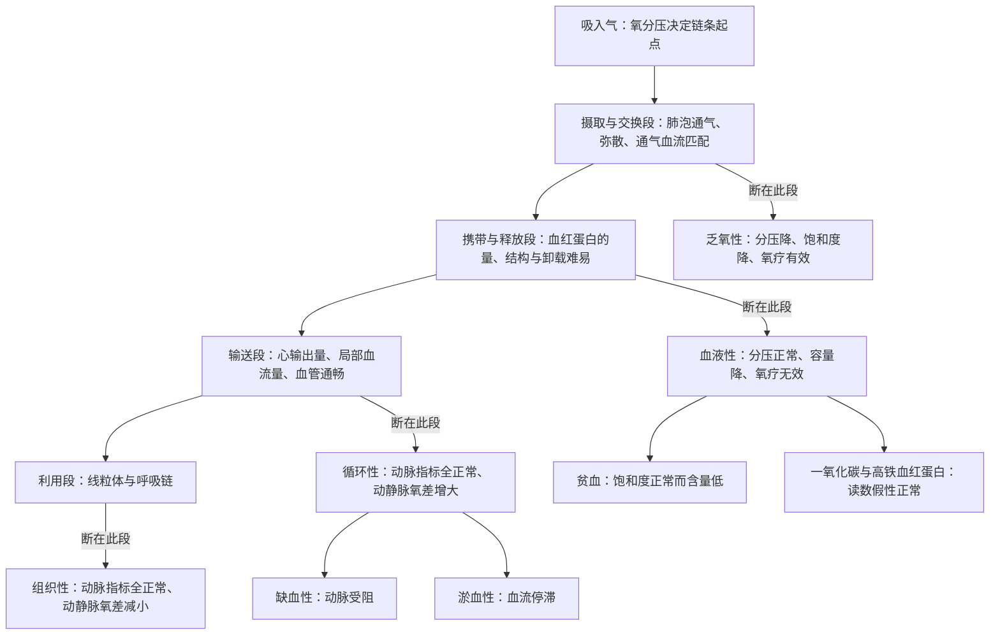

# 第 13 章 · 氧运输异常（Alterations in Oxygen Transport）

> **源**：`standards/binglishengli/supplements/jiangyi/U04-氧运输与凝血血流血压.md`（讲义第 13 章，本仓原创；`standards/binglishengli/supplements/jiangyi/`）
> **抽取**：`python scripts/build_binglishengli_textbook.py` · 2026-10-30 · sha256 `80578e28fcf18a368876417aee9fbf812d83aa54f6d187ee3a0026ecdb4a24cf…` · 正文一字未改
> **层次**：**源正文层**（讲义该章逐节照录）+ **改写层**（N.1–N.5 与思考题，见文末标记块，人工撰写）
> **规模**：12 节 · 5,033 汉字（现算；含学习目标/术语表/小结/自测题，与讲义索引的「节正文」口径不同）
> **免责**：本章为教学材料，只写类别与关系与机制，不写数值与正常值，不构成诊断、治疗或用药依据。

## 学习目标

完成本章学习后，你应当能够：

1. 画出氧从外界到线粒体的运输链条，并把四型缺氧指认到链条上的四段；
2. 区分氧分压、氧容量、氧含量、氧饱和度四个概念，说明各自反映什么、不反映什么；
3. 解释氧解离曲线 S 形的生理意义，列出使曲线左移与右移的因素；
4. 分别说明乏氧性、血液性、循环性、组织性缺氧的环节、成因与指标变化方向；
5. 用「先看分压、再看容量、最后看动静脉氧差」三条规则鉴别四型缺氧及其混合型；
6. 说明氧疗与脉搏血氧监测在不同类型缺氧中的边界与陷阱。

## 13.1 氧运输的链条与四段环节

氧从外界空气到达线粒体，要经过一条位置固定的链条：外界空气 → 肺泡 → 肺泡毛细血管膜 → 血浆 → 红细胞内的血红蛋白 → 循环输送 → 组织毛细血管 → 细胞 → 线粒体。链条上任何一段断掉，临床上都会被称为「缺氧」，但断在哪一段，指标的变化方向不同，处理的方向也不同。把「缺氧」当成一个笼统的状态去处理，是这一章最常犯的错误。

本课程第 5 章已经把这条链条切成四段，本单元沿用同一口径，不另立分类：

- **摄取与交换段**（外呼吸）：吸入气氧分压、肺泡通气、弥散面积与厚度、通气/血流匹配；
- **携带与释放段**（血液）：血红蛋白的数量、结构，以及所携带的氧向组织释放的难易；
- **输送段**（循环）：心输出量、局部血流量、血管通畅性；
- **利用段**（细胞）：线粒体氧化磷酸化、呼吸链酶系、细胞对氧的利用能力。

四段对应四个名称：**乏氧性、血液性、循环性、组织性**。四个词不是四张并列的标签，是四个位置。记住名称只是第一步，能把一次具体的缺氧指到某一段，才算真正理解。底本把方法写在分类之前，道理就在这里：现象是多样的，同一类可以表现得很不一样，不同类又可以表现得很像；环节是有限的，只有四段。先定环节，类别才有归属。

## 13.2 正常生理：氧分压、氧容量、氧含量与氧饱和度

这四个概念在日常语言里几乎被当成同义词，而鉴别四型缺氧恰恰全靠把它们分开看。

- **氧分压（partial pressure of oxygen, PO₂）**：溶解在血浆中的氧所产生的张力。它反映的是「压力」——推动氧从气相进入血液、从血液进入组织的力，不反映血液里装了多少氧。
- **氧容量（oxygen capacity）**：单位容积血液中血红蛋白所能结合的最大氧量。它取决于血红蛋白的**数量与性质**，与当前吸入多少氧无关。
- **氧含量（oxygen content）**：血液中实际结合的氧量，等于血红蛋白结合氧与物理溶解氧之和。生理条件下溶解部分占比很小。
- **氧饱和度（oxygen saturation）**：氧含量占氧容量的百分比。它反映「装满的程度」，不反映「总量」。

一句话记法：分压管「推」，容量管「装得下多少」，含量管「实际装了多少」，饱和度管「装了几成」。由此可以直接推出四型缺氧的判读骨架：

- 分压正常而容量下降 → 问题在血红蛋白的数量或性质（血液性）；
- 分压与饱和度同时下降 → 问题在交换段（乏氧性）；
- 分压、容量、饱和度都正常，而动静脉氧差增大 → 问题在输送段（循环性）；
- 动静脉氧差减小、静脉端氧分压偏高 → 问题在利用段（组织性）。

## 13.3 正常生理：氧解离曲线与氧的释放

**氧解离曲线（oxyhemoglobin dissociation curve）**描述氧分压与氧饱和度之间的关系，呈 S 形。S 形的意义在两头：上段平坦，肺泡氧分压小幅下降时饱和度掉得不多，保证「装载」不因轻微的通气波动而大幅损失；下段陡峭，组织氧分压降低时血红蛋白迅速卸载，保证「释放」跟得上组织的消耗。曲线的形状本身就是一种设计——在肺里抓得牢，在组织里放得开。

曲线位置用**左移/右移**描述，不用具体数值：

- **右移（释放增强）**：酸中毒（氢离子升高）、二氧化碳升高、温度升高、2,3-二磷酸甘油酸（2,3-DPG）增多。这四件事恰好都是组织代谢旺盛处的局部特征，所以右移可以理解为「就地卸货」；
- **左移（释放减弱）**：碱中毒、低温、2,3-DPG 减少、胎儿血红蛋白、一氧化碳血红蛋白、高铁血红蛋白。

**临床联系**：大量输注库存红细胞时，红细胞内 2,3-DPG 含量下降，曲线左移，装载正常而卸载受阻。患者血红蛋白被「补上去了」，饱和度也好看，组织实际得到的氧却少于数字所显示的。这解释了一类常见困惑：指标改善了，患者的缺氧表现却没有同步改善。判断时要问的不是「装了多少」，而是「放得出来多少」。

## 13.4 失衡机制一：乏氧性缺氧（摄取与交换段）

环节在链条的最前端。成因可归为三种情形：

1. **吸入气氧分压降低**：高原、密闭空间、通风不良的作业环境、麻醉机或呼吸机供气异常；
2. **外呼吸功能障碍**：通气不足（气道阻塞、呼吸肌疲劳、中枢驱动下降）、弥散障碍（肺水肿、肺纤维化、肺泡透明膜）、通气/血流比例失调（肺炎、肺不张、肺栓塞、支气管痉挛）；
3. **静脉血分流入动脉**（右向左分流）：先天性心脏缺损、肺内动静脉短路。

指标方向：动脉氧分压降低，氧容量正常，氧饱和度降低，氧含量降低，动静脉氧差可正常或偏小。发绀常见，因为毛细血管内还原血红蛋白的绝对量增多。

**氧疗有效**：提高吸入气氧分压可抬高肺泡氧分压，进而抬高饱和度。但分流性缺氧对氧疗的反应差——分流的血液根本没有接触肺泡气，再怎么提高吸入氧浓度也「照不到」它。这一点在临床上很实用：提高吸入氧浓度后缺氧不改善，要想到分流，而不是单纯加大流量。

## 13.5 失衡机制二：血液性缺氧（携带与释放段）

交换正常、输送通畅，问题出在血液本身。三种典型情形，机理各不相同，但都落在「装」与「放」上。

**（1）贫血**：血红蛋白数量减少 → 氧容量降低、氧含量降低；但动脉氧分压正常，氧饱和度也正常——剩下的每一个血红蛋白分子仍然是装满的。动静脉氧差偏小，因为组织能从每毫升血里拿到的氧总量本来就少。特点是**饱和度正常而含量低**，这是最容易误判的一型：脉搏血氧读数可以完全正常，患者却已经明显缺氧。贫血患者的缺氧表现更多来自心输出量的代偿（心率增快、心慌、活动后气促），而不是发绀。

**（2）一氧化碳中毒**：一氧化碳与血红蛋白的亲和力远高于氧，占据结合位点 → 氧容量降低；同时它使剩余位点释放氧更困难（曲线左移），形成「双重打击」。动脉氧分压正常，氧含量显著降低。皮肤黏膜呈樱桃红，不发绀。脉搏血氧仪无法区分一氧化碳血红蛋白与氧合血红蛋白，读数假性正常——这是急诊最容易漏诊的一处。处理方向是脱离接触与高压氧，而不是单纯提高吸入氧浓度。

**（3）高铁血红蛋白血症**：血红蛋白中的二价铁被氧化为三价铁，失去携氧能力，且使曲线左移。可为先天（还原酶系统缺陷）或后天（亚硝酸盐、某些局麻药与抗菌药、含苯的化合物）。表现为发绀而动脉氧分压正常，血液呈暗褐色，氧疗无效。这一型与一氧化碳中毒恰好相反：一个「红得不对」，一个「暗得不对」，但两者都让血氧读数失去意义。

## 13.6 失衡机制三：循环性缺氧（输送段）

环节在输送段，氧的「装载」与「交换」都没有问题，问题是送不到。分两类：

- **缺血性（ischemic）**：动脉受阻——粥样硬化、血栓、栓塞、痉挛、外部压迫 → 组织供血减少；
- **淤血性（stagnant）**：静脉回流受阻——心力衰竭、静脉血栓、静脉受压 → 毛细血管内血流停滞。动脉仍在供血，但血流太慢，单位时间内送到的氧仍然不够，代谢产物也带不走。

指标方向：动脉氧分压、氧容量、氧饱和度均正常；**动静脉氧差增大**——血流慢、停留久，组织从每单位血液中摄取的份额增加，血回到静脉端时「被拿得更干净」。发绀可出现于淤血部位（如心衰时的口唇、肢端）。

氧疗效果有限。问题不是「装不满」，而是「送不到」，提高吸入氧浓度只能略微增加溶解氧，不能解决灌注。这一型的关键处理是恢复灌注：扩容、强心、解除梗阻、改善体位与活动。

## 13.7 失衡机制四：组织性缺氧（利用段）

氧送到了细胞面前，细胞却用不上。成因有三类：

- **呼吸链抑制**：氰化物抑制细胞色素氧化酶，电子传递中断，组织无法利用氧；
- **氧化磷酸化解偶联**：某些毒物使电子传递与 ATP 合成脱钩，氧照常被消耗，ATP 却产不出来，能量以热的形式散失；
- **细胞损伤或酶系不足**：严重感染、休克晚期、某些维生素缺乏导致酶系功能下降。

指标方向：动脉氧分压、氧容量、氧饱和度全部正常；**动静脉氧差减小**，静脉端氧分压升高——血「带着氧回来了」。这是与循环性缺氧最关键的分野：两者都表现为组织缺氧而动脉指标正常，但一个动静脉氧差增大，一个减小，方向相反。皮肤可呈玫瑰红而不发绀。氧疗无效，甚至可能因加重氧化应激而不利，处理必须针对毒物或病因而非给氧。

## 13.8 四型缺氧的鉴别：一张表与三条规则

| 型别 | 环节 | 动脉氧分压 | 氧容量 | 氧饱和度 | 动静脉氧差 | 发绀 | 氧疗 |
|---|---|---|---|---|---|---|---|
| 乏氧性 | 摄取与交换 | 降低 | 正常 | 降低 | 正常或偏小 | 常有 | 有效（分流者差） |
| 血液性·贫血 | 携带 | 正常 | 降低 | 正常 | 偏小 | 无 | 无效 |
| 血液性·一氧化碳 | 携带与释放 | 正常 | 降低 | 降低 | 偏小 | 无（樱桃红） | 需高压氧 |
| 血液性·高铁血红蛋白 | 携带与释放 | 正常 | 降低 | 降低 | 偏小 | 有（发绀） | 无效 |
| 循环性 | 输送 | 正常 | 正常 | 正常 | 增大 | 可有 | 有限 |
| 组织性 | 利用 | 正常 | 正常 | 正常 | 减小 | 无（玫瑰红） | 无效 |

**三条判读规则**（按顺序问，不要跳步）：

1. **先看动脉氧分压**：降低 → 乏氧性；正常 → 其余三型；
2. **再看氧容量或血红蛋白**：降低 → 血液性；
3. **分压与容量都正常时，看动静脉氧差**：增大 → 循环性；减小 → 组织性。

**混合型**在临床上比单一型更常见：休克合并贫血、肺炎合并心力衰竭、一氧化碳中毒合并心肌损伤。此时两条段同时受损，指标互相掩盖——例如贫血把循环性缺氧的「动静脉氧差增大」削弱，心衰又把乏氧性缺氧的「分压降低」放大。处理的办法不是找一个完美符合的类别，而是按「最可能的一段」逐段排查，并承认可能同时存在两段。

## 13.9 机体的代偿反应及其代价

缺氧是强刺激，机体从四个层面同时应答。代偿有效，患者可以长期维持；代偿有成本，成本累积就是失代偿。

| 层面 | 代偿反应 | 代价 |
|---|---|---|
| 呼吸 | 缺氧刺激外周化学感受器 → 通气增加 → 肺泡氧分压上升 | 呼吸功增加、二氧化碳排出过多致碱中毒、呼吸肌疲劳 |
| 循环 | 交感兴奋 → 心率增快、收缩力增强、血流重分布（心脑优先） | 心肌耗氧增加、心律失常、肾与内脏灌注下降 |
| 血液 | 促红细胞生成素增加 → 红细胞增多 → 携氧能力上升 | 黏度升高、血流阻力增加、血栓风险上升 |
| 组织与细胞 | 毛细血管增生、肌红蛋白增加、无氧酵解增强、低氧诱导因子通路激活 | 乳酸堆积、酸中毒、细胞水肿 |

代偿的方向是「保住氧输送」，代价是「把别的系统推到极限」。慢性缺氧患者往往同时具备两套表现：一方面是长期代偿的痕迹（红细胞增多、右心肥厚、杵状指），另一方面是代偿耗竭的信号（活动耐量下降、夜间阵发性呼吸困难、意识改变）。看到前者要想到病程长，看到后者要想到已经越过了代偿的边界。

## 13.10 缺氧对主要器官的损伤

- **脑**：对缺氧最敏感。早期兴奋、烦躁、判断力下降，继而嗜睡、昏迷。缺氧使脑血管扩张、血脑屏障通透性升高 → 脑水肿 → 颅内压升高 → 灌注进一步下降，形成恶性循环。
- **心**：心肌缺氧 → 收缩力下降、心律失常；酸中毒降低心肌对儿茶酚胺的反应性，使「强心」的手段变得不灵。
- **肺**：缺氧性肺血管收缩（hypoxic pulmonary vasoconstriction）本意是减少无通气区域的灌注、保住通气/血流匹配；但广泛而持久的收缩 → 肺动脉高压 → 右心负荷增加 → 肺源性心脏病。
- **肝与肾**：缺氧 → 细胞膜泵功能障碍 → 细胞水肿；肾血流减少 → 肾前性功能下降，严重时发展为肾小管损伤。
- **代谢**：无氧酵解增强 → 乳酸升高 → 代谢性酸中毒；钠钾泵失效 → 细胞内钠、钙超载 → 细胞死亡。这一条把缺氧与 U01 的「因果交替」规律接了起来：缺氧致酸中毒，酸中毒又使曲线右移（短期有利）并抑制心肌（长期有害）。

## 13.11 发绀的临床意义与边界

**发绀（cyanosis）**是皮肤黏膜呈青紫色，机制是毛细血管内**还原血红蛋白的绝对量**增多。三个边界必须记住：

1. 贫血者即使严重缺氧也可以不发绀——还原血红蛋白的总量不够「显色」；
2. 红细胞增多者轻度缺氧即可发绀——同样的饱和度下降，还原血红蛋白的绝对量更大；
3. 一氧化碳中毒与组织性缺氧可以发绀不明显，甚至呈樱桃红或玫瑰红。

所以发绀是「提示」，不是「分级」，更不能替代指标判断。反过来也成立：没有发绀不等于没有缺氧。临床上把发绀当作唯一的缺氧体征，是这一章最常见的两个误判之一（另一个是把血氧读数当作氧含量）。

## 13.12 临床联系：氧疗的边界与监测陷阱

- **氧疗对乏氧性缺氧最有效**；对循环性缺氧仅部分有效（须同时改善灌注）；对血液性（贫血、一氧化碳、高铁血红蛋白）与组织性基本无效，须针对病因处理——输血、高压氧、解毒、支持治疗。
- **脉搏血氧仪的陷阱**：一氧化碳血红蛋白与高铁血红蛋白造成读数假性正常；末梢冷、低灌注、指甲油、深色皮肤可致读数偏差；读数反映的是饱和度，不反映氧含量，也不反映输送。
- **观察顺序**：先定「哪一段」，再看「代偿是否足够」（呼吸功、心率、意识），最后看「器官是否已受损」（意识、尿量、乳酸、心律）。顺序颠倒，就会在「饱和度还行」的安慰里错过休克。

## 关键术语表（中英对照）

| 术语 | 中文 | 术语 | 中文 |
|---|---|---|---|
| hypoxia | 缺氧 | hypoxemia | 低氧血症 |
| oxygen partial pressure (PO₂) | 氧分压 | oxygen capacity | 氧容量 |
| oxygen content | 氧含量 | oxygen saturation | 氧饱和度 |
| oxyhemoglobin dissociation curve | 氧解离曲线 | shift to the right / left | 曲线右移／左移 |
| 2,3-DPG | 2,3-二磷酸甘油酸 | Bohr effect | 波尔效应 |
| hypoxic hypoxia | 乏氧性缺氧 | anemic hypoxia | 血液性缺氧（贫血性） |
| circulatory hypoxia | 循环性缺氧 | histotoxic hypoxia | 组织性缺氧 |
| carboxyhemoglobin | 一氧化碳血红蛋白 | methemoglobin | 高铁血红蛋白 |
| cyanosis | 发绀 | oxygen therapy | 氧疗 |
| arteriovenous oxygen difference | 动静脉氧差 | hypoxic pulmonary vasoconstriction | 缺氧性肺血管收缩 |
| erythropoietin (EPO) | 促红细胞生成素 | hypoxia-inducible factor (HIF) | 低氧诱导因子 |
| oxygen delivery | 氧输送 | oxygen consumption | 氧耗 |

## 本章小结（Key Points）

- 氧运输是一条四段链条：摄取与交换、携带与释放、输送、利用；四型缺氧就是四段断裂，名称背后是位置；
- 分压管「推」、容量管「装得下」、含量管「装了多少」、饱和度管「装了几成」，四者不可互相替代；
- 氧解离曲线 S 形保证「肺里抓得牢、组织里放得开」；右移增强释放，左移削弱释放；
- 乏氧性：分压与饱和度下降，氧疗有效（分流者反应差）；血液性：分压正常、容量下降，氧疗无效，血氧读数可假性正常；
- 循环性：动脉指标正常、动静脉氧差增大；组织性：动脉指标正常、动静脉氧差减小，两者方向相反；
- 鉴别按「分压 → 容量 → 动静脉氧差」三步走；混合型常见，须逐段排查；
- 代偿有四层（呼吸、循环、血液、组织），每层都有代价；发绀只是提示，不是分级。

## 自测题

**A 型选择题**

1. 某患者动脉氧分压正常，血红蛋白明显减少，动脉氧饱和度正常。其缺氧类型是（　）
   A. 乏氧性　B. 血液性（贫血）　C. 循环性　D. 组织性　E. 混合性
2. 关于氧解离曲线右移，说法正确的是（　）
   A. 释放氧减少　B. 由碱中毒引起　C. 由酸中毒、二氧化碳升高、温度升高引起　D. 仅见于胎儿血红蛋白　E. 使氧容量下降
3. 组织性缺氧与循环性缺氧最关键的区别是（　）
   A. 动脉氧分压是否降低　B. 有无发绀　C. 动静脉氧差是减小还是增大　D. 氧容量是否正常　E. 血红蛋白数量
4. 一氧化碳中毒时脉搏血氧读数常假性正常，原因是（　）
   A. 一氧化碳提高氧分压　B. 仪器不能区分一氧化碳血红蛋白与氧合血红蛋白　C. 氧容量升高　D. 曲线右移　E. 溶解氧增多
5. 缺血性缺氧与淤血性缺氧共同的特点是（　）
   A. 动脉氧分压降低　B. 氧容量降低　C. 动脉血氧指标正常而动静脉氧差增大　D. 氧疗完全有效　E. 氧饱和度降低

**简答题**

6. 试述四型缺氧的鉴别思路，并说明为何「混合型」在临床上更常见。
7. 为什么说「血氧饱和度正常」不能排除组织缺氧？请举两种情形说明。

**参考答案**：1.B　2.C　3.C　4.B　5.C　6.（先看动脉氧分压定乏氧性；再看氧容量定血液性；两者均正常时看动静脉氧差，增大为循环性、减小为组织性。混合型常见是因为危重症常同时累及两段，如休克合并贫血、肺炎合并心衰，指标互相掩盖）7.（贫血时饱和度正常而氧含量低；一氧化碳中毒时读数假性正常而组织缺氧；此外曲线左移使释放受阻，饱和度好看而组织得不到氧）

---
<!-- REWRITE:BEGIN -->
## 本章要回答的问题

为什么四型缺氧不是四个病名，而是同一条链上的四个位置——以及「断在哪一段」能推出什么。

## N.1 概念与出处

| 概念 | 讲义出处 | 代用底本对应 | 说明 |
|---|---|---|---|
| 氧运输链条与四段环节 | `补充·hermes-病理生理学讲义·第13章·13.1` | `教材·疾病学基础·第6章·6.1.1` | 底本按型别分节，「位置」写法是讲义加的 |
| 分压／容量／含量／饱和度四量分工 | `第13章·13.2` | **无** | 底本不写四量定义 |
| 氧解离曲线与左右移 | `第13章·13.3` | **无** | 底本无曲线与 2,3-DPG 调节 |
| 乏氧性缺氧（摄取与交换段） | `第13章·13.4` | `同章 6.1.1` | 型别名可对，指标方向底本从简 |
| 血液性缺氧（携带与释放段） | `第13章·13.5` | `同章 6.1.2` | 贫血、一氧化碳、高铁血红蛋白三种并列 |
| 循环性与组织性缺氧 | `第13章·13.6`、`13.7` | `同章 6.1.3` | 底本合在一节，正是最易混处 |
| 四型鉴别表与三条判读规则 | `第13章·13.8` | **无** | 判读顺序是讲义的方法学 |
| 代偿四层及其代价 | `第13章·13.9` | `同章 6.2.2` | 底本写「对各系统影响」，不写代价 |
| 缺氧对各器官的损伤 | `第13章·13.10` | `同章 6.2.2` | 脑、心、肺、肝肾、代谢五处 |
| 发绀的三条边界 | `第13章·13.11` | `同章 6.2.3` | 底本只提表述边界，未列三条 |
| 氧疗边界与监测陷阱 | `第13章·13.12` | **无** | 底本不涉氧疗与血氧监测 |

出处口径：底本第 6 章把缺氧写成「三个型别 + 对机体影响」，型别名可与本章对上；四量定义、曲线、判读顺序、氧疗边界四处写「无」，那是讲义独有的方法学；把「型别」当「环节」读，方向就丢了。

## N.2 为什么可以这样翻译

本章是**一条定序链加三个可分离观测量**：

四个横排节点是**位置**，四条带「断」字的边是**型别**：型别不是从病名推出来的，是从「哪条边断了」读出来的。链条负责定位，量负责验证。

为什么对得上：13.1 明说「四段对应四个名称」，13.2 给出四量分工，13.8 再给三步判读——分压、容量、动静脉氧差，顺序不能换，因为每一步都在排除一整段。

由此得到本章最有用的一句判据：**动脉分压正常，不等于氧送到了线粒体。** 分压只说明交换段通了，剩下三段一概不管。贫血、一氧化碳中毒、心衰、细胞毒损害，机制完全不同，共同点都是「分压正常」——只看分压，会把四种方向相反的处理压成一句「给氧」。

动静脉氧差之所以是枢纽，因为它是唯一落在链条末端、又能在床旁间接观察的量。循环性缺氧时血流慢、停留久，组织把每毫升血里的氧拿得更干净，差值增大；组织性缺氧时细胞用不上，血带着氧回来，差值减小。同一个测量、方向相反的两个答案，这就是 13.6 与 13.7 必须分写的理由。

## N.3 这个翻译丢掉了什么

1. **「没断但变差」无处安放。** 模型是二值的，而曲线左移是斜率改变：库存血、一氧化碳血红蛋白都让卸载变难，数字好看、组织拿到的氧少。丢掉的是「装载正常而释放受阻」这一独立环节。
2. **时间被压平。** 代偿的时标差别很大：呼吸与循环以秒计，红细胞增多以日计。图上四段没有时钟，读起来像同时发生。
3. **空间异质性被抹掉。** 循环性缺氧被写成全身一个「输送段」，实际是分布：肾与内脏先被牺牲，脑与心还被保住。这解释了动脉指标全正常的人为何已经少尿。
4. **混合型只剩并列。** 13.8 末说两段同时受损时指标互相掩盖，图能画两条边同时断，画不出「一条边抹掉另一条边的证据」。
5. **主观体验没有位置。** 气促、乏力、活动耐量下降是患者最先说出口的，图上只有细胞层一个节点。
6. **严重度无处安放。** 模型答「哪一段」，不答「多严重」；分压降到什么程度算越界，本章一律不给。

一句话：**这套翻译擅长讲「该往哪个方向处理」，不擅长讲「现在还来不来得及」。**

## N.4 与相邻学科的接口

- **呼吸生理学**：通气、弥散、通气／血流匹配是交换段的三个零件。生理学给正常参照，本章给「这三件坏掉后指标往哪动」。
- **血液学与生物化学**：血红蛋白结构与 2,3-DPG 调节属携带段，氧化磷酸化与呼吸链属利用段。解偶联与呼吸链抑制的区别，只有生化层讲得清。
- **心血管生理学**：心输出量与血流分布是输送段的零件。本章在此与第 20 章（休克）接上：休克的本质就是输送段整体失效。
- **中医学**：「气虚」常对应输送与利用不足，「血虚」常对应携带不足。接口是隐喻层的对应，不是等号：中医的「气」不承担分压这个量。
- **tcmP 平台**：桥接句「病机演变→状态机」在本章不适用——这是**定位图**不是演变图。平台只能落成「四段各自判据 + 三步排除顺序」，不能压成一个严重度评分。

## N.5 争议与本项目立场

**争议一：四型分类还要不要。** 一种意见主张用「氧输送与氧耗的供需比」统一描述，理由是缺氧都是供需失衡；另一种坚持四型，理由是四型各指向不同动作。**本项目立场：四型作定位，供需比只作补充。** 依据是动作性：四型分别对应给氧、输血或解毒、恢复灌注、解除毒性，供需比给不出其中任何一个。分类的价值在能否改变下一步，不在是否更「本质」。

**争议二：发绀能不能当体征用。** 一派把它当缺氧的经典体征；一派指出贫血时可不出现、红细胞增多时又会夸大。**本项目立场：只作提示，不作分级。** 依据是 13.11 的三条边界——贫血者重度缺氧可不发绀、红细胞增多者轻度缺氧即发绀、一氧化碳与组织性缺氧可不发绀甚至呈樱桃红。三条都指向同一件事：发绀反映还原血红蛋白的绝对量，不是缺氧的程度。

**争议三：脉搏血氧读数该放在什么位置。** 临床习惯把它当「氧合」的总代表，而四量分工说明它只反映饱和度。**本项目立场：写「饱和度」不写「氧合」，并同时给出两种假性正常。** 依据是 13.5 的两处机制与 13.12 的陷阱清单；只说「可能不准」不够，要写清「不准的方向是偏高」。

> 本章改写层是教学解读，不构成诊断、治疗或用药依据。

## 思考题

1. 用图上四条「断」边解释：为什么动脉分压正常不能排除组织缺氧？举出落在不同边上的两个例子。
2. 曲线左移在模型里没有位置。它算「断」还是「没断但变差」？这个区分对判断库存血输注后的疗效有什么用？
3. 动静脉氧差为什么能同时判循环性与组织性？方向为何相反？
4. 若把四型换成一个供需比，本章会丢掉哪四个动作？

## 延伸阅读

- 讲义 `standards/binglishengli/supplements/jiangyi/U04-氧运输与凝血血流血压.md` 第 13 章（本仓原创，可逐字核）。
- 代用底本《疾病学基础》第 6 章 6.1–6.2（`standards/binglishengli/底本.json`）。
- 本仓第 20 章（休克）——输送段失效的那一端；第 21 章——交换段的零件。
- 同院系《病理学》教材缺氧章（`textbooks/09-jichu/10-bingli-xue/10-第10章-缺氧.md`）。
- Banasik, *Pathophysiology*, 8th ed.（目录结构来源；**本仓未持有原书**，不作引用）。
<!-- REWRITE:END -->
