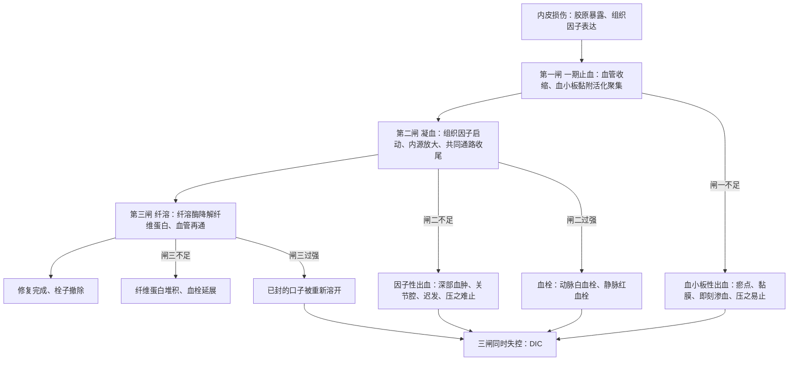

# 第 14 章 · 止血与凝血异常（Alterations in Hemostasis and Blood Coagulation）

> **源**：`standards/binglishengli/supplements/jiangyi/U04-氧运输与凝血血流血压.md`（讲义第 14 章，本仓原创；`standards/binglishengli/supplements/jiangyi/`）
> **抽取**：`python scripts/build_binglishengli_textbook.py` · 2026-10-30 · sha256 `80578e28fcf18a368876417aee9fbf812d83aa54f6d187ee3a0026ecdb4a24cf…` · 正文一字未改
> **层次**：**源正文层**（讲义该章逐节照录）+ **改写层**（N.1–N.5 与思考题，见文末标记块，人工撰写）
> **规模**：11 节 · 4,626 汉字（现算；含学习目标/术语表/小结/自测题，与讲义索引的「节正文」口径不同）
> **免责**：本章为教学材料，只写类别与关系与机制，不写数值与正常值，不构成诊断、治疗或用药依据。

## 学习目标

完成本章学习后，你应当能够：

1. 把止血拆成「一期止血—凝血—纤溶」三条线，说明各自的时相、主角与功能；
2. 描述血管内皮与血小板在一期止血中的作用，指出 vWF、GP Ib、GP IIb/IIIa 的位置；
3. 说明凝血级联内外源与共同通路的衔接，指出维生素 K 依赖因子与钙离子的作用；
4. 列出抗凝系统与纤溶系统的主要成员及其临床意义；
5. 按四个层面归类出血性疾病，并用出血形态区分血小板性与凝血因子性出血；
6. 用 Virchow 三联解释血栓形成，说明弥散性血管内凝血为何是三条线同时失控。

## 14.1 三条线：止血、凝血、纤溶

「止血」在口语里是一件事，在生理上是三条同时开动的线：

1. **一期止血（primary hemostasis）**：血管收缩 + 血小板黏附、活化、聚集 → 形成血小板栓子。起效以秒计，先把口子堵住；
2. **二期止血（凝血，coagulation）**：凝血因子级联激活 → 纤维蛋白网形成 → 把松软的血小板栓子加固成牢固的血栓；
3. **纤溶（fibrinolysis）**：纤溶酶原被激活为纤溶酶 → 降解纤维蛋白 → 血管再通，修复后把「脚手架」拆掉。

三条线的正常关系可以概括为「限局、适度、可撤」：栓子只长在破损处（限局），只长到够用（适度），修复完成后能被溶解（可撤）。疾病就是三条线中某一条过强或过弱，并且**失去了限局性**——出血是「该堵的没堵住」，血栓是「不该堵的堵了」，而三条线同时失控就是弥散性血管内凝血。

分开三条线的实用价值在于：出血可以是「一期止血不足」，也可以是「二期凝血不足」，两者的出血形态、观察重点与处理方向都不同；把它们混成一句「凝血不好」，就只能开一张化验单，开不出一个判断。

## 14.2 正常生理：血管内皮与一期止血

血管内皮不是被动的衬里，而是一层主动的抗血栓表面：它释放一氧化氮与前列环素抑制血小板，表达血栓调节蛋白与硫酸类肝素样物质激活抗凝，分泌组织型纤溶酶原激活物（t-PA）启动纤溶。内皮完整时，血小板不会黏上去——**「不黏」本身就是一种需要持续消耗能量的状态**，这也是为什么内皮功能障碍会同时带来血栓与出血两种风险。

内皮损伤后，顺序是：

1. **血管收缩**：反射性收缩加上内皮素释放，先减少血流；
2. **黏附**：内皮下胶原暴露 → 血管性血友病因子（vWF）结合胶原并发生构象改变 → 血小板经糖蛋白 Ib（GP Ib）受体黏附于 vWF；
3. **活化**：血小板形态改变（伪足伸展）、释放颗粒内容物（ADP、血栓烷 A₂、5-羟色胺）→ 招募并激活更多血小板；
4. **聚集**：糖蛋白 IIb/IIIa（GP IIb/IIIa）受体与纤维蛋白原桥接，把血小板彼此连起来 → 血小板栓子形成。

**临床联系**：vWF 缺乏（血管性血友病）→ 黏附失败；GP Ib 或 GP IIb/IIIa 异常（巨大血小板综合征、血小板无力症）→ 黏附或聚集失败；阿司匹林抑制血栓烷 A₂ 生成、P2Y12 抑制剂阻断 ADP 通路 → 药物性一期止血减弱。这一路缺损的出血形态是**皮肤瘀点、黏膜出血、刷牙出血、月经过多、即刻渗血、压之易止**——因为栓子的「第一层」建不起来，但凝血与纤溶是好的。

## 14.3 正常生理：凝血级联的三条通路

凝血级联的经典描述是三条通路：

- **外源性通路（extrinsic pathway）**：组织因子（tissue factor, TF）暴露 → 与因子 VII 结合并激活 → 激活因子 X。这是**启动**通路，是生理止血真正的第一步；
- **内源性通路（intrinsic pathway）**：接触激活（因子 XII、XI）→ 因子 IX 被激活 → 与因子 VIII 形成复合物 → 激活因子 X。这是**放大**通路；
- **共同通路（common pathway）**：因子 X 激活 → 凝血酶原（因子 II）转变为凝血酶（IIa）→ 纤维蛋白原（因子 I）转变为纤维蛋白（Ia）→ 因子 XIII 交联加固，形成耐纤溶的网。

三个必须抓住的要点：

1. **维生素 K 依赖因子**：II、VII、IX、X，以及抗凝的蛋白 C、蛋白 S。维生素 K 缺乏、肝功能不全、华法林类药物的作用都集中在这一组上——这解释了为什么「缺维生素 K」与「吃抗凝药」的实验室表现相似；
2. **钙离子（曾称因子 IV）**是多个步骤的辅因子，枸橼酸抗凝正是通过螯合钙实现，所以采血管里必须加枸橼酸；
3. **组织因子是生理启动的关键**。「外源性」这个名字容易误导：它其实是体内最重要的启动途径，内源性通路更像一台放大器。理解这一点，才能解释为什么严重创伤、产科意外、恶性肿瘤（组织因子大量释放）会迅速触发全身凝血。

**临床联系**：血友病 A 缺因子 VIII、血友病 B 缺因子 IX，两者都在内源性通路，表现为**深部出血、关节腔与肌肉血肿、迟发性出血、压之难止**；外源性通路受损（肝病、维生素 K 缺乏、华法林）则表现为多部位、黏膜与消化道出血。同一句「凝血不好」，落在这两条通路上，出血的样子完全不同。

## 14.4 正常生理：抗凝与纤溶

凝血一旦启动必须能被限局与终止，否则就是全身凝血。抗凝系统有四道闸：

- **抗凝血酶（antithrombin）**：灭活凝血酶以及因子 Xa 等，肝素类物质使其活性大幅增强——这是肝素类药物起效的机制基础；
- **蛋白 C／蛋白 S 系统**：凝血酶与内皮上的血栓调节蛋白结合后，激活蛋白 C；蛋白 C 在蛋白 S 辅助下灭活因子 Va 与 VIIIa，即「拆掉放大器」；
- **组织因子途径抑制物（TFPI）**：抑制 TF-VIIa 复合物，管住启动环节；
- **纤溶系统**：t-PA 与尿激酶型激活物（u-PA）使纤溶酶原变为纤溶酶，降解纤维蛋白，产生 D-二聚体与纤维蛋白降解产物（FDP）。

**临床联系**：抗凝血酶缺乏、蛋白 C／S 缺乏、因子 V Leiden（对活化蛋白 C 抵抗）→ 遗传性易栓症，机制都是「闸门关不紧」。D-二聚体反映的是「纤维蛋白形成之后又被降解」这一事件，升高提示凝血与纤溶同时活跃；但它**不定位、不定量**，不能单独用来诊断血栓，也不能凭它一项排除血栓。这一点在急诊与术后评估中尤其重要：术后 D-二聚体几乎都会升高。

## 14.5 失衡机制：出血性疾病的四个层面

按三条线的解剖分层，出血原因可分四层，逐层排查就不会漏：

1. **血管壁异常**：遗传性毛细血管扩张症、过敏性紫癜、老年性紫癜、维生素 C 缺乏（胶原合成障碍）、感染性血管损伤；
2. **血小板数量减少**：生成减少（骨髓抑制、白血病、放疗）、破坏增加（免疫性血小板减少、血栓性微血管病）、消耗（DIC）、分布异常（脾功能亢进、大量输血）；
3. **血小板功能异常**：遗传性（黏附或聚集缺陷）、获得性（尿毒症、肝病、药物）；
4. **凝血因子缺乏或被抑制**：遗传性（血友病）、获得性（维生素 K 缺乏、肝病、DIC 消耗、循环抗凝物）。

**鉴别靠出血形态**：血小板与血管问题 → 皮肤黏膜、瘀点瘀斑、即刻出血、压之易止；凝血因子问题 → 深部血肿、关节腔、迟发出血、压之难止。这条经验规则的生理基础是：血小板栓子负责「先堵住小口」，凝血因子负责「把大口子焊牢」。小血管靠前者，大血管与深部组织靠后者。

## 14.6 血小板数量与功能异常

数量减少的三大机制（生成、破坏、消耗/分布）在临床上要分开推理，因为处理方向相反：

- **生成减少**且伴其他血细胞减少 → 想到骨髓问题，需查骨髓而非单纯输注；
- **单纯血小板减少**而骨髓巨核细胞增多 → 想到破坏增加（免疫性），处理方向是抑制免疫破坏；
- **血小板减少伴溶血与器官损害** → 想到血栓性微血管病（血栓性血小板减少性紫癜、溶血尿毒综合征）。此时「血小板低」不是因为没造，而是因为**在微血管里被血栓消耗掉了**——低血小板恰恰是「血栓正在发生」的证据，这是最容易判反的一处。

**功能异常**时数量可以完全正常，照样出血：尿毒症时毒素抑制血小板功能；肝病时纤维蛋白原与 vWF 的质与量都异常；阿司匹林、氯吡格雷类阻断活化通路。这类患者血小板计数正常，但出血时间延长、临床有出血倾向。**所以「血小板计数正常」不等于「一期止血正常」**，问诊要问用药史，观察要看黏膜。

## 14.7 凝血因子缺乏：三个常见获得性原因

- **维生素 K 缺乏**：新生儿（肠道菌群未建立、母乳中含量低）、长期禁食或吸收不良、广谱抗菌药抑制肠道菌群 → II、VII、IX、X 与蛋白 C／S 合成不足。因子 VII 半衰期最短，故外源性通路最先受影响，凝血酶原时间最先延长，可伴出血。方向：依赖维生素 K 的因子活性降低、凝血酶原时间延长。
- **肝病**：几乎全部凝血因子（除因子 VIII 与 vWF）在肝合成，肝功能受损 → 因子减少、抗凝物质减少、血小板减少、纤溶亢进同时存在。方向是「出血与血栓风险并存」——这是一种容易被忽略的组合，不能因为凝血酶原时间延长就认定「只会出血」。
- **消耗性**：DIC 时因子被大量消耗，同时纤溶亢进，形成「越凝越缺、越缺越出」的循环。

**治疗方向的差别必须分清**：维生素 K 缺乏可补充维生素 K；肝病需综合支持；DIC 的关键是去除病因，单纯补充因子可能「火上浇油」——补进去的因子会立刻成为微血栓的原料。

## 14.8 失衡机制：血栓形成的三要素

**Virchow 三联（Virchow's triad）**是血栓形成的统一框架：

1. **内皮损伤（endothelial injury）**：动脉血栓的主因——粥样硬化斑块破裂、高血压剪切力、吸烟、感染、导管与支架；
2. **血流异常（abnormal blood flow）**：淤滞与涡流——长期制动、卧床、心房颤动、静脉曲张、动脉瘤、红细胞增多导致的高黏滞；
3. **高凝状态（hypercoagulability）**：遗传性或获得性，见 14.9。

三个要素不是「三选一」，而是**叠加**：长时间卧床 + 手术创伤 + 高龄，三条同时具备，静脉血栓的风险骤升。这也解释了为什么预防静脉血栓的措施总是成组出现（活动、机械预防、药物预防），因为单独一条措施只能对付一个要素。

部位与成分也有规律：动脉血栓在高剪切力下形成，以血小板为主（白色血栓），后果是缺血与梗死；静脉血栓在低剪切力与淤滞下形成，以纤维蛋白与红细胞为主（红色血栓），后果是脱落栓塞。

## 14.9 高凝状态：遗传性与获得性

**遗传性**：因子 V Leiden（活化蛋白 C 抵抗，最常见的遗传性易栓因素）、凝血酶原基因变异、抗凝血酶缺乏、蛋白 C／S 缺乏。特点：**年轻、反复、诱因轻微或无诱因即血栓、有家族史、静脉多于动脉**。

**获得性**：恶性肿瘤（肿瘤细胞释放组织因子与促凝微粒）、妊娠与产褥期、口服避孕药与激素替代治疗、抗磷脂综合征（动静脉均可受累、可致反复流产）、肾病综合征（抗凝血酶随尿丢失）、真性红细胞增多与血小板增多、肥胖、高龄、制动、创伤与手术、脓毒症、重大感染。

**临床联系**：评估血栓风险要问四件事——既往血栓史、家族史、当前诱因（制动、手术、肿瘤、妊娠、感染）、用药史（激素、抗凝、抗血小板）。这四问不需要任何化验就能把风险分层，是护理评估里性价比最高的四句话。

## 14.10 弥散性血管内凝血：三条线同时失控

DIC 不是一种独立的病，而是多种危重症的共同终末通路。机制三步：

1. **促凝物质大量入血**：严重感染（内毒素）、大面积创伤与烧伤、产科意外（羊水栓塞、胎盘早剥）、恶性肿瘤（尤其急性早幼粒细胞白血病）、严重溶血；
2. **微血管内皮广泛损伤 + 抗凝系统被抑制**：抗凝血酶被消耗、蛋白 C 系统受损、TFPI 不足 → 微血栓在全身微血管内广泛形成；
3. **消耗与纤溶**：凝血因子与血小板被大量消耗 → 出血；同时纤溶被继发性激活 → 已形成的纤维蛋白被降解，出血进一步加重。

临床表现的「矛盾」正是三条线的表现：

- **微血栓** → 器官缺血与功能障碍（肾、肺、脑、皮肤），可表现为少尿、呼吸困难、意识改变、肢端发凉；
- **消耗性减少** → 广泛出血，穿刺点渗血、皮肤瘀斑、黏膜出血；
- **微血管病性溶血** → 红细胞在纤维蛋白网中被切割，出现碎片、贫血与黄疸。

**实验室的方向性改变**（只记方向，不记数值）：血小板降低、纤维蛋白原降低、凝血酶原时间与活化部分凝血活酶时间延长、D-二聚体与 FDP 升高。判读必须「动态、成组、结合临床」——单项异常不能定论，因为肝病、大量输血、原发性纤溶都能造成部分相似的结果。

**临床联系**：护理重点是「看出血也看血栓」——穿刺点渗血与肢端发凉、尿量减少、意识改变同等重要。避免不必要的侵入性操作，采血后充分压迫，注射部位轮换并记录。

## 14.11 临床联系：评估与观察

- **病史**：出血的部位与形态（黏膜还是深部）、起病时间（先天还是后天）、诱因（外伤、手术、药物、感染）、家族史、肝病史、饮酒史、饮食与吸收情况；
- **用药**：抗血小板药、抗凝药、糖皮质激素、广谱抗菌药、部分中草药（个别含抗凝或抗血小板成分）；
- **体检**：皮肤黏膜瘀点瘀斑、关节肿胀与活动度、肝脾大小、生命体征、有无黄疸；
- **实验室的方向性组合**：血小板计数、凝血酶原时间、活化部分凝血活酶时间、纤维蛋白原、D-二聚体——五项同看，才能把病变定位到三条线的哪一条。

**护理观察要点**：新发瘀斑的位置与范围变化、穿刺点压迫所需时间、牙龈与鼻出血、黑便与血尿、月经量变化、意识与尿量（提示微血栓导致的器官受累）。记录要写「部位 + 大小 + 时间 + 是否新发」，因为出血倾向的判断靠的是**变化**，不是单次的绝对值。

## 关键术语表（中英对照）

| 术语 | 中文 | 术语 | 中文 |
|---|---|---|---|
| hemostasis | 止血 | primary hemostasis | 一期止血 |
| coagulation | 凝血 | fibrinolysis | 纤溶 |
| platelet adhesion | 血小板黏附 | platelet aggregation | 血小板聚集 |
| von Willebrand factor (vWF) | 血管性血友病因子 | GP Ib / GP IIb/IIIa | 糖蛋白 Ib／IIb/IIIa 受体 |
| tissue factor (TF) | 组织因子 | intrinsic / extrinsic pathway | 内源性／外源性通路 |
| vitamin K-dependent factors | 维生素 K 依赖因子 | thrombin | 凝血酶 |
| fibrinogen / fibrin | 纤维蛋白原／纤维蛋白 | antithrombin | 抗凝血酶 |
| protein C / protein S | 蛋白 C／蛋白 S | tissue factor pathway inhibitor | 组织因子途径抑制物 |
| tissue plasminogen activator (t-PA) | 组织型纤溶酶原激活物 | D-dimer | D-二聚体 |
| Virchow's triad | Virchow 三联 | hypercoagulability | 高凝状态 |
| disseminated intravascular coagulation (DIC) | 弥散性血管内凝血 | thrombotic microangiopathy | 血栓性微血管病 |
| platelet plug | 血小板栓子 | coagulation cascade | 凝血级联 |

## 本章小结（Key Points）

- 止血是三条线：一期止血（血管 + 血小板，秒计）、凝血（因子级联，分钟计）、纤溶（溶解与再通）；正常状态是「限局、适度、可撤」；
- 一期止血的关键分子是 vWF、GP Ib、GP IIb/IIIa；缺损表现为皮肤黏膜出血、即刻渗血、压之易止；
- 凝血级联以组织因子启动、内源性通路放大、共同通路收尾；维生素 K 依赖因子 II、VII、IX、X 与蛋白 C／S 是高频考点；
- 抗凝四道闸：抗凝血酶、蛋白 C／S、TFPI、纤溶；闸门关不紧即易栓症；
- 出血按血管、血小板数量、血小板功能、凝血因子四层归类，靠出血形态定位；
- 血栓形成用 Virchow 三联解释，三要素叠加而非三选一；DIC 是三条线同时失控，表现为「出血 + 微血栓 + 溶血」的矛盾组合。

## 自测题

**A 型选择题**

1. 患者皮肤瘀点、刷牙出血、血小板计数正常，最可能受损的环节是（　）
   A. 凝血因子合成　B. 血小板功能或血管壁　C. 纤溶抑制　D. 抗凝血酶增多　E. 因子 XIII 缺乏
2. 维生素 K 依赖因子不包括（　）
   A. 因子 II　B. 因子 VII　C. 因子 IX　D. 因子 VIII　E. 因子 X
3. 关于 DIC，说法正确的是（　）
   A. 只有出血没有血栓　B. 血小板升高是典型表现　C. 微血栓、消耗性出血与微血管病性溶血可同时存在　D. 纤维蛋白原升高　E. 纤溶始终被抑制
4. 血栓性微血管病中血小板减少的机制是（　）
   A. 生成减少　B. 脾功能亢进　C. 微血管内血栓形成消耗　D. 稀释性减少　E. 免疫性破坏为主
5. Virchow 三联不包括（　）
   A. 内皮损伤　B. 血流淤滞　C. 高凝状态　D. 纤溶亢进　E. 涡流

**简答题**

6. 如何用出血形态区分血小板性出血与凝血因子性出血？请说明其生理基础。
7. 为什么肝病患者可以同时具备出血与血栓两种风险？

**参考答案**：1.B　2.D　3.C　4.C　5.D　6.（血小板性：皮肤黏膜瘀点、即刻渗血、压之易止；因子性：深部血肿、关节腔出血、迟发、压之难止。基础是血小板栓子先堵小口、凝血因子焊牢大口与深部组织）7.（肝合成几乎全部凝血因子与抗凝物质，肝功能受损使因子与抗凝物同时减少；加之血小板减少、纤溶亢进、门脉淤滞，故出血与血栓风险并存）

---
<!-- REWRITE:BEGIN -->
## 本章要回答的问题

为什么「凝血不好」是不能下判断的一句话——以及拆成三道闸之后，出血形态为什么能反指是哪一道闸坏了。

## N.1 概念与出处

| 概念 | 讲义出处 | 代用底本对应 | 说明 |
|---|---|---|---|
| 三条线的分工与时相（一期／凝血／纤溶） | `补充·hermes-病理生理学讲义·第14章·14.1` | `教材·疾病学基础·第4章·4.1.3` | 底本只写「出血类别」，不拆三条线 |
| 内皮的双向作用与一期止血四步 | `第14章·14.2` | **无** | 底本无黏附、活化、聚集的分子环节 |
| 凝血级联三通路与维生素 K 依赖因子 | `第14章·14.3` | **无** | 底本不写级联 |
| 抗凝四闸与纤溶系统 | `第14章·14.4` | **无** | 底本无抗凝系统 |
| 出血的四层归类与形态判据 | `第14章·14.5` | `同章 4.1.3` | 四层分法与形态判据是讲义加的 |
| 血小板数量与功能异常、三个获得性因子缺乏 | `第14章·14.6`、`14.7` | `同章 4.1.3`（仅类别） | 底本不写血小板疾病与获得性缺乏 |
| Virchow 三联 | `第14章·14.8` | `同章 4.2.1` | 底本叫「血栓形成条件」 |
| 遗传性与获得性高凝状态 | `第14章·14.9` | `同章 4.2.1` | 底本只列条件，不分先天后天 |
| DIC 三步与矛盾表现 | `第14章·14.10` | `同章 4.2.2` | 底本写「血栓形成过程的环节」 |
| 评估与观察要点 | `第14章·14.11` | **无** | 底本不涉护理观察 |

出处口径：底本第 4 章有出血类别、血栓形成条件与形成环节，但没有止血生理本身——血小板四步、级联三通路、抗凝四闸、纤溶四处写「无」。这是本章与底本差距最大的一处：底本讲「出了什么问题」，讲义先讲「本来靠什么」。

## N.2 为什么可以这样翻译

本章是**三道串联的闸，每闸带两个方向**：

形式化地写：止血状态是三元组 `(S, L, R)`——栓子强度、限局性、可撤性。正常态三条同时成立：够强、只在破口、能溶掉；疾病是某个分量越界，DIC 是三个同时越界。

为什么要三道而不是一道：14.2 说一期止血管**小口**，14.3 说级联把栓子**焊牢**，14.5 把形态与层面接起来——小血管靠血小板栓子，大血管与深部组织靠纤维蛋白网。所以形态差异不是经验口诀，是模型的推论：哪一道闸坏了，出血就长成它管不住的样子。这是本章最有用的换算——把出血形态当作闸门位置的可观察代理。

模型还解释了三件容易读反的事。**其一**，纤溶是唯一必须「晚到」的闸，来早了就是出血（14.10 的继发纤溶）。**其二**，「血小板低」不总是「造得少」：血栓性微血管病里恰是「正在长血栓」把它消耗掉（14.6），低值是血栓的证据。**其三**，肝病的凝血酶原时间延长不等于「只会出血」：抗凝物质也在肝合成，加纤溶亢进与门脉淤滞，两种风险同时在场（14.7）。

与 Virchow 三联的关系是：三闸在时间轴上串联，三联在血流与管壁上叠加，两张图只在内皮一个节点交汇。所以 14.8 说三要素「不是三选一，而是叠加」，与三闸模型不冲突——叠加说的是同一条闸被几个因素同时推。

## N.3 这个翻译丢掉了什么

1. **三闸其实并行启动。** 组织因子一暴露凝血就启动，不等血小板栓子建成；血小板又为级联提供磷脂表面。画成串联，会让人以为「先止血、再凝血」。
2. **剪切力没有位置。** 动脉白血栓与静脉红血栓的差别由流速决定，模型没有「流速」这一维，Virchow 的第二条只能挂在文字里。
3. **内皮被降格成「起点」。** 14.2 明说内皮是持续的抗血栓表面，「不黏」本身要耗能。模型只画「损伤之后」，丢掉了「内皮功能障碍同时致栓与致出血」这一层。
4. **消耗是速率问题，不是开关问题。** DIC 的崩点取决于「生成跟不上消耗」的速度，模型只有二值判断，说不出「什么时候会崩」。
5. **纤溶的空间选择性被抹掉。** t-PA 要在纤维蛋白表面才高效激活，纤溶本应「就地溶」；写成全身第三闸，「纤溶亢进」像是全身都在溶。
6. **药物只落在「哪一闸」，说不出时程。** 同一道闸上的不同类别，起效与恢复差别很大；模型能定位，不能回答「停药后多久恢复」。

一句话：**这套翻译擅长讲「哪一道闸、往哪个方向坏」，不擅长讲「坏得多快、还剩多少余量」。**

## N.4 与相邻学科的接口

- **血液学**：因子的命名与半衰期、五项指标的方向组合，是本章的零件。血液学给项目，本章给「五项同看才能定位到哪一闸」。
- **病理学**：血栓的形态与组成、DIC 的微血栓与微血管病性溶血，是本章的形态证据。第 4 章的「血栓形成过程」与本章的「闸二过强」是同一件事的两种写法。
- **药理学**：抗血小板、抗凝、溶栓三类分别对应三道闸。本章只给「作用在哪一闸」，不给类别选择与剂量。
- **中医学**：「血瘀」跨在闸二过强与闸三不足之间，「出血」对应闸一或闸二不足。接口是并列描述：同一个词可以落在两道闸上，这正是不能逐条对译的原因。
- **tcmP 平台**：桥接句「代偿失调→阈值模型」在本章落成「三闸各自判据 + 限局性与可撤性两条约束」。若只做「凝血功能」一个总分，DIC 的矛盾表现必然被平均掉。

## N.5 争议与本项目立场

**争议一：瀑布模型是否过时。** 一派主张以细胞模型取代级联，理由更贴近体内；一派保留级联，理由是实验室检查与因子命名都长在这套语言上。**本项目立场：保留级联作命名与定位，用一句话纠正方向。** 依据是 14.3 第 3 点——组织因子才是生理启动，内源通路是放大器；这一句纠正了级联图最易误读处，而细胞模型不改变「哪一闸」的判断。

**争议二：「外源性／内源性」这对名称要不要改。** 名称暗示「外源来自外界」，与事实相反：组织因子在血管壁与多数细胞上都有。**本项目立场：名称保留，每次出现加一句「名称不表功能」。** 依据是 14.3 明写「这个名字容易误导」，且检验单沿用它；改名会让本章与检验脱节。

**争议三：DIC 该不该算独立疾病。** 一派当病种列条目，一派当危重症的共同终末通路。**本项目立场：不算，写「共同终末通路」。** 依据是 14.10 首句与底本 4.2.2——底本把它放在「血栓形成过程的环节」里；当病种，处理会从「去除病因」滑向「治 DIC 本身」，而 14.7 已明说单纯补因子可能火上浇油。

> 本章改写层是教学解读，不构成诊断、治疗或用药依据。

## 思考题

1. 用三元组 `(S, L, R)` 说明：为什么「血小板计数正常」不能推出「一期止血正常」？
2. 出血形态为什么能反推闸门位置？用一期止血与凝血各自「管什么口径」解释。
3. DIC 从四条边汇入图上。各对应临床表现的哪一面？
4. 拒绝把 DIC 写成独立疾病，会改变哪一步处理的方向？

## 延伸阅读

- 讲义 `standards/binglishengli/supplements/jiangyi/U04-氧运输与凝血血流血压.md` 第 14 章（本仓原创，可逐字核）。
- 代用底本《疾病学基础》第 4 章 4.1–4.2（`standards/binglishengli/底本.json`）。
- 本仓第 15 章（血流异常）——淤滞与涡流那一端；第 20 章（休克）——DIC 与微循环的交叉点。
- 同院系《病理学》教材 DIC 章（`textbooks/09-jichu/10-bingli-xue/14-第14章-弥散性血管内凝血.md`）。
- Banasik, *Pathophysiology*, 8th ed.（目录结构来源；**本仓未持有原书**，不作引用）。
<!-- REWRITE:END -->
